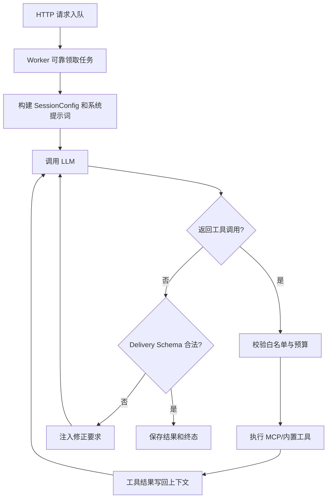

# AgentCode

AgentCode 是 QASystem 仓库内的单智能体运行时和后台 Agent 服务。它负责把一次用户请求组织成完整的执行循环：调用 LLM、解析工具请求、执行 MCP/内置工具、回填结果、控制预算，并通过异步任务 API 返回最终结果和实时事件。

当前包版本：`0.3.0`。

## 文档导航

| 文档 | 适用场景 |
| --- | --- |
| [架构设计](docs/架构设计.md) | 理解组件关系、任务状态机、可靠队列、跨进程 SSE 和取消语义 |
| [开发扩展指南](docs/开发扩展指南.md) | 接入模型、MCP、Skill，修改 Agent loop 或编写测试 |
| [部署运维指南](docs/部署运维指南.md) | Compose 部署、环境变量、容量规划、监控和故障排查 |
| [流式接口说明](流式接口说明.md) | 面向调用方的 HTTP、任务状态和 SSE 事件协议 |
| [接口参考](接口参考.md) | 启动参数、请求字段、响应结构和调用示例 |

## 能力边界

AgentCode 当前负责：

- 单 Agent 的 LLM ↔ Tool 执行循环；
- OpenAI 兼容 `chat/completions` 模型适配；
- MCP `streamable_http`、HTTP、SSE、stdio 客户端；
- 内置 Shell 工具（仅 CLI 会话启用；HTTP API 的连接池已关闭 Shell）；
- Skill 发现、按需加载和提示词注入；
- 工具白名单、轮次/工具次数/墙钟时间预算；
- JSON Schema 终稿校验；
- 用户上下文透传：入口鉴权头经 Redis 暂存随任务下发，MCP 调用自动携带（见[工具服务与鉴权透传](#工具服务与鉴权透传)）；
- Redis 或内存任务队列；
- 后台 Worker、任务取消、任务租约和崩溃恢复；
- Redis Stream/内存事件日志与 SSE；
- 任务级 Trace 和 JSONL Trace。

当前不负责：

- 图谱检索、SQL、图表等能力的数据层实现，这些由专属 agent-mcp 服务提供（见[工具服务与鉴权透传](#工具服务与鉴权透传)）；
- 跨请求的对话历史持久化。`session_id` 当前用于关联和追踪，不会自动恢复历史消息；
- 独立 Worker CLI。当前 Worker 由 FastAPI lifespan 在每个 API 进程中启动；
- 通用编码 Agent 所需的结构化文件编辑、Git、持久终端和审批工作流。

## 快速启动

### 使用仓库 Compose

先构建 runtime 并生成交付包；首次本机构建还需给构建命令加 `-BuildBase`：

```powershell
.\build-image.ps1
.\package-deploy.ps1
docker compose up -d
```

Compose 会启动：

- `agent`：AgentCode API，默认宿主机端口 `9180`；
- `agent-mcp`：Agent 专属工具服务（`agent-tools`），容器内端口 `9181`，不对外发布；
- `backend`：QASystem HTTP 和老链路 MCP Server，容器内端口 `8000`；
- `redis`：任务、租约和事件流存储。

检查服务：

```bash
curl http://127.0.0.1:9180/health
```

提交任务（带鉴权头，见[工具服务与鉴权透传](#工具服务与鉴权透传)）：

```bash
curl -X POST http://127.0.0.1:9180/v1/query \
  -H "Content-Type: application/json" \
  -H "Authorization: Bearer <应用方token>" \
  -d '{"user_message":"查询知识图谱中的采购指标定义"}'
```

返回示例：

```json
{
  "task_id": "6a97f5f4c4f94db5aeedecbc4c992a47",
  "status": "queued",
  "queue_position": 1
}
```

查询和取消：

```bash
curl http://127.0.0.1:9180/v1/task/6a97f5f4c4f94db5aeedecbc4c992a47
curl -X POST http://127.0.0.1:9180/v1/task/6a97f5f4c4f94db5aeedecbc4c992a47/cancel
```

订阅流式事件：

```bash
curl -N http://127.0.0.1:9180/v1/task/6a97f5f4c4f94db5aeedecbc4c992a47/stream
```

### 本地开发启动

```powershell
cd agent
..\.venv\Scripts\python.exe -m pip install -e ".[api,dev]"
$env:PYTHONPATH = "$PWD"
python -m agentcode.api --host 127.0.0.1 --port 9180
```

默认 MCP 配置位于：

```text
agent/agentcode/tools/mcp_tools/mcp_config.json
```

当前默认连接容器网络内的 agent-mcp（`http://agent-mcp:9181/mcp`）。本地开发时该主机名不可解析，需先在本地起 agent-mcp（`python -m agent_mcp`）并覆盖：

```bash
export AGENT_MCP_URL=http://127.0.0.1:9181/mcp
```

也可以指定另一份配置：

```bash
AGENT_MCP_CONFIG=/absolute/path/to/mcp_config.json
```

MCP 连接池在服务启动时建立，工具表在启动时拉取；修改 `AGENT_MCP_URL` 或 MCP 代码后必须 recreate 容器（restart 不会重读 .env）。

## 工具服务与鉴权透传

Agent 不直接连接 backend 的老 MCP，只连接专属的 **agent-mcp**（服务名 `agent-tools`，21 个工具）：

| 分组 | 工具 |
| --- | --- |
| 图谱检索（6） | `search_entities`、`search_graph`、`get_entity_details`、`get_stakeholders`、`get_graph_schema`、`run_cypher` |
| 知识空间（3） | `locate_knowledge_space`、`get_all_subspaces`、`search_space_units` |
| SQL（1） | `execute_sql` |
| 图表（11） | `draw_bar/pie/line/scatter/histogram/area/radar/box/bubble/heatmap`、`list_chart_types` |

老 MCP（`qasystem-tools`，backend:8000）保持原样服务旧链路，两者互不影响。

### 鉴权头透传链

所有图谱查询按用户权限过滤，网关只认调用方的鉴权头。Agent 是独立进程，入口收到的请求头会沿任务一路带到网关：

```text
调用方 ──5 个鉴权头──▶ agent API(9180)
   api.py 捕获 → Redis 暂存（任务里只存 auth_context_id 引用，不存 token）
   worker 领取任务 → 恢复请求头 → 写入 MCP httpx 客户端
       ↓ 每次 MCP 调用自动携带
agent-mcp(9181) 中间件捕获 → ContextVar → 知识地图客户端出站携带 → 应用方网关按权限过滤
```

- 识别的请求头（白名单之外静默丢弃）：`authorization`、`x-user-id`、`x-user-name`、`x-tenant-id`、`x-user-roles`。最低限度带 `Authorization: Bearer <token>` 即可通过网关鉴权。
- **任务归属**：入队时带了鉴权头，任务即归属该身份（租户 + 用户 + token 指纹）。之后 `GET /v1/task/{id}`、`/stream`、`/cancel` 必须带同样的头，否则返回 404——这与下游 401 鉴权失败是两回事，排查时先分清。
- token 只在框架层流转（Redis 暂存、HTTP 头），不进入 LLM 上下文、系统提示词、日志、SSE 事件和结果 payload。

## 核心执行流程



每次 HTTP 请求都会创建独立的 `AgentState`。LLM 调用次数计入 `spent.turns`，实际发起的工具调用数量计入 `spent.tool_calls`。

## 任务状态

```text
queued → running → completed
                 ↘ failed
queued → cancelled
running → cancelling → cancelled
```

- `queued`：等待 Worker；
- `running`：已领取并执行；
- `cancelling`：收到取消请求，等待 LLM/工具在协作检查点退出；
- `completed`：成功产生最终结果；
- `failed`：预算、模型、工具或运行时错误；
- `cancelled`：任务取消完成。

Redis 模式使用 processing 队列和续租时间。Worker 异常退出后，超过 `TASK_STORE_VISIBILITY_TIMEOUT` 的任务会重新入队。

## 最小 Python 用法

```python
from agentcode import AgentRuntime, CancellationToken, SessionConfig
from agentcode.trace import JsonlTraceSink

runtime = AgentRuntime(
    llm_backend=my_llm_backend,
    tool_manager=my_tool_manager,
    trace_sink=JsonlTraceSink("./traces/session.jsonl"),
)

token = CancellationToken()
result = runtime.run_session(
    config=SessionConfig(session_id="s-1", trace_id="t-1"),
    user_message="分析这个问题",
    cancel_token=token,
)
```

`LLMBackend` 和 `ToolManager` 的契约见[开发扩展指南](docs/开发扩展指南.md)。

## 常用配置

| 环境变量 | 默认值 | 说明 |
| --- | --- | --- |
| `AGENT_MCP_URL` | mcp_config.json 中的地址 | 单 MCP 服务器时覆盖其 URL（容器内为 `http://agent-mcp:9181/mcp`） |
| `AGENT_MCP_CONFIG` | `agent/agentcode/tools/mcp_tools/mcp_config.json` | MCP 配置文件绝对路径 |
| `AGENT_LLM_BASE_URL` | `http://localhost:9999` | OpenAI 兼容 API 根地址 |
| `AGENT_LLM_API_KEY` | 空 | 模型 API Key |
| `AGENT_LLM_MODEL` | `Qwen/Qwen3-8B` | 模型名 |
| `AGENT_TEMPLATE_TIMEOUT_SECONDS` | `120` | 单次模型请求超时 |
| `AGENT_API_WORKERS` | `1` | API 进程数 |
| `AGENT_WORKER_CONCURRENCY` | `1` | 每个 API 进程的 Worker 线程数 |
| `AGENT_WORKER_POOL_SIZE` | 等于 concurrency | 每进程 MCP 连接池大小 |
| `TASK_STORE_REDIS_URL` | `redis://localhost:6379/0` | Redis 地址；多进程必需 |
| `TASK_STORE_VISIBILITY_TIMEOUT` | `1500` | Worker 失联后的任务回收时间 |
| `TASK_STORE_TASK_TTL` | `86400` | 任务和结果保留时间 |
| `TASK_STORE_EVENT_MAXLEN` | `10000` | 每任务最大事件数 |
| `COMPACT_TOKEN_THRESHOLD` | `100000` | 触发上下文压缩的估算 token 数 |

## 运维提示

- **INFO 日志**：API 服务入口（`agentcode/api.py`）已统一配置 root logger，worker 就绪、MCP 连接等 INFO 日志在 `docker logs` 中可见；CLI 会话未配置 handler，只有 WARNING 以上可见。
- **`.env` 改动需 recreate**：`env_file` 在容器创建时注入，`docker compose restart` 不会重读；改完用 `docker compose up -d --no-deps --force-recreate agent`。
- **上传代码后必须重启容器**：Python 在启动时 import、MCP 工具表在启动时拉取，只替换文件不重启等于没换（grep 容器内文件只能证明磁盘状态，不能证明运行状态）。

完整配置和容器网络注意事项见[部署运维指南](docs/部署运维指南.md)。

## 测试

> 测试文件仅保留在本地（已加入 `.gitignore`，不入库），新 clone 的仓库需要另行获取 `agent/tests/` 后才能运行。

普通测试：

```powershell
$env:PYTHONPATH = "$PWD\agent"
.\.venv\Scripts\python.exe -m pytest agent/tests -q
```

Redis 集成测试：

```powershell
$env:TEST_REDIS_URL = "redis://127.0.0.1:6379/15"
.\.venv\Scripts\python.exe -m pytest agent/tests/test_task_store_redis.py -q
```

Shell 资源限制测试依赖 POSIX `resource`，在 Windows 上会自动跳过，应在 Linux 镜像或 CI 中执行。

## 源码入口

| 文件 | 作用 |
| --- | --- |
| `agentcode/runtime.py` | Agent 主循环、预算、取消和 Delivery 校验 |
| `agentcode/api.py` | FastAPI、请求入队、鉴权头捕获、查询、取消和 SSE 端点 |
| `agentcode/worker.py` | Worker 消费循环、鉴权头恢复绑定和 LLM HTTP 适配 |
| `agentcode/task_store.py` | Redis/内存任务队列、租约、结果、事件日志和 auth context 暂存 |
| `agentcode/identity.py` | 任务归属指纹（租户/用户/token 指纹）与匹配 |
| `agentcode/delivery.py` | 终稿投递 schema 定义 |
| `agentcode/stream_broker.py` | 面向 SSE 的游标事件读取封装 |
| `agentcode/pool.py` | ToolManager 连接池 |
| `agentcode/tools/mcp_tools/` | MCP 配置、连接、用户头注入（`mcp.py::apply_user_headers`）和工具调度 |
| `agentcode/skillsets/` | Skill 发现与按需加载（Skill 文件位于 `agent/skills/`，当前为 `graph-qa`） |
| `agentcode/trace.py` | JSONL 与任务事件 Trace |
