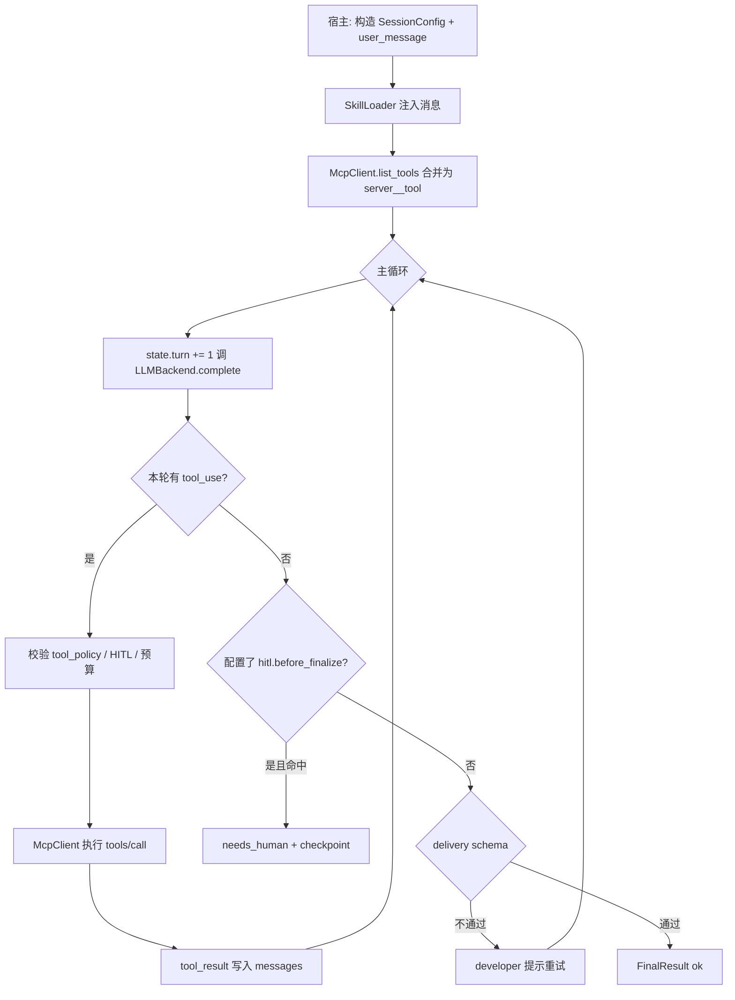

# agentcode

本仓库内的 **单智能体运行时**：固定「LLM ↔ MCP 工具 ↔ 会话状态」主循环，把业务差异收敛到 **MCP 实现**、**Skill 文本** 与 **SessionConfig / Profile**，避免复制第二套 agent loop。

**设计边界**

- **负责**：会话状态、预算、工具白名单、MCP 调用、Skill 注入、可选 delivery 校验、HITL 检查点、JSONL 追踪。
- **不负责**：向量库、业务数据库、鉴权、HTTP 路由细节（由宿主应用或 `integrations/fastapi` 薄层完成）。
- **模型调用**：通过 `LLMBackend` 协议由宿主实现；本仓库提供 FastAPI 示例中的 OpenAI 兼容 `chat/completions` 适配，非强制。

---

## 1. 包内目录（当前与扩展预留）

```text
agentcode/
├── pyproject.toml
├── README.md
├── agentcode/
│   ├── runtime.py              # AgentRuntime：主循环、delivery、trace outcome
│   ├── models.py               # SessionConfig、FinalResult、AgentState…
│   ├── interfaces.py           # LLMBackend、ToolAdapter
│   ├── mcp.py                  # McpClient、HttpToolAdapter（JSON-RPC）
│   ├── skills.py               # SkillLoader：SkillRef → system/developer/task 文本
│   ├── trace.py                # JsonlTraceSink
│   ├── memory.py               # 检查点存储（默认 Noop）
│   ├── errors.py
│   ├── entrypoints.py          # 可选：run_chat_session / run_answer_generation
│   ├── mcp_servers/            # 【内置 MCP 实现】按领域分子包，例如 time/
│   ├── skillsets/              # 【Skill 正文】按场景分子目录，例如 common/
│   ├── profiles/               # 【配置模板】build_*_config，供宿主一键组装 SessionConfig
│   ├── integrations/           # 【宿主集成】可选依赖，如 fastapi/agent_template.py
│   └── examples/               # 教程与兼容入口（如 beijing_time 转发 MCP）
└── tests/
```

扩展新能力时，优先 **新增** `mcp_servers/<domain>/`、`skillsets/<scene>/`、`profiles/<name>.py`，**避免** 在 `runtime.py` 里写分支业务逻辑。

---

## 2. 整体智能体流程

### 2.1 流程图（运行时）



### 2.2 一轮里具体发生什么

1. **预算**：检查墙钟时间、`state.turn` 是否超过 `budget.max_turns`。
2. **待执行工具**（HITL 恢复场景）：若有 `pending_tool_calls`，先执行再 `continue`，**不**增加 `turn`。
3. **LLM**：`state.turn += 1`，调用 `complete(messages, tools)`；将 assistant 消息追加到 `messages`。
4. **追踪**：写入 JSONL 一行（含 `outcome`，见下文）。
5. **工具分支**：若 content 中含 `tool_use`，执行 MCP，将结果以 `tool_result` 形式追加（实现上为 user 消息的 content 块列表），再回到步骤 1。
6. **终稿分支**：若无工具调用，则做 HITL（若配置）→ `delivery` JSON Schema 校验；失败则注入 developer 文本并回到步骤 1；成功则 `status=ok`。

### 2.3 `spent.turns` 与 `tool_calls`

- **`spent.turns`**：等于 **`state.turn`**，即 **LLM 的调用次数**（含 delivery 重试导致的多次调用），不是「用户轮数」。
- **`spent.tool_calls`**：实际执行 MCP 的次数（多工具一轮可能 +N）。

---

## 3. 消息与工具契约（agentcode 内部）

运行时消息为 **类 Chat** 结构：`{"role": "...", "content": [ ... blocks ]}`。

| `content` 块类型 | 含义 |
|------------------|------|
| `{"type":"text","text":"..."}` | 普通文本 |
| `{"type":"tool_use","id","name","input"}` | 模型请求工具（`name` 为合并名 `server__tool`） |
| `{"type":"tool_result","tool_use_id","content":[...]}` | 工具执行结果（由 `McpClient` 生成） |

**宿主 LLM 适配**（如 OpenAI）需在 `complete` 内完成：内部消息 ↔ 厂商 API（`tools` / `tool_calls` / `role=tool`）的映射；可参考 `integrations/fastapi/agent_template.py` 中的 `_ConfiguredLLMBackend`。

---

## 4. MCP 与工具命名

- 每个 `McpServerConfig` 有一个 **`name`**（如 `time`）。
- MCP 返回的每个工具有本地名（如 `get_beijing_time`）。
- 运行时合并名为 **`{server_name}__{tool_name}`**（双下划线），例如 **`time__get_beijing_time`**。
- `tool_policy.allow` 使用 glob（如 `time__*`、`time__get_beijing_time`）。

**HTTP MCP 最小协议**（`mcp.py` 中 `HttpToolAdapter`）：

- `tools/list` → `result.tools`：列表，项含 `name`、`description`、`input_schema`（或 `inputSchema`）。
- `tools/call` → `params`: `name`、`arguments`、`timeout_s`；返回 **dict** 作为结果负载。

---

## 5. 扩展新工具 / 新 MCP（推荐步骤）

1. **实现服务**  
   - 在 `agentcode/mcp_servers/<your_domain>/` 下实现 HTTP 处理器（或独立进程），保证 `tools/list` / `tools/call` 行为稳定。  
   - `input_schema` 使用 JSON Schema 子集：`type: object`、`properties`；避免非常规模型字段，以便 OpenAI 兼容层映射（宿主可对 schema 做裁剪）。

2. **注册到会话**  
   - `SessionConfig.mcp_servers` 增加一项：`name` 唯一且稳定，`transport="http"`，`url` 指向 `.../mcp`。

3. **白名单**  
   - `tool_policy.allow` 写入 `yourname__*` 或精确工具名。

4. **Skill**  
   - 在 `agentcode/skillsets/<scene>/your_skill.md` 写明：何时调用、参数约定、禁止行为、终稿格式（若使用 `delivery`）。

5. **Profile（可选）**  
   - 在 `agentcode/profiles/your_agent.py` 提供 `build_*_config(...)`，集中默认 `budget`、`delivery`、`skills`，供 FastAPI 或其它宿主引用。

6. **测试**  
   - 单元测试：对 MCP URL 测 `tools/list` / `tools/call`。  
   - 集成测试：`AgentRuntime` + `MockLLM` 或录制响应，覆盖工具轮与终稿。

7. **追踪**  
   - 生产环境设置 `JsonlTraceSink` 路径；根据 `outcome` 与 `delivery_error` 排查多轮 LLM。

---

## 6. 扩展 Skill

- `SkillRef`：`path` 指向 `.md` 文件，或 `uri`（当前 loader 以可解析为准）；`inject_layer` 为 `system` / `developer` / `task`。
- `SkillLoader.resolve` 将多个 skill 拼成三层文本，注入 `_build_initial_messages`。
- 写作要点：**触发条件**、**工具名（全名）**、**失败时勿编造**、**与 delivery 一致的 JSON 终稿**（不要 markdown 围栏；运行时也会尝试剥离 `` ```json `` 块）。

---

## 7. SessionConfig 速查

| 字段 | 说明 |
|------|------|
| `mcp_servers` | MCP 列表：`name`、`transport`、`url` / `command` |
| `skills` | `SkillRef` 列表 |
| `tool_policy.allow` | 允许的工具 glob 列表 |
| `budget` | `max_turns`、`max_tool_calls`、`max_time_s`、`max_retries_per_tool`、`repeat_action_threshold` |
| `tool_execution` | `sequential` / `parallel`（由 `McpClient` 执行策略使用） |
| `delivery` | 可选；终稿 JSON Schema（jsonschema） |
| `hitl` | 可选；`gate` 含 `before_tool` / `after_tool` / `before_finalize` |

---

## 8. Trace（JSONL）

每行对应 **一次 LLM 返回之后** 的记录（含本轮判定结果）：

| 字段 | 说明 |
|------|------|
| `turn` | 当前 LLM 调用序号 |
| `tool_calls` | 本轮解析出的 tool_use 列表 |
| `tool_calls_used` | 截至写日志时已执行的 MCP 次数（本轮待执行的尚未计入） |
| `duration_ms` | 本轮 LLM 耗时 |
| `outcome` | `tool_requests` / `delivery_invalid` / `completed` / `needs_human_before_finalize` |
| `delivery_error` | `outcome=delivery_invalid` 时的校验错误信息，否则 `null` |

---

## 9. FastAPI 宿主集成

```bash
pip install -e ".[fastapi]"
```

- 路由实现：`agentcode.integrations.fastapi.agent_template`（多路径 `/raw`、`/brief`、`/debug`、`/ping`、`/config`）。
- 本仓库 `backend` 通过 `app.routers.agent_template` **仅 re-export `router`**，便于与现有 `main.py` 对齐。

---

## 10. 依赖安装与测试

```bash
# 与 backend 一起使用时
pip install -r backend/requirements.txt   # 已含 -e ../agentcode[fastapi]

# 仅库 + 开发
pip install -e ".[dev]"
```

```bash
PYTHONPATH=agentcode pytest agentcode/tests -q
```

---

## 11. 参考示例：北京时间

| 角色 | 位置 |
|------|------|
| MCP 实现 | `agentcode/mcp_servers/time/server.py` |
| Skill | `agentcode/skillsets/common/beijing_time.md` |
| Profile | `agentcode/profiles/time_agent.py`（`build_beijing_time_config`） |
| 兼容 CLI | `python -m agentcode.examples.beijing_time.mcp_server` |
| 端到端 Mock | `python -m agentcode.examples.beijing_time.demo_agent` |

更多操作说明见 `agentcode/examples/beijing_time/README.md`。

---

## 12. 常用导入

```python
from agentcode import AgentRuntime, McpClient, SessionConfig, JsonlTraceSink
from agentcode.profiles import build_beijing_time_config, resolve_default_beijing_skill_path
# 可选薄封装
from agentcode.entrypoints import run_chat_session
```
