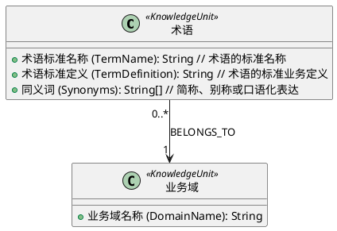

# 本体驱动知识抽取模块

`algorithm/knowledge_extract` 使用调用方传入的 PlantUML 类图作为知识抽取 Schema，从文档中抽取实体和关系，并输出统一的图结构。

这里的 PlantUML 不只是给大模型看的说明文本。它同时具有两种作用：

1. **语义约束**：原始 PlantUML 会进入提示词，指导大模型判断可抽取的实体、属性和关系。
2. **输出规范**：程序解析类和属性标识，对大模型输出做确定性规范化，避免中文名、英文名、alias 和 stereotype 混用。

因此，接口支持的是本文定义的“知识本体类图方言”，不是任意 PlantUML 图形语法。

## 处理流程

```text
上传文件 + ontology
        │
        ├─ 文档解析 → Markdown/纯文本
        │
        └─ PlantUML 解析 → 本体标识目录
                         │
文档文本 + 原始 PlantUML + 标识目录
                         │
                         ▼
                    LLM 知识抽取
                         │
                         ▼
              entities / relations JSON
                         │
                         ▼
       根据本体规范化类型、属性和关系端点
                         │
                         ▼
              nodes / relationships 图结构
                         │
                 ▼
              接口返回
```

主要实现（第一版，均位于 `v1/` 子包）：

- `v1/ontology_schema.py`：解析本体类、alias、stereotype、属性和稳定标识。
- `v1/extractor.py`：构建提示词、调用 LLM、校验 JSON、规范化结果并生成图结构。
- `v1/uml/`：项目内置的本体示例。接口不会自动加载这些文件，调用方仍需传入 `ontology`。

## 推荐的本体格式



### 类声明

```plantuml
class "术语" as Terminology <<KnowledgeUnit>>
```

| 部分                  | UML 含义             | 本模块用途                                   |
| --------------------- | -------------------- | -------------------------------------------- |
| `"术语"`            | 展示名称             | 面向业务人员阅读，也可被解析为该类的输入名称 |
| `as Terminology`    | PlantUML alias       | 首选的稳定类型标识，最终用于节点`label`    |
| `<<KnowledgeUnit>>` | stereotype（构造型） | 表达分类、角色或扩展语义                     |

推荐新本体使用 `as Alias` 明确稳定类型标识。为兼容现有本体，如果没有 alias，程序会使用第一个 stereotype；两者都没有时使用类名。

稳定类型标识的优先级为：

```text
as Alias > 第一个 stereotype > PlantUML 类名
```

所以下面两种声明都会得到 `label: "Terminology"`：

```plantuml
class "术语" as Terminology <<KnowledgeUnit>>
class 术语 <<Terminology, KnowledgeUnit>>
```

第二种是兼容写法。按照标准 UML 语义，`Terminology` 仍然是 stereotype，不是类名。

### 属性声明

```plantuml
+ 术语标准名称 (TermName): String // 术语的标准名称
```

| 部分             | 含义                                            |
| ---------------- | ----------------------------------------------- |
| `+`            | UML public 可见性；在本体中表示可抽取的公开属性 |
| `术语标准名称` | 属性展示名                                      |
| `(TermName)`   | 稳定属性标识，最终作为`properties` 的键       |
| `String`       | 属性数据类型                                    |
| `// ...`       | 属性说明和抽取提示                              |

支持的可见性符号包括 `+`、`-`、`#`、`~`，当前抽取过程不根据可见性过滤属性。

建议使用以下基础类型：

- `String`
- `String[]`
- `Boolean`
- `Integer`
- `Float`

其中 `String[]` 应输出 JSON 数组，`Boolean` 应输出 JSON 布尔值。类型约束目前主要由提示词交给 LLM 执行，程序尚未进行完整的运行时类型校验。

### 关系声明

```plantuml
Terminology "0..*" --> "1" BusinessDomain : BELONGS_TO
```

表示多个术语可以属于一个业务域。LLM 输出：

```json
{
  "from_type": "Terminology",
  "from_name": "采购标段数量",
  "rel_type": "BELONGS_TO",
  "to_type": "BusinessDomain",
  "to_name": "采购管理域"
}
```

当前版本会根据本体规范化 `from_type` 和 `to_type`。关系名称和基数仍由原始 PlantUML 提供给 LLM 理解，程序尚未对 `rel_type` 和基数做完整的本地语法校验。

### Identity 声明

```plantuml
' @identity Terminology: TermName
```

这是项目自定义注释，用于告诉 LLM：`Terminology` 实体优先使用 `TermName` 作为身份值，并把该值写入实体 `name` 以及关系的 `from_name`、`to_name`。

如果没有声明 identity，提示词默认要求模型使用 `name`。当前 identity 由 LLM 执行，程序尚未根据属性值重新计算实体 `name`。

## 输入与输出示例

假设文档包含：

```text
采购标段数量是指一个采购项目划分的采购标段总数，简称标段数量，属于采购管理域。
```

LLM 即使返回展示名：

```json
{
  "entities": [
    {
      "type": "术语",
      "name": "采购标段数量",
      "properties": {
        "术语标准名称": "采购标段数量",
        "同义词": ["标段数量"]
      }
    }
  ],
  "relations": []
}
```

本体解析层也会将其规范化为：

```json
{
  "entities": [
    {
      "type": "Terminology",
      "name": "采购标段数量",
      "properties": {
        "TermName": "采购标段数量",
        "Synonyms": ["标段数量"]
      }
    }
  ],
  "relations": []
}
```

最终图节点为：

```json
{
  "uid": "terminology::采购标段数量",
  "label": "Terminology",
  "properties": {
    "name": "采购标段数量",
    "TermName": "采购标段数量",
    "Synonyms": ["标段数量"]
  }
}
```

节点 UID 的当前生成规则为：

```text
{稳定类型标识的规范化形式}::{实体 name 的小写形式}
```

## 调用方式

### 知识沉淀接口

```bash
curl -X POST http://127.0.0.1:8006/api/knowledge/precipitation \
  -F 'file=@./terms.docx' \
  -F 'ontology=<./terminology.puml' \
  -F 'save_to_db=false'
```

该流程还会执行文档解析、产物存储、文本切片和向量化。切片与向量化直接处理文档内容，不使用本体。

### MCP 工具

工具名：`kg_extract_v2`

参数：

```json
{
  "ontology": "@startuml\n...\n@enduml",
  "text": "待抽取文本",
  "model": null,
  "base_url": null
}
```

> 注意：`kg_extract_v2` 是共享入口，实际由 `KG_EXTRACT_ALGO_VERSION`（`latest` / `v2` / `v3` / `v3.1` / `jev`，
> 默认 `latest`）经 `algorithm.knowledge_extract.version` 路由执行；`latest` 是现行 `v3`
> 的同步副本（独立实体目录），直接运行 `knowledge_extract/latest` 包，也可显式指定
> `knowledge_extract/v2` / `knowledge_extract/v3` / `knowledge_extract/v3_1`。`jev` 是实验副本，不作为默认。
> 本包仅在无本体时提供文本摘要能力。

### Python 调用

本包对外保留的调用是无本体文本摘要：

```python
from algorithm.knowledge_extract.v1 import summarize_text

summary = summarize_text(text=document_text)
```

`v1/extractor.py` 中的 `extract_v2` 是第一版内部的历史抽取器，已无生产调用方；
新代码请使用 `knowledge_extract/latest`（默认生产路径）或显式的 `knowledge_extract/v2` / `knowledge_extract/v3` / `knowledge_extract/v3_1`。

## LLM 配置

默认从环境变量读取，模型默认 `deepseek-v4-flash-0731`（与 agent 部分一致），thinking 默认关闭：

| 环境变量                           | 用途                                |
| ---------------------------------- | ----------------------------------- |
| `KG_EXTRACT_LLM_API_KEY`         | API Key                             |
| `KG_EXTRACT_LLM_DISABLE_THINKING` | 是否关闭 thinking，默认 `1` 关闭；设 `0` 开启 |
| `KG_EXTRACT_LLM_MAX_TOKENS`      | 最大输出 token 数                   |
| `KG_EXTRACT_LLM_JSON_RETRIES`    | JSON 格式错误后的重试次数           |

部分配置保留旧环境变量作为回退，具体以 `config.py` 和 `extractor.py` 为准。

## 支持范围与边界

本模块当前适合：

- `class` 和 `abstract class` 类声明；
- 引号展示名及 `as Alias`；
- 单行类声明中的 stereotype；
- `{` 与类声明位于同一行的属性块；
- `属性名: 类型`、`属性展示名 (PropertyId): 类型`；
- `//` 属性说明；
- 类之间的常见关系和基数；
- `@identity` 项目注释。

以下内容可能被 LLM 阅读，但不保证被程序正确解析或校验：

- 时序图、活动图、状态图、用例图和部署图；
- 宏、函数、动态 PlantUML 和复杂 `!include`；
- 方法定义、复杂泛型和嵌套类型；
- 一个文件中混合多种 UML 图；
- 依赖布局方向表达业务语义；
- 超大规模本体。

颜色、标题、`skinparam` 和布局指令通常会被本地解析器忽略，不影响抽取，但也不应承载业务约束。

## 本体设计建议

1. 使用英文 alias 作为稳定类型标识，例如 `as Terminology`。
2. 中文名称只用于展示，不要作为跨系统检索的唯一标识。
3. 属性使用稳定英文标识，例如 `(TermName)`。
4. 关系名称使用稳定的大写英文标识，例如 `BELONGS_TO`。
5. 为每个实体定义明确的 identity 字段。
6. 属性注释写清楚业务含义和示例，帮助模型区分相似字段。
7. 单次只传入与当前文档相关的领域本体，避免无关类型干扰模型。
8. 本体发生不兼容修改时进行版本管理，不要静默复用旧 `label`。

## 当前限制与后续方向

当前实现已经确定性处理类标识、属性标识和关系端点，但还不是完整的 PlantUML 编译器。可以继续增强：

- 解析关系为结构化模型并校验 `rel_type`；
- 校验关系端点是否存在；
- 校验属性类型和必填字段；
- 检测重复 alias、重复类型标识和重复属性标识；
- 在调用 LLM 前返回明确的本体语法错误；
- 按本体 identity 在本地统一生成实体 UID；
- 对大型本体按领域或相关性裁剪后再进入提示词。


服务连接通过 ops 登记，抽取用途选择服务 ID。旧地址、模型、PROVIDERS_JSON 和配额环境变量只用于人工审核迁移，不再作为运行时连接回退。各版本 `get_llm_policy()` 保留算法策略，`get_llm_config()` 在运行时组合登记服务；默认 live 工厂缺服务时明确失败，独立算法调用仍共用服务排队。输入、输出、思考等策略环境入口将在后续算法策略批退役，本批不改变各版本默认策略。

2.2-v31 对应 2_2_v31/：独立 v3.1 实体阶段与 v2.2 关系阶段，沿用 ops 注册模型服务与统一排队。
