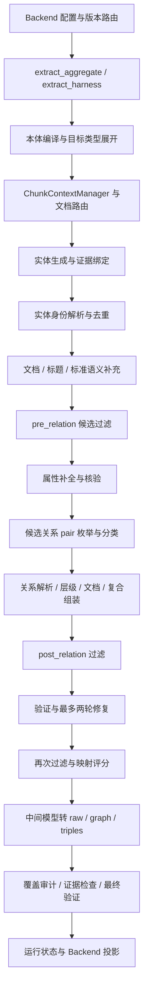

# 知识抽取 V3.1 全流程代码审查（2026-10-11）

## 1. 结论与审查边界

**当前工作区版本存在 Backend 入口阻断，暂不具备直接部署条件。** 绕过接线问题直接调用算法后，仍能复现错误实体被接受、属性与原文矛盾、同名异人合并、合法名单被清空、标准状态被臆填、关系漏抽或错连等问题。`status=succeeded`、`verification.valid=true` 和证据覆盖率 `100%` 目前都不足以证明结果可靠。

本报告整理 **20 项问题**，按实际流程展开。优先处理 F01（接线）、F20（测试可信度），再处理 F06/F10/F13/F16（验收规则）以及 F07/F08/F09/F11/F14（事实错误）。修复验收建议见第 5 节。

### 1.1 评审的到底是哪一个 v3.1

- 仓库：`qasystem`；分支：`develop`；HEAD：`f7810da019ab79de7201f4da5d2b5203bebbd47b`。
- **对象是 2026-10-11 当前磁盘工作区，包含未提交修改、删除及未跟踪文件，不是仅审查 HEAD。** 开始审查时 `v3_1/` 已存在大规模替换：`harness.py`、`decisions.py`、`controller.py` 等被删除，新增 `split_extractor.py` 等两阶段流水线模块。
- 当前主入口是 `extract_aggregate → extract_harness → extract_split`；本体编译、候选生成、确定性补充、属性补全、关系分类、修复与最终验证均在本包执行。主链没有自动调用旧 Clef 裁决流程；`entity_adjudicator` 只是可注入的回调。
- README 仍自称 V2，旧文档仍描述 Clef 语义 Harness，因此本报告**以运行代码为准**。历史报告中的 F1、耗时、线上状态不作为当前版本的实测证据。
- 沿抽取入口审查上游 chunk 契约与 Backend 配置/投影，但未重新审查 PDF/OCR 解析器、上游切片算法和落库服务的全部实现。文档解析和切片本身不在 v3.1 中完成；实体阶段另有表格子窗口处理。
- 本次只交付审查文档和临时复现材料，未修改算法、测试或服务实现，未提交、推送、部署。

### 1.2 证据标准

“已复现”指使用真实 `algorithm.knowledge_extract.v3_1` 包、构造本体和 chunk、注入固定响应的离线 Stub 验证。它证明给定输入/模型响应下代码的行为，不表示真实模型一定会生成该响应，也不代表缺陷在线上的发生频率。

严重度：**P1**＝阻断运行或造成明确的数据正确性/验收错误，应优先修；**P2**＝特定输入、接口语义或诊断可靠性问题，应排期修。没有实测的性能/泛化问题单列为风险，不伪装成已测结论。

证据文件位于 [tmp/review-v3_1/20261011](../../tmp/review-v3_1/20261011/)：

- [reproduce.py](../../tmp/review-v3_1/20261011/reproduce.py)：20 个离线探针，直接导入真实 v3.1 包，不调用网络模型。
- [reproduction-results.json](../../tmp/review-v3_1/20261011/reproduction-results.json)：完整输入对应的输出、告警、状态与关键字段。
- [source-manifest.json](../../tmp/review-v3_1/20261011/source-manifest.json)：源码哈希与工作区基准，供后续代码变更后判断结论是否仍适用。
- 测试日志与版本导入冲突证据见第 4 节。`tmp/` 是本地审查产物，不进入运行时源码交付包；核心结论和复现条件已写入本文。

## 2. 实际调用链与每阶段评审结论

| 阶段 | 实际职责与关键入口 | 评审结果 |
| --- | --- | --- |
| 1. 请求接入 | Backend `resolve_config`、`create_request_llm`、`run_aggregate` | chunk 类型、配置函数、LLM 工厂同时残留旧契约，F01；公共入口吞参数，F02 |
| 2. 本体编译 | `_compile_runtime` 缓存、`OntologyCompiler`、`TargetScopeResolver` | 有目标展开、循环继承检查和 strict 模式；多级属性继承丢失，F03；词面匹配被用于硬裁剪，F04 |
| 3. 上下文/领域路由 | `ChunkContextManager`、`resolve_document_route` | 有邻接片数与章节过滤；无 document_id 隔离，F05；领域路由泛化风险见第 3.21 节 |
| 4. LLM 请求 | `generate_structured`、`OpenAICompatibleLLM`、scheduler | 有请求/解析/schema 重试、截断识别、关闭 SDK 隐式重试；文档预算与调用计数边界见 F02、3.21 |
| 5. 实体生成/绑定 | `entity_pass`、`_normalize_span_entities`、`bind_evidence` | 无支持实体仍被接受，F06；表格按行拆成子窗口后再绑定原始 chunk |
| 6. 身份解析 | `CandidatePool`、`EntityResolver` | 有类型/别名/identity 解析，但 identity 在属性提取前冻结，同名异实体合并，F07 |
| 7. 确定性补充 | `enrich_document_entities`、`add_structural_heading_entities`、`enrich_standard_semantics` | 标准状态无证据写为现行，F08；规则优先级/闭集假设见 3.21 |
| 8. 候选筛选 | `CandidateSelector.pre_relation/post_relation` | 有结构冲突与被拒端点级联处理；普通合法名单可能全部被删，F09 |
| 9. 属性补全 | `enrich_entity_properties` | 实体 ID 和属性名有边界，但属性值没有充分证据约束，F10 |
| 10. 关系生成 | `enumerate_relation_pairs`、`relation_pass` | 有签名预枚举和 pair_id 校验；全局关系黑名单，F11；未验证逐 pair 决策完整性，F12 |
| 11. 关系接纳 | `RelationResolver.add` | 有端点、方向、签名和去重；基数超限只告警，F13 |
| 12. 确定性关系/复合规则 | `hierarchy.*`、`CompositeElementHandler.assemble` | HAS_PART 可跨属主错连，F14；复合规则校验没有完整纳入终态，见 3.21 |
| 13. 修复闭环 | `TargetedRepairOrchestrator`、`builtin_repair` | 有两轮上限和无新增事实停止条件；必填属性修复使用不含属性的 schema，F15 |
| 14. 映射评分 | `MappingScorer` | 默认 annotate，不作为接纳门禁；基数错误仍可能 0.9 分，F13；不能当真实准确率，见 3.21 |
| 15. 图组装/校验 | `build_intermediate_model`、`GraphAssembler`、Coverage/Verifier | 图组装有悬空端点异常与稳定 UID；身份受 F07 影响；属性 ID 转展示名后误报缺失，F16；span 校验不完整，F17 |
| 16. 状态/对外输出 | `ExtractionRun`、`to_public_result`、Backend 投影 | 关系扫描完成度失真，F18；可选核验失败被判 chunk 失败，F19；测试与版本维护问题，F20 |

`standard_strategy.py`、`official_document_strategy.py` 中的旧策略类/注册表，并未由当前 `extract_split` 主链调用。不能把这些类自己的测试通过，算作在线领域策略已经得到覆盖。`benchmark_lint.py`、`markdown_quality.py` 也不是在线主链的自动门禁。

## 3. 按流程展开的问题清单

### F01 · P1 · Backend 与替换后的 v3.1 契约不兼容

**证据：已复现，R01；集成测试收集失败。** 三个独立断点都发生在真正的模型请求之前：

1. [适配器](../../backend/app/services/knowledge_extract_adapter.py) 第 279、313–320 行仍为 v3.1 构造 V2 `ExtractionChunk`；[split_extractor.py](../../algorithm/knowledge_extract/v3_1/split_extractor.py) 第 475–479 行只接受本包类。传 `build_chunks(['张三'])` 即 `TypeError: extract_split 只接收 ExtractionChunk 序列`。
2. [extraction_config.py](../../backend/app/services/extraction_config.py) 第 82 行导入已不存在的 `thinking_disabled`；默认 provider 解析直接 `ImportError`。
3. [request_runtime.py](../../algorithm/knowledge_extract/request_runtime.py) 第 127 行选择已不存在的 `create_client`，当前客户端只导出 `create_llm_client`；命名 provider 绕过前一项后仍会 `AttributeError`。

**影响：** 单看包内抽取单测会漏掉真实服务入口不可用的事实；修复其中一个断点不代表链路恢复。

**建议与验收：** 一次性统一 chunk 构造、配置查询、LLM 工厂契约；默认 provider、命名 provider、直接 aggregate 三条路径都使用真实 runner 和离线 SDK Stub 测试，禁止只 monkeypatch 整个 `extract_aggregate`。

### F02 · P2 · aggregate 静默吞掉调用方配置

**证据：已复现，R01；** [__init__.py](../../algorithm/knowledge_extract/v3_1/__init__.py) 第 21–49 行。

`extract_aggregate` 用 `**_` 接受剩余参数却不传递。传入 `request_timeout=7`、`document_timeout=9`、`include_subclasses=False`，下层收到的参数里都没有它们；`max_tokens`、`max_repair_rounds`、显式实体裁决器等也不在透传列表。

**影响：** 直接调用者认为限制已生效，实际仍使用下层默认值，无法可靠关闭修复或控制子类范围。

**边界：** Backend 的 `ScheduledClient` 另有文档 deadline；修好 F01 并成功注入该客户端后，HTTP 层仍会受到它约束。不能把这里概括成“所有 Backend 超时限制都失效”。

**建议与验收：** 显式声明支持的选项并透传；不支持的参数立即报错。分别验证 SDK 超时、文档预算、等待额度、重试和修复是否共同遵守预算。

### F03 · P1 · 本体编译遗漏祖父类属性

**证据：已复现，R02；** [ontology_compiler.py](../../algorithm/knowledge_extract/v3_1/ontology_compiler.py) 第 501–568 行。

`_compile_class_specs` 只遍历直接父类的 `properties`。本体 `C → B → A` 中，若 `code` 仅声明在 A，底层 `OntologySchema.resolve_property('C', 'code')` 返回有效属性，但编译后的 `plan.class_specs['C'].properties` 是空的。

**影响：** 属性提示、补全 schema、feature coverage 与映射评分使用的计划和最终 schema 解释不一致；祖先的 required 字段甚至可能不进入 coverage 检查。

**建议与验收：** 编译器复用 schema 的递归有效属性集合，明确多继承覆盖顺序；增加三层继承、菱形继承、required/identity 继承用例，断言计划与解析器一致。

### F04 · P2 · 词面路由会硬排除同一片内其他合法类型

**证据：已复现计划选择，R03；** `ontology_compiler.py:183–196`、[candidate_generation.py](../../algorithm/knowledge_extract/v3_1/candidate_generation.py) 的 `output_schema_for_types` / `entity_pass`。

本体有不连通的 `Person` 和 `Device` 两个分区时，文本“Person 张三负责一台泵。”会把 `relevant_types` 缩成只有 Person。设备实体虽在文本中，Device 不再进入输出 enum，模型无法合法输出。没有任何词面命中时反而允许全部类型。

**影响：** 从“没有命中”到“命中一个词”会降低其他类型的召回，属于非单调的过滤行为；混合内容和英文 ID/中文实例尤其容易触发。

**建议与验收：** 词面分区只用于排序/分批，不作为否定其他类型的充分证据；增加混合类型片段，验证单个类型词的出现不会删除其他可抽类型。

### F05 · P2 · 局部上下文缺少文档边界

**证据：已复现，R04；** [chunk_context.py](../../algorithm/knowledge_extract/v3_1/chunk_context.py) 第 133–164 行；[entity_resolver.py](../../algorithm/knowledge_extract/v3_1/entity_resolver.py) 的 `_resolve_coreference`。

两片 `document_id` 分别为 doc-a/doc-b，`section_id` 均为 `None` 时，默认 `local_context` 同时返回两份文档。章节过滤只比较 `section_id`，不比较 `document_id`；指代匹配也只按章节相等匹配。

**影响及条件：** 在一次调用接收多文档、批量聚合文本或复用章节号时，可能把其他文档当上下文、误解指代。若上游严格保证每次只处理单文档，此项影响被该保证限制，但算法入口没有声明或执行该检查。

**建议与验收：** 上下文邻接、局部指代、层级关系统一使用文档与章节联合边界；若仅支持单文档，入口应显式拒绝多文档。测试显式邻接指向另一文档的情况。

### F06 · P1 · 无证据甚至被核验否定的实体仍被当作成功事实

**证据：已复现，R05；** `candidate_generation.py:775–893、1032–1095`；[verification.py](../../algorithm/knowledge_extract/v3_1/verification.py) 第 155–165 行；[evidence.py](../../algorithm/knowledge_extract/v3_1/evidence.py) 第 251–287 行。

原文只有“北京。”，实体阶段返回 Person“火星人”、引文“火星殖民地”，核验返回 `no`。最终仍输出火星人，`status=succeeded`、`verification.valid=true`，证据覆盖率为 `1.0`。

**根因：** 实体无论语义核验 yes/no/uncertain 都已加入返回列表；selector 没有据此拒绝；最终证据失败只是 warning。覆盖统计只检查 quote 非空，没有检查 source、span 或核验结论。

**影响：** 假实体可进入公开结果；Backend 的 `graph_publishable` 根据 valid/status 判断时也无法识别这类错误。所谓“100% evidence”只是填写率。

**建议与验收：** 分离候选与已接受事实；`no` 必须拒绝，`uncertain` 按明确策略隔离，保留原始候选供诊断。分别统计有引文、定位有效、语义支持三个比例；增加有引用但不支持、否定、无 source 的负例。

### F07 · P1 · 先合并实体再抽身份属性，造成不可逆同名误合并

**证据：已复现，R08；** `candidate_generation.py:886–891`、`entity_resolver.py:76–83、301–373`、`split_extractor.py:586–684`。

实体阶段只输出 mention，归一化后 `properties={}`。因此声明了 `@identity Person: code` 也先回退到名字合并。输入“张三，编号A001。”和“张三，编号B002。”，最终只有一个张三和 `code=A001`；中间模型 identity 仍为“张三”。

**影响：** 第二个人及其属性/关系被吞掉；后续属性补全按合并实体的首条证据分组，无法恢复两个人。补齐 identity 后也不更新 resolver 索引与冻结 identity，图 UID 延续旧名字。

**建议与验收：** 在不可逆合并之前提取身份属性或保留 mention 级对象；身份不足时延后合并，补齐后再重算映射。测试同名异编号、不同别名同编号、跨片补齐身份和 UID 一致性。

### F08 · P1 · 确定性层无条件把标准状态写成“现行”

**证据：已复现，R10；** [document_entities.py](../../algorithm/knowledge_extract/v3_1/document_entities.py) 第 120、301 行。

文本为“# GB/T 1234-2000 测试标准\n此标准已废止。”，LLM 返回空实体，算法仍补出 `标准状态=现行`，最终验证通过。主文档与规范性引用都存在该默认写入。

**影响：** 确定性代码生成与正文直接矛盾的业务属性；被引用或有标准号不能证明仍然有效。这些来源还会跳过属性补全，后续难以纠正。

**建议与验收：** 未见状态证据就不填；正文明确废止/替代时尊重证据。若确需外部状态库，走显式授权的数据源与来源记录，不能在离线抽取内隐式猜测。覆盖缺失状态、现行、废止、引用旧版四类用例。

### F09 · P1 · 高密度枚举过滤误删合法名单

**证据：已复现，R09；** [candidate_selector.py](../../algorithm/knowledge_extract/v3_1/candidate_selector.py) 第 522–561 行。

文本“参会人员：张三、李四、王五、赵六、钱七。”，五个 Person 候选都有逐字证据，最终被 `_dense_enumerations` 全部设为 rejected；无结构元数据时仍返回 succeeded、valid=true 的空图。

**根因：** 同段同类候选数 ≥5、分隔符足够就视为不构成独立实体；普通名单不是 JSON/TSV/Markdown 表格，无法命中例外。它也与主 prompt 的“并列同类实体必须逐一抽取”矛盾。

**建议与验收：** 不以人数/枚举密度作为否定实体性的充分条件；结合本体角色、名单语义和类型判定。加入 4/5/10 人边界测试及并列单位、附件、设备清单。

### F10 · P1 · 属性补全核验了引文位置，没有充分核验属性值

**证据：已复现，R06、R07；** [property_enrichment.py](../../algorithm/knowledge_extract/v3_1/property_enrichment.py) 第 233–251、421–452、529–565 行；[semantic_evidence.py](../../algorithm/knowledge_extract/v3_1/semantic_evidence.py) 第 49–84 行。

原文“张三年龄为20岁。”，模型更新 `age=999`，引用整句原文。因引文能定位，直接进入 planned；`_valid_update` 只拒绝未声明/已有/部分空值，不校验 999 是否受引文支持。结果 `age=999`、valid=true，且保存的仍只有实体级引文“张三”，没有这次属性的独立证据。

即便进入所谓语义匹配，它主要使用包含、最长匹配和字词重合；`semantic_support('设备不得启动。', ['设备启动'])` 返回 true，不能判断否定关系。

**建议与验收：** 每个属性分别校验“实体—属性—值—证据”的支持关系，数值、单位、日期严格比对；语义归纳须检查否定和归属。保存属性级引用与核验结论。测试错数值、另一实体的数值、单位变化、否定/条件语句和核验 uncertain。

### F11 · P1 · 关系名全局排除，确定性规则失效时没有生成后备路径

**证据：已复现，R11；** [relation_resolver.py](../../algorithm/knowledge_extract/v3_1/relation_resolver.py) 第 13–50、120–125 行；[hierarchy.py](../../algorithm/knowledge_extract/v3_1/hierarchy.py) 第 131–156 行。

`issuedBy`、`cites`、`defines`、`hasCharacteristic` 等关系名在所有本体下都跳过 pair 枚举。但相应确定性生成依赖特定来源、文档主锚点或标准路由。

本体 `Document --> Organization : issuedBy`，原文“公司发布通知。”，两个端点正确抽出；因没有标准式主锚点，确定性关系不生成，而 LLM 关系阶段也完全不调用，最终零关系且成功。

**建议与验收：** 只在本次输入上确实有确定性生成器负责的关系签名/实例范围内跳过；未处理部分回到模型分类。对普通文档、无 H1、非标准本体和相同关系名不同语义分别测试。

### F12 · P1 · 关系批次遗漏判定被静默当作成功

**证据：已复现，R12；** `candidate_generation.py` 的 `relation_pair_decision_schema` 与第 1258–1285 行。

一个合法 `worksAt` pair 已送给模型，响应 `{"decisions":[]}` 仍通过 schema；代码只检查返回行是否有效/重复，不比较 `seen_decisions` 与全部 pair_id。最终零关系、无缺失告警、valid=true。

**影响：** “已明确判 NONE”和“模型漏答”无法区分。可选关系没有最小基数要求时，CoverageAuditor 也不会补救。

**建议与验收：** 对每个 pair 强制恰好一个决策；缺项单独重试或标记未完成，禁止把缺项当 NONE。测试全空、漏一项、重复项及错误 pair_id。

### F13 · P1 · 基数超限仍通过 strict 验证和映射门槛

**证据：已复现，R18；** `relation_resolver.py:338–376`、[mapping_scorer.py](../../algorithm/knowledge_extract/v3_1/mapping_scorer.py) 第 155–164 行、`verification.py:77–190`。

本体限制一个 Person 只有一个 Company，模型返回张三到两个公司的 `worksAt`。接纳层只产生 `RELATION_CARDINALITY_EXCEEDED` warning，不拒绝、不进入 verifier 的 hard issue。最终 strict 模式下仍 succeeded、valid=true。

第二条关系的映射分为 **0.9**，高于默认接受阈值 **0.85**，所以仅打开 mapping threshold 也不能单靠这项分数阻断错误。

**建议与验收：** cardinality 作为结构约束独立检查，冲突事实须标记冲突/隔离或验证失败，不靠加权分数抵消。缺少判别证据时不要凭顺序留下第一条就声称正确；补齐单值、多值、区间基数测试。

### F14 · P1 · 文档单元组装把每份文档连接到所有单元

**证据：已复现，R17；** `hierarchy.py:367–404`。

`HAS_PART` 组装对所有匹配 source 和所有 DocumentUnit 做双重循环，没有检查文档属主、包含 span 或位置。输入“通知甲含条款甲。”“通知乙含条款乙。”两片，正确应是两条边，实际生成四条，包括通知甲→条款乙、通知乙→条款甲；引用只有单元文本也被视为结构证据。

**影响及条件：** 一次调用中有多份文档实体、附件文档或被引用文档时，结构边可能大规模错连；并非每份单文档输入都会触发。

**建议与验收：** 先确定单元所属文档与结构区间，只对已证实包含关系组装。同名章节、多个附件、文档引用以及多文档批处理均应做隔离回归。

### F15 · P1 · 必填属性修复选择了不允许输出属性的协议

**证据：已复现，R14；** `split_extractor.py:789–861`、`ontology_compiler.py:676–686`、`candidate_generation.py:886–891`。

`REQUIRED_PROPERTY_MISSING` 被路由到 `repair_entity`，使用实体 schema，只允许 `type/mention/start_char/end_char/evidence`；归一化又固定 `properties={}`。原文有张三编号A001，属性阶段漏抽后，修复即使再次正确返回张三，也无法填写 code，停止于 `repair_no_new_facts`。

**影响：** “可修复”的错误在协议上不可修复，增加模型成本却无法闭环；最多两轮不是有效修复的保证。

**建议与验收：** required_property 使用受限的属性更新协议，修复结果复用属性证据验收；修复后同步身份索引及相关事实。测试原文支持且首轮漏字段的场景应真正补齐，而不是仅增加实体/引用。

### F16 · P1 · 展示名与属性 ID 混用导致必填项误报

**证据：已复现，R15；** `split_extractor.py:189–201、776–787`、[coverage.py](../../algorithm/knowledge_extract/v3_1/coverage.py) 第 100–132 行。

本体声明 `编号 (code): String` 且 required code。属性补全正确产生 `code=A001`，但 `compat_raw` 前转换为 `编号=A001`，CoverageAuditor 仍用稳定 ID `code` 检查字典键，于是报 `REQUIRED_PROPERTY_MISSING`。strict 返回 failed；permissive 可保留图，但验证仍失败，Backend 会将其标为不可发布。

**建议与验收：** 内部验证始终使用稳定属性 ID；展示名转换只放在最终兼容输出边界，或者在 auditor 内通过 schema 归一化。测试中英双名、继承 required、optional 和复合属性，确保不存在错误缺失告警。

### F17 · P2 · 引文可定位不等于存储的 span 正确

**证据：已复现，R20；** `evidence.py:179–248`。另见 [structure_entities.py](../../algorithm/knowledge_extract/v3_1/structure_entities.py) 创建 heading evidence 的代码。

对“张三。”保存 `span_id=c0:999:1001`、offset 999–1001、quote“张三”，`verify_evidence` 仍返回 L2 ok。它查 quote 是否在 source 中出现，没有核对 span_id、offset、原文切片是否一致。

结构标题补充还存在具体不一致：offset 从标题正文开始，但 quote 是包含 `#` 的整行。当前 verifier 检测不到这种差异。

**影响：** UI 高亮、定位、结构包含与后续证据操作不能相信这些偏移；重复引用时容易定位到错误出现位置。

**建议与验收：** 验证 `0 <= start < end <= len(text)`、切片与 quote 一致、span_id 与字段一致；修正时显式记录。测试重复引文、越界、错 source、标题标记和空白归一化。

### F18 · P2 · 关系请求已失败，coverage ledger 仍显示扫描完成

**证据：已复现，R13；** `candidate_generation.py:1253` 与 `split_extractor.py:1077–1092`。

关系调用使用 `c0.batch-0` 作为 attempt.chunk，最终完成度判断却查 `('relation', 'c0')`。注入关系超时后，run 是 partial，attempt 明确 terminal timeout，但 ledger 的 `relation_scan_complete=true`。

**影响：** 运维、评测或续跑机制可能把未完成 chunk 当作扫描完成，失败原因与覆盖统计相互矛盾。

**建议与验收：** 分离 chunk_id、batch_id 与 pass 状态，按所有必要子批次聚合；明确 skipped/not_applicable 与 completed 的区别。测试单批失败、多批部分失败、无候选和重试成功。

### F19 · P2 · 非必需证据核验失败被 Backend 当作 chunk 失败

**证据：已复现，R19；** `candidate_generation.py:711–757`、[run_state.py](../../algorithm/knowledge_extract/v3_1/run_state.py) 第 236–249 行、`knowledge_extract_adapter.py:73–75、437–479`。

代码注释规定核验失败保留原结果，但 `evidence_verification` 的 terminal timeout 进入统一 attempts；运行状态按错误类型判 partial/failed。Backend 非致命 pass 白名单只有 `verification`，没有 `evidence_verification`。包含一个正常张三实体和一个待核验候选时，核验超时会使 `_failure_plan` 将 chunk 0 列为失败。

**建议与验收：** 按步骤角色明确“必需生成失败”“可选验证未完成”“已确认不支持”三种语义；统一 pass 标识和策略，已验证事实可保留，但未核验候选不能因此自动可信。增加核验故障与实体主 pass 故障的对照测试。

### F20 · P1 · 测试混用 V2，且真实集成测试仍引用已删除模块

**证据：已复现，R16 和 test-import-collision.log；** [tests 目录](../../algorithm/knowledge_extract/v3_1/tests/)、[集成测试](../../tests/backend/test_knowledge_extract_v31.py) 第 12 行。

- `test_batch.py`、`test_llm_compatibility.py`、`test_ontology_inheritance.py` 直接导入 `algorithm.knowledge_extract.v2.*`，没有测试 v3.1。
- 9 个测试文件使用共享动态包名 `knowledge_extract_v2`，并在 `sys.modules` 已存在时直接复用。先加载 V2 的 chunk 测试、再加载 v3.1 同名测试，两个 `CC.__file__` 都指向 **v2/chunk_context.py**，且是同一个模块对象。默认 pytest 配置会先收集 V2 测试，因此这是实际的覆盖污染风险。
- Backend v3.1 测试仍导入已删除的 `decisions.ClefDecider`，测试在收集阶段就失败；不是简单把断言改绿可以解决的问题。
- README 和旧文档的版本说明与本次工作区不一致，易造成实现、测试和运维对同一版本号的不同理解。

**建议与验收：** 本包测试直接导入真实 v3.1，或使用版本唯一命名；断言被测模块 `__file__` 指向正确版本。更新真实集成契约并保留对应行为覆盖，不删除/跳过旧测试来掩盖回归。分别跑单包和全库，确认收集顺序不改变被测代码。

### 3.21 已检查但需要进一步评测/确认的风险

以下项目不计入上面的 20 项已确认问题，不给未经测量的损失比例。

| 环节 | 源码观察 | 风险与下一步验证 |
| --- | --- | --- |
| 文档路由与 prompt | `prompt_router.py` 优先依赖 ontology 词表，文本只采样前 12 片、每片前 1200 字符；扩展提示包含具体领域类名和示例 | 混合本体、同义类名、封面缺失、长前言可能路由不适配；用跨领域集做路由消融，区分提示收益与规则绑定 |
| 表格子窗口 | 实体阶段 `_structured_row_segments` 按行重建 JSON 子表，但仍使用原 chunk_id；属性/关系阶段继续面对原 chunk | quote 格式、偏移和子表级诊断需专项测试；当前只验证了主流程，未对多种转义/多表格格式做全量评估 |
| 确定性闭集假设 | selector 的 document/technical dominance 按来源或类型族整体拒绝其他候选；属性阶段跳过所有 authoritative sources；部分标准补充整体替换 properties | 正则只识别了部分事实时，可能压掉其余正确候选或完整属性；以规则“已覆盖范围”取代“全类已覆盖”需要消融验证 |
| 相邻片关系 | relation_pass 给 prompt 邻接上下文，但候选端点主要限于当前片证据/提及，引用也要求当前片可定位 | 跨片指代和跨边界关系缺少组合证据表达；构造真实切片边界回归，不能简单放开全局 pair |
| 关系规模与预算 | 同类 N 个实体、自关系签名最多生成 N×(N−1) 个 pair，每 200 个串行一批；普通实体/关系 prompt 无统一 token 预算 | N=1000 时单签名理论 999000 pairs、4995 批，此处是复杂度计算，非实测耗时；需要候选召回、总预算和取消机制验证 |
| 请求计数与限流 | 包内 scheduler 包住一次 generate；客户端内部可能 fallback 多次 HTTP；request_runtime 的 ScheduledClient 则逐 HTTP 计额度 | 直接包调用与 Backend 注入路径计数语义不同；profile.llm_calls 不能自动等同真实 HTTP 数。修复 F01 后专项验证 429、fallback、取消 |
| 复合规则 | `CompositeElementHandler` 会告警成员不足/组合值非法；CoverageAuditor 成员足够时提前 continue，组合值未必成为 verifier issue | 要明确组合值是否正式约束；补 AND/OR/非法组合值、成员足够但缺组合属性的端到端测试 |
| 映射评分 | 默认 annotate，score 主要按字段和关系存在性计算；无适用分量可为 0，但事实仍 accepted | 它是启发式完整性分数，不能解释为事实正确概率。先校准再考虑 enforce，避免按低分误删没有属性的合法实体 |
| 图组装/证据传递 | GraphAssembler 有悬空检查；compat_raw 仅取首条 evidence，关系入池后主链又用单条 evidence 覆盖已有 evidence | 多片支持可能丢失；应对重复事实做证据并集回归，并检查公开 graph、raw、intermediate_model 的一致性 |
| 运行追踪 | call_metrics 保存完整 messages；prompt_version 仍写 V2 版本字符串 | 大文档可能放大内存/快照体积，版本比较容易混淆；对已授权的本地诊断设置保留范围与正确版本标识，不据此推断有凭据泄漏 |

## 4. 实际验证结果

在仓库 `.venv/bin/python` 下运行。系统 `python3` 未安装 pytest，首次尝试因此没有执行测试，随后改用已有虚拟环境。

| 命令（仓库根目录执行） | 结果 | 说明/日志 |
| --- | --- | --- |
| `.venv/bin/python -m pytest -q algorithm/knowledge_extract/v3_1/tests` | **140 passed, 1 skipped** | [unit-tests.log](../../tmp/review-v3_1/20261011/unit-tests.log)；跳过项缺少旧评测本体；受 F20 限制，不能视为 140 条都覆盖真实 v3.1 |
| `.venv/bin/python -m pytest -q tests/backend/test_extraction_request_config.py` | **1 failed, 26 passed** | [config-tests.log](../../tmp/review-v3_1/20261011/config-tests.log)；v3.1 的 create_client 缺失 |
| `.venv/bin/python -m pytest -q tests/backend/test_knowledge_extract_v31.py` | **收集失败，exit 2** | [integration-tests.log](../../tmp/review-v3_1/20261011/integration-tests.log)；decisions 模块缺失 |
| `.venv/bin/python -m pytest -q tests/backend/test_knowledge_extract_adapter.py` | **33 passed** | [adapter-tests.log](../../tmp/review-v3_1/20261011/adapter-tests.log)；通用适配测试通过不能覆盖 F01 的真实包接线 |
| `.venv/bin/python tmp/review-v3_1/20261011/reproduce.py` | **20 个探针完成，无 probe_error** | [reproduction-results.json](../../tmp/review-v3_1/20261011/reproduction-results.json)；输出的是缺陷行为，不是宣称算法功能通过 |
| 依次动态加载 V2/v3.1 chunk 测试 | **v3.1 被测模块实际指向 V2** | [test-import-collision.log](../../tmp/review-v3_1/20261011/test-import-collision.log) |

补充说明：先前将包内测试、请求配置和适配测试合跑，出现 198 passed、1 skipped、2 failed；其中第二个为 JEV 导入/包污染相关失败。隔离运行适配测试 33 passed，故本文没有把该额外失败归因为 JEV 生产实现缺陷。配置工厂失败独立运行仍稳定复现。

**未执行：** 全库 pytest、真实 Backend 全量 LLM 评测、生产数据抽样、88 测试部署和线上发布。当前已有接线阻断与测试收集错误；本次审查未请求部署，也未用远端运行掩盖这些本地问题。没有据此给出新的 F1、模型耗时或线上事故结论。

## 5. 建议修复顺序与验收清单

1. **先恢复可运行、可验证的版本边界：F01、F02、F20。** 统一包入口及请求级配置；测试必须导入真实 v3.1；修复旧测试契约和 README，保留现有有效覆盖。完成后再跑一次相关集成链路，不能靠 stub 掉 runner 通过。
2. **建立一致的事实接纳与最终验证：F06、F10、F13、F16、F17。** 不支持/冲突事实不可凭 warning 变成 accepted；内部始终用稳定 ID；属性、关系与 span 验证独立于启发式分数。以本文负例验证 succeeded/valid/publishable 一致。
3. **修正事实生成与召回：F03、F04、F05、F07、F08、F09、F11、F12、F14。** 先解决同名误合并、状态臆填、结构错连，再做过滤/路由消融。新增断言同时覆盖误抽与漏抽，防止修复一侧恶化另一侧。
4. **恢复修复与诊断闭环：F15、F18、F19。** 修复协议必须能表达待修字段；完成度由实际子任务聚合；失败步骤明确 required/optional，保留 request_id、chunk/batch 和原因。
5. **最后进行真实质量与成本评测。** 先在 88 的既有 `qasystem_backend` 跑相关测试和小规模链路；正式线上发布依仓库门禁依次执行全库单测、全量 `--match-mode llm` 评测、基线对比与本地日志/指标观测。失败案例沉淀到对应单测或 `test_data/eval/`，通过后才部署。

建议优先沉淀的回归集：默认/命名 provider 接入、多级继承、双名 required 属性、同名异编号、五人名单、废止标准、无支持实体、错误数值、漏答 pair、单值关系冲突、双文档结构、属性定向修复、关系批次失败、可选核验超时。每一类都应经过真实公共入口至少一次，并检查业务事实、状态和证据三者，而不只检查返回非空。
