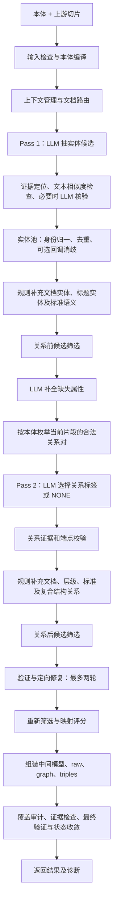

# 知识抽取 V3.1 流程说明

更新时间：2026-10-11。本文依据当前工作区 `algorithm/knowledge_extract/v3_1/` 源码，描述删除 NanoJev 后的实现，不代表已部署服务器的运行状态。

V3.1 的核心流程是：**本体编译 → 实体候选抽取 → 实体归一和筛选 → 属性补全 → 关系候选判定 → 规则补充 → 校验与定向修复 → 图结果组装**。

当前实现不再包含 NanoJev 客户端、模型加载、关系裁决探针或相关配置读取，也没有自动接入 Clef。实体消歧保留通用的 `entity_adjudicator` 回调，默认值为 `None`。

## 1. 流程边界与入口

上游负责文件解析与切片，V3.1 消费本体和切片，不直接接收原始 PDF、Word 或完整 Markdown 字符串。图谱写入、向量化和外部服务调用不属于本包的抽取主流程。

```text
上游文档解析 / knowledge_pipeline 切片
  └─ ontology + ExtractionChunk[]
      ├─ extract() → extract_harness() → extract_split() → to_public_result()
      └─ extract_aggregate() → extract_harness() → extract_split()
```

Backend 的预期入口为 `knowledge_extract_adapter.run_aggregate()`，按版本选择 `v3_1.extract_aggregate()`；当前适配限制见第 8 节。

| 入口 | 默认校验 / 容错 | 输出 |
| --- | --- | --- |
| `extract()` | 经 harness 使用 `strict`、`best_effort=False` | 成功时仅返回 `entities`、`relations`；非成功状态抛出类型化异常 |
| `extract_aggregate()` | `permissive`、`best_effort=True` | 原始事实、图、三元组、中间模型及诊断 |
| `extract_harness()` | `strict`、`best_effort=False` | 初始化或接收 LLM，转交主流程，返回聚合结果 |
| `extract_split()` | `strict`、`best_effort=False` | 实际编排各阶段，支持细粒度控制参数 |

输入 `chunks` 必须是本包 `chunk_context.ExtractionChunk` 对象的可迭代序列。核心字段是 `chunk_id`、`text`；还可携带文档、章节、页码、原文偏移、前后片段及 `metadata`。`ontology` 必须非空，`target_types` 可限制目标类型，默认包含子类。

## 2. 总体流程图



“两阶段”指实体与关系的先后依赖，不代表整篇文档只调用两次模型。属性补全、证据核验、分批关系判定、重试和修复均可能产生额外调用。

## 3. 各阶段处理

### 3.1 输入检查、本体编译与路由

`extract_harness()` 检查本体非空和校验模式，使用调用方传入的 `llm`，或从配置创建主模型客户端。

`extract_split()` 检查切片对象类型，通过 `_compile_runtime()` 得到 `ExtractionPlan` 与 `OntologySchema`：解析允许类型、继承、属性和关系签名，并应用目标类型范围。严格模式下，本体编译错误直接抛出异常。

随后创建 `ChunkContextManager`，按本体与文本信号确定 `DocumentRoute`，影响提示词领域扩展与规则补充。默认局部上下文包含前后各一个片段，并限制在同章节；上下文用于理解，不能替代当前片段的证据要求。

空切片列表返回空结果及 `EMPTY_INPUT` 告警，不进入实体和关系模型调用。

### 3.2 Pass 1：实体候选生成与证据检查

`candidate_generation.entity_pass()` 按片段组织本体类型、当前文本、邻近上下文及结构化输出要求，调用主模型生成实体候选。

大表格在实体阶段可按行拆成内部子表调用后合并，以控制单次输入输出规模；这是内部调用拆分，上游切片仍是请求输入契约。

证据处理顺序为：

1. 将候选证据绑定到原文位置。
2. 无法逐字定位时，使用 `semantic_support()` 检查归一化包含、最长公共片段与词元覆盖率。这是确定性的文本相似度检查，不是独立语义模型。
3. 仍不支持时，调用主模型执行 `evidence_verification`，输出 `yes / no / uncertain`。

**实体候选不会仅因这里的核验结果为 `no` 或 `uncertain` 而立即丢弃，而是保留并记录告警。** 后续仍会经过实体池与候选选择规则，保留候选不等于最终接纳。

### 3.3 实体归一、规则补充与筛选

候选进入 `CandidatePool`，由 `EntityResolver` 处理身份：

- 优先使用本体声明的 identity 属性，没有有效值时回退到实体名称。
- 按精确身份、兼容别名及局部共指规则查找已有实体，合并属性和证据。
- 如显式传入 `entity_adjudicator`，可对歧义实体对进行裁决；默认不调用外部裁决模型。

随后执行确定性补充：从文档信息补充文档实体，从编号标题补充结构实体，标准路由额外补充标准语义实体。

`CandidateSelector.pre_relation()` 在关系判定前筛选候选。关系阶段使用已接纳实体目录与稳定候选 ID，不重新自由生成端点。

### 3.4 属性补全

`property_enrichment.enrich_entity_properties()` 在实体身份与类型固定后，调用主模型补齐本体声明的缺失属性。

模型只能引用已有实体 ID，属性名受本体约束，并需提供当前片段证据。属性阶段也会使用原文定位、文本相似度检查和必要的 LLM 核验；其接纳行为由属性模块控制，不能套用“实体候选先保留”的规则。

### 3.5 Pass 2：关系候选判定

`candidate_generation.relation_pass()` 先构建当前片段可用的实体目录：当前片段有证据或名称提及的实体，以及主文档锚点实体。

程序按本体允许的方向和类型签名枚举关系对，过滤不属于当前范围的组合，再分批交给主模型。每个决策必须引用合法 `pair_id`，标签只能是该关系对对应的本体关系或 `NONE`。

关系接纳检查包括：ID 存在、同一 pair 不重复决策、标签符合签名、证据能在当前片段逐字定位。`NONE` 不生成关系；无效关系证据会被拒绝并告警。进入实体池后继续解析端点和关系类型。

当前关系阶段直接调用主模型，不经过 NanoJev 的接受、拒绝、灰区分流。

### 3.6 规则关系补充与关系后筛选

模型关系之后，代码补充可从文档结构确定的关系：

- 文档相关关系、编号层级关系。
- 文档单元关系，如 `HAS_PART`、`EVIDENCED_BY`。
- 标准路由下的标准语义和技术关系。
- 复合元素成员关系，如 `hasSubRule`。

之后执行 `CandidateSelector.post_relation()`，结合实体与关系状态筛选结果。

### 3.7 验证与定向修复

`ExtractionVerifier` 检查本体契约、重复实体与关系、悬空端点、证据和覆盖缺口。验证器只报告问题，不直接增删事实；并非所有覆盖缺口都会升级为可修复错误。

`TargetedRepairOrchestrator` 仅对具体可修复问题构造修复请求。内置修复按问题选择相关片段，限制修复原文长度，并根据问题类型调用实体或关系修复。修复结果仍经实体池接纳，循环结束后重新执行候选筛选。

最多两轮修复，停止原因包括：

| `repair_stop_reason` | 含义 |
| --- | --- |
| `validation_complete` | 校验通过且没有待修复问题 |
| `hard_gap_not_repairable` | 无可继续修复的问题 |
| `repair_no_new_facts` | 本轮没有新增接纳事实 |
| `repair_round_limit` | 达到轮数上限 |
| `empty_input` | 输入切片为空 |

### 3.8 评分、组装与最终检查

`MappingScorer` 对实体和关系打分，默认 `apply_mapping_threshold=False`，只记录评分。开启阈值应用后，才按分数更新接纳状态；底层默认 accepted 阈值为 `0.85`，low-confidence 阈值为 `0.70`。

`GraphAssembler` 从中间模型生成 `raw`、`graph` 和 `triples`。随后再次执行覆盖审计、证据检查和最终验证，汇总模型调用与修复记录，形成运行状态。

严格模式下，最终硬校验问题会被记为终止失败。使用宽松模式或尽力返回结果时，调用方仍须检查状态与诊断，不能以“返回了字典”判断业务成功。

## 4. 输出契约

### 4.1 公共业务结果

`extract()` 经 `to_public_result()` 输出以下结构，不携带内部诊断；非成功状态或存在错误码时抛出异常。

```json
{
  "entities": [
    {"type": "Person", "name": "张三", "properties": {}},
    {"type": "Organization", "name": "示例单位", "properties": {}}
  ],
  "relations": [
    {
      "from_type": "Person",
      "from_name": "张三",
      "rel_type": "WORKS_FOR",
      "to_type": "Organization",
      "to_name": "示例单位"
    }
  ]
}
```

以上仅展示字段形状；实际实体类型和关系必须由传入本体声明，关系两端也必须存在于实体集合中。

### 4.2 聚合与诊断结果

| 字段 | 用途 |
| --- | --- |
| `raw` | 内部实体、关系事实 |
| `graph` / `triples` | 图节点、边及三元组 |
| `intermediate_model` | 中间对象模型和覆盖缺口 |
| `warnings` / `attempts` | 告警、请求重试和失败记录 |
| `evidence_coverage` / `coverage_gaps` | 证据覆盖统计和缺口 |
| `verification` | 最终校验报告 |
| `mapping` | 映射评分与阈值信息 |
| `profile` | 路由、候选数量、补充统计、修复轮次、停止原因、模型调用数 |
| `status` / `error_code` / `run_trace` | 运行状态、错误归因与调用轨迹 |

Backend 适配器正常返回时还会附加 `extract_version`，在使用请求级配置时附加 `effective_config`。

## 5. 调用示例

以下示例直接使用 V3.1 自己的切片类，避开 Backend 适配层的类型差异；运行需要配置可用的主模型服务。

```python
from algorithm.knowledge_extract.v3_1 import extract_harness
from algorithm.knowledge_extract.v3_1.chunk_context import ExtractionChunk

ontology = """@startuml
class Person {
  name: String
}
@enduml"""

result = extract_harness(
    ontology=ontology,
    chunks=[ExtractionChunk(chunk_id="chunk-0", text="张三参加了会议。")],
    validation_mode="strict",
    best_effort=False,
)
print(result["status"])
print(result["raw"])
print(result["verification"])
```

## 6. 配置与调用规模

主模型配置由 `config.py` 的 `KG_EXTRACT_LLM_*` 变量提供，包括地址、模型、凭据、输出 token 上限、并发、超时和调度限流。文档不记录真实地址或凭据。

实体和关系任务按片段并发执行，关系在片段内按候选对分批。生成请求支持结构化响应解析和有限重试；默认 `max_attempts=3`，定向修复最多两轮。它们是不同维度的限制，不代表整篇最多三次或两次调用。

默认关闭主模型 thinking。配置细节以 `config.py`、`llm_client.py` 和具体入口的参数透传为准，不应把 `.env.example` 中旧实现的 V31 专用配置全部视为当前有效。

## 7. 源码导航

以下路径相对本文件。

| 代码 | 职责 |
| --- | --- |
| [包入口](../../algorithm/knowledge_extract/v3_1/__init__.py) | 公共结果与聚合结果入口 |
| [harness_extractor.py](../../algorithm/knowledge_extract/v3_1/harness_extractor.py) | 初始化主模型并转交主流程 |
| [split_extractor.py](../../algorithm/knowledge_extract/v3_1/split_extractor.py) | 完整阶段编排 |
| [ontology_compiler.py](../../algorithm/knowledge_extract/v3_1/ontology_compiler.py) | 本体编译 |
| [chunk_context.py](../../algorithm/knowledge_extract/v3_1/chunk_context.py) / [prompt_router.py](../../algorithm/knowledge_extract/v3_1/prompt_router.py) | 片段上下文、路由及提示词 |
| [candidate_generation.py](../../algorithm/knowledge_extract/v3_1/candidate_generation.py) | 实体生成、证据核验、关系判定及请求重试 |
| [entity_resolver.py](../../algorithm/knowledge_extract/v3_1/entity_resolver.py) / [candidate_selector.py](../../algorithm/knowledge_extract/v3_1/candidate_selector.py) | 实体池、身份解析与候选筛选 |
| [property_enrichment.py](../../algorithm/knowledge_extract/v3_1/property_enrichment.py) | 属性补全 |
| [hierarchy.py](../../algorithm/knowledge_extract/v3_1/hierarchy.py) / [composite.py](../../algorithm/knowledge_extract/v3_1/composite.py) | 结构关系与复合元素组装 |
| [verification.py](../../algorithm/knowledge_extract/v3_1/verification.py) / [orchestrator.py](../../algorithm/knowledge_extract/v3_1/orchestrator.py) | 验证及有限修复循环 |
| [mapping_scorer.py](../../algorithm/knowledge_extract/v3_1/mapping_scorer.py) / [graph_assembler.py](../../algorithm/knowledge_extract/v3_1/graph_assembler.py) | 评分与图组装 |
| [result_contract.py](../../algorithm/knowledge_extract/v3_1/result_contract.py) | 公共结果裁剪与异常边界 |

## 8. 当前接入限制与验证边界

以下为写作时的静态源码观察，文档整理未修改这些接口：

1. **切片类型不一致**：Backend 的 `build_chunks()` 构造 `v2.ExtractionChunk`，但 V3.1 检查自己的 `ExtractionChunk` 类型，可能在入口触发 `TypeError`。
2. **请求级客户端工厂不一致**：`request_runtime.create_request_llm()` 对 V3.1 调用 `create_client`，当前 V3.1 模块只定义 `create_llm_client`。
3. **聚合入口并非透传全部参数**：`extract_aggregate()` 用 `**_` 接收但忽略未显式处理的参数，不能据 Backend 传入 `document_timeout` 等字段认定其在算法层生效。请求超时还需区分注入的 LLM 自身配置。
4. **旧说明尚有残留**：部分 README、索引和历史设计文档描述 V2 或 Clef 版 harness。本文以当前代码为依据；旧版设计不应当作当前调用链。

NanoJev 删除后的 V3.1 目录测试记录为 **140 passed、1 skipped**，跳过项缺少评测本体文件。该记录不等于 Backend 接入成功或生产发布门禁通过。当前文档整理仅做源码核对和文档检查，未执行线上评测或部署。
