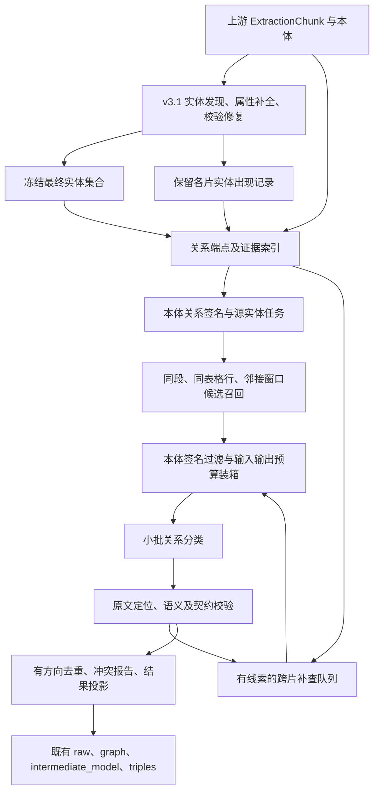

# V3.1 长文档关系抽取方案：本体驱动的小任务、局部证据与跨片补查

调研日期：2026-10-12。本文是方案记录。v2.2 已按其中的局部证据召回和小批分类实现关系阶段，现行行为见 [知识抽取 V2.2 抽取逻辑](知识抽取V2.2抽取逻辑.md)。v3.1 仍是实体主流程，没有按本文改关系抽取。下文“尚未实现”描述的是写作时的代码，不是 v2.2 的当前状态。

代码依据：写作时的本地工作区（当时 HEAD 为 `fff455c`，包含尚未提交的 v3.1 实体化改造），不是仅依据该提交，也不代表 88 或生产服务器正在运行的代码。

## 1. 建议先采用什么方案

**保留 v3.1 的实体抽取，在实体完成后增加独立关系阶段：先用本体关系签名划分任务，再按源实体和原文证据细分，模型每次只判断一个小范围证据中的少量候选关系；局部处理后，再针对明确的跨片线索补查。**

本体驱动拆任务作为主方案：**本体定义任务边界，原文决定证据范围，token 预算决定单次任务大小。**程序持有完整索引，模型接收当前任务的必要内容。

具体分为五步：

1. 保留每个实体在各切片中的出现记录，建立“实体 ↔ 原文位置”索引。
2. 从本体生成“源类型—关系—目标类型”任务模板，实例化到源实体；在同段、同表格行、相邻片段和明确引用范围内召回目标实体。
3. 将候选关系和原文一起装入有输入、输出预算的小任务。初始每批最多 32 个“头实体—关系类型—尾实体”候选，实际数量以 token 预算为准。
4. 模型逐项给出“支持／当前证据不支持／证据不足”，正例必须指向原文。程序校验、去重、汇总。
5. 对指代、条款引用、文档主体等跨片线索，取回少量相关原文重新判断，最终仍通过同一个校验和输出入口。

这里的重点是**改变模型任务的组织单位**：从“这一大段里的实体两两可能有什么关系”，收缩为“这组原文能否证明这几条候选关系”。把一个大请求拆成很多请求，只解决单次调用上限；候选召回和证据选择同时收缩，才能控制总成本。

第一版建议采用**候选分类**，而不是自由生成任意三元组。它与当前已有实体、本体约束和严格结果契约更容易衔接，也能区分“判过但没证据”与“根本没处理”。直接生成正例可以作为后续对照实验；没有必要现在引入整套 GraphRAG、向量库或训练专用模型。

## 2. 当前代码实际是什么状态

### 2.1 v3.1 确实只有实体主流程

| 位置 | 已核实的行为 | 对关系方案的影响 |
| --- | --- | --- |
| `algorithm/knowledge_extract/v3_1/harness_extractor.py::extract_harness` | 调用 `extract_split`，入口描述为实体抽取和属性补全 | 在现有入口中增加可配置的关系阶段即可，不需要重做解析和切片 |
| `v3_1/split_extractor.py::extract_split` | 逐片实体发现 → 属性补全 → 实体校验/修复 → 映射及输出；`raw.relations`、`graph.relationships`、`intermediate_model.relations`、`triples` 均为空 | 关系应在最终实体集合确定后执行，避免关系端点随后被删掉 |
| `v3_1/property_enrichment.py::enrich_entity_properties` | 按完全相同的 `type + name` 汇集 occurrences，再由模型返回完整实体；默认每批 24 个同类型 key | 不存在可直接复用的全局候选池；最终实体的单条 evidence 不能代替全部出现记录 |
| `v3_1/output_contracts.py`、`prompt_router.py`、`skill_registry.py` | 只支持实体、属性、实体修复；关系 schema 和关系 skill 阶段尚未开放 | 不能只把 `task` 改成 `relation` 就接上关系抽取 |
| `v3_1/ontology_compiler.py::RelationSpec` | 仍保留关系 ID、源/目标类型、基数和签名 | 可复用合法性约束；本体允许某种边，不代表文本已经证明这条边 |
| `v3_1/chunk_context.py::ExtractionChunk` | 有 document、section、邻居、页码、偏移和 metadata 字段 | 有条件建立局部证据窗口，但字段可能缺失，需要明确降级规则 |
| `v3_1/tests/test_entity_only.py` | 显式验证关系为空、拒绝关系 prompt/skill、实体修复不得偷偷生成边 | 将来启用关系时需保留关闭模式测试，新增开启模式测试，不能删除现有契约测试来绕过 |

目前实体身份采用精确 `type + name`，没有恢复别名归并；图 UID 只用于兼容投影。关系阶段应尊重这一点，不把关系功能做成一次隐式的实体合并重构。

另一个需要单独记账的长文档风险：属性阶段会汇总一个批次实体对应的全部来源切片。即使每批只有 24 个实体，只要其中某个实体在全文大量重复，也可能产生长输入。**本方案控制的是关系阶段，不能据此承诺整条实体—关系流水线都不会截断。**属性阶段预算应另外测试和修复。

### 2.2 当前 v2 不是简单地把全篇实体一次性送入模型

检查了以下调用链，而不是只看函数参数或旧文档：

```text
v2/split_extractor.py
  → candidate_generation.relation_pass
  → relation_resolver.enumerate_relation_pairs
  → output_batching.generate_batched
  → prompt_router.build_chat_messages
```

当前工作区的具体实现是：

- `relation_pass` 先取当前 chunk 中有证据或名称出现的实体，再加 `document_anchor` 实体；并非直接使用整篇所有实体。
- 在这个范围内，`enumerate_relation_pairs` 按本体可赋值的源、目标类型展开组合，跳过一批旧实现规定为确定性组装的关系。
- 外层 `RELATION_PAIR_BATCH_SIZE=200`；内层再由 `output_batch_size(..., tokens_per_item=128)` 和 `generate_batched` 根据输出预算拆分，截断后可二分。
- 虽然 `build_request` 传了 `known_entities=local_catalog`，**最终 pair 分类模板会把 known entities 区域替换成“关系端点已由候选 pair 固定”**。不能据此认定完整实体目录实际进入了每一个请求。
- 子批次重建了候选列表和 schema，但当前 chunk 与邻居上下文仍随每个子批发送。只拆候选，不保证原文输入也能缩小。
- 关系证据只能在当前 chunk 定位。邻居虽然可见，跨片联合证据并没有获得同等的接受能力。
- 接收逻辑检查非法 ID、重复决策、错误标签和证据；没有在该层核对“收到的决策集合是否完整覆盖发送的候选集合”。JSON 合法不等于候选都判断完了。

代码中另有 `relation_catalog_for_context` 的 80/160 阈值，但不能把这个辅助函数的裁剪策略当成主关系 pass 的实际端点上限。

因此，用户反馈的截断需要结合实际运行版本与日志进一步定位；目前可以从代码确认的风险是：

| 风险 | 为什么现有拆批不一定解决 | 新方案处理方式 |
| --- | --- | --- |
| 长 chunk/长邻居文本 | 拆候选后仍重复携带同一大段原文 | 按可回溯原文片段构造证据窗口，独立核算输入预算 |
| 密集表格、片内实体很多 | 类型合法的组合仍可能接近平方增长 | 先按行、段和引用召回，再应用本体约束 |
| 单次输出过多 | 每个候选的 ID、标签、证据都消耗输出 token | 小批逐项判断，负例不输出长解释，截断递归拆分 |
| 跨片遗漏 | 当前片证据限制挡住真正跨片的事实 | 多证据片段 + 有触发条件的跨片补查 |
| 静默漏处理 | 成功解析不代表候选被完整覆盖 | 精确核对任务清单和返回决策集合 |

没有读取服务器截断日志或复现具体失败文档，因此这些是**代码风险定位，不是已经确认的生产根因**。

## 3. 开源社区有哪些可借鉴的做法

本节以项目官方文档、源代码和作者论文为依据；“适用于本项目的取舍”是本次设计判断，不是这些项目给出的效果保证。

| 项目/研究 | 核实到的做法 | 对本项目有用的部分 | 不宜直接照搬的部分 |
| --- | --- | --- | --- |
| Microsoft GraphRAG | 索引时逐个 text unit 抽实体与关系，随后归并；关系结果保存 `text_unit_ids`。另提供有限次 gleaning 配置 | 分片处理、关系保留来源、汇总与抽取分离 | 它的关系描述和图摘要目标不等同于本项目的固定本体关系；逐片处理也不能自动保证跨片召回。[数据流](https://microsoft.github.io/graphrag/index/default_dataflow/)、[输出结构](https://microsoft.github.io/graphrag/index/outputs/)、[配置](https://microsoft.github.io/graphrag/config/yaml/) |
| LightRAG | 单 chunk 抽取后合并节点和边；保留来源。所读版本对输出记录数、补漏上下文和截断有显式处理 | 局部抽取、来源追踪、补漏也必须核算预算 | 所读合并代码按排序后的端点 key 归并无向边，不能用于本项目有方向的本体关系；输出限额也不等于完整性保障。[固定版本抽取/合并代码](https://github.com/HKUDS/LightRAG/blob/4d0afc1bc36e6a34d4a5895b68efe9413748627a/lightrag/operate.py)、[提示词](https://github.com/HKUDS/LightRAG/blob/4d0afc1bc36e6a34d4a5895b68efe9413748627a/lightrag/prompt.py) |
| LlamaIndex `SchemaLLMPathExtractor` | 按 node 抽取，允许指定实体类型、关系类型、合法连接，并用结构化输出和后处理校验；提供 `max_triplets_per_chunk` | 关系签名约束、动态 schema、端点类型校验 | 数量提示不是无遗漏分页机制；还会生成实体节点，不能替代“仅从 v3.1 已有实体中选端点”。[官方指南](https://developers.llamaindex.ai/python/framework/module_guides/indexing/lpg_index_guide/)、[固定版本实现](https://github.com/run-llama/llama_index/blob/6dd2f3cdd9ce7ff927ea8d46ccee08875bb00f95/llama-index-core/llama_index/core/indices/property_graph/transformations/schema_llm.py) |
| DocRED | 将跨句关系作为文档级关系抽取的重要问题，而非只做句内实体配对 | 测试集必须有跨句、跨段关系；只评同片关系会高估方案 | 它是数据集/研究任务，不是可直接处理任意超长中文业务文档的在线组件。[论文](https://aclanthology.org/P19-1074/)、[官方仓库](https://github.com/thunlp/DocRED) |
| EIDER | 学习抽取关系证据，并融合证据输入与全文输入的预测 | 为候选关系挑选支持句，而不是把所有全文内容平铺给模型 | 原方法包含训练模型和全文预测分支；本方案只借鉴证据选择，不宣称复现 EIDER，也不引入全文大请求。[论文](https://aclanthology.org/2022.findings-acl.23/)、[作者代码](https://github.com/yiqingxyq/Eider) |
| GLiREL | 给定文本、实体和关系标签，可做关系分类，并约束关系两端的实体类型 | 后续可比较“小模型预筛 + LLM 确认”的成本与效果 | 本次未验证其中文铁路/标准领域、长文档和自定义本体表现，暂不作为第一版依赖。[官方仓库](https://github.com/jackboyla/GLiREL) |

由此得到的工程选择是：**借鉴 GraphRAG/LightRAG 的局部抽取、LlamaIndex 的 schema 校验、DocRED/EIDER 的跨句证据思路，在本项目内实现一个小型关系阶段。**无需把这些框架的存储、检索或整套图构建流水线搬进来。

“再来一轮看看有没有漏掉”只能作为有限补漏，不能成为长文档的主要完整性机制：上一轮对话越长，下一轮输入也可能越长。LightRAG 所读版本在 gleaning 前检查这类输入增长，说明补漏同样受上下文限制。

## 4. 总体流程与明确边界



补查队列有明确轮数、请求次数和文档截止时间，不构成无限循环。

第一版范围：**单文档内的显式关系，以及有明确指代/引用线索的跨片关系。**不承诺推理所有隐含关系，不做跨文档知识库消歧，不为提高连通度强行连边。

上游切片仍是唯一源码数据。关系层读取段落、句子或表格行形成临时“证据视图”，记录它在原 chunk 中的区间；不改 chunk 文本、ID、边界或 `__source_range` 契约。视图不是重新切片后的业务数据。

文档边界必须显式检查：现有 `local_context()` 的邻居遍历本身不能替代 document guard，尤其 `section_id=None` 时，不能把两个文档当作同一节。第一版按调用方文档上下文分组执行；无法确认文档归属的多文档请求明确报不支持，不能按名称全局合并。

## 5. 先建立实体与证据索引

### 5.1 保留两层数据

| 数据 | 来源 | 用途 |
| --- | --- | --- |
| `final_entities` | 当前 v3.1 最终接受的实体列表 | 冻结关系端点集合；不允许关系模型创造实体 |
| `entity_occurrences` | `discovered`、修复后的 `all_occurrences` 及其原文证据 | 知道实体在哪些 chunk、段落、表格行中出现 |

在 `split_extractor.py` 的请求生命周期内保存这个 sidecar 索引即可，不要求把内部出现记录加入公共实体响应。绑定时依据现有精确 `type + name`；只保留能映射到最终实体的记录。出现记录丢失、被筛掉或无法定位时记为缺口，不能为了完成关系再把实体加回来。

还需补齐一个现有契约限制：实体候选阶段要求同一 `type + mention` 每个 chunk 只输出一次，已有 evidence 定位也可能只返回一次命中。**`discovered` 不是完整 mention 表。**如果同一设备在一个长表中出现 20 行，仅保留首次 quote 会漏掉其余行的关系候选。索引构建应在原文中补充已接受实体明确名称/可靠 quote 的全部位置，保留重叠匹配和歧义标记；短名称子串命中只能用于候选召回，不能据此判定实体身份或关系成立。归纳名称无法可靠展开时，保留较宽的来源片段并报告 mention coverage 缺口，不伪造行级精度。

推荐内部结构，以下均为拟新增字段：

```text
EntityRef
  ref                 请求内稳定的短引用，例如 e17
  exact_key           原始 type + name，不进行大小写/空格归一后合并
  document_scope      调用方提供的文档范围
  type, name          原样引用最终实体

EntityOccurrence
  occurrence_id
  entity_ref
  chunk_id
  start_char, end_char 原始 chunk 内左闭右开区间，可为空
  quote               可定位原文
  grounding           literal / semantic_only / unresolved
  section_id
  row_key             有可靠表格结构时才填
```

`e17` 只是关系任务的序列化引用，不写回实体 name，也不重启已删除的候选池或别名合并。绑定表中保存原始类型与名称，任务恢复时复用同一个绑定表。

当前实体流程允许部分归纳名称和语义核验：不能假设每个 name 都逐字存在。对于这类实体，使用来源 quote 召回候选；找不到可靠来源时标记待处理，不能靠名称子串猜位置。

### 5.2 身份错误会直接变成关系错误

例如两处同类型的“1号阀门”实际属于不同车辆，当前 `type + name` 合并可能已失去区别。关系模块无法凭分批修复它。第一版要把“同名但不同对象范围”作为单独回归项；发现歧义时保留 unresolved，后续再单独演进实体身份契约。

别名和代词也不直接成为新实体。原文明确说明简称或唯一指代时，可以建立带来源的 occurrence 指向；有多个合理 antecedent 时进入 `insufficient_evidence`，不凭距离最近就认定。

## 6. 如何召回候选，而不生成全文笛卡尔积

### 6.0 本体先拆任务：关系签名 → 源实体 → 证据范围

这比简单“按实体类型分批”更具体。假设本体包含以下三条签名，仅作方案示例，不代表当前项目一定采用这些类型名：

```text
Department -[responsibleFor]-> Work
Work       -[actsOn]---------> Equipment
Fault      -[occursOn]-------> Equipment
```

程序据此生成三类任务模板，不把三个关系领域同时交给模型。拿到已接受实体后，再按源实体实例化：

| 本体模板 | 实例任务 | 模型实际回答的问题 |
| --- | --- | --- |
| `Department → responsibleFor → Work` | 设备部 + 其出现位置附近的 Work | 这些证据支持“设备部负责哪几项给定工作”？ |
| `Work → actsOn → Equipment` | 制动系统巡检 + 相关 Equipment | 这些证据支持“这项巡检作用于哪个给定设备”？ |
| `Fault → occursOn → Equipment` | 压力异常 + 相关 Equipment | 这些证据支持“该故障发生于哪个给定设备”？ |

一个执行任务的范围可表示为：

```text
RelationTask = (
    document_scope,
    ontology_signature,
    source_entity_ref,
    evidence_scope,
    candidate_target_page
)
```

**源实体固定、关系类型固定、目标从给定集合中选择。**例如文档有 800 个实体，设备部当前责任段只出现 6 项工作，这个任务只携带设备部、6 项工作、`responsibleFor` 的含义及有关原文。设备部在另一章节出现时，生成另一份证据任务，最终按事实键合并。

本体驱动时必须避免几种新的膨胀和漏抽：

- 不能把“所有 Department × 所有 Work”作为模板实例化结果。模板只建立类型索引和源实体工作清单，目标必须经过证据召回。
- 不能把一个文档级高频源实体的全部原文放进同一个任务。它也按段落、表格行或引用目标分页。
- 一种源/目标类型间有多个合法关系时，每种关系都保留独立任务；不能因第一个关系被判为 supported 就停止其他关系判断。
- 同一关系 ID 对应多个签名或继承类型时，在任务中保留具体签名，候选去重时避免父类/子类展开重复，但不能漏掉子类端点。
- 一对多不能裁成只取一个目标；单值基数只能用于冲突检查，不能在缺证据时强制选一个。
- 无关系定义的本体不进入开放关系生成，返回 `no_relation_schema` 的阶段原因；有签名但没有合法实体则返回 `no_candidate_endpoints`，和模型失败分开。

先采用每任务一种关系签名，便于提示词明确、按关系类别观察错误。后续若模型调用开销过大，可以把**同一证据范围内**的几个小任务装入一个请求，仍保留独立 candidate ID、语义和完整性检查。不要为减少请求次数重新合并成全篇任务。

这是一种可实现的本体任务规划，不需要先让另一个 LLM 阅读全文规划。现有 `ExtractionPlan.relation_specs`、类型继承与实体出现索引足以确定第一版任务骨架；领域 skill 只补充关系的业务判定规则，不能覆盖本体签名和原文证据。

### 6.1 三种证据范围

| 范围 | 候选来源 | 证据包内容 | 首版策略 |
| --- | --- | --- | --- |
| 局部事实 | 同一句、同段、同列表项、同表格行中的端点 | 原句/段；表格为表头、当前行及必要的合并单元格上下文 | 必做；同段较密集时先按句/行组织，不把整张表实体两两相乘 |
| 邻接事实 | 同文档相邻片段、前后句中的指代或延续 | 当前片段 + 必要前后片段，保留原始归属 | 第一版支持有界相邻窗口；section 未知时只按文档内距离降级 |
| 远距离事实 | “见第 5.2 条”“上述设备”“该部门”、明确对象编号或文档主体引用 | 指代/引用原文 + 被引用片段 + 必要连接证据 | 按触发线索补查；不能因孤立实体多就遍历全文两两关系 |

“同段/同表格行”只产生**候选**，不是直接产生边。表中一行同时出现两个对象，并不必然证明它们存在某种关系；最终仍由原文语义判断。

程序先建立 `chunk → occurrences`、`entity_ref → occurrences`、`section/row → occurrences`、`条款号/明确编号 → 原文位置` 的索引。对每个小证据范围，只展开本体允许的候选三元组；继承类型需沿用现有本体的可赋值语义。

关系类型必须覆盖本体中允许的签名，不能复制 v2 的 `DETERMINISTIC_RELATION_IDS` 黑名单。v3.1 的旧确定性组装已删除，如果把这些关系排除又没有新的实现，会静默漏掉整类关系。第一版默认全部按语义关系判断；后续若加入结构规则，要逐条证明该规则和对应本体含义一致。

### 6.2 两种“分组”不能混淆

**按实体列表位置切成 50 个一组不够。**如果 A 在第 1 组、B 在第 2 组，分别抽关系会漏掉 A→B；为了补齐又让组间全组合，会重新回到高成本。

本方案先根据原文生成候选 `(A, r, B, evidence_scope)`，再按预算分装候选。一个候选不可因为它的两个实体位于不同列表批次而被拆散；每个子批重新取自己涉及的端点、关系定义和原文。

对于一个真正很密集、无法安全缩小的段落，仍可能有大量合法候选。此时把候选分页处理，或达到总预算后明确返回未完成；不能截取前 32 个就假装全处理了。**32 是每次调用大小，不是整段关系数量上限。**

### 6.3 跨片补查的具体做法

优先级从高到低：

1. 明确条款号、对象编号、表格续行定位，直接取目标片段。
2. 同文档内已验证的实体出现记录、标题/段落层次和有限邻居。
3. 必要时对当前文档原文做本地词项检索；语义向量检索留作第二阶段选项。

初始只取前 3 个相关证据片段，并非断言它们覆盖全文。若原文有明确引用但尚未解析，保留 `unresolved_reference`；若有更多可枚举的引用目标，继续分页，超预算明确记录 deferred。对于开放式语义检索，top-k 之外的召回没有保证，应报告使用的策略和 k，在人工标注集测量召回，不能称为穷举完成。

不要先枚举全文所有实体对再给每一对检索。应由一条原文线索或局部证据不足的任务发起补查，先取得目标证据，再取其中实体，最后过滤关系签名。

跨片关系需要**连接证据**。原文甲片提到 A、乙片提到 B，并不证明 A 与 B 有关系；仅靠语义相似度或两个实体共用一个邻居，也不能生成 A→B。

### 6.4 成本的变化及限制

一个包含 100 位人员、100 项任务的文档，若本体允许 `Person → Work`，全组合是 10,000 个候选。如果原文是一张 100 行的一对一分工表，可靠的行范围可以先收缩为约 100 个候选，再分页判断。这只是规模说明，不是本仓库实测。

若文档明确写着“所有 100 位人员都参与所有 100 项任务”，真实输出就可能有 10,000 条，任何完整方案都必须付出相应处理与输出成本。不能同时保证固定总调用数和任意密集图的完整召回。

因此承诺的是**单次请求有界、进度可核对、未完成可观测**。总体成本依赖证据范围、候选密度和真实边数，不宣称无条件线性复杂度。

## 7. 每次模型调用到底长什么样

### 7.1 输入：沿用五段 JSON 外壳

保留 `task / output_contract / domain_policy / ontology / documents` 的风格，给关系阶段单独构建 schema。示意如下，真实调用的 `success_schema` 需展开为完整 JSON Schema：

```json
{
  "task": {
    "stage": "relation",
    "job_id": "rel-job-17",
    "entities": [
      {"ref": "e1", "type": "Department", "name": "设备部"},
      {"ref": "e2", "type": "Work", "name": "制动系统巡检"}
    ],
    "candidates": [
      {"candidate_id": "p1", "head": "e1", "relation": "responsibleFor", "tail": "e2"}
    ]
  },
  "output_contract": {
    "mode": "one_decision_per_candidate",
    "statuses": ["supported", "not_supported", "insufficient_evidence"],
    "evidence_rule": "supported 必须引用本次 documents 中的原文"
  },
  "domain_policy": {},
  "ontology": {
    "relations": [
      {"id": "responsibleFor", "source": "Department", "target": "Work", "description": "明确承担某项工作的责任"}
    ]
  },
  "documents": [
    {"fragment_id": "f1", "chunk_id": "c12", "text": "设备部负责制动系统巡检。"}
  ]
}
```

端点只带本批涉及的 `ref/type/name`；确需消歧才带少量有原文依据的身份属性，不把所有 properties 重复传入。关系定义只带本批使用的签名及语义说明。短引用只是压缩键，名称和类型仍应对模型可见。

### 7.2 输出：小而可核对

```json
{
  "decisions": [
    {
      "candidate_id": "p1",
      "status": "supported",
      "evidence": [
        {"fragment_id": "f1", "quote": "设备部负责制动系统巡检。"}
      ]
    }
  ]
}
```

约束：

- 每个输入 candidate 必须返回一次；程序检查集合相等和重复，不依赖模型的 `complete=true`。
- `supported` 才可能产生边；其证据必须支持该关系，而不仅是包含两个名字。
- `not_supported` 表示**这组证据不支持该候选**，不是“整篇文档证明这条关系永远不存在”。负例 evidence 可为空，避免输出长解释。
- `insufficient_evidence` 用于明确指代不清、引用目标缺失、条件无法确定等情况，可触发一次有界补查；达到策略范围后仍保留 unresolved。
- 同一实体对允许多个关系类型，各自有 candidate，不用单标签互斥分类误删合法的多关系。
- 不要求输出自然语言推理过程，也不把模型自报置信度当校准概率。

输出 schema 可以约束 ID 枚举与字段；跨字段对应、返回集合完整性、证据有效性仍在本地校验。关系阶段不得沿用实体 evidence 的“仅用名称定位作为降级”来通过验证，因为名称存在只能证明实体出现，不能证明关系成立。

### 7.3 跨片例子

假设原文为：

```text
c10：制动系统巡检由设备部负责。
c11：该部门还负责空压机检修。
```

第二条关系的证据包需要 c10 中的指代前件、c11 中的事实，绑定到现有的“设备部”和“空压机检修”实体。输出 evidence 引用两个独立片段，各自映射到原始 chunk，不能把拼接后的字符串伪装成一个连续原文区间。

如果 c10 同时出现多个部门且“该部门”无法唯一解释，就保留 unresolved。跨片机制不会凭空补充实体；“空压机检修”如果没有进入最终实体集合，记录端点缺失供实体阶段排查。

## 8. 输入和输出分别做预算，截断后真正缩小任务

### 8.1 预算公式

设：`C` 为模型可用上下文，`I` 为配置的输入上限，`O` 为本次输出预留，`S` 为安全余量。

```text
T_input = system + domain_policy + ontology + endpoint_catalog
          + candidate_list + evidence_fragments + response_schema + 消息封装开销

必须同时满足：
T_input <= I
T_input + O + S <= C
预计输出 <= O
```

同时遵守服务端的最大输出限制；有 reasoning token 的模型需按服务端实际计费/限额口径计入预算。不要只以字符串长度或候选条数判断是否能发送。

优先使用已部署模型的本地 tokenizer；没有可靠 tokenizer 时复用当前保守估算并留余量，不能联网临时下载。配置和模型元数据不完整时，不应把未经核实的上下文长度写死成“支持 128K”。

以下是**待 88 小规模评测的初始参数**，不是开源项目结论或已验证最优值：

| 参数 | 初始建议 | 说明 |
| --- | --- | --- |
| 候选数/调用 | 最多 32，预算不足可降到 16/8/1 | 上限只限制一次调用，不限制总关系数 |
| 原文证据/调用 | 约 2K～4K token 内优先 | 还须为 prompt、schema、端点和输出让位；不盲目截断否定/条件句 |
| 输出预留 | 起步约 4K token，服从模型实际限制 | 按正例比例、证据长度和实际 usage 修正 |
| 邻居 | 必要时前后各 1 个片段 | 保证同文档；原始 chunk 很长时只取有关片段 |
| 远距离检索 | 首轮至多 3 个证据片段 | 明确引用未覆盖须继续分页或报告未处理 |
| 跨片补查轮数 | 起步 1 轮 | 不允许自我无限扩展 |
| 拆分深度/调用预算 | 先复用通用拆批的 6 层/63 次保护 | 这是一次拆批调用的限制；还必须叠加请求级总预算和截止时间 |
| 并发 | 复用当前运行层配额 | 不为关系阶段创建独立、不受限的并发池 |

### 8.2 失败时如何处理

1. **调用前输入超预算**：重装候选子批，同时重建端点、签名、schema 和证据包。若只剩一个候选仍过大，缩小为支持它所需的原文片段；必要证据依然放不下则明确报预算失败，不能截掉后半句后继续声称语义完整。
2. **`finish_reason=length` / `status=incomplete`**：拆分候选重试。不要对完全相同的大请求反复重试，也不把残缺 JSON 前缀当作该批完成。
3. **返回少了决策**：保留已完整校验的决策，只对缺失 ID 重试；重试耗尽留下 terminal failure，不能把缺项当作 NONE。
4. **网络超时/限流**：采用现有有限退避，复用文档截止时间；与 token 超预算分开记账。
5. **证据/契约失败**：只对对应 candidate 做有限修复或拒绝；不能用一次修复重新生成全文关系。
6. **达到总预算**：保留成功任务结果，在内部结果中标记 partial、列出待处理数量和原因。公共 `extract()` 继续遵守当前 `to_public_result()` 的非成功抛错契约，不能把 partial 包装成普通成功列表。

子批次必须重新计算证据。如果拆成 1 个候选后仍原样携带整张长表，输入超限问题仍然存在。

### 8.3 有限处理不等于语义完整

分别记录：

- **执行完整性**：计划处理的任务是否都收到有效决策，是否有失败/deferred。
- **检索范围**：本次使用了哪些局部窗口、引用和 top-k 策略，哪些线索仍 unresolved。
- **语义召回**：人工标注的真实关系有多少被找回，只能通过评测估计。

`status=succeeded` 最多表示配置范围内任务执行完成，不能表达“所有隐含真实关系均已穷举”。缺少明确引用目标、预算耗尽和模型漏回属于不同原因，不能统一记成“无关系”。

## 9. 校验、去重与现有输出如何衔接

### 9.1 关系接受条件

每条边至少经过：端点属于冻结实体集 → 本体关系 ID 有效 → 源/目标类型可赋值及方向正确 → 引用属于本次证据包 → quote 能在原 chunk 中唯一定位或明确消歧 → 语义支持该关系 → 条件/否定/基数冲突检查。

quote 匹配是可自动检查的定位条件，不是语义正确性的证明。第一版让关系分类模型承担主判断；对跨片、指代、否定和条件关系增加有界复核，并通过人工标注评估。复核仍可能出错，不能称为形式化保证。

表格头和行分属不同原文位置时分别引用。重复 quote 应限定 chunk/片段范围，不能总取全文第一次命中。chunk-relative offset 与文档全局 offset 分开保存，不把拼接后的偏移写回上游。

### 9.2 去重与冲突

内部事实键建议：

```text
(document_scope, head_exact_key, relation_id, tail_exact_key, qualifier_scope)
```

相同事实合并多份 evidence，保留来源；相同候选在不同证据窗口中的负判定不覆盖另一窗口的有效正判定。去重时不排序有向关系端点；只有本体明确声明对称性时，才允许对称归并。

条件、时间或主体范围不同的事实不能无条件合并。“低温时禁用 A”和“常温时使用 A”不应被强行裁成单一结论。第一版可以在内部记录 qualifier；若既有公共关系格式无法保真表达，而本体又没有事件/约束实体承载，则报告 `needs_schema_support`，不能静默丢条件后输出无条件边。

基数也不是补边理由：本体规定某实体应有一个负责人，但文中未给出，不得猜负责人。多条有证据的结果违反声明基数时报告冲突，不按置信度挑一个抹掉问题。

### 9.3 保留公共业务字段，扩展内部来源

公共关系继续遵守现有 `result_contract.py` 的五字段：

```json
{
  "from_type": "Department",
  "from_name": "设备部",
  "rel_type": "responsibleFor",
  "to_type": "Work",
  "to_name": "制动系统巡检"
}
```

内部关系保留 evidence 列表、任务 ID、原文范围和校验状态，再统一投影到 `raw`、`intermediate_model`、`graph`、`triples`。不得在这些出口各自重新推断关系；图 UID 映射必须复用同一实体绑定表，并检测 UID 归一化碰撞，不能无声合并两个不同的原始 key。

Backend 当前图投影优先用关系自身 `evidences` 归属切片，缺失时才从端点推断。新关系必须提供自身来源，跨片边的端点闭包和证据归属要一起回归测试；不能只改算法 `raw.relations`，让其他出口继续为空或断边。

## 10. 在仓库里怎样落地

### 10.1 建议的最小代码边界

以下是实施规划，本次未新增这些模块：

| 文件/区域 | 计划职责 |
| --- | --- |
| 新增 `v3_1/relation_context.py` | 实体引用、occurrence 索引、原文证据视图和文档隔离 |
| 新增 `v3_1/relation_candidates.py` | 本体签名任务模板、源实体实例化、局部/邻接/明确引用目标召回与任务清单 |
| 新增 `v3_1/relation_extraction.py` | 预算装箱、小批调用、缺项重试、有限补查；复用当前模型运行层 |
| 新增 `v3_1/relation_validation.py` | 端点/方向/证据校验、去重及冲突状态；不恢复旧的语义猜边规则 |
| 修改 `v3_1/split_extractor.py` | 实体完成后保留 sidecar，按开关执行关系阶段，统一结果投影 |
| 修改 `output_contracts.py`、`prompt_templates.py`、`prompt_router.py` | 增加专用关系任务、schema 与五段消息装配 |
| 修改 `skill_registry.py`、`skill_planner.py` | 允许 `relation` 规则段；关系修复只处理限定候选，不能复用实体修复行为 |
| 复用并按需扩展 `algorithm/output_batching.py`、`request_runtime.py` | 截断分类、有限拆批、配额和文档截止时间；修改公共行为时补齐其他版本回归 |
| 修改 `verification.py`、`coverage.py`、`run_state.py` 及 Backend 适配测试 | 关系校验、任务完成度、partial 传播、四种输出和证据投影 |

先增加显式关系开关，关闭时保留当前 entity-only 行为；评测通过后再决定默认开启。若新增环境变量，默认和说明统一放根 `.env.example`；请求覆盖需接入当前配置白名单，不在 Compose 重复默认值。以上配置名称以实现评审为准，本方案不声称它们已存在。

不要依赖已删除的 v3.1 `CandidatePool`、`RelationResolver` 或 `GraphAssembler`，也不要从 v2 整包导入旧流程。可以参考其本体可赋值和有限重试思路，但新模块必须明确自己的输入输出与测试。

### 10.2 分三次做，先验证最小闭环

| 阶段 | 交付 | 完成条件 |
| --- | --- | --- |
| P0：局部关系闭环 | occurrence 索引；本体签名/源实体任务；同段/同表格行目标召回；32 候选小批；方向/证据校验；输出适配和完整性统计；有限邻接窗口 | 同片、表格密集、截断拆批、候选缺项和关闭模式测试通过；真实小样本能运行 |
| P1：跨片召回 | 明确编号/条款引用、指代前件、跨片多 evidence、有界补查 | 跨片标注子集召回达到预先锁定标准，且精确率/耗时满足预算；不支持项有原因 |
| P2：效果驱动优化 | 按失败集决定是否增加本地检索、轻量预筛模型、局部正例生成或更好的实体身份 | 消融实验确认收益；不能仅凭关系数量增加就上线 |

P0 可以用于原型验证，但不能宣称已经解决所有长文档跨片遗漏。推荐上线候选是 P0 + P1；P2 不是第一版的前置条件。

部署保持现有源码外置方案。第一版若只增加 Python 业务代码而不增加环境依赖，无需重建 `qasystem-env-v1`；模型和源码仍分别只读挂载。运行时检索仅访问请求内原文或已授权的既有内部能力，不恢复直接 Neo4j/Elasticsearch 访问，也不新增外网依赖。

## 11. 怎样证明方案有效

### 11.1 先把两类效果分开测

1. **固定实体评测**：固定同一份人工实体或同一份 v3.1 实体结果，仅比较关系阶段，隔离实体漏抽、别名和属性差异。
2. **端到端评测**：走运行中的 Backend，从解析、切片、实体到关系完整评测，检查最终实际收益。

比较组建议：

| 组别 | 用途 |
| --- | --- |
| A：固定版本 v2 的实际关系链路 | 当前业务参考；必须记录源码版本、模型、输入输出上限和全部失败 case |
| B：v3.1 + 局部小批关系 | 验证预算控制和局部召回 |
| C：B + 跨片补查 | 测量跨片召回增量及额外成本 |
| D：可选的局部正例直接生成 | 比较候选分类成本是否值得；同样保留来源、失败与完整性统计 |

v2 与 v3.1 的完整输出比较不完全隔离实体阶段差异，因此应同时做固定实体对照；不能把 v2 截断/失败样本从统计中删掉。

### 11.2 建议准备的小规模数据

先人工复核约 24 份代表文档：普通局部关系、长/密集文档、跨片/否定/条件困难文档各约 8 份。按文档划分调参集和保留测试集，冻结实体、关系及支持证据标注。数量是启动建议，不足以证明所有领域泛化。

至少覆盖以下回归场景：

- 同句与同段，多方向、多关系以及合法无关系。
- 100 行以上表格、续表、合并单元格、相邻行同名对象，防止跨行错连。
- 端点跨 chunk、超过相邻一片的条款引用、明确和不明确的代词。
- 同名不同对象、简称、归纳实体名、最终实体只保留一个 evidence 的情况。
- 否定、条件、时间变化、基数冲突，以及只共现但没有事实关系的硬负例。
- 输入超限、输出截断、单候选仍过大、返回合法 JSON 但少一个 candidate。
- 并发次序变化、重复窗口、失败后恢复、预算耗尽、关系关闭模式。
- 多文档隔离、`section_id=None`、重复 quote、原始 offset 和 `__source_range` 保持不变。

测试放 `tests/` 或版本内单测；数据放 `test_data/eval/`；辅助评测实现放 `eval/`，运行结果按版本/时间写 `tmp/`，不放进算法源码目录或交付包。

### 11.3 指标与候选门禁

| 指标 | 为什么要测 | 初始目标/判定 |
| --- | --- | --- |
| 候选召回率 | 真关系如果没进候选，后面模型再强也无用 | 固定实体条件下整体争取 ≥95%；按局部/跨片分别报，不能只报平均；这是待基线确认的目标 |
| 关系 P/R/F1 | 关系增多可能只是幻觉增多 | 以人工核验结果为主建立基线；小规模启动可暂用 F1≥0.5 作最低探索线，不能当最终上线充分条件 |
| 跨片关系召回及新增边精确率 | 衡量补查是否有净收益 | C 相比 B 的收益必须可见；实际阈值在调参集锁定后用保留集验证 |
| 证据可定位率/人工支持率 | 定位正确和语义正确是两件事 | 接受边可定位率应为 100%；另抽检其原文是否真的支持关系 |
| 任务完成率 | 防止静默漏回和预算截断被当成功 | 被标记成功的任务候选覆盖率必须 100%；失败/deferred/unresolved 分开报 |
| 截断率及拆分恢复率 | 区分“发生过截断”和“最终未恢复” | 保留测试集最终未恢复截断为 0 才可声称该集通过；人工注入失败必须明确报告 |
| 调用数、输入/输出 token、P50/P95、峰值任务量 | 防止单次请求变小但总成本失控 | 与相同文档、模型、并发和预算的基线比较，并报告长文档尾部 |
| 实体 F1、名称/属性回归 | 新关系阶段不能破坏当前实体改造 | 固定输入与输出检查；端到端遵守现有基线门禁 |

候选召回至少分两种口径：端点已经抽到时的关系候选召回，以及端到端关系召回。实体缺失不得从端到端分母中移除。关系抽取 F1 之外，还应记录不存在关系的文档是否被错误连边。

本地日志/指标建议记录：`request_id`、doc/job ID、候选数、实际批大小、原文/目录/schema token 估计、usage、finish_reason、拆分层数、缺项数量、未处理原因、局部/跨片边数和耗时。不得写入 Authorization 等认证信息；关系阶段复用原任务调度和 `auth_context_id` 边界。

### 11.4 使用仓库已有发布门禁

88 是测试环境，使用现有 `qasystem_backend` 做相关单测和小规模链路验证，不另建评测 Backend。实际生产发布前仍依次完成全仓单测、全量评测、基线对比和观测检查。

现有 `eval/run.py` 已支持 `--min-relation-f1`，不能只看 `--min-f1`：后者在当前 CLI 中是实体 F1 阈值。完整发布命令沿用仓库要求：

```bash
python3 -m pytest -q

python3 eval/run.py \
  --match-mode llm \
  --fail-on-empty \
  --min-f1 0.5 \
  --max-case-seconds 1800 \
  --max-stage-seconds parse=300,chunk=120,extract=900
```

关系上线时还需在上述命令加入经过基线确认的 `--min-relation-f1` 和同口径 `--baseline`；阈值不得在看到测试集结果后为了通过而放宽。`identity` 适合先验证链路，正式判定按仓库规定用 `llm`，同时保留人工复核集约束裁判误差。

以上是未来实施后的验收要求。本次没有执行模型效果评测、服务器部署或发布门禁，不能将文档中的建议参数写成实测成绩。

## 12. 调研证据与实施前待核实项

开源源码核对版本：

| 项目 | 所读版本 | 重点核对位置 |
| --- | --- | --- |
| LightRAG | `4d0afc1bc36e6a34d4a5895b68efe9413748627a` | `operate.py` 的 `extract_entities`、单 chunk 处理、gleaning 预算、边归并；`prompt.py` 的数量与方向约束 |
| LlamaIndex | `6dd2f3cdd9ce7ff927ea8d46ccee08875bb00f95` | `schema_llm.py` 的 `SchemaLLMPathExtractor`、`_prune_invalid_triplets`、`_aextract` |
| DocRED | `64622e608d06e83deda6b6e0e871effb9d1fd74c` | 官方 README 与 ACL 2019 论文；仅用作任务和数据设计参考 |
| EIDER | `558996d4179d4edad64a05d98387b9a50b19559d` | 作者 README 与 ACL Findings 2022 论文；未运行其训练/推理代码 |

GraphRAG 官方文档和 GLiREL README 按调研当天页面读取，未运行这些框架。外部实现可能继续变化；实际复用任何依赖或源码前，应固定版本并核对许可证。当前推荐设计不要求新增它们为运行依赖。

实施前仍需用实际环境确认的四件事：

1. 截断样本的服务版本、阶段、`finish_reason`、实际输入/输出 token 和模型限制，区分实体、属性、关系与 transport 问题。
2. 上游表格行、条款层次、文档边界和 offset 元数据实际保留到什么程度；没有结构数据时不能宣称可靠同行召回。
3. 现有业务本体中最重要的关系类别、跨片比例，以及是否需要条件/时间限定；不应默认所有关系都能压平成无条件三元组。
4. 当前实体精确同名合并对对象范围是否足够，以及真实模型在 16/32 候选批次上的质量和耗时。

这些信息用于校准实现和参数，不妨碍先按 P0 做局部闭环。**第一步最值得做的是把实体出现位置保留下来，按本体关系签名和源实体生成小任务，并让每个任务同时有候选清单、原文依据和输入输出预算。**
