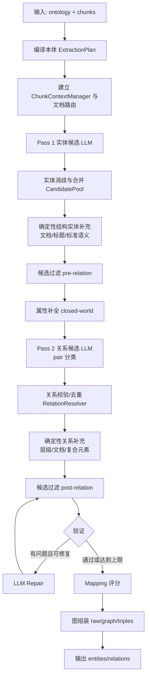

# Knowledge Extract V2 算法逻辑说明

## 一、这是什么

一个 **ontology 驱动的两阶段知识抽取算法**：

- 输入：PlantUML 风格 `ontology` + 上游已切好的 `ExtractionChunk`
- 输出：稳定 JSON 的 `entities` 和 `relations`

```python
result = extract(
    ontology=ontology,
    chunks=[ExtractionChunk(chunk_id="chunk-0", text=chunk_text)],
)
```

核心思想：**LLM 提候选，确定性规则做裁决、补结构、验质量**。

---

## 二、主流程



### 简要步骤

1. **编译本体**：解析类、属性、继承、关系、identity、复合元素，生成 `ExtractionPlan` 和 JSON Schema。
2. **准备上下文**：管理 chunk 顺序、前后邻居、evidence 定位；自动判断文档类型路由（普通/公文/标准）。
3. **实体抽取（LLM）**：每个 chunk 只返回 `type + mention + span + evidence`。
4. **实体入池**：做类型/scope 校验，并按 identity、别名、指代、adjudicator 合并。
5. **结构实体补全（确定性）**：主文档、编号标题、术语、附录、参考文献、公式、表等不靠 LLM，由正则/结构规则补充。
6. **候选过滤**：拒绝文档别名、标量/公式变量、无支撑的表述形式等候选。
7. **属性补全（LLM）**：只允许给已接受实体补 ontology 中缺失且当前 chunk 可支撑的属性。
8. **关系抽取（LLM）**：枚举本体合法 pair，让 LLM 对每个 pair 选关系或 `NONE`，必须有证据 quote。
9. **关系入池**：按本体签名、端点类型、基数、层级关系做确定性接受/拒绝/去重。
10. **确定性关系补充**：编号标题层级、文档引用、标准语义关系、复合元素成员关系等。
11. **验证与修复**：验证 schema、重复、悬空关系、evidence、coverage；可修复问题触发最多 2 轮 LLM repair。
12. **评分与组装**：计算 mapping 分数，生成 `raw / intermediate_model / graph / triples / coverage`，最终公开结果只保留 `entities/relations`。

### 主流程分步示例：official_01

以下以 `benchmark/official/official_01` 为例，展示主流程中各步骤的“简要说明 + 结果示例”。实际内部运行字段可能更丰富，示例主要便于阅读和对照 golden。示例中凡是展示“实体对象”的地方，都会尽量保持该实体完整；如果某阶段按设计只输出候选片段（例如 LLM 实体候选），会在该步骤说明中特别标注。

- 数据目录：`benchmark/official/official_01/`
- 本体：`ontology/officialDocument_onotology.uml`
- 输入文档：
  - `docs/关于开展OpenClaw(“龙虾”)等开源智能体安全风险排查工作的通知.md`
  - `docs/表单.md`
- 标准答案：`extract/golden.json`

#### 输入示例

```text
ontology:
  OfficialDocument: 公文管理单元
  DocumentUnit: 公文结构单元
  OperationalAgent: 运行主体
  OperationalObject: 公文业务对象
  OperationalActivity: 任务活动
  OperationalInformation: 运行信息
  OperationalExchange: 运行交互
  OperationalConstraint: 运行约束条件

docs:
  1. 关于开展OpenClaw(“龙虾”)等开源智能体安全风险排查工作的通知.md
  2. 表单.md
```

---

#### 1. 编译本体

**说明**
解析 `officialDocument_onotology.uml`，得到允许抽取的公文本体类型、属性、关系签名等。

**结果示例**

```json
{
  "allowed_types": [
    "OfficialDocument",
    "DocumentUnit",
    "OperationalAgent",
    "OperationalObject",
    "OperationalActivity",
    "OperationalInformation",
    "OperationalExchange",
    "OperationalConstraint"
  ],
  "relation_signatures": [
    "OfficialDocument -[ISSUED_BY]-> OperationalAgent",
    "OfficialDocument -[APPLIES_TO]-> OperationalAgent",
    "OfficialDocument -[HAS_PART]-> DocumentUnit",
    "OfficialDocument -[DEFINES]-> OperationalInformation",
    "OperationalActivity -[EVIDENCED_BY]-> DocumentUnit",
    "OperationalExchange -[sourceAgent]-> OperationalAgent",
    "OperationalExchange -[targetAgent]-> OperationalAgent"
  ]
}
```

---

#### 2. 准备上下文与文档路由

**说明**
读取两个 Markdown 文档后生成多个 `ExtractionChunk`；根据本体中的 `OfficialDocument` 类和正文中的“通知/文号/主送/抄送”等信号，路由为 `official_document`。

**结果示例**

```text
chunks:
  - chunk-0: 通知标题、来文单位、文件正文开头
  - chunk-1: 一、二、三、四、五条排查要求
  - chunk-2: 报送要求、附件列表
  - chunk-3: 表单.md 中的收文号、来文单位、拟办意见、领导批示等
```

```json
{
  "route": {
    "kind": "official_document",
    "source": "ontology + chunks"
  }
}
```

---

#### 3. 实体抽取（LLM Pass 1）

**说明**
每个 chunk 只抽取“类型 + mention + 原文位置 + evidence quote”，例如公文标题、主体单位、对象、任务活动等，暂不生成最终属性。
注意：这是 Pass 1 的实体候选记录，不是最终实体对象，因此不包含 `properties`。

**结果示例**

```json
[
  {
    "type": "OfficialDocument",
    "mention": "关于开展OpenClaw（“龙虾”）等开源智能体安全风险排查工作的通知",
    "start_char": 86,
    "end_char": 124,
    "evidence": {
      "quote": "# 关于开展 OpenClaw（“龙虾”）等开源智能体安全风险排查工作的通知"
    }
  },
  {
    "type": "OperationalAgent",
    "mention": "中国中车集团有限公司",
    "start_char": 222,
    "end_char": 238,
    "evidence": {
      "quote": "来文单位: 中国中车集团有限公司"
    }
  },
  {
    "type": "OperationalAgent",
    "mention": "各一级子公司",
    "start_char": 126,
    "end_char": 166,
    "evidence": {
      "quote": "中国中车集团有限公司各一级子公司，中国中车股份有限公司各一级子公司"
    }
  },
  {
    "type": "OperationalObject",
    "mention": "OpenClaw（“龙虾”）等开源智能体",
    "start_char": 168,
    "end_char": 265,
    "evidence": {
      "quote": "“龙虾”等开源智能体（及相关衍生组件）"
    }
  }
]
```

---

#### 4. 实体入池与消歧合并

**说明**
把上述候选放入全局 `CandidatePool`，校验类型是否属于本体，并按相同 type + identity 合并，例如多个 chunk 出现的“中国中车集团有限公司”只保留一个实体。
注：为了便于对照最终输出，下面的实体对象按完整 `properties` 展示；实际管线中属性在步骤 7 才逐步补全。

**结果示例**

```json
[
  {
    "candidate_id": "ent-official-001",
    "type": "OfficialDocument",
    "name": "关于开展OpenClaw（“龙虾”）等开源智能体安全风险排查工作的通知",
    "properties": {
      "收文号": "信息公司收〔2026〕209号",
      "文件标题": "关于开展OpenClaw（“龙虾”）等开源智能体安全风险排查工作的通知",
      "来文单位": "中国中车集团有限公司",
      "来文字号": "中车集团办科信〔2026〕18号",
      "密级": "内部",
      "收文日期": "2026-03-27",
      "收文部门": "综合管理部（党群工作部、董事会办公室、企业文化部）",
      "主送": "中国中车集团有限公司各一级子公司，中国中车股份有限公司各一级子公司，总部各部门",
      "联系电话": "72415",
      "拟办意见": "请刘总阅批。（白雪峰 2026-03-27 16:36）",
      "领导批示": "请公司领导阅，各中心和各事业部阅。请韩总指导资源服务中心组织排查，及时修正存在的风险隐患；同时组织各中心和事业部研讨制定公司部署、使用开源智能体的规范、安全措施，保证开发、应用智能体期间的数据安全。王元元（2026-03-30 09:26）：已阅。请部门员工阅，按照集团规范要求开展开源智能体部署安装。韩毅斌（2026-03-30 09:27）：请技术中心牵头、安全中心配合，组织公司自建自用信息系统和员工电脑终端安装使用开源智能体风险排查工作，填报反馈表经公司领导审核后报集团，并修订有关制度，从技术和管理两方面着手，严格杜绝此类现象发生。（刘春明 2026-03-28 07:51）",
      "缓急": "",
      "文件备注": "",
      "抄送": "公司领导，总师级领导，纪委副书记，工会副主席",
      "主办部门": ""
    }
  },
  {
    "candidate_id": "ent-agent-001",
    "type": "OperationalAgent",
    "name": "中国中车集团有限公司",
    "properties": {
      "主体名称": "中国中车集团有限公司",
      "主体类型": "组织",
      "组织层级": "集团",
      "职责": "发布专项排查通知，组织集团及各子企业开展开源智能体安全风险排查"
    }
  },
  {
    "candidate_id": "ent-object-001",
    "type": "OperationalObject",
    "name": "OpenClaw（“龙虾”）等开源智能体",
    "properties": {
      "对象名称": "OpenClaw（“龙虾”）等开源智能体",
      "对象类型": "模型",
      "所属领域": "网络安全",
      "对象描述": "存在较高安全风险的开源智能体及相关衍生组件，被引入内部系统后极易被攻击者利用进行横向移动、数据窃取或植入勒索病毒"
    }
  }
]
```

---

#### 5. 确定性结构实体补充

**说明**
不靠 LLM，而是根据标题、序号和文档结构自动补充 `DocumentUnit` 等结构实体，例如“通知正文”“排查要求一”“报送要求”“附件列表”。

**结果示例**

```json
{
  "added_entities": [
    {
      "type": "DocumentUnit",
      "name": "通知正文",
      "properties": {
        "单元类型": "正文",
        "单元标题": "关于开展OpenClaw（“龙虾”）等开源智能体安全风险排查工作的通知",
        "原文内容": "国家网络安全监管部门监测发现，“龙虾”等开源智能体（及相关衍生组件）存在较高安全风险，该智能体若被引入内部系统，极易被攻击者利用进行横向移动、数据窃取或植入勒索病毒，对网络安全造成较大威胁隐患。为贯彻落实国家有关部门和集团党委工作要求，保障集团及各子企业信息系统网络和数据安全，切实做好开源智能体风险防范，决定组织开展专项排查工作。现将有关要求通知如下。",
        "顺序号": "",
        "原文位置": "《关于开展OpenClaw（“龙虾”）等开源智能体安全风险排查工作的通知》正文"
      }
    },
    {
      "type": "DocumentUnit",
      "name": "排查要求一",
      "properties": {
        "单元类型": "条",
        "单元标题": "全面组织开展排查",
        "原文内容": "全面组织开展排查，梳理本企业使用开源智能体情况，摸清安全风险底数。",
        "顺序号": "一",
        "原文位置": "《关于开展OpenClaw（“龙虾”）等开源智能体安全风险排查工作的通知》一"
      }
    }
  ]
}
```

---

#### 6. 候选过滤（pre-relation）

**说明**
在关系抽取前，拒绝无法映射到 ontology 的候选，例如日期、文件编号、标量属性值等不应作为实体。

**结果示例**

```json
{
  "rejected": [
    {
      "type": "",
      "name": "2026-03-25",
      "reason": "候选是日期标量，不是 ontology 声明实体类型"
    },
    {
      "type": "OperationalAgent",
      "name": "联系电话: 72415",
      "reason": "候选混入了属性文本，不能作为主体实体"
    }
  ],
  "accepted_entity_count": 30
}
```

---

#### 7. 属性补全（LLM，closed-world）

**说明**
只对已接受的实体补充 ontology 声明属性。例如 `OfficialDocument` 从 `表单.md` 中补充收文号、来文字号、来文单位、收文日期等。
注：这里展示的是该步骤的“属性补全更新列表”，不是完整实体对象；最终实体的完整属性见第 12 步。

**结果示例**

```json
{
  "entity_id": "ent-official-001",
  "entity_type": "OfficialDocument",
  "updates": [
    {
      "property": "收文号",
      "value": "信息公司收〔2026〕209号",
      "evidence": {"quote": "收文号: 信息公司收(2026)209号"}
    },
    {
      "property": "来文字号",
      "value": "中车集团办科信〔2026〕18号",
      "evidence": {"quote": "来文字号: 中车集团办科信(2026)18号"}
    },
    {
      "property": "来文单位",
      "value": "中国中车集团有限公司",
      "evidence": {"quote": "来文单位: 中国中车集团有限公司"}
    },
    {
      "property": "收文日期",
      "value": "2026-03-27",
      "evidence": {"quote": "收文日期: 2026-03-27"}
    }
  ]
}
```

---

#### 8. 关系抽取（LLM Pass 2）

**说明**
基于已接受实体目录枚举合法 pair，让 LLM 选择关系或 `NONE`。例如判断“发布专项排查通知”这个 `OperationalExchange` 的 source/target agent。

**结果示例**

```json
[
  {
    "pair_id": "pair-001",
    "from": "ent-official-001",
    "to": "ent-agent-001",
    "label": "ISSUED_BY",
    "evidence": {
      "quote": "来文单位: 中国中车集团有限公司"
    }
  },
  {
    "pair_id": "pair-002",
    "from": "ent-exchange-001",
    "to": "ent-agent-001",
    "label": "sourceAgent",
    "evidence": {
      "quote": "中国中车集团有限公司向各一级子公司发布..."
    }
  },
  {
    "pair_id": "pair-003",
    "from": "ent-exchange-001",
    "to": "ent-agent-002",
    "label": "targetAgent",
    "evidence": {
      "quote": "中国中车集团有限公司各一级子公司..."
    }
  }
]
```

---

#### 9. 关系入池与校验

**说明**
对 LLM 关系候选做本体签名、端点类型、基数、悬空端点校验。例如关系方向必须符合 ontology，端点必须是已接受实体。

**结果示例**

```json
{
  "accepted": [
    {
      "from_type": "OfficialDocument",
      "from_name": "关于开展OpenClaw（“龙虾”）等开源智能体安全风险排查工作的通知",
      "rel_type": "ISSUED_BY",
      "to_type": "OperationalAgent",
      "to_name": "中国中车集团有限公司"
    }
  ],
  "rejected": [
    {
      "reason": "RELATION_SIGNATURE_MISMATCH",
      "message": "DocumentUnit 到 OperationalAgent 的未知关系不在 ontology 中"
    }
  ]
}
```

---

#### 10. 确定性关系补充

**说明**
补齐不需要 LLM 也能确定的结构关系，例如 `OfficialDocument -[HAS_PART]-> DocumentUnit`、公文对附件的 `DEFINES` 关系等。

**结果示例**

```json
[
  {
    "from_type": "OfficialDocument",
    "from_name": "关于开展OpenClaw（“龙虾”）等开源智能体安全风险排查工作的通知",
    "rel_type": "HAS_PART",
    "to_type": "DocumentUnit",
    "to_name": "通知正文"
  },
  {
    "from_type": "OfficialDocument",
    "from_name": "关于开展OpenClaw（“龙虾”）等开源智能体安全风险排查工作的通知",
    "rel_type": "HAS_PART",
    "to_type": "DocumentUnit",
    "to_name": "排查要求一"
  },
  {
    "from_type": "OfficialDocument",
    "from_name": "关于开展OpenClaw（“龙虾”）等开源智能体安全风险排查工作的通知",
    "rel_type": "DEFINES",
    "to_type": "OperationalInformation",
    "to_name": "附件1 关于防范OpenClaw（“龙虾”）开源智能体安全风险的“六要六不要”建议"
  }
]
```

---

#### 11. 验证与修复循环

**说明**
验证 schema、重复、悬空关系、evidence、coverage。若存在可修复问题，触发 LLM repair 后重新入池；如果没有问题则直接进入下一步。

**结果示例**

```json
{
  "verification": {
    "valid": true,
    "hard_issue_count": 0,
    "repairable_issue_count": 0
  },
  "repair_rounds": []
}
```

---

#### 12. 评分与图组装输出

**说明**
计算 mapping 分数，生成 raw / graph / triples / coverage 等内部结果，最终公开输出只保留 `entities` 和 `relations`。

**最终公开输出示例（截取部分实体/关系；每个实体均按公开契约补全 properties，不包含 evidence）**

```json
{
  "entities": [
    {
      "type": "OfficialDocument",
      "name": "关于开展OpenClaw（“龙虾”）等开源智能体安全风险排查工作的通知",
      "properties": {
        "收文号": "信息公司收〔2026〕209号",
        "文件标题": "关于开展OpenClaw（“龙虾”）等开源智能体安全风险排查工作的通知",
        "来文单位": "中国中车集团有限公司",
        "来文字号": "中车集团办科信〔2026〕18号",
        "密级": "内部",
        "收文日期": "2026-03-27",
        "收文部门": "综合管理部（党群工作部、董事会办公室、企业文化部）",
        "主送": "中国中车集团有限公司各一级子公司，中国中车股份有限公司各一级子公司，总部各部门",
        "联系电话": "72415",
        "拟办意见": "请刘总阅批。（白雪峰 2026-03-27 16:36）",
        "领导批示": "请公司领导阅，各中心和各事业部阅。请韩总指导资源服务中心组织排查，及时修正存在的风险隐患；同时组织各中心和事业部研讨制定公司部署、使用开源智能体的规范、安全措施，保证开发、应用智能体期间的数据安全。王元元（2026-03-30 09:26）：已阅。请部门员工阅，按照集团规范要求开展开源智能体部署安装。韩毅斌（2026-03-30 09:27）：请技术中心牵头、安全中心配合，组织公司自建自用信息系统和员工电脑终端安装使用开源智能体风险排查工作，填报反馈表经公司领导审核后报集团，并修订有关制度，从技术和管理两方面着手，严格杜绝此类现象发生。（刘春明 2026-03-28 07:51）",
        "缓急": "",
        "文件备注": "",
        "抄送": "公司领导，总师级领导，纪委副书记，工会副主席",
        "主办部门": ""
      }
    },
    {
      "type": "DocumentUnit",
      "name": "通知正文",
      "properties": {
        "单元类型": "正文",
        "单元标题": "关于开展OpenClaw（“龙虾”）等开源智能体安全风险排查工作的通知",
        "原文内容": "国家网络安全监管部门监测发现，“龙虾”等开源智能体（及相关衍生组件）存在较高安全风险，该智能体若被引入内部系统，极易被攻击者利用进行横向移动、数据窃取或植入勒索病毒，对网络安全造成较大威胁隐患。为贯彻落实国家有关部门和集团党委工作要求，保障集团及各子企业信息系统网络和数据安全，切实做好开源智能体风险防范，决定组织开展专项排查工作。现将有关要求通知如下。",
        "顺序号": "",
        "原文位置": "《关于开展OpenClaw（“龙虾”）等开源智能体安全风险排查工作的通知》正文"
      }
    },
    {
      "type": "OperationalAgent",
      "name": "中国中车集团有限公司",
      "properties": {
        "主体名称": "中国中车集团有限公司",
        "主体类型": "组织",
        "组织层级": "集团",
        "职责": "发布专项排查通知，组织集团及各子企业开展开源智能体安全风险排查"
      }
    }
  ],
  "relations": [
    {
      "from_type": "OfficialDocument",
      "from_name": "关于开展OpenClaw（“龙虾”）等开源智能体安全风险排查工作的通知",
      "rel_type": "ISSUED_BY",
      "to_type": "OperationalAgent",
      "to_name": "中国中车集团有限公司"
    },
    {
      "from_type": "OfficialDocument",
      "from_name": "关于开展OpenClaw（“龙虾”）等开源智能体安全风险排查工作的通知",
      "rel_type": "HAS_PART",
      "to_type": "DocumentUnit",
      "to_name": "通知正文"
    }
  ]
}
```

---

## 三、关键设计

| 阶段 | LLM 负责                 | 确定性算法负责                               |
| ---- | ------------------------ | -------------------------------------------- |
| 实体 | type、mention、span      | 校验、消歧、结构补全、候选拒绝               |
| 属性 | 补缺失属性               | 校验是否声明、是否已有、证据是否充分         |
| 关系 | 在给定 pair 中选关系     | pair 枚举、签名/基数校验、去重、结构关系组装 |
| 修复 | 按 verifier issue 补候选 | 定位 issue、绑定证据、接受/合并、限制轮数    |

---

## 四、模块说明

| 模块                                                                             | 职责                          |
| -------------------------------------------------------------------------------- | ----------------------------- |
| `extract.py / __init__.py`                                                     | 公共入口                      |
| `split_extractor.py`                                                           | 主流水线编排                  |
| `ontology_compiler.py`                                                         | 本体 → ExtractionPlan        |
| `prompt_router.py`                                                             | 统一 prompt 与文档路由        |
| `candidate_generation.py`                                                      | 实体/关系 LLM 候选生成        |
| `entity_resolver.py`                                                           | 实体消歧与全局实体池          |
| `relation_resolver.py`                                                         | 关系签名校验与去重            |
| `candidate_selector.py`                                                        | 确定性候选拒绝                |
| `document_entities.py` / `structure_entities.py` / `standard_semantics.py` | 确定性结构实体                |
| `hierarchy.py` / `composite.py`                                              | 确定性关系补充                |
| `verification.py` / `coverage.py` / `orchestrator.py`                      | 验证-修复循环                 |
| `graph_assembler.py`                                                           | O1/O2/triples/raw 组装        |
| `result_contract.py`                                                           | 对外只暴露 entities/relations |

---

## 五、测试

### 新旧版抽取算法效果对比

以下为 identity 匹配下，旧版纯大模型抽取算法与新版harness算法的效果对比。模型运行时间较长，每个文本约15-35分钟，standard数据集中6个文本有4个因超时而抽取失败，以下仅为standard_01和standard_02文档的抽取结果平均值。

| 数据集   | 旧版纯大模型 实体 F1 | 旧版纯大模型 关系 F1 | 新版harness 实体 F1 | 新版harness 关系 F1 |
| -------- | --------------------- | --------------------- | -------------------- | -------------------- |
| Official | 22.22%                | 0.00%                 | 1.90%                | 0.00%                |
| Standard | 3.50%                 | 0.00%                 | 56.70%               | 49.50%               |


### 有无路由prompt测试结果

两组实验对比：`eval_results_official_standard_20260909_141526` 使用 official / standard 各自路由 prompt；`eval_results_official_standard_20260909_191504` 的 official / standard prompt 均为空。

| 实验目录       | official 实体 P/R/F1         | official 关系 P/R/F1         | standard 实体 P/R/F1         | standard 关系 P/R/F1         |
| -------------- | ---------------------------- | ---------------------------- | ---------------------------- | ---------------------------- |
| `路由prompt` | `74.89% / 70.59% / 72.68%` | `18.10% / 28.00% / 21.99%` | `71.97% / 81.97% / 76.65%` | `73.92% / 83.92% / 78.60%` |
| `通用prompt` | `2.63% / 5.88% / 3.64%`    | `0.00% / 0.00% / 0.00%`    | `32.00% / 7.16% / 11.71%`  | `43.24% / 8.65% / 14.41%`  |

### 有 prompt 实验的关键问题

1. **official 关系过生成**

   - 关系预测 `116` 条，golden `75` 条，FP 高，关系 F1 仅 `21.99%`。
   - 主要来自 `REQUIRES_ACTIVITY`、`PERFORMED_BY`、`PRECEDES`、`ACTS_ON` 等关系被大量错误组合。
2. **official 关键结构实体不完整**

   - `DocumentUnit`、`OperationalInformation`、`OperationalExchange` 覆盖不足。
   - 导致 `HAS_PART`、`DEFINES`、`HAS_EXCHANGE`、`EVIDENCED_BY` 等 golden 关系无法命中，关系 recall 偏低。
3. **活动粒度与 golden 不一致**

   - 预测中仍有“向集团报告”“第一时间处置”“摸清安全风险底数”等碎片化活动；
   - golden 更倾向于高层级活动，活动名称不一致会连带影响关系匹配。

### Prompt 内容

#### 通用 Prompt（基础 system prompt）

```text
KNOWLEDGE_EXTRACT_V2_BASE_SYSTEM_PROMPT v1
你是 ontology-bound 知识图谱抽取器。只能依据已编译 ontology 与当前上游 chunk/局部上下文抽取事实。
必须遵守：只使用 ontology 中允许的 type/property/relation；每个事实必须有当前 chunk 的逐字 evidence quote；
禁止补写常识、禁止猜测缺失字段、禁止扩大 schema；输出必须是 JSON object，且只能包含本轮 schema 允许的顶层键。
```

#### Standard Prompt（标准路由扩展）

standard 路由下实际 system prompt = 通用 Prompt + 以下扩展：

```text
STANDARD_PROMPT_EXTENSION v2
领域表达提示：若文本是标准/规范，重点识别标准号、标准标题、章条编号、要求/试验/检验条款、引用标准、约束指标和适用对象。
这些提示只帮助映射 ontology 已声明字段；不得新增实体类型、关系、字段或无证据事实。

标准抽取精度规则：
- 机构角色优先使用最具体的类型：发布机构 Publishing Organization、提出机构 Proposing Organization、归口部门 CompetentDepartment、起草单位 Drafting Organization、组织实施单位 Implementing Organization 等；不要额外创建父类 Organization 来表达同一个机构。
- 一个标准只保留一个 Standard 实体，不要将标准编号、标题或简称拆成多个 Standard。
- 标准整体对象使用 StandardizationObject（例如“电动汽车用动力蓄电池单体”）；不要在条款中为同一对象的简称/别名另建 Subject of Standardization。
- 若文本中的“电池单体”“锂离子电池单体”“金属氢化物镍电池单体”等只是同一标准化对象在不同条款中的表达，应复用已有 StandardizationObject，不要创建冗余对象实体。
- Clause、Subclause、Section、Annex 等结构实体只按实际标题层级创建，不要同时用多个结构类型重复表达同一个标题。
- 不要因为条款中出现了多个约束数值，就把同一条要求拆成多个互相独立的 Constrain；先合并为同一特性的约束，再在属性中记录最大值/最小值/单位。
```


---

---

# Knowledge Extract V3 算法逻辑说明

> 上文为 **V2** 版说明；本节是 **V3** 的增量/差异说明，未提到的部分与上文一致。
> 包路径：`algorithm/knowledge_extract/v3/`（后端 `KG_EXTRACT_ALGO_VERSION=v3` 时使用）；入口契约见 `v3/README.md`。

## 一、与 V2 的关系

V3 与 V2 同源，沿用同一条 **Phase 1 两阶段流水线**（LLM 提候选 → 确定性规则裁决/补结构/验质量），入口与结果契约保持一致：

- 入口：`extract_harness(ontology, chunks, **kw)` / `extract_aggregate(...)` / `extract(...)`
- 完整结果：`raw` / `graph` / `intermediate_model` / `warnings` / `attempts` / `profile` / `verification` / `quality`
- 公开契约（`result_contract.py`）相对 V2 **新增**：`mapping_score` / `gate_status` / `confidence` / `confidence_details` / `confidence_status`

## 二、主流水线的增量阶段

在 V2 的 12 个阶段基础上，V3 增加了以下环节（按执行顺序）：

1. **逐 chunk 路由**：`profile.chunk_routes` / `chunk_route_details`（`scores` / `signals` / `decision` / `abstain_reason` / `router_version`），支持公文与标准**多标签并存**（V2 为单标签）。
2. **前置结构骨架**：标准文档先由 `standard_skeleton` 铺结构（实体 + 层级关系），再进 LLM 候选。
3. **表单 / 公文结构确定性入池**（在候选选择之前）：
   - `build_official_form_agents`：来文单位、拟办意见、承办职责 → `OperationalAgent`
   - `build_official_structure_entities`：文件标题、文号、结构单元、附件说明
4. **身份补全 + 全局实体解析**：identity 缺失补全、同义合并。
5. **闭世属性补全（覆盖率兜底）**：本体声明字段全量补齐（缺失以 `""` / `[]` 占位）；对完全没补到属性的实体**自动补跑一轮**（`retry_calls` / `retry_applied`）。
6. **关系后处理的基数（cardinality）重算**：`recompute_relation_cardinality` → `cardinality_exceeded`，超限关系被拒绝/降级（V2 只算不拦）。
7. **标准对齐**：仅 standard 路由，`standard_alignment` 输出对齐后的图；失败时保留原图并告警。
8. **映射评分参与终选**：输出 `accepted / low_confidence / rejected` 统计；`apply_mapping_threshold=True` 时按阈值过滤（含 `include_cardinality`）。

## 三、Prompt 版本差异

| 组成 | V2 | V3 | V3 增量 |
| --- | --- | --- | --- |
| BASE | v4 | **v5** | 新增 `GENERIC_STRUCTURE_RULES`（通用归类与粒度）+ `GENERIC_SEMANTIC_RULES`（通用语义归类）；新增输出预算「单次调用最多 60 个实体」、evidence.quote 最短化/去重 |
| OFFICIAL | v5 | **v10** | 单一 OfficialDocument；DocumentUnit 命名规范；业务实体（Agent / Activity / Exchange / Constraint / Object）粒度与命名；表单字段与职责取舍；签名流转与泛称岗位抑制；低价值候选抑制 |
| STANDARD | v2 | **v3** | 标准专项规则更新 |

V3 在 `PROMPT_VERSIONS = {"base": "v5", "official_document": "v10", "standard": "v3"}` 中登记，并随 `profile` 输出，便于回放。

