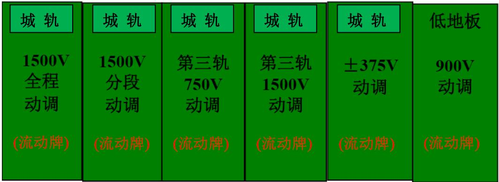
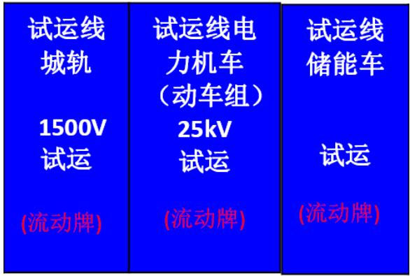

# 城轨车辆动态调试工艺指导书

1 目的及适用范围

本指导书的目的是为了规范城轨车辆动态调试作业，确保作业安全和正确性。

本指导书适用于所有在城轨动调线和机车试运线动态运行的车辆。

# 2 一般要求

# 2.1 人员要求

每列车至少有5名交车车间作业人员，包括3名调试工和2名司机。其中1名调试工具有动调资质证并作为本次行车的动调负责人，其余两名调试工具有助理动调资质证作为本次试验的瞭望及试验辅助人员，司机要求有司机证。

# 2.2 场地及环境要求

2.2.1 试验场地应为专用调试区域，并有明显的安全标识。

2.2.2 除非另有规定，试验应在铺设良好、干燥的轨道上进行。试验进行时的轨道干、湿状况应填写在试验记录中。

2.2.3 线路应有照明设施且满足夜间动调要求。

2.2.4 试验线路应有距离和限速等指示牌，指示牌显示清晰无破损。

2.2.5 试验线路应全封闭，良好无缺失。

2.2.6 暴雨、暴雪、大雾、冰冻等严重影响司机视线或行车安全，能见度在 $2 0 0 \mathrm { ~ m ~ }$ 以内的情况下严禁进行动调试验。

2.3 工具、设备要求

2.3.1 车辆应安装记录仪且运行正常，安装位置应能清晰观察到司机操作，并且记录语音。

2.3.2 动调人员应配有对讲机，其中包括与道口和调度楼联系的对讲1台，动调人员间沟通的自用对讲机3台。

所有的试验和测量设备应有合格证明，所有检测工具应在检测有效日期内。

# 2.4 车辆要求

2.4.1 车辆应进行了 Q40 交检及淋雨，经评审后可以进行动调。

2.4.2 车辆的牵引、制动系统静态试验已完成，对于试验结果不符合产品工艺文件规定的项点，需工艺确认。

2.4.3 车辆刮雨器、司机室座椅、电（汽）笛、头灯（夜间）、登车设施（如司机室扶手、

司机室登车梯等）无缺失且功能正常。

2.4.4 车辆警惕、紧急停车、安全回路功能应正常，无开口项。

2.4.5 车辆的载荷状态应符合产品工艺文件的规定。

2.4.6 车辆的牵引、制动及 TCMS 网络等所有软件均为最新发布的正式软件（在软件未定版或进行牵引、制动软件验证时，按照软件未定版车辆的动态试验作业管理要求有条件进行）。

2.4.7 车辆应配备灭火器。

3 动调线、试运线线路情况

3.1 机车试运线（交流车、直流车、标轨动车组、城轨车辆）起于涂装道口位置，止于毛塘，有效长度 $2 2 0 0 \mathrm { ~ m ~ }$ 。机车米轨区试运线（米轨车辆）起于试运线米轨道岔，止于毛塘，全长 $2 0 6 5 \mathrm { ~ m ~ }$ 。

3.2 公司机车试运线（储能车）起于储能车主站台位置，止于毛塘，有效长度 $2 5 0 0 \mathrm { ~ m ~ }$ 。

3.3 城轨动调线（以下简称动调线）全程起于起于物流中心道口，止于毛塘，有效长度2800m。半程起于 2 道口（铸造道口），止于毛塘，有效长度 $2 3 3 0 \mathrm { ~ m ~ }$ 。

3.4 三轨受流动调试验线、四轨受流动调试验线起于动调线米轨道岔以北 $1 0 0 \mathrm { ~ m ~ }$ 处，止于毛塘，全长 $1 9 2 8 \mathrm { ~ m ~ }$ 。

3.5 城轨动调线及机车试运线线路示意图见图 1，线路限速：城轨动调线限速 $1 2 0 ~ \mathrm { k m / h }$ ，道岔处限速 $7 5 \mathrm { { k m / h } }$ ，3 道口（电气道口）弯道处限速 $6 0 ~ \mathrm { k m / h }$ ；机车试运线限速 $1 0 0 \mathrm { k m / h }$ ，米轨道岔处限速 $7 5 ~ \mathrm { { k m / h } }$ ，机车试运线米轨线路限速 $6 5 ~ \mathrm { { k m / h } }$ 。

3.6 夜间作业时，车辆头灯应能正常工作，若全线照明均没有打开，不允许在未开照明的轨道区域进行试验；全线照明开启时，城轨动调线和机车试运线的试验速度不得超过80km/h。

4 动调基本作业流程

4.1 动调拖车前检查动调拖车前检查拖车准备应按照 T-71-013《城轨车辆拖车前检验文件》要求完成。

4.2 动调车辆的停放位置及登车要求

具体要求如下：

a) 如无特殊要求，车辆应停放在线路道岔以北，动调线车辆最南端的首节车司机室门应在三轨外；b) 储能车辆在调运到动调线后，应停放在“低地板充电终点”牌处，车辆受电器升

起后可以接触到站台接触网的位置，动调过程中进入动调线主站台时应停在此位置充电，动调区间北端为“三轨区终点”牌，南端为“低地板充电终点”牌，动调要求参照三轨车辆执行；c) 动调车辆过渡车钩解钩应解城轨车辆端车钩，并由牵引车将过渡车钩运至 3 道口放置。如需动调人员解钩，至少需要 3 人操作，1 人拉解钩拉环，其他 2 人负责抬车钩，由操作解钩的人发出解钩指令，其他 2 人听指令操作，将车钩放到轨道 1.5m 外；d) 米轨项目应将车辆停放在米轨区南端终点牌以北，不得越过南端终点牌；e) 动调线三轨区内车辆，应在三轨区南端终点牌处使用登车梯或简易登车梯上下车，其余位置应从司机室上下车，严禁踩踏三轨和四轨绝缘罩；f) 动调作业前，动调负责人收取司机、瞭望人员手机，放置于 3 道口，动调试验人员只能由动调负责人佩带手机，所有动调试验人员的工作证挂于 3 道口指定位置。线路及标牌见图1城轨车辆试运线路标识牌。

4.3 动调通电前静态检查

车辆到达动调线，牵引车离开动调线后才可开始对车辆进行检查。由动调负责人安排动调人员对车辆状态检查确认，并填写动调车辆状态检查表，见表1。

4.3.1 通电前静态检查项点

a) 车下设备的电气开关全部打到正常工作位；  
b) 刀开关处于正常受电位且限制销子已锁到位,库用电源的盖板盖好；  
c) 车辆气管路塞门处于正常工作位；  
d) 合蓄电池保险；  
e) 所有设备箱盖板盖好且已锁紧；  
f) 速度传感器全部连接好；  
g) 高压回流线全部连接好；  
h) 车钩，跳接电缆全部连接好，半自动解钩塞门应在非解钩位置；  
i) 车下未固定的插头或线缆须绑扎并防护处理；  
j) 车下轨道上无异物，检查并确认止轮器数量及位置；  
k) 全自动车钩的电气钩头盖板应关闭，重联后车钩和电气钩头应连挂良好；  
l）三轨受流项目应检查西侧受流器工装（如需）已按要求安装，且西侧受流器碳滑板与第三轨接近水平接触，接触面未超出第三轨。东侧受流器已拆除，拆除的线

缆做无电和绝缘处理；m）四轨受流项目应检查东侧受流器工装（如需）已按要求安装，且东侧受流器碳滑板与四轨接近水平接触，接触面未超出四轨。西侧受流器已拆除，拆除的线缆做无电和绝缘处理；n) 车上所有的转向架制动隔离塞门恢复到正常位置；o) 所有的侧顶板全部锁闭；p) 所有的门的紧急解锁开关处于正常位置且所有的门全关好；q) 恢复相应的 MCB 开关和旋钮；r) 非旁路试验状态下，所有旁路开关处于非旁路位（除 ATC 旁路）；s) 受电弓强制升弓塞门处于正常升弓位；t) 贯通道全部连接锁闭，已安装的贯通道围板应安装锁闭到位，未安装的围板须平放在车厢内并保护；u) 车上应配备灭火器；v) 司机室座椅全部安装到位；w) 司机安装记录仪，摄像头对准司机，监控司机操作；x) 注意车上设备的外观质量，已碰伤或损坏的物品器件，及时通知相关质量人员。车辆重新上线，应再进行通电前静态检查。

# 4.4 送电

# 4.4.1 城轨动调线的送电

# 4.4.1.1 城轨动调线的送电流程

动调负责人或其指派的动调人员凭工作证到物流部运输车间调度室填写《试运及动调安排情况记录》，并根据动调车辆电压制式及动调范围领取“1500V 全程动调”、“1500V分段动调”、“第三轨 750V 动调”、“第三轨 1500V 动调”“ $\pm 3 7 5 \mathrm { V }$ 动调”或“低地板900V动调”等相应的流动送停电牌，字样如下图2。

  
图 2 动调线流动送停电牌

动调负责人确认动调通电前静态检查完毕，使用自用对讲机（动调人员间沟通的自用对讲机3台，动调负责人一台，司机每人一台）与车上作业人员确认后，通知送电人员持申请审批单及领取的流动送停电牌到直流所签字要求送电，并在直流所做详细记录（包括送电电压，送电时间和送电人员姓名）。

需要投入地面吸能装置的车辆送电时，应将“动调线吸能装置投入”牌交直流所，此牌由交车车间保管使用。

4.4.1.2 城轨动调线的送电注意事项：

a） 送电人员非动调负责人时，应在送电前与动调负责人确认送电类型；送电时，送电人员应与动调负责人确认是否可以送电；  
b） 第三、四轨送电后，可通过车上网压表或司机室显示器确认高压电已送出，三、四轨区的红色警示灯应正常工作；  
c）动调线接触网送电前，2 道口横向栅栏和 3 道口应关闭；三、四轨区送出高压前，除特殊需要，3 道口进入动调线的栅栏应关闭。如有道口未关闭，应提醒道口值守人员关闭相应道口栅栏；  
d） 动调线送出高压后，送电人员应去 3 道口领取与道口联系的对讲机，并与道口人员核实对讲机频道，确认对讲机可以正常使用，此对讲机放置于车辆南端司机室，由南端司机、调试人员和动调负责人使用；  
e） 储能车辆送电时应先送副充电站（如需）后送主充电站，主充电站可使用手动充电和自动充电两种方式，动调车辆第一次充电应使用手动充电，之后可使用自动充电。副充电站只能使用手动充电方式充电。需等待充电站送出900V电，触网正常伸出，且警示灯亮后，才允许进行受电器升起等操作。

# 4.4.2 机车试运线的送电

# 4.4.2.1 机车试运线的送电流程

动调负责人或其指派的专人凭工作证到物流部运输车间调度室填写《试运及动调安排情况记录》，并根据动调车辆电压制式领取“城轨1500V试运”、“电力机车（动车组）$2 5 \mathrm { k V }$ 试运”或“储能车试运”的流动送停电牌，字样如下图 3。

  
图 3 机车试运线流动送停电牌

动调负责人确认动调通电前静态检查完毕，经与车上作业人员确认可以送电后，通知送电人员持申请审批单及领取的流动牌送交直流所签字要求送电，并在各直流所做详细记录（包括送电电压，送电时间和送电人员姓名）。

4.4.2.2 机车试运线的送电注意事项。

a） 机车试运线 DC1500V 或 $\mathrm { A C 2 5 k V }$ 送出后，需检查 3 道口位置的电压指示牌是否相应显示为“DC1500V”或“ $\mathrm { \dot { A } C 2 5 k V ^ { \prime \prime } }$ ；  
b） 送电人员非动调负责人时，应在送电前与动调负责人确认送电类型；送电时，送电人员应与动调负责人确认是否可以送电；  
c） 机车试运线送电前，涂装道口横向栅栏和 3 道口应关闭，如有道口未关闭，应提醒道口值守人员关闭相应道口栅栏；  
d） 送出高压后，送电人员应去 3 道口领取与道口联系的对讲机，并与道口人员核实对讲机频道，确认对讲机可以正常使用，此对讲机放置于车辆南端司机室，由南端司机、调试人员和动调负责人使用。

# 4.5 车辆通电前确认

所有人员上车后，动调负责人清点车上人员人数，通知动调人员下车确认车下有无非相关试验人员，并将动调线登车梯移至限界外存放处，从南端司机室上车向动调负责人报告，动调负责人确认安全后方可进行下一步操作。动调期间，任何人员上下车需向动调负责人报告。

4.6 带电静态检查

动调负责人确认车辆准备工作完成后，动调人员根据动调负责人指令给车辆送电。

a) 打开司机记录仪，激活车辆。车辆激活后，蓄电池电压表显示正常。通过司机室显示器确认所有车门状态良好且全部关闭，司机室侧门关闭；  
b) 检查刮雨器、喇叭、头灯功能是否正常；  
c) 在占有端司机室进行升弓操作，观察并确认受电弓或受流器是否正常工作。网压显示应正常；所有辅逆和充电机应正常；空压机工作，主风管风压应正常；停放制动可以正常施加、缓解。如受电弓没有升起，应检查压力表总风压力，如总风压力低，则应通过应急操作将受电弓升起；  
d) 液压制动系统车辆应先缓解保压制动，之后原地将制动重复施加和缓解 3 次，待车辆制动可以正常施加后，方可进行后续试验；  
e) 按占有端司机室内的高速断路器“合”按钮，通过司机室显示器观察高速断路器是否闭合，动调负责人确认车辆是否已达到动车状态。非连续的动调作业，应进行一次通电前确认和带电静态检查。例如：上午动调完  
成且停电，下午重新送电开始动调前应按以上步骤检查。

# 4.7 巡道

4.7.1 动调负责人确认状态正常后，通知道口负责人车辆即将动车，此时要求两个司机分别到位，另外两个动调人员每人到一个司机室内值守，协助司机监控车辆及轨道的状态，按照表 2 标准用语及手势要求作业，紧急情况下及时拍紧急停车按钮施加紧急制动。

4.7.2 动调负责人与道口负责人联系确定可以动车后，指挥司机按以下步骤动车：

a) 北端司机动车，将车向前牵引约 $1 \mathrm { ~ m ~ }$ ，常用制动停车，停车后将司机室方向手柄置于零位，施加停放制动。停车 $1 0 \mathrm { ~ s ~ }$ 后通知南端司机室司机下车将止轮器放到车上指定位置，南端司机上车后告知北端司机止轮器已解除；  
b) 北端司机在征得动调负责人同意后，继续以低于 $1 0 ~ \mathrm { { k m / h } }$ 的速度行驶约 $1 0 \mathrm { ~ m ~ }$ ，司机按主台紧急停车按钮，车辆立即紧急制动停车。恢复后司机再以低于 $1 0 ~ \mathrm { { k m / h } }$ 的速度行驶约 $1 0 \mathrm { ~ m ~ }$ ，值守动调人员按副台紧急停车按钮，车辆立即紧急制动停车（如司机室内只有一个紧急制动按钮，则只需进行一次操作）；  
c) 北端司机继续以低于 $1 0 ~ \mathrm { { k m / h } }$ 的速度行驶，松开警惕按钮，车辆延时报警并自动施加紧急制动，之后司机以不高于 $1 0 ~ \mathrm { { k m / h } }$ 的速度巡道至线路北端 “终点”牌前停车；

d) 北端助理动调下车，在西侧钢轨平齐终点牌的位置放置 1 个响墩，向北 $1 0 \mathrm { ~ m ~ }$ 的东侧钢轨上放置 1 个响墩，向北继续前行 $1 0 \mathrm { ~ m ~ }$ 的西侧钢轨上放置 1 个响墩，共放置3个，放置时应吸牢。放置完成后北端司机上车向动调负责人报告；

e) 换端给南端司机室，南端司机在征得动调负责人同意后，按照 4.7.2 的 b)、c)步骤方法测试紧急制动和警惕功能；

f) 南端司机以不高于 $1 0 ~ \mathrm { { k m / h } }$ 的速度巡道至南端“终点”标牌前。在米轨试运线试运，向北巡道时，应在北端“米轨区终点牌”前停车，向南巡道时，应在南端“米轨区终点牌”前停车。车辆在动调时，严禁越过相应终点；

g) 如车辆需通过 3 道口，则应用对讲机向道口人员确认道口是否关闭，是否可以通过，得到道口人员允许后方可通过 3 道口；

h) 储能车辆，北端巡道至“终点”牌前，南端巡道至 “低地板充电终点”牌，此牌视为其动调南端终点。巡道前，北端司机在显示器上确认车辆充电电流小于 5A 后，再进行动车巡道。如受电弓有自动降弓功能，应先降弓，后动车。司机巡道至充电站前，速度应降至 $5 ~ \mathrm { k m / h }$ ，进入充电站，并将车头位置对标至“低地板充电终点”牌处停车，车辆开始充电，充电电流小于 5 A 后，应通知北端司机将车辆开出充电区域（如有自动降弓功能，应先降弓），再进行后续试验。充电站手动充电及自动充电操作方法见 T035_MD_2016《动调线主站台地面充电站作业指导书》。

非连续的动调作业，作业前应按以上步骤巡道检查。例如：上午动调完成且停电，下午重新送电开始动调前应按以上步骤巡道检查。

4.7.3 在巡道及运行过程中，要求检查瞭望的项点：

a) 道岔位置正确且已上锁，可正面看见“V”字型扳道牌表示不可直行，道岔防脱轨装置应在非工作状态且锁闭（低地板车辆动调时道岔防脱轨装置应处于工作状态），如不符合要求，车辆应停止动调；  
b) 线路区域内应无任何无关人员；  
c) 轨道面及车辆限界内无异物；  
d) 相应道口门已关闭；  
e) 车辆有明显摆动或异响，应立即停车，并及时向动调负责人报告处理；  
f) 检查线路围墙是否有缺口，如有应立即停止动调，并通知动调负责人上报处理；  
g) 动调线送触网 DC1500V 后，在巡道时应确认三、四轨区域的警示灯不亮，方可继续巡道；