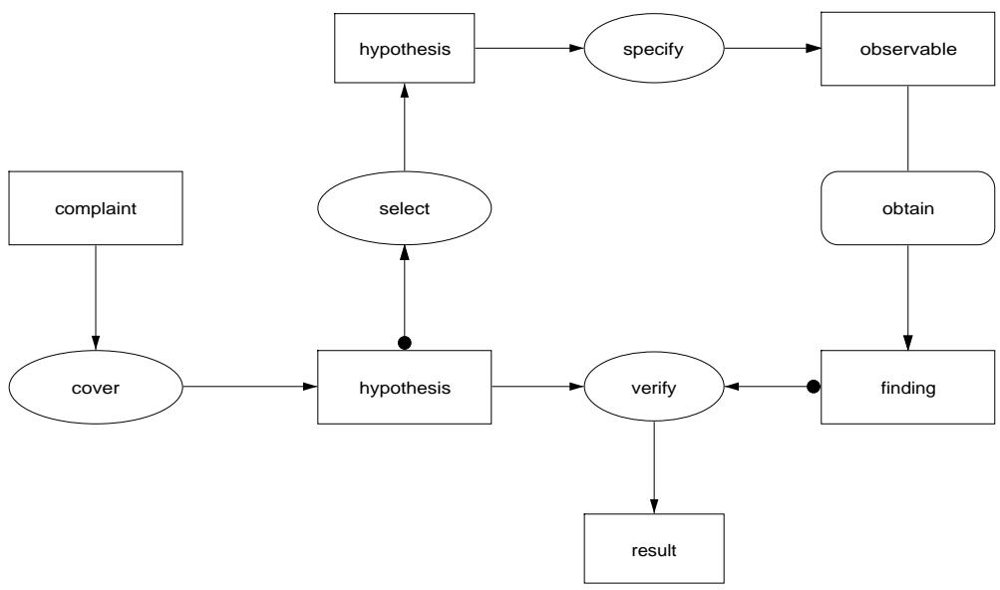

1. Specification of case data: this is often a combination of features of two domain types, e.g., the applicant and the requested loan (in the loan assessment domain). 2. Case abstraction knowledge: specifies dependencies between case data (see the hasabstraction rule type in Figure 6.7). 3. Norm-evaluation knowledge: specifies logical dependencies between case data and norms. As discussed, norm-ordering knowledge can be added as well. 4. Decision knowledge: specifies the decision options that can act as task output, as well as logical dependencies between norm values and a particular decision.

This schema is phrased in domain-neutral terms. For a particular application these types have to mapped onto domain-specific types. For example, the case data have to be linked to domain types that represent the case, e.g., a loan-applicant and a loan.

# 6.5 Diagnosis

# General characterization

<table><tr><td rowspan=2 colspan=5>Goal</td><td rowspan=3 colspan=1>Find the fault that causes a system to malfunctionDiagnosis of a technical device, such as a copier.</td></tr><tr><td rowspan=1 colspan=2></td></tr><tr><td rowspan=7 colspan=5>Typical exampleTerminology</td><td rowspan=1 colspan=1></td></tr><tr><td rowspan=1 colspan=1>Complaint/symptom: the data that initiate a diagnostic process</td></tr><tr><td rowspan=1 colspan=1>Hypothesis: a potential solution (thus a fault)Differential: the set of active hypotheses</td></tr><tr><td rowspan=1 colspan=1>Finding(s)/evidence: additional data about the system being di</td></tr><tr><td rowspan=1 colspan=1>agnosed</td></tr><tr><td rowspan=1 colspan=1>Fault: the solution found by the diagnostic reasoning process.</td></tr><tr><td rowspan=1 colspan=2></td><td rowspan=1 colspan=1>The nature of the fault representation varies, e.g., an internal sys</td></tr><tr><td rowspan=1 colspan=5></td><td rowspan=3 colspan=1>tem state, a component, a causal chain, or a heuristic label.Symptoms and/or complaintsFault(s) plus the evidence gathered for the fault(s)</td></tr><tr><td rowspan=9 colspan=5>InputOutputFeatures</td></tr><tr><td rowspan=1 colspan=4>Output</td></tr><tr><td rowspan=1 colspan=4>Features</td><td rowspan=1 colspan=1>In principle, a diagnosis task should always have some model of</td></tr><tr><td rowspan=2 colspan=4></td><td rowspan=1 colspan=1>the behavior of the system being diagnosed. Sometimes however,</td></tr><tr><td rowspan=1 colspan=1>a diagnosis task is reduced to a classification task by replacing</td></tr><tr><td rowspan=1 colspan=4></td><td rowspan=1 colspan=1>the behavioral model with direct associations between symptoms</td></tr><tr><td rowspan=1 colspan=2></td><td rowspan=1 colspan=3></td><td rowspan=1 colspan=1>and faults. In the default method we assume that the underlying</td></tr><tr><td rowspan=2 colspan=4></td><td rowspan=1 colspan=1></td><td rowspan=1 colspan=1>domain knowledge contains an (albeit quite simple) causal model</td></tr><tr><td rowspan=1 colspan=1>of system behavior.</td></tr></table>

Default method The default method is somewhat different from the method used in the car-diagnosis application of Chapter 5. The method assumes a simple causal model in which symptoms and potential faults are placed in a causal network, and in which internal system states act as intermediate nodes. The network also contains causal links that indicate typical findings for some state (see the domain schema further on).

TASK diagnosis; ROLES: INPUT: complaint: "Finding that initiates the diagnostic process"; OUTPUT: faults: "the faults that could have caused the complaint"; evidence: "the evidence gathered during diagnosis";   
END TASK diagnosis;   
TASK-METHOD causal-covering; REALIZES: diagnosis; DECOMPOSITION: INFERENCES: cover, select, specify, verify; TRANSFER-FUNCTIONS: obtain; ROLES: INTERMEDIATE: differential: "active candidate solutions"; hypothesis: "candidate solution"; result: "boolean indicating result of the test"; expected-finding: "data one would normally expect to find"; actual-finding: "the data actually observed in practice"; CONTROL-STRUCTURE: WHILE NEW-SOLUTION cover(complaint -> hypothesis) DO differential : $=$ hypothesis ADD differential; END WHILE REPEAT select(differential $- >$ hypothesis); specify(hypothesis $- >$ observable); obtain(observable -> finding); evidence : $: =$ finding ADD evidence; FOR-EACH hypothesis IN differential DO verify(hypothesis $^ +$ evidence -> result); IF result $= =$ false THEN differential : $=$ differential SUBTRACT hypothesis; END IF END FOR-EACH UNTIL SIZE differential $< = ~ 1$ OR "no more observables left"; END REPEAT faults : $=$ differential;   
END TASK-METHOD causal-covering;

  
Figure 6.9 Inference structure for the default diagnostic method.

Figure 6.8 shows the method specification. The corresponding inference structure is shown in Figure 6.9. The method follows a generate-and-test strategy. The method decomposes the diagnosis task into five subfunctions: four inferences and one transfer function, which are briefly discussed below.

 Cover This inference searches backward through a causal network to find potential causes of the complaint. This inference is executed until no more hypotheses can be found. The set of hypotheses is placed in the differential.   
 Select The select inference selects one hypothesis from the differential. We assume that a simple form of preference knowledge is used in this selection process, e.g., knowledge about the a priori probability of the fault.   
 Specify This inference specifies some observable entity, the value of which can be used to limit the number of candidate faults. The observable may not only tell us something about the presence of the hypothesis that acts as input for this step but can also be used to rule out other hypotheses.   
 Obtain This is a simple transfer function to obtain the actual value of the observable used for testing the candidates. Verify This inference is used to check a candidate fault (a hypothesis). The result is a

boolean, indicating whether the candidate should be kept in the differential. The verify step can be modelled as a single inference in the case of a simple verification method such as the one used in the car-diagnosis application, where the domain knowledge is assumed to contain direct association between hypotheses and expected values of observables. However, in many applications the verify step will need to be modelled in more detail. Some frequently occurring variations are discussed further on.

The last four functions are executed in a loop in which the candidates are tested in the order dictated by the select inference. The loop terminates either when the differential contains at most one hypothesis or when no more observables can be specified. Thus, the method can lead to three situations:

1. The differential is empty: no fault is found. This implies that the evidence is inconsistent with all faults known to the system.   
2. Precisely one solution is found. This is usually the ideal outcome.   
3. A set of faults remains. The system cannot differentiate between the remaining fault candidates.

Method variations The method sketched is in fact a simple form of what is called “model-based diagnosis” in the literature. There is a complete research field connected to diagnosis, and knowledge engineers interested in complex diagnostic applications will probably make themselves familiar with this literature. A good starting point is the library of diagnostic methods described by Benjamins (1993). The default method described here is a variation of one of the methods described by Benjamins. Here, we limit the discussion to a few common and relatively simple extensions and variations of the diagnostic method without any claim of completeness.

 Verification through explanation or consistency In the verify step several techniques can be used. For example, one can either require that all findings need to be fully explained by the hypotheses, or alternatively that the hypotheses only need to be consistent with the evidence found. The latter option is the most common one, because we usually do not have complete knowledge to enforce explanation-based diagnosis. Mixed forms are also possible, e.g., by stating that only a subset of the findings needs to be explained. One usually requires that at least the initial complaint is explained.

Abstraction of findings Often it is useful to add an inference in which one tries to find an abstraction of the findings obtained. Knowledge about faults is often expressed in abstract terminology, which does not relate directly to the findings found.

 Multiple faults The default method assumes that there is only one fault that causes the complaint. If this assumption cannot be made, the method has to be refined. This can be done by inserting an inference after the cover step that transforms the differential into a set of potential fault sets. A common way of realizing this inference is through set covering.

  
Figure 6.10 Typical domain schema for diagnosis.

Fault selection A the end of the method we can introduce an inference that, if necessary, selects the most promising ones from the remaining fault candidates. Several preference techniques exist for this. The introduction of this step is particularly useful if the method is extended to cope with multiple faults, because in that case the number of hypotheses usually increases considerably and the verification step may not be able to rule out a sufficient number of candidates.

 Add simulation methods In the verification step one can use simulation methods to derive expected values for findings. This requires two major extensions:

1. Additional domain knowledge about system behavior, e.g., a model that can be used for quantitative or qualitative prediction of behavior.

2. A separate prediction step within verification. Note that prediction can be a complex task in its own right.

Typical domain schema Figure 6.10 shows a typical domain schema for simple diagnosis. It assumes that each system being diagnosed can be characterized in terms of a number of system features. There are two types of system features, namely those that can be observed (e.g., a certain color) and those that represent an internal state of the system (e.g., some disease process). Faults are defined as subtypes of internal states, meaning that not every internal system state may act as a fault. For example, often only the starting points in the causal networks are allowed as faults, as is the case in the car-diagnosis example.