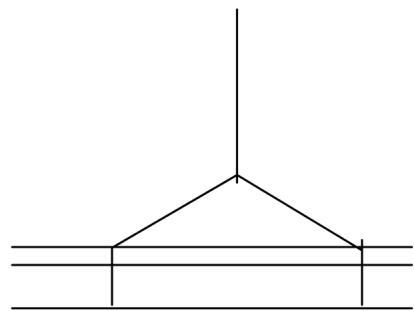

# 湖北普龙消防设备有限公司Q/PL3---2014

# 生产工艺流程作业指导书

第 A 版

编制：审核：批准：

# 工艺作业指导书目录

总2页第1页  

<table><tr><td rowspan=1 colspan=1>序号</td><td rowspan=1 colspan=1>编号</td><td rowspan=1 colspan=1>标题</td><td rowspan=1 colspan=1>修订状态</td><td rowspan=1 colspan=1>页码</td></tr><tr><td rowspan=1 colspan=1>1</td><td rowspan=1 colspan=1>Q/PL3-01</td><td rowspan=1 colspan=1>自动制管作业指导书</td><td rowspan=1 colspan=1>0</td><td rowspan=1 colspan=1></td></tr><tr><td rowspan=1 colspan=1>2</td><td rowspan=1 colspan=1>Q/PL3-02</td><td rowspan=1 colspan=1>五吨行吊吊装作业指导书</td><td rowspan=1 colspan=1>0</td><td rowspan=1 colspan=1></td></tr><tr><td rowspan=1 colspan=1>3</td><td rowspan=1 colspan=1>Q/PL3-03</td><td rowspan=1 colspan=1>灭火器筒身剪切下料作业指导书</td><td rowspan=1 colspan=1>0</td><td rowspan=1 colspan=1></td></tr><tr><td rowspan=1 colspan=1>4</td><td rowspan=1 colspan=1>Q/PL3-04</td><td rowspan=1 colspan=1>灭火器上下封头冲压成形作业指导书</td><td rowspan=1 colspan=1>0</td><td rowspan=1 colspan=1></td></tr><tr><td rowspan=1 colspan=1>5</td><td rowspan=1 colspan=1>Q/PL3-05</td><td rowspan=1 colspan=1>灭火器底座冲压成形作业指导书</td><td rowspan=1 colspan=1>0</td><td rowspan=1 colspan=1></td></tr><tr><td rowspan=1 colspan=1>6</td><td rowspan=1 colspan=1>Q/PL3-06</td><td rowspan=1 colspan=1>灭火器底座冲孔作业指导书</td><td rowspan=1 colspan=1>0</td><td rowspan=1 colspan=1></td></tr><tr><td rowspan=1 colspan=1>7</td><td rowspan=1 colspan=1>Q/PL3-07</td><td rowspan=1 colspan=1>灭火器底座切边轧筋作业指导书</td><td rowspan=1 colspan=1>0</td><td rowspan=1 colspan=1></td></tr><tr><td rowspan=1 colspan=1>8</td><td rowspan=1 colspan=1>Q/PL3-08</td><td rowspan=1 colspan=1>灭火器底座打码作业指导书</td><td rowspan=1 colspan=1>0</td><td rowspan=1 colspan=1></td></tr><tr><td rowspan=1 colspan=1>9</td><td rowspan=1 colspan=1>Q/PL3-09</td><td rowspan=1 colspan=1>灭火器底座钻孔作业指导书</td><td rowspan=1 colspan=1>0</td><td rowspan=1 colspan=1></td></tr><tr><td rowspan=1 colspan=1>10</td><td rowspan=1 colspan=1>Q/PL3-10</td><td rowspan=1 colspan=1>灭火器筒身焊接定位缺口冲压作业指导书</td><td rowspan=1 colspan=1>0</td><td rowspan=1 colspan=1></td></tr><tr><td rowspan=1 colspan=1>11</td><td rowspan=1 colspan=1>Q/PL3-11</td><td rowspan=1 colspan=1>灭火器筒身卷圆作业指导书</td><td rowspan=1 colspan=1>0</td><td rowspan=1 colspan=1></td></tr><tr><td rowspan=1 colspan=1>12</td><td rowspan=1 colspan=1>Q/PL3-12</td><td rowspan=1 colspan=1>灭火器筒身直焊作业指导书</td><td rowspan=1 colspan=1>0</td><td rowspan=1 colspan=1></td></tr><tr><td rowspan=1 colspan=1>13</td><td rowspan=1 colspan=1>Q/PL3-13</td><td rowspan=1 colspan=1>灭火器筒身收口作业指导书</td><td rowspan=1 colspan=1>0</td><td rowspan=1 colspan=1></td></tr><tr><td rowspan=1 colspan=1>14</td><td rowspan=1 colspan=1>Q/PL3-14</td><td rowspan=1 colspan=1>灭火器环焊作业指导书</td><td rowspan=1 colspan=1>0</td><td rowspan=1 colspan=1></td></tr><tr><td rowspan=1 colspan=1>15</td><td rowspan=1 colspan=1>Q/PL3-15</td><td rowspan=1 colspan=1>灭火器补焊作业指导书</td><td rowspan=1 colspan=1>0</td><td rowspan=1 colspan=1></td></tr><tr><td rowspan=1 colspan=1>16</td><td rowspan=1 colspan=1>Q/PL3-16</td><td rowspan=1 colspan=1>灭火器水压检验作业指导书</td><td rowspan=1 colspan=1>0</td><td rowspan=1 colspan=1></td></tr><tr><td rowspan=1 colspan=1>17</td><td rowspan=1 colspan=1>Q/PL3-17</td><td rowspan=1 colspan=1>灭火器气密性检验作业指导书</td><td rowspan=1 colspan=1>0</td><td rowspan=1 colspan=1></td></tr><tr><td rowspan=1 colspan=1>18</td><td rowspan=1 colspan=1>Q/PL3-18</td><td rowspan=1 colspan=1>灭火器底座装配作业指导书</td><td rowspan=1 colspan=1>0</td><td rowspan=1 colspan=1></td></tr><tr><td rowspan=1 colspan=1>19</td><td rowspan=1 colspan=1>Q/PL3-19</td><td rowspan=1 colspan=1>灭火器机械除锈作业指导书</td><td rowspan=1 colspan=1>0</td><td rowspan=1 colspan=1></td></tr><tr><td rowspan=1 colspan=1>20</td><td rowspan=1 colspan=1>Q/PL3-20</td><td rowspan=1 colspan=1>灭火器表面喷涂作业指导书</td><td rowspan=1 colspan=1>0</td><td rowspan=1 colspan=1></td></tr><tr><td rowspan=1 colspan=1>21</td><td rowspan=1 colspan=1>Q/PL3-21</td><td rowspan=1 colspan=1>灭火器组装作业指导书</td><td rowspan=1 colspan=1>0</td><td rowspan=1 colspan=1></td></tr><tr><td rowspan=1 colspan=1>22</td><td rowspan=1 colspan=1>Q/PL3-22</td><td rowspan=1 colspan=1>灭火器浸水检验作业指导书</td><td rowspan=1 colspan=1>0</td><td rowspan=1 colspan=1></td></tr><tr><td rowspan=1 colspan=1>23</td><td rowspan=1 colspan=1>Q/PL3-23</td><td rowspan=1 colspan=1>灭火器气压稳定性检验作业指导书</td><td rowspan=1 colspan=1>0</td><td rowspan=1 colspan=1></td></tr><tr><td rowspan=1 colspan=1>24</td><td rowspan=1 colspan=1>Q/PL3-24</td><td rowspan=1 colspan=1>灭火器包装作业指导书</td><td rowspan=1 colspan=1>0</td><td rowspan=1 colspan=1></td></tr><tr><td rowspan=1 colspan=1>25</td><td rowspan=1 colspan=1>Q/PL3-25</td><td rowspan=1 colspan=1>灭火器装卸作业指导书</td><td rowspan=1 colspan=1>0</td><td rowspan=1 colspan=1></td></tr><tr><td rowspan=1 colspan=1>26</td><td rowspan=1 colspan=1>Q/PL3-26</td><td rowspan=1 colspan=1>推车式灭火器车架加工作业指导书</td><td rowspan=1 colspan=1>0</td><td rowspan=1 colspan=1></td></tr><tr><td rowspan=1 colspan=1>27</td><td rowspan=1 colspan=1>Q/PL3-27</td><td rowspan=1 colspan=1>推车式灭火器组装作业指导书</td><td rowspan=1 colspan=1>0</td><td rowspan=1 colspan=1></td></tr><tr><td rowspan=1 colspan=1>28</td><td rowspan=1 colspan=1>Q/PL3-28</td><td rowspan=1 colspan=1>推车式灭火器检验作业指导书</td><td rowspan=1 colspan=1>0</td><td rowspan=1 colspan=1></td></tr><tr><td rowspan=1 colspan=1>29</td><td rowspan=1 colspan=1>Q/PL3-29</td><td rowspan=1 colspan=1>推车式灭火器成品包装作业指导书</td><td rowspan=1 colspan=1>0</td><td rowspan=1 colspan=1></td></tr><tr><td rowspan=1 colspan=1>30</td><td rowspan=1 colspan=1>Q/PL3-30</td><td rowspan=1 colspan=1>切割机切割作业指导书</td><td rowspan=1 colspan=1>0</td><td rowspan=1 colspan=1></td></tr><tr><td rowspan=1 colspan=1>31</td><td rowspan=1 colspan=1>Q/PL3-31</td><td rowspan=1 colspan=1>砂轮机磨削作业指导书</td><td rowspan=1 colspan=1>0</td><td rowspan=1 colspan=1></td></tr><tr><td rowspan=1 colspan=1>32</td><td rowspan=1 colspan=1>Q/PL3-32</td><td rowspan=1 colspan=1>台钻钻孔作业指导书</td><td rowspan=1 colspan=1>0</td><td rowspan=1 colspan=1></td></tr><tr><td rowspan=1 colspan=1>33</td><td rowspan=1 colspan=1>Q/PL3-33</td><td rowspan=1 colspan=1>普通电焊、气割作业指导书</td><td rowspan=1 colspan=1>0</td><td rowspan=1 colspan=1></td></tr><tr><td rowspan=1 colspan=1>3</td><td rowspan=1 colspan=1>Q/PL3-34</td><td rowspan=1 colspan=1>物料运输、堆码作业指导书</td><td rowspan=1 colspan=1>0</td><td rowspan=1 colspan=1></td></tr><tr><td rowspan=1 colspan=1>35</td><td rowspan=1 colspan=1>Q/PL3-35</td><td rowspan=1 colspan=1>钳工作业指导书</td><td rowspan=1 colspan=1>0</td><td rowspan=1 colspan=1></td></tr><tr><td rowspan=1 colspan=1>36</td><td rowspan=1 colspan=1>Q/PL3-36</td><td rowspan=1 colspan=1>电工作业指导书</td><td rowspan=1 colspan=1>0</td><td rowspan=1 colspan=1></td></tr><tr><td rowspan=1 colspan=1>37</td><td rowspan=1 colspan=1>Q/PL3-37</td><td rowspan=1 colspan=1>水基型灭火器灌装、组装作业指导书</td><td rowspan=1 colspan=1>0</td><td rowspan=1 colspan=1></td></tr><tr><td rowspan=1 colspan=1>38</td><td rowspan=1 colspan=1>Q/PL3-38</td><td rowspan=1 colspan=1></td><td rowspan=1 colspan=1></td><td rowspan=1 colspan=1></td></tr></table>

# 自动制管生产线作业指导书

1.适用范围：

本作业指导书适用于3、4型手提式灭火器筒体自动制管生产线的作业指导。

2.使用设备：自动制管机、焊机、无屑切管机组成的成套生产线。

3.检测器具：

0-500 游标卡尺

4.使用材料：

厚 $1 . 2 0 \mathrm { m m }$ 、宽 $4 0 4 . 8 \mathrm { m m }$ 钢带

5.作业程序

5.1 作业准备

5.1.1 设备检查

5.1.1.1 空载检查行吊是否能前后、左右、上下正常运转。

5.1.1.2 将制管、切管设备启动空载运行，检查电、气管路和设备是否运转正常，有无不正常动作和异常音响。发现问题及时排除。严禁带病运转。

5.1.1.3 对设备中应润滑的部位应加注润滑油，检查切管刀片是否应该更换，进刀是否合适。

5.1.1.4 设定切管机切割工件的长度。

5.1.2备料

5.1.2.1 将整件卷材用五吨行吊移至吊装工位，用电动葫芦将其吊起安放在开平机料架主轴适当位置上，并安装两侧固定架，顶紧中心固定块，使钢圈不致晃动，又能灵活转动。在吊装过程中，注意不使钢带两侧受损。同时注意钢带方向，钢带从上部抽出开平为正确，反之错误。

# 5.1.3 清理作业现场

5.1.3.1 将行吊钩升高至 $2 \mathrm { m }$ 以上，并移至非制管线上方位置。

5.1.3.2 将所有工具、材料、杂物撤离工作区域，保证工作区域整洁、干净,不妨碍行走。

5.2 装机调试

5.2.1 去除钢卷包装，剪断去除钢卷包装钢带。

5.2.2将电机调速旋钮调到最低档后开机，并将钢带一端从上部抽出，对准挤管模进口处的导引模中，并根据实际情况调整压力，使钢板产生纵向弧状形变，并逐渐对后面的模具进行调整，使钢板纵向形变逐渐扩大，最终成圆筒状。

5.2.3检查成形后的钢管是否符合焊接要求，焊接处两侧既无间隙又不重叠为最佳焊接工况。如达不到最佳焊接工况要求，可采取调整模具压力、调整电机转速，或调整电机转动方向，使主机反转进行重复旋压。遇有紧急情况，可按动急停按钮，停止作业。

# 5.3试焊

5.3.1打开氩气瓶阀门，调至合适的气压，启动循环冷却水泵，调整焊枪位置、角度，使钨极对准焊缝并锁死。

5.3.2 将试焊电流初调至220A左右，同时启动“调速电机开关”、“焊机开关”、“引弧开关”，焊接作业即开始，根据焊缝情况，适当调整电流、电压和焊枪位置，以求达到不虚焊、不漏焊、不击穿、焊缝平直的最佳焊接效果。如发现问题或更换焊丝时，必须按下停止按钮，停止制管。

# 5.4试割

5.4.1 制管开始前，安装调好切割刀片，并根据管子直径和工件长度调好行程开关和夹紧装置。

5.4.2 接通气源，开启气阀。

5.4.3焊好的管子行进到切割位置，触动控制开关，夹紧装置夹紧管子，切割开始。在整个切割过程中，切割机随移动的管子同步移动，直至切割完成。此时，夹紧装置松开，切割机自动退回重复进行切割过程。

5.4.4．当挤管、焊接、切割三道工序能协调动作时，即可进行制管作业。

6.停机

6.1 当需要上料、更换焊丝和氩气以及发现设备异常或发现工件质量有问题时，必须停机检查，找出原因，及时排除，不得带病运转。

6.2 每天作业完成，必须关闭水、电、气开关阀门，清扫现场。

6.3 生产的工件，必须撤离工作现场，堆放到指定位置，或转运到下道工序，不合格品另行堆放，做好标识。

7．设备维护和安全生产

7.1 操作人员必须遵守劳动纪律和工艺纪律，工作时间必须坚守岗位，不得擅离职守，对设备运转和产品质量实行不间断的监控。

7.2 坚持开机前加油润滑、关机后清扫现场的设备维护这一基本要求，保证设备技术状况良好和整洁有序的操作现场。

7.3 设备运转时，不可用手触摸工件，检查焊缝情况时，必须戴防护眼镜或面罩，以防灼伤眼睛。

7.4 材料上架时，吊装动作要轻缓、平稳，避免与设备产生碰撞，对设备和材料造成损伤。

7.5 吊装作业结束，将电动葫芦移至安全位置，不要滞留在制管线和操作区域的上方，吊钩必须升高至 $2 \mathrm { m }$ 以上。

7.6 吊装物品重量不得超过吊装设备额定重量的 $90 \%$ ，即 $5 \times 0 . 9 { = } 4 . 5$ 吨，同时，吊装物品不得在空中长时间悬停。

# 五吨行吊吊装作业指导书

Q/PL3-02

1.适用范围：

本指导书适用于五吨行吊吊装作业的指导。

2.操作指南。

2.1.在吊装作业前，对吊装进行空载试运转，分别进行向前、向后、上升、下降各种作业状况的实际操作，发现异常，查找原因，及时排除，认无异常时方可进行重载吊装作业。

2.2.吊装重物时，根据不同吊装物品的外形、材质等不同状况，选用不同的吊具：钢卷用专用吊钩，易损品用吊带，硬质重物用钢丝绳。绑吊装物品时，如物品本身无钩挂处的，必须根据物品重心，合理确定捆扎部位，以保证起吊后保持平衡。一般情况呈三角形，如图：

2.3.吊装物品时，动作要平稳、轻缓，先试吊到合适高度，观察物品离地面后是否保持平衡、捆扎是否牢固，当需要移位时，在离地不超过一米时停止上升，进行移位作业。吊装长形物品时，可在一端栓上细绳，以控制物品晃动。当吊装物晃动幅度大时，可暂停动作，待其停止晃动时作业，直至工作完成。

3.安全操作和设备保养规程。

吊装前要确认吊装物品的重量不超过行吊额定吨位的 $90 \%$ ，即 $5 \mathrm { x } 0 . 9 \mathrm { = } 4 . 5$ 吨。

3.2.吊装作业时动作要平稳、轻缓，尽量减少吊装物的晃动。

3.3.不可将重物长时间吊离地面、停留在高空处。

3.4.作业结束时，将电动葫芦移至导轨棵一端，并将吊钩升至二米以上，以免操作人员行走时碰头。

3.5.每次作业完成，清除作业现场，保持作业现场整洁、有序。

3.6.物品堆放要整齐、稳当，下层放大件，上层放小件，码放整齐，不得超高。圆形物品落地后塞上三角形物品（如角铁），防止滚动。

3.7.定期检查电动葫芦导轮有否破损，固定螺母是否松动、油面是否正常、吊具是否有断裂情况，发现问题及时排除。