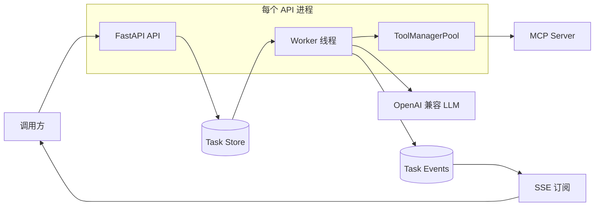
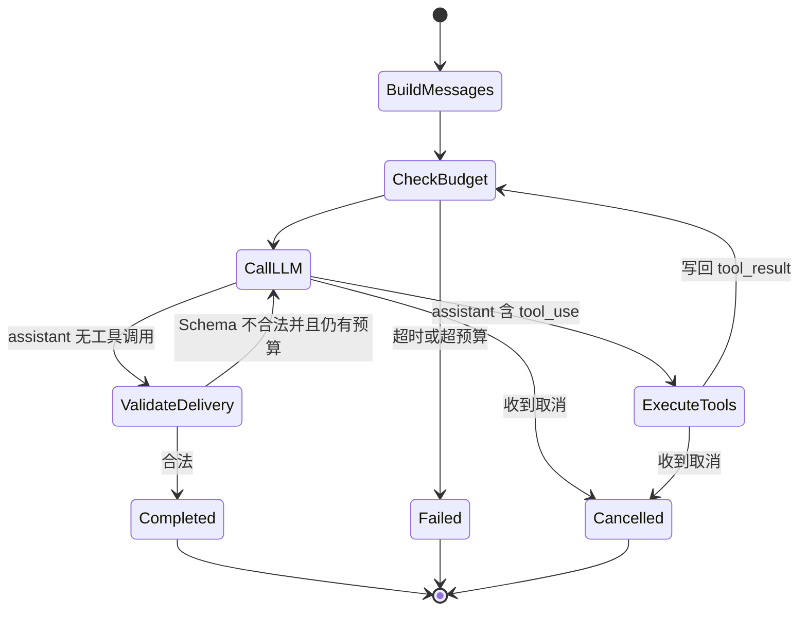
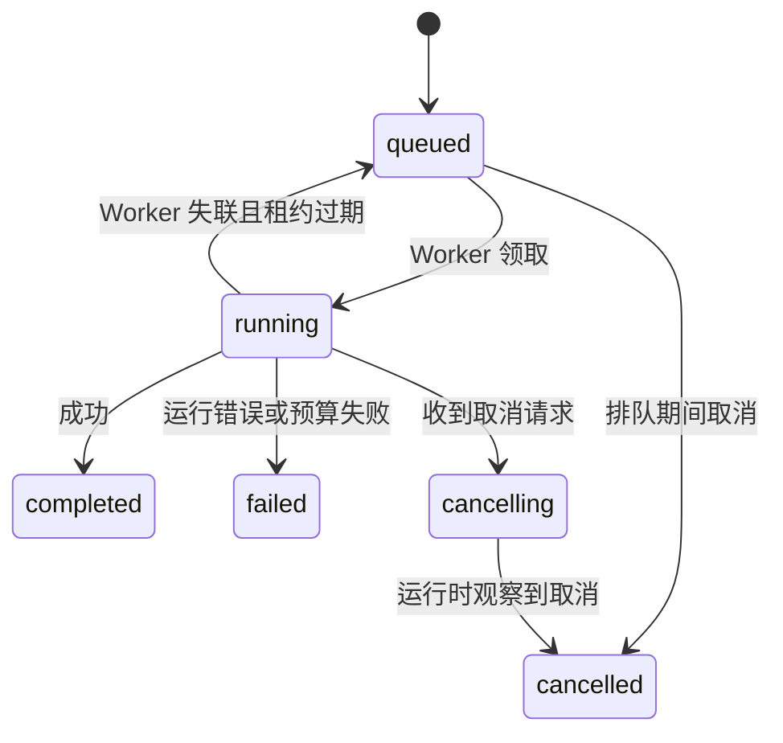

# AgentCode 架构设计

本文描述 AgentCode 0.3.0 的实际运行架构、组件职责、并发模型、任务可靠性和已知边界。接口字段以[接口参考](../接口/Agent接口参考.md)为准，部署参数以[部署运维指南](部署运维指南.md)为准。

## 一、设计目标

AgentCode 的核心目标是提供一套与业务领域解耦的单 Agent 执行内核：

1. Agent loop 只关心消息、工具、预算和终稿；
2. 业务能力通过 MCP Server 提供；
3. 场景知识通过 Skill 提供；
4. HTTP 层采用异步任务模型，避免长时间占用普通请求；
5. 单进程开发和 Redis 多进程部署使用相同接口；
6. 任务状态、实时事件和 Trace 可以被外部系统观察。

AgentCode 不在 `runtime.py` 中编写知识图谱、SQL 或文档处理等业务分支。QASystem 当前通过统一的 `qasystem-tools` MCP Server 暴露这些能力。

## 二、总体架构



Redis 部署中，Task Store 和 Task Events 都位于 Redis。API 请求、实际执行任务的 Worker 和 SSE 连接可以处于不同进程。

内存模式中，所有状态只存在于当前 Python 进程，适合本地开发和单进程测试。

## 三、组件职责

### 3.1 API 层

源码：`agentcode/api.py`

API 层负责：

- 校验请求参数；
- 生成 `task_id`；
- 将请求写入 Task Store；
- 查询或取消任务；
- 将任务事件转换为 SSE；
- 在 lifespan 中启动和关闭 Worker、ToolManagerPool。

API 层不直接调用 LLM，也不直接执行工具。

### 3.2 Worker

源码：`agentcode/worker.py`

每个 Worker 是一个同步线程，循环执行：

```text
dequeue → renew lease → build config → borrow ToolManager
        → run AgentRuntime → persist result → acknowledge task
```

每个线程持有一个可复用的 LLM HTTP Client。ToolManager 从连接池借用，任务结束后归还。

### 3.3 AgentRuntime

源码：`agentcode/runtime.py`

AgentRuntime 是不依赖 FastAPI 和 Redis 的执行内核。输入包括：

- `SessionConfig`；
- 当前用户消息；
- `LLMBackend`；
- `ToolManager`；
- `TraceSink`；
- 可选 `CancellationToken`。

输出统一为 `FinalResult`。

### 3.4 ToolManager 与 MCPToolWrapper

源码：

- `agentcode/tools/mcp_tools/tool_manager.py`
- `agentcode/tools/mcp_tools/mcp.py`

ToolManager 合并远程 MCP 工具和内置工具，并提供：

- 工具列表；
- glob 白名单判断；
- 顺序或并行调用；
- 工具错误规范化；
- 重试和超时传递。

每个 MCPToolWrapper 有一个常驻 asyncio 事件循环线程。同步 Worker 通过 `run_coroutine_threadsafe` 调用 MCP，避免每次工具调用创建新事件循环，也允许同一轮并行调度多个工具。

### 3.5 SkillLoader

源码：`agentcode/skillsets/loader.py`

SkillLoader 扫描 `skills/**/SKILL.md`，读取 frontmatter 元数据。系统提示词只注入 Skill 的名称和描述；模型调用 `Skill` 工具后，运行时再读取完整正文并作为内部消息加入上下文。

这种按需加载方式避免所有 Skill 正文同时占用上下文。

### 3.6 Task Store

源码：`agentcode/task_store.py`

Task Store 有两种实现：

| 实现 | 使用场景 | 特性 |
| --- | --- | --- |
| `_MemoryQueue` | 单进程开发、测试 | 无外部依赖；进程退出后全部丢失 |
| `_RedisQueue` | 多进程和生产部署 | 共享队列、processing、租约、TTL、Redis Stream |

调用方通过模块级函数访问，不依赖具体实现。

### 3.7 StreamBroker

源码：`agentcode/stream_broker.py`

StreamBroker 不再保存进程内订阅队列。它是 Task Store 事件接口的薄封装：

- Worker 同步调用 `publish()`；
- SSE 异步调用 `subscribe()`；
- 订阅按游标读取；
- 15 秒无事件时产生 heartbeat。

Redis Stream 使多个订阅者可以独立读取同一个任务的完整事件，而不是互相竞争消息。

## 四、Agent 执行循环



执行细节：

1. 构建 system 和 user 消息；
2. 获取 MCP/内置工具 schema；
3. 检查取消、墙钟时间和最大轮次；
4. 调用 LLM；
5. 解析 `tool_use`；
6. 校验白名单、重复动作和工具预算；
7. 调用工具并写入 `role=tool` 消息；
8. 无工具调用时解析终稿；
9. 如果配置了 `DeliveryConfig`，用 JSON Schema 校验；
10. 写 Trace 并返回 `FinalResult`。

### 4.1 turn 的定义

`turn` 是 LLM 调用次数，不是 HTTP 请求数量，也不是自然语言多轮会话数量。

以下行为都会增加 turn：

- 首次调用 LLM；
- 工具返回后再次调用 LLM；
- Delivery Schema 不合法后的修正调用；
- 空响应后的恢复调用。

### 4.2 工具调用结果

运行时内部格式：

```json
{
  "type": "tool_result",
  "tool_use_id": "call-1",
  "name": "qasystem-tools__search_graph",
  "is_error": false,
  "content": "...",
  "error_code": null,
  "error": null
}
```

模型适配层会把每个结果转换为 OpenAI 格式的独立 `role=tool` 消息。

## 五、消息模型

AgentCode 内部使用 block 形式：

```json
{
  "role": "assistant",
  "content": [
    {"type": "text", "text": "我先查询图谱。"},
    {
      "type": "tool_use",
      "id": "call-1",
      "name": "qasystem-tools__search_graph",
      "input": {"start_entity_id": "123"}
    }
  ]
}
```

支持的核心 role：

- `system`；
- `developer`，发送 OpenAI 兼容接口时映射为 system；
- `user`；
- `assistant`；
- `tool`。

## 六、任务状态机



终态是：

- `completed`；
- `failed`；
- `cancelled`。

终态任务会从 Redis processing 和待执行队列中移除，但任务 Hash 和事件 Stream 会保留到 TTL 到期。

## 七、Redis 可靠性语义

### 7.1 领取与确认

Redis 使用主队列和 processing 队列：

1. API 将任务 `LPUSH` 到主队列；
2. Worker 使用 `BRPOPLPUSH` 原子移动到 processing；
3. Worker 将任务状态改为 `running` 并写入 `claimed_at`；
4. 执行期间每 30 秒刷新租约；
5. 进入终态后，从 processing 移除。

### 7.2 崩溃恢复

Worker 在领取任务后崩溃时，任务 ID 仍在 processing。其他 Worker 在领取任务前扫描 processing：

- 如果租约仍有效，不处理；
- 如果超过 `TASK_STORE_VISIBILITY_TIMEOUT`，重新放回主队列；
- 如果已经请求取消，直接标记为 `cancelled`；
- 如果任务 Hash 已不存在，清理孤立 ID。

这提供的是“至少一次”执行语义，不是“恰好一次”。具有外部副作用的 MCP 工具仍应实现幂等键或业务去重。

### 7.3 Redis 不可用

- 单 API 进程：启动时自动降级为 MemoryQueue；
- 多 API 进程：拒绝启动，避免请求落到不同进程后查询不到任务；
- 运行过程中 Redis 断开：当前操作会失败，API 返回 503 或 Worker 将任务记为失败；不会在运行中自动切换到另一套内存状态。

## 八、事件与 SSE

典型事件顺序：

```text
status(queued)
status(running)
reasoning / token
tool_calls
tool_result
trace
...
status(completed | failed | cancelled)
done
```

Redis 模式下事件写入每任务一个 Stream。订阅从 `0` 游标开始，因此重新连接会重放仍在 Stream 中的历史事件。

当前 HTTP 接口支持用查询参数 `cursor` 或请求头 `Last-Event-ID` 从上次事件之后续传。未提供游标时仍从事件流开头重放，首条仍是任务快照。

## 九、取消与超时

`CancellationToken` 同时承载：

- 本地线程事件；
- Redis `cancel_requested` 远程检查；
- 单任务 deadline。

检查点包括：

- 每轮 Agent loop 开始；
- LLM 流式响应的每个数据行；
- MCP Future 等待期间；
- 每次工具调用重试之前；
- 工具批次完成后。

排队任务可以立即取消。运行中任务是协作式取消：如果第三方 HTTP 服务完全不返回数据，退出延迟仍受该请求的 HTTP timeout 约束。

deadline 到期返回 `BUDGET_EXCEEDED`，显式取消返回 `CANCELLED`。

## 十、并发模型

并发面向**不同用户 / 子公司在不同设备上的独立调用**，且全部打到**同一套部署**（一个 Backend 入口、一个 Agent 服务、一个 Redis、同一 MCP / 模型）。每个请求是一条互不干涉的任务：不共享对话历史、鉴权上下文或 MCP 占用，但共享排队与执行名额。

设：

- API 进程数为 `W`；
- 每进程 Worker 线程数为 `C`；
- 每进程 ToolManagerPool 大小为 `P`。

理论最大同时执行任务数：

```text
W × min(C, P)
```

一般设置 `C == P`。如果 `C > P`，多余 Worker 会阻塞在 pool.borrow；如果 `P > C`，多余 MCP 连接会闲置。

隔离约定：

- 任务按 `task_id` 隔离结果和 SSE；取消只作用于该任务。
- 一个 ToolManager 同一时刻只服务一个 Agent；归还时清除用户身份头。
- 带身份头创建的任务，查询 / 订阅 / 取消必须携带同一调用方身份（租户、用户或 Authorization 指纹）。不匹配时返回 404，不泄露任务是否存在。
- 未带身份头的任务保持开发期开放访问。
- 各子公司共享同一 FIFO 队列和并发名额，可能排队等待，但不会读到其他用户的过程或结果。不按子公司拆队列或拆实例。

单个 Agent 可以在 `tool_execution=parallel` 时并行发起多个 MCP 调用；这仍属于同一用户的一次任务，不是跨用户并行。

## 十一、上下文压缩

当估算 token 超过 `COMPACT_TOKEN_THRESHOLD` 时，MemoryCompactor 会：

1. 保留 system 消息；
2. 保留最近真实用户消息和最近交互；
3. 尝试用摘要模型压缩较早内容；
4. 无摘要客户端或摘要失败时写入占位摘要。

压缩只作用于当前请求的 Agent loop，不会创建跨请求会话存储。

## 十二、Trace

两种 TraceSink：

| 实现 | 用途 |
| --- | --- |
| `JsonlTraceSink` | 嵌入库使用或本地调试，写入 JSONL 文件 |
| `TaskEventTraceSink` | 后台 Worker，写入任务事件流 |

每次 LLM 返回后的 Trace 包含 turn、工具调用、耗时、已用工具数、outcome 和 Delivery 错误。常见敏感字段名会被替换为 `***REDACTED***`。

## 十三、当前已知边界

- HTTP API 终稿固定为 `answer-v1` JSON（`conclusion` / `evidence` / `gaps` / `confidence` 等）；不合格则重试，预算内仍失败返回 `DELIVERY_NOT_SATISFIED`。嵌入库调用可不设 `DeliveryConfig`；
- `session_id` 不会自动加载以前任务的消息；调用方可通过请求体 `history` 显式传入多轮上下文；
- HTTP API 的 ToolManager 连接池不注册 Shell 工具；
- 用户身份头只写入独立的 `auth_context_id` 存储，不进入任务 payload、SSE 或结果；Worker 借用 MCP 连接时再绑定到 HTTP 头；
- Redis 提供至少一次执行，副作用工具需要自行幂等；
- 每请求 MCP 配置不受支持，因为连接池在启动时建立；
- MemoryQueue 不支持多进程和进程重启恢复；
- 当前仅提供 OpenAI 兼容 Chat Completions 适配；
- 独立 Worker 进程入口尚未提供。
