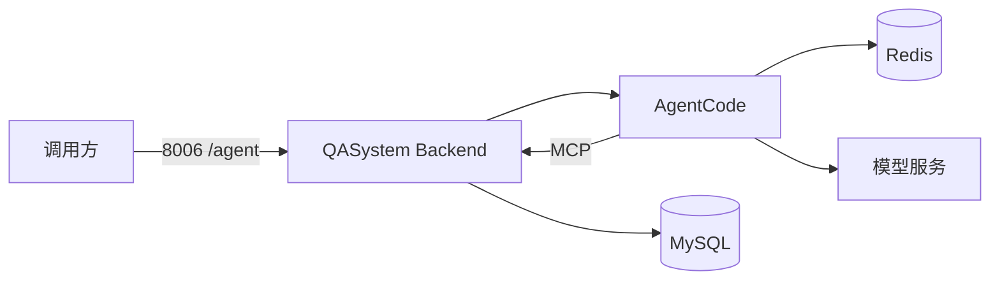

# AgentCode 部署运维指南

本文说明 AgentCode 的部署拓扑、配置、容量规划、健康检查、监控和故障处置。

## 一、推荐部署拓扑

QASystem 当前推荐使用根目录 `docker-compose.yml`：



Agent 和 Backend 使用同一个 `qasystem-env-v1` 环境镜像，并只读挂载同一份外置源码，但运行不同命令：

- Backend：`python -m app.execution.supervisor`；
- Agent：`python -m agentcode.api ...`。

`opencode` 当前仍保留在该镜像中，与 AgentCode 服务启动相互独立。

## 二、构建与启动

### 2.1 生成交付包

```powershell
.\package-deploy.ps1
```

日常发布生成：

```text
deploy/
├── runtime/
├── docker-compose.yml
└── .env.example
```

Compose 将 `runtime/` 下的 Backend、Agent、算法和 MCP 源码挂载到环境容器。

### 2.2 构建镜像

```powershell
.\build-image.ps1
```

`Dockerfile` 会：

1. 安装 CUDA/vLLM、系统程序和 Python 依赖；
2. 保留 Node、npm、OpenCode、Java 和 OFD 工具；
3. 排除 Backend、Agent、算法、MCP 源码和 models；
4. 构建后挂载仓库源码执行完整运行时校验。

### 2.3 启动

```powershell
docker compose up -d
docker compose ps
```

查看日志：

```powershell
docker compose logs -f agent
docker compose logs -f redis
docker compose logs -f backend
```

停止：

```powershell
docker compose down
```

Redis 数据保存在 `agent-redis-data` volume。普通 `docker compose down` 不会删除该 volume。

## 三、环境变量

### 3.1 模型配置

| 变量 | 默认值 | 说明 |
| --- | --- | --- |
| `AGENT_LLM_BASE_URL` | `http://localhost:9999` | OpenAI 兼容服务地址 |
| `AGENT_LLM_API_KEY` | 空 | Bearer Token |
| `AGENT_LLM_MODEL` | `Qwen/Qwen3-8B` | 模型名 |
| `AGENT_TEMPLATE_TEMPERATURE` | `0.2` | temperature |
| `AGENT_TEMPLATE_MAX_TOKENS` | `4096` | 单次最大输出 token |
| `AGENT_TEMPLATE_TIMEOUT_SECONDS` | `120` | 单次模型请求 timeout |

容器中的 `127.0.0.1` 指 Agent 容器本身。如果模型运行在宿主机，Docker Desktop 通常应设置：

```bash
AGENT_LLM_BASE_URL=http://host.docker.internal:8003
```

如果模型与 Agent 在同一个 Compose 网络，使用服务名：

```bash
AGENT_LLM_BASE_URL=http://llm:8000
```

### 3.2 MCP 配置

| 变量 | 说明 |
| --- | --- |
| `AGENT_MCP_CONFIG` | MCP JSON 配置绝对路径 |
| `AGENT_MCP_URL` | 只有一个 MCP Server 时覆盖其 URL |

Compose 中设置：

```bash
AGENT_MCP_URL=http://backend:8000/mcp
```

MCP 配置只在进程启动时读取。修改后需要重启 Agent 服务。

### 3.3 并发配置

| 变量 | 默认值 | 说明 |
| --- | --- | --- |
| `AGENT_API_WORKERS` | `1` | uvicorn 进程数 |
| `AGENT_WORKER_CONCURRENCY` | 代码缺省 `1`；根 `.env.example` 设为 `4` | 每进程执行线程数 |
| `AGENT_WORKER_POOL_SIZE` | 等于 concurrency | 每进程 ToolManager 数 |

启动参数优先：

```bash
python -m agentcode.api --workers 2 --concurrency 8 --pool-size 8
```

多进程必须连接 Redis。Redis 不可用时启动会失败，而不是降级到多个彼此隔离的内存队列。

### 3.4 任务存储

| 变量 | 默认值 | 说明 |
| --- | --- | --- |
| `TASK_STORE_REDIS_URL` | `redis://localhost:6379/0` | Redis URL |
| `TASK_STORE_KEY_PREFIX` | `agentcode:task` | Key 前缀 |
| `TASK_STORE_TASK_TTL` | `86400` | 任务和结果 TTL，秒 |
| `TASK_STORE_MAX_QUEUE` | `50000` | 最大排队任务数 |
| `TASK_STORE_VISIBILITY_TIMEOUT` | `1500` | 无续租任务回收时间 |
| `TASK_STORE_EVENT_MAXLEN` | `10000` | 每个任务事件 Stream 上限 |

可见性超时应满足：

```text
TASK_STORE_VISIBILITY_TIMEOUT > 租约刷新间隔（30 秒） + 可接受网络抖动
```

默认 1500 秒主要避免异常情况下过早重复执行。正常运行任务每 30 秒续租，因此可以执行超过 1500 秒而不被回收。

### 3.5 上下文和日志

| 变量 | 默认值 | 说明 |
| --- | --- | --- |
| `COMPACT_TOKEN_THRESHOLD` | `100000` | 触发上下文压缩 |
| `AGENT_LOG_DIR` | 系统临时目录 | ShellTool 日志目录 |

容器中建议将日志输出交给 stdout/stderr 和平台日志收集。ShellTool 文件日志默认位于 `/tmp/agentcode/shell_tool.log`。

## 四、端口与网络

默认端口：

| 服务 | 容器端口 | 默认宿主机端口 |
| --- | ---: | ---: |
| Backend | 8000 | 8006 |
| AgentCode | 9180 | 9180 |
| Redis | 6379 | 不映射 |

Backend 同时通过 `/agent` 反代暴露 Agent；Agent 的宿主机映射由 `AGENT_HOST_PORT` 控制，不需要直连时可在防火墙侧限制来源。

可通过以下变量改变绑定：

```bash
AGENT_BIND=127.0.0.1
AGENT_HOST_PORT=9180
BACKEND_BIND=127.0.0.1
BACKEND_HOST_PORT=8006
```

Compose 内部调用必须使用容器端口和服务名，例如 `http://backend:8000/mcp`，不能使用宿主机映射端口 `8006`。

## 五、健康检查

### 5.1 Agent 健康接口

```bash
curl http://127.0.0.1:8006/agent/health
```

响应：

```json
{
  "status": "ok",
  "pid": 123,
  "queue_depth": 2,
  "concurrency": 4,
  "pool": {
    "total": 4,
    "in_use": 1,
    "available": 3,
    "total_errors": 0,
    "total_borrows": 12
  }
}
```

指标解释：

- `queue_depth` 持续上升：执行能力不足或下游变慢；
- `pool.available=0` 持续存在：连接池成为瓶颈；
- `pool.total < AGENT_WORKER_POOL_SIZE`：部分 MCP 连接初始化失败；
- `total_errors` 增长：借出的 ToolManager 执行期间发生异常。

当前健康接口表示进程和 Task Store 可响应，不会主动探测 LLM 是否可生成答案。

### 5.2 下游探测

建议额外监控：

- Backend `/health`；
- Backend `/mcp` 初始化和 `tools/list`；
- Redis `PING`、内存、连接数和持久化状态；
- LLM `/v1/models` 或最小 completion；
- Agent 真实合成任务。

## 六、容量规划

### 6.1 执行并发

```text
有效并发 = API workers × min(worker concurrency, pool size)
```

示例：

```text
AGENT_API_WORKERS=2
AGENT_WORKER_CONCURRENCY=8
AGENT_WORKER_POOL_SIZE=8
```

有效并发约 16，每个 API 进程维护 8 组 MCP 连接和 8 个 LLM HTTP Client。

所有子公司共用这一套名额和同一 Redis 队列，没有按租户分片的 Agent 实例。一家占满 Worker 时，其他家在 FIFO 里等待，但读不到对方的任务。扩容加的是全局 `concurrency` / `workers`，不是给某家单独起一套服务。

### 6.2 调整顺序

1. 先观察单任务平均耗时和 P95；
2. 调整 `concurrency` 与 `pool-size` 相等；
3. 确认 MCP Server、数据库和模型能承受新增并发；
4. 再增加 API workers；
5. 观察 Redis 连接数、队列深度和宿主机内存。

### 6.3 内存估算

每个运行任务至少持有：

- 完整消息上下文；
- 工具 schema；
- 当前模型响应；
- 工具返回结果；
- 一个 ToolManager 借用；
- 一个 LLM HTTP Client 所使用的连接资源。

大型 MCP 返回值会同时存在于内存上下文和 Redis 事件中，应在 MCP 层限制结果大小并提供分页或对象引用。

## 七、任务保留与 Redis 容量

每个任务至少产生：

- 一个任务 Hash；
- 若干 Stream 事件；
- 排队或 processing 中的一个 ID。

粗略容量取决于 token 事件数量。如果每个 token 单独写一条 Stream，长回答会产生大量小记录。生产环境应根据回答长度调整：

- `TASK_STORE_EVENT_MAXLEN`；
- `TASK_STORE_TASK_TTL`；
- 模型最大输出；
- 并发任务数量。

检查键：

```bash
redis-cli --scan --pattern 'agentcode:task*'
redis-cli LLEN agentcode:task:queue
redis-cli LLEN agentcode:task:processing
```

不要在生产高峰使用 `KEYS *`。

## 八、任务取消

```bash
curl -X POST http://127.0.0.1:9180/v1/task/<task_id>/cancel
```

排队任务通常立即变为 `cancelled`。运行中任务先变为 `cancelling`，Worker 在下一个协作检查点结束。

若长时间停留在 `cancelling`：

1. 检查是否在等待无响应的第三方 HTTP 请求；
2. 检查 `AGENT_TEMPLATE_TIMEOUT_SECONDS`；
3. 检查 MCP 工具自身是否遵守 timeout；
4. 查看任务 Stream 的最后一个 `trace`、`tool_calls` 或 `tool_result`；
5. 必要时重启对应 Agent 进程，租约过期后任务会按取消标志进入 cancelled。

## 九、故障排查

### 9.1 Agent 无法启动

常见原因：

- MCP 配置文件不存在；
- 所有 ToolManager 初始化失败；
- 多进程模式未连接 Redis；
- Python 包或运行目录未生成；
- `AGENT_WORKER_POOL_SIZE < 1`。

检查：

```powershell
docker compose logs agent
docker compose exec agent python -c "import agentcode; print(agentcode.__file__)"
docker compose exec agent python -m agentcode.api --help
```

### 9.2 MCP 连接失败

检查容器内地址：

```powershell
docker compose exec agent curl -fsS http://backend:8000/health
docker compose exec agent python -c "import os; print(os.getenv('AGENT_MCP_URL'))"
```

stdio MCP 还需要检查：

- command 是否存在；
- args 是否正确；
- env 是否包含必要的 PATH/PYTHONPATH；
- Windows `.cmd`/`.bat` 包装是否正确。

### 9.3 任务一直 queued

检查：

1. `/health` 中 pool 是否存在；
2. Worker concurrency 是否大于 0；
3. Redis 主队列长度；
4. Worker 日志是否循环 dequeue；
5. 所有 Worker 是否阻塞在 MCP 初始化或 pool.borrow。

### 9.4 任务一直 running

检查：

- LLM HTTP timeout；
- MCP 调用耗时；
- processing 队列；
- Hash 中 `claimed_at` 是否每约 30 秒更新；
- 是否有持续 token/heartbeat/trace 事件。

### 9.5 SSE 无事件

先查询任务快照：

```bash
curl http://127.0.0.1:9180/v1/task/<task_id>
```

如果任务已完成，新的 SSE 连接只发送快照并关闭。运行中无事件时：

- 15 秒应至少收到 heartbeat；
- 检查 Redis Stream 是否存在；
- 检查反向代理是否缓冲 `text/event-stream`；
- 保持 `X-Accel-Buffering: no` 和 `Cache-Control: no-cache`；
- 检查代理读取超时是否大于 15 秒。

### 9.6 LLM 请求失败

AgentRuntime 会返回 `LLM_ERROR`。检查：

- 容器内的 `AGENT_LLM_BASE_URL`；
- API Key；
- 模型名；
- `/v1/chat/completions` 是否兼容；
- 响应是否包含 OpenAI 风格 `choices[0].message` 或 SSE delta；
- timeout 是否小于模型首 token 延迟。

## 十、升级流程

推荐：

1. 记录当前镜像 tag 和 AgentCode 版本；
2. 在测试 Redis DB 执行单元和集成测试；
3. 构建新 tag，不覆盖正在运行的 tag；
4. 运行最小合成任务；
5. 停止接收新任务或等待队列清空；
6. 滚动替换 Agent 进程；
7. 观察 queued、processing、failed 和 Redis Stream；
8. 再更新默认 latest tag。

当前任务存储没有显式 Schema 版本。修改 Redis 字段或 Key 结构时，应使用新的 `TASK_STORE_KEY_PREFIX` 进行蓝绿切换。

## 十一、备份与恢复

Redis Compose 默认启用 AOF：

```yaml
command: redis-server --appendonly yes
```

需要恢复任务时，应同时保留：

- Redis volume；
- 当时使用的 AgentCode 版本；
- MCP Server 版本；
- Skill 文件；
- 模型配置。

由于执行语义是至少一次，恢复后重新投递的写操作可能重复。业务 MCP 必须承担最终幂等。

## 十二、生产检查清单

- [ ] `AGENT_LLM_BASE_URL` 在容器内可达；
- [ ] `AGENT_MCP_URL` 指向容器网络地址；
- [ ] 多进程模式连接独立 Redis；
- [ ] `concurrency == pool-size` 或有明确理由；
- [ ] visibility timeout 大于租约刷新和网络抖动；
- [ ] Redis TTL、maxlen 与容量匹配；
- [ ] 反向代理禁用 SSE 缓冲；
- [ ] 合成健康任务可以完成；
- [ ] Redis integration tests 使用隔离 DB 通过；
- [ ] 镜像内 `agentcode-api`/`python -m agentcode.api` 可启动；
- [ ] 已验证 Linux Shell/resource 测试；
- [ ] 已记录当前已知边界和回滚镜像。
