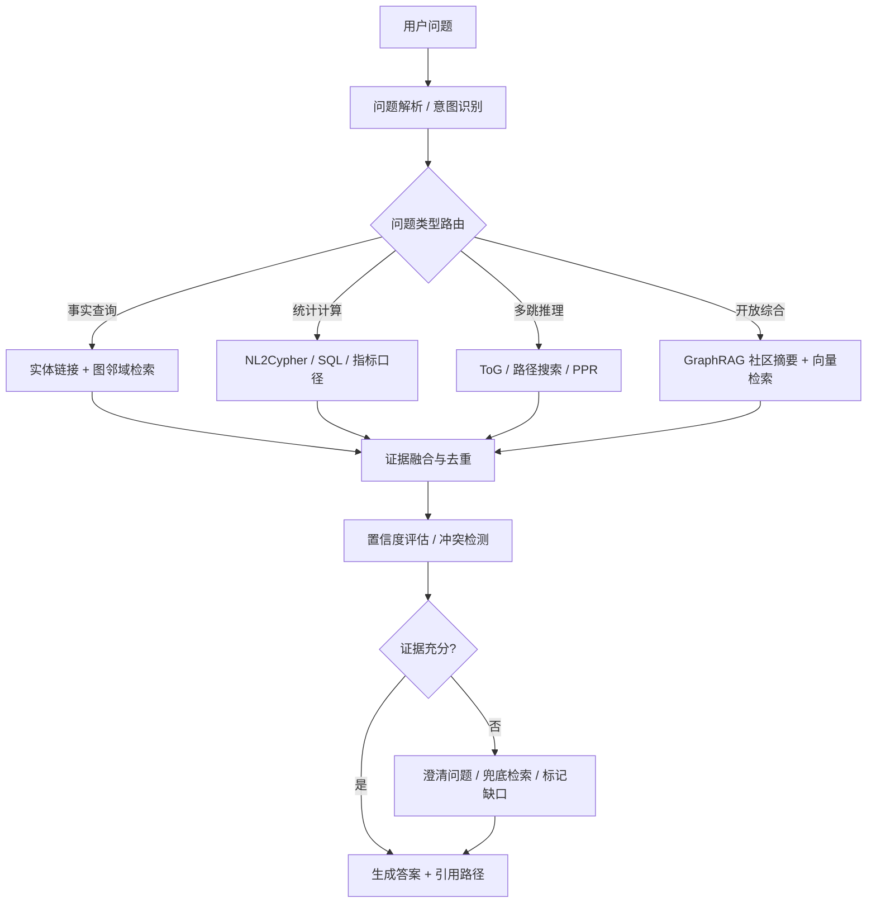
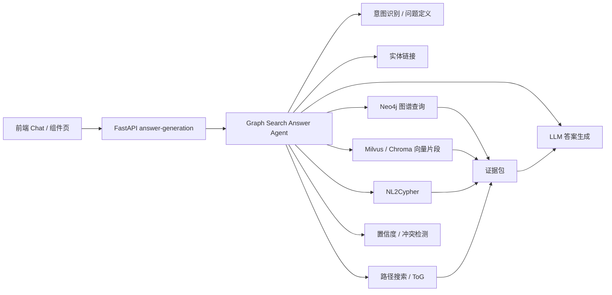

# 基于知识图谱进行搜索回答的 Agent 设计思路与原型实现调研报告

调研日期：2026-07-04  
适用项目：轨道交通知识服务系统（`qasystem`）  
关键词：Knowledge Graph Agent、KGQA、GraphRAG、Agentic RAG、Neo4j、NL2Cypher、ToG、LightRAG、KAG、HippoRAG

## 1. 摘要

基于知识图谱进行搜索回答的 Agent，正在从早期的“自然语言转 Cypher + 图数据库查询”演进为“图谱检索、向量检索、路径推理、工具调用、证据校验、可追溯回答”的复合系统。最新实践大致形成三条主线：

1. **GraphRAG 型**：将文档抽取为实体、关系、社区摘要或属性图，在回答时结合向量检索、图遍历和摘要检索。代表包括 Microsoft GraphRAG、LightRAG、Neo4j GraphRAG、LlamaIndex Property Graph Index。
2. **KG Reasoning Agent 型**：让 LLM 作为决策器，在知识图谱上迭代选择实体、关系和路径，逐步搜索可回答证据。代表包括 Think-on-Graph（ToG）、GraphReader、KAG、KG^2RAG 等。
3. **工程工具链型**：使用 LangGraph/LangChain/LlamaIndex/Neo4j MCP 将图谱能力封装为 Agent 工具，使 Agent 能够在多轮对话中路由、规划、查询、纠错和生成答案。

对本项目而言，最适合的路线不是直接替换现有模块，而是在已有 `algorithm/ans/QA`、`algorithm/NL_to_cypher`、`algorithm/knowledge_extract`、`algorithm/KGUpdate` 和 `agentcode` 之上，新增一个 **Graph Search Answer Agent** 编排层：保留现有 Neo4j、NL2Cypher、ToG 风格搜索与向量片段能力，引入更清晰的状态机、工具接口、证据包、置信度和失败兜底。

## 2. 背景：为什么知识图谱 Agent 又变热

传统 RAG 的核心问题是“扁平文本片段相似不等于可推理相关”。在专业领域，用户问题往往包含业务对象、指标口径、时间条件、组织层级、故障因果、规则约束等结构化关系。单纯向量检索容易出现：

- 多跳事实散落在多个文档或节点中，召回片段彼此缺少关系。
- 数值、时间、层级、规则、指标口径等逻辑不容易靠相似度排序解决。
- 答案难以解释来源，无法稳定输出“为什么这样回答”。
- 图谱更新、实体同义词、结构化数据库查询和文档证据无法统一编排。

GraphRAG 与 KG Agent 的价值在于：把实体和关系变成一等公民，让 Agent 可以先理解问题结构，再选择图谱入口，沿关系路径搜索证据，最后用证据生成可追溯答案。

## 3. 最新技术路线总览

### 3.1 GraphRAG：图谱作为检索索引和上下文组织方式

Microsoft GraphRAG 提出用 LLM 从私有语料中抽取知识图谱，并结合社区摘要在查询时增强提示词，面向“全局性问题”和“跨文档综合问题”效果更明显。其开源项目定位为面向非结构化文本的图构建与转换流水线。

LightRAG 进一步强调轻量化和速度，用“双层检索”同时覆盖低层实体事实与高层主题关系。它的工程启发是：不必一开始就构建非常重的图谱社区摘要体系，也可以通过实体关系图 + 向量索引实现可用的 GraphRAG。

Neo4j GraphRAG Python 包则更偏工程落地，提供 VectorRetriever、VectorCypherRetriever、HybridRetriever、HybridCypherRetriever、Text2CypherRetriever、ToolsRetriever 等检索器。关键思想是：先用向量或全文命中入口节点，再通过 Cypher 拓展上下文，把命中的片段和周边实体关系一起交给 LLM。

LlamaIndex Property Graph Index 代表了另一路“应用框架集成”：用属性图承载实体、关系和元数据，并允许多个子检索器组合，例如同义词检索、向量检索、Cypher 查询、路径检索。

### 3.2 KG Reasoning Agent：LLM 在图上搜索和推理

Think-on-Graph（ToG）是这一方向的代表。它把 LLM 看作在知识图谱上交互式探索的 Agent：从问题中的主题实体出发，每一轮选择候选关系和候选实体，使用 beam search 保留最有希望的推理路径，最终基于路径给出答案。它的优势是训练成本低、路径可追溯、可结合专家反馈纠错。

GraphReader 面向长上下文问题，把长文档组织成图，由 Agent 制定计划并调用读取节点、读取邻居等函数进行粗到细探索。它提示了一个重要趋势：图不只来自显式知识库，也可以来自长文档分块之间的结构化索引。

HippoRAG 借鉴长期记忆理论，将 LLM、知识图谱和 Personalized PageRank 结合，用图上的关联扩散实现多跳召回。它的亮点是降低迭代检索成本，在多跳问答中用一次图排序替代多轮昂贵 LLM 检索。

KAG（Knowledge Augmented Generation）更偏专业领域服务框架，强调 LLM 友好的知识表示、图谱与原文片段互索引、逻辑形式引导的混合推理、语义对齐和模型增强。它尤其适合政务、医疗、金融、工业等需要“事实 + 规则 + 计算 + 溯源”的场景。

### 3.3 Agentic GraphRAG：路由、规划、工具化和自校验

当前工程趋势是把图谱检索变成 Agent 可调用工具，而不是单条固定 Chain。典型流程如下：



这类系统的核心不再是“LLM 一次性生成查询”，而是：

- **Planner**：判断问题是属性查询、路径推理、指标计算、文档证据问答还是图谱维护。
- **Retriever Tools**：实体链接、向量检索、全文检索、Cypher 查询、邻居扩展、路径搜索、社区摘要检索。
- **Reasoner**：选择下一步动作，控制搜索深度、候选宽度和停止条件。
- **Verifier**：检查答案是否被图谱路径、原文片段或结构化查询结果支撑。
- **Answerer**：输出面向业务用户的答案，同时提供证据、路径、数据来源和不确定性。

## 4. 代表方案对比

| 方案 | 核心思想 | 适用问题 | 优点 | 局限 |
|---|---|---|---|---|
| Microsoft GraphRAG | 文档抽取图谱 + 社区摘要 + 查询时增强 | 跨文档综合、主题洞察、全局性问题 | 全局摘要能力强，适合私有语料探索 | 构建成本较高，在线更新和精确事实查询需额外设计 |
| LightRAG | 图结构 + 向量的轻量双层检索 | 中小规模知识库、快速原型 | 简洁、快、易集成 | 对强 schema、规则推理和权限控制支持有限 |
| Neo4j GraphRAG | Neo4j 内向量、全文、Cypher、图遍历组合 | 企业图数据库问答 | 工程成熟，和 Neo4j 生态贴合 | 复杂 Agent 编排需自行实现 |
| LlamaIndex Property Graph | 属性图索引 + 多子检索器组合 | 文档到图谱、混合检索应用 | 抽象完整，适合快速搭建 | 深度业务规则仍需定制 |
| LangChain GraphCypherQA | NL2Cypher + 图查询 + 回答生成 | 结构化图谱查询 | 上手快，适合 demo | 容易生成错误 Cypher，需要 schema 约束和校验 |
| Think-on-Graph | LLM 迭代选择关系/实体，beam search 搜索路径 | 多跳推理、可追溯 KGQA | 路径清晰，训练成本低 | 多轮 LLM 调用成本高，实体链接质量很关键 |
| GraphReader | 长文档构图，Agent 调工具读节点和邻居 | 超长上下文、多文档问答 | 避免一次塞入长上下文，搜索过程可控 | 需要设计文档图构建策略 |
| HippoRAG | KG + Personalized PageRank 做多跳记忆检索 | 多跳召回、长期记忆 | 检索成本低，适合复杂关联 | 对图构建质量敏感 |
| KAG | 图谱与原文互索引 + 逻辑形式混合推理 | 专业领域问答、规则/数值/时序推理 | 更贴近工业专业问答 | 框架较重，落地依赖 schema 与工程治理 |

## 5. 推荐的 Agent 设计

### 5.1 总体架构

建议在本项目新增一个图谱搜索回答 Agent 编排层，定位为 `answer-generation` 的升级版，而不是替代现有算法组件。



### 5.2 Agent 状态模型

建议统一维护一个 `GraphAnswerState`，便于调试、前端展示和后续评测。

```python
class GraphAnswerState(TypedDict):
    question: str
    normalized_question: str
    intent: dict
    query_type: str
    constraints: dict
    linked_entities: list[dict]
    candidate_tools: list[str]
    retrieval_steps: list[dict]
    graph_paths: list[dict]
    chunks: list[dict]
    cypher_results: list[dict]
    evidence_pack: list[dict]
    confidence: dict
    final_answer: str
    need_clarification: bool
```

### 5.3 工具接口设计

建议将图谱 Agent 的工具收敛为以下 8 类：

| 工具 | 输入 | 输出 | 用途 |
|---|---|---|---|
| `schema_inspect` | 问题、候选领域 | labels、relations、properties | 限制 NL2Cypher 搜索空间 |
| `entity_link` | 问题、领域、别名词表 | linked entities | 找图谱入口 |
| `vector_search` | 问题、实体、top_k | chunks | 找原文证据 |
| `graph_expand` | entity_id、relation_filter、depth | neighborhood | ToG/邻域探索 |
| `path_search` | source、target、constraints | paths | 多跳路径推理 |
| `text2cypher` | 问题、schema、约束 | cypher + result | 精确结构化查询 |
| `evidence_verify` | answer draft、evidence | score、missing、conflict | 防幻觉与证据缺口 |
| `answer_compose` | question、evidence_pack、style | final answer | 面向用户生成结构化答案 |

### 5.4 路由策略

可以先用规则 + LLM 分类的混合方式：

| 问题类型 | 示例 | 首选路径 |
|---|---|---|
| 属性/定义查询 | “公开采购比例有什么属性？” | 实体链接 -> 一跳属性/邻域 |
| 指标/统计查询 | “某指标今年是多少？” | 意图识别 -> NL2Cypher/SQL -> 数据证据 |
| 多跳关系推理 | “故障 A 为什么会导致 B？” | 实体链接 -> ToG/路径搜索 -> 证据验证 |
| 规章制度问答 | “发生火灾应如何处置？” | 向量检索 -> 图谱实体扩展 -> 文档证据 |
| 开放综合分析 | “公开采购与非公开采购金额构成如何？” | 指标图谱 + Cypher/SQL + 文档口径 |
| 图谱缺口问题 | “没有找到某实体怎么办？” | 澄清/候选推荐/标注待补知识 |

### 5.5 搜索策略

建议采用“三段式搜索”：

1. **入口召回**：实体链接 + 向量召回 + 全文检索并行执行，得到候选实体、候选片段、候选 schema。
2. **关系扩展**：基于问题意图过滤关系类型，进行 1-3 跳邻域扩展；多跳问题使用 beam search 或 PPR 排序。
3. **证据压缩**：把路径、节点属性、原文片段、结构化查询结果统一成 `EvidenceItem`，再交给 LLM。

`EvidenceItem` 建议格式：

```json
{
  "id": "ev_001",
  "source_type": "graph_path",
  "source_id": "NEO_390",
  "content": "CG_003 公开采购中标金额 ...",
  "path": ["电子采购类指标", "包含", "CG_003 公开采购中标金额"],
  "properties": {
    "指标编码": "CG_003",
    "数据来源表": "ads_dzcg_bidsum",
    "计算SQL": "SELECT ..."
  },
  "score": 0.91,
  "supports": ["公开采购金额口径"]
}
```

## 6. 原型实现方案

### 6.1 最小可行原型（MVP）

目标：在现有系统基础上，用最少改动实现可追溯的图谱搜索回答 Agent。

建议新增：

```text
algorithm/ans/QA/agent/
├── __init__.py
├── state.py              # GraphAnswerState / EvidenceItem
├── router.py             # 问题类型路由
├── tools.py              # 工具封装：entity_link、graph_expand、text2cypher 等
├── planner.py            # 选择工具和搜索计划
├── executor.py           # 执行计划、记录步骤
├── verifier.py           # 证据充分性与置信度
└── graph_answer_agent.py # 统一入口
```

在后端保持现有接口不变，仅在 `backend/app/modules/component/answer_generation/service.py` 中增加一个开关：

```python
if settings.GRAPH_AGENT_ENABLED:
    return graph_answer_agent.answer(question, detailed=detailed)
return legacy_neo4j_qa_service.answer_question_with_details(question)
```

### 6.2 Planner 伪代码

```python
def plan(state: GraphAnswerState) -> list[dict]:
    query_type = route_question(state["question"], state.get("intent"))

    if query_type == "metric_or_stat":
        return [
            {"tool": "schema_inspect"},
            {"tool": "text2cypher"},
            {"tool": "vector_search", "purpose": "metric_definition"},
            {"tool": "evidence_verify"},
            {"tool": "answer_compose"},
        ]

    if query_type == "multi_hop":
        return [
            {"tool": "entity_link"},
            {"tool": "path_search", "max_depth": 3, "beam_width": 5},
            {"tool": "vector_search", "purpose": "path_evidence"},
            {"tool": "evidence_verify"},
            {"tool": "answer_compose"},
        ]

    return [
        {"tool": "entity_link"},
        {"tool": "graph_expand", "depth": 1},
        {"tool": "vector_search"},
        {"tool": "evidence_verify"},
        {"tool": "answer_compose"},
    ]
```

### 6.3 ToG 风格路径搜索原型

核心参数：

- `max_depth`: 2-4，专业问答建议默认 3。
- `beam_width`: 每层保留 3-8 条候选路径。
- `relation_top_k`: 每个实体选择 5-10 个候选关系。
- `entity_top_k`: 每个关系选择 5-20 个候选实体。
- `stop_condition`: 找到可回答证据、置信度超过阈值、达到最大深度或预算耗尽。

伪代码：

```python
def tog_search(question, seeds):
    beams = [[seed] for seed in seeds]
    finished = []

    for depth in range(MAX_DEPTH):
        candidates = []
        for path in beams:
            rels = rank_relations(question, current_entity(path))
            for rel in rels[:REL_TOP_K]:
                neighbors = fetch_neighbors(current_entity(path), rel)
                ranked = rank_entities(question, path, rel, neighbors)
                for node in ranked[:ENTITY_TOP_K]:
                    new_path = path + [rel, node]
                    if can_answer(question, new_path):
                        finished.append(new_path)
                    candidates.append(new_path)
        beams = rank_paths(question, candidates)[:BEAM_WIDTH]
        if enough_evidence(finished):
            break

    return rank_paths(question, finished or beams)
```

### 6.4 GraphRAG + NL2Cypher 混合原型

适合本项目的混合策略是：

1. 用户问题先进入意图识别，识别业务域、场景、对象、目标和意图类型。
2. 如果问题涉及“多少、比例、趋势、构成、排名、同比、环比”等，优先走指标图谱和 NL2Cypher/SQL。
3. 如果问题涉及“为什么、如何、依据、规则、流程、影响”，优先走图路径 + 文档片段。
4. 如果生成 Cypher 失败，则降级为实体邻域搜索；如果邻域证据不足，再降级为向量检索。
5. 最终回答必须引用至少一种证据：图路径、节点属性、原文片段或查询结果。

## 7. 与本项目现状的结合

本仓库已经具备知识图谱 Agent 的多个基础部件：

- `algorithm/ans/QA`：已有 Neo4j 问答服务、问题定义、实体链接、答案生成、推理日志和 ToG 搜索描述。
- `algorithm/NL_to_cypher`：已有文本切分、Milvus/Chroma 相关向量检索、NL2Cypher 相关模块。
- `algorithm/knowledge_extract` 与 `algorithm/uie`：支撑文档知识抽取和图谱构建。
- `algorithm/KGUpdate`：支撑图谱增删改。
- `algorithm/confidence_calculate` 与 `algorithm/conflict_detection`：可作为证据置信度和冲突检查模块。
- `agentcode`：已有单智能体运行时和工具管理能力，可作为更通用的 Agent 执行框架参考。

建议的演进路线：

| 阶段 | 目标 | 改动范围 | 验收标准 |
|---|---|---|---|
| P0 | 统一证据结构 | `algorithm/ans/QA` | 每个答案返回证据列表、图路径和来源 |
| P1 | Agent 编排层 | 新增 `algorithm/ans/QA/agent` | 能按问题类型选择实体邻域、NL2Cypher、向量检索 |
| P2 | ToG 搜索增强 | 复用/改造 `wiki_func.py`、`entity_linker.py` | 多跳问题输出候选路径和路径评分 |
| P3 | 置信度与冲突检测 | 接入 `confidence_calculate`、`conflict_detection` | 答案附带置信度、缺口和冲突说明 |
| P4 | 前端可视化 | `frontend/src/views/component/answer-generation` | 展示推理步骤、证据路径、原文片段 |
| P5 | 评测集和回归测试 | `algorithm/ans/QA/tests` 或 `docs/eval` | 覆盖事实、指标、多跳、无答案、冲突样例 |

## 8. 评价指标

建议从“答案质量、检索质量、图推理质量、工程可用性”四个层面评估：

| 类别 | 指标 | 说明 |
|---|---|---|
| 答案质量 | Exact Match / F1 / Rouge-L | 标准 QA 指标 |
| 专业正确性 | Expert Score | 领域专家对口径、结论、规则判断打分 |
| 证据支撑 | Evidence Precision / Recall | 答案中关键断言是否被证据支持 |
| 图推理 | Path Hit Rate | 是否找到 gold path 或合理路径 |
| 可追溯性 | Citation Coverage | 每个关键结论是否带来源 |
| 鲁棒性 | No-answer Accuracy | 图谱无答案时是否拒答或澄清 |
| 性能 | Latency / Token Cost | 多轮图搜索很容易超预算，需要独立监控 |
| 可维护性 | Schema Drift Fail Rate | 图谱 schema 变化后失败率 |

## 9. 关键工程风险与对策

1. **实体链接错误会放大后续错误**  
   对策：引入别名词典、embedding 候选、LLM rerank、用户澄清和 top-k 多入口并行。

2. **NL2Cypher 幻觉或危险查询**  
   对策：只读权限、schema 白名单、Cypher AST/正则校验、LIMIT 注入、超时控制、查询解释日志。

3. **多跳搜索成本高**  
   对策：beam search 限宽、关系类型过滤、缓存邻域、PPR 预排序、先小模型筛选再大模型生成。

4. **图谱和原文证据割裂**  
   对策：建立互索引：图节点保存 `VectorAddress`、文档片段保存实体/关系反向链接。

5. **答案看似合理但证据不足**  
   对策：生成前先构造证据包；生成后做 claim-level verification；证据不足时明确说明缺口。

6. **图谱更新导致历史答案不可复现**  
   对策：答案记录图谱版本、节点版本、文档版本和查询时间。

## 10. 推荐技术选型

短期建议以现有栈为主：

- 图数据库：继续使用 Neo4j。
- 向量库：沿用 Milvus/Chroma，优先统一一个生产默认。
- Agent 编排：先自研轻量状态机；如果后续需要复杂循环和可视化，再引入 LangGraph。
- 检索策略：实体链接 + VectorCypher + ToG beam search + NL2Cypher。
- 框架借鉴：Neo4j GraphRAG 的 Retriever 设计、LlamaIndex Property Graph 的多子检索器设计、KAG 的图文互索引和逻辑形式设计。

中期可考虑：

- 引入 Neo4j 原生向量索引，将“图节点 + embedding + Cypher 扩展”放在一个数据库内减少系统复杂度。
- 将 Agent 工具通过 MCP 暴露，方便 `agentcode` 或外部 Agent 调用。
- 建立领域 schema registry，控制实体类型、关系类型、属性、查询模板和权限。

## 11. 结论

截至 2026 年 7 月，知识图谱搜索回答 Agent 的最新共识是：**不要把知识图谱只当作查询库，也不要把 RAG 只当作相似片段召回；更好的设计是让 Agent 在图谱、文本、结构化查询和验证器之间做受控决策**。

对本项目最现实的落地路径是：

1. 先统一证据包和推理日志，让每个答案可追溯。
2. 再引入 Agent 路由和工具化检索，按问题类型选择 NL2Cypher、图邻域、路径搜索或向量检索。
3. 最后补齐置信度、冲突检测、前端路径可视化和评测集。

这样可以在不推翻现有模块的前提下，把当前“图谱问答组件”升级为更稳定、更可解释、更适合专业领域的 Graph Search Answer Agent。

## 12. 参考资料

- Microsoft Research, GraphRAG: [GraphRAG approach to query-focused summarization](https://arxiv.org/abs/2404.16130), [Microsoft GraphRAG docs](https://microsoft.github.io/graphrag/), [microsoft/graphrag](https://github.com/microsoft/graphrag)
- LightRAG: [LightRAG paper](https://arxiv.org/html/2410.05779v1), [hkuds/lightrag](https://github.com/hkuds/lightrag)
- KAG: [KAG paper](https://arxiv.org/abs/2409.13731), [OpenSPG/KAG](https://github.com/openspg/kag)
- Think-on-Graph: [ToG paper](https://arxiv.org/abs/2307.07697), [GasolSun36/ToG](https://github.com/GasolSun36/ToG)
- GraphReader: [GraphReader paper](https://arxiv.org/abs/2406.14550), [ACL Anthology](https://aclanthology.org/2024.findings-emnlp.746/)
- HippoRAG: [HippoRAG paper](https://arxiv.org/abs/2405.14831), [OSU-NLP-Group/HippoRAG](https://github.com/OSU-NLP-Group/HippoRAG)
- GraphRAG surveys: [Retrieval-Augmented Generation with Graphs](https://arxiv.org/abs/2501.00309), [A Survey of Graph Retrieval-Augmented Generation for Customized Large Language Models](https://arxiv.org/abs/2501.13958), [Graph Retrieval-Augmented Generation: A Survey](https://arxiv.org/abs/2408.08921)
- Neo4j GraphRAG: [Neo4j GraphRAG Python Package](https://neo4j.com/developer/genai-ecosystem/graphrag-python/), [Neo4j GraphRAG docs](https://neo4j.com/docs/neo4j-graphrag-python/current/user_guide_rag.html), [neo4j/neo4j-graphrag-python](https://github.com/neo4j/neo4j-graphrag-python)
- LlamaIndex Property Graph: [Property Graph Index guide](https://developers.llamaindex.ai/python/framework/module_guides/indexing/lpg_index_guide/), [Property Graph Index blog](https://www.llamaindex.ai/blog/introducing-the-property-graph-index-a-powerful-new-way-to-build-knowledge-graphs-with-llms)
- LangChain / LangGraph / Neo4j: [LangChain Neo4j integration](https://docs.langchain.com/oss/python/integrations/providers/neo4j), [Neo4j LangChain integration](https://neo4j.com/labs/genai-ecosystem/langchain/), [Neo4j GraphRAG workflow with LangChain and LangGraph](https://neo4j.com/blog/developer/neo4j-graphrag-workflow-langchain-langgraph/)
