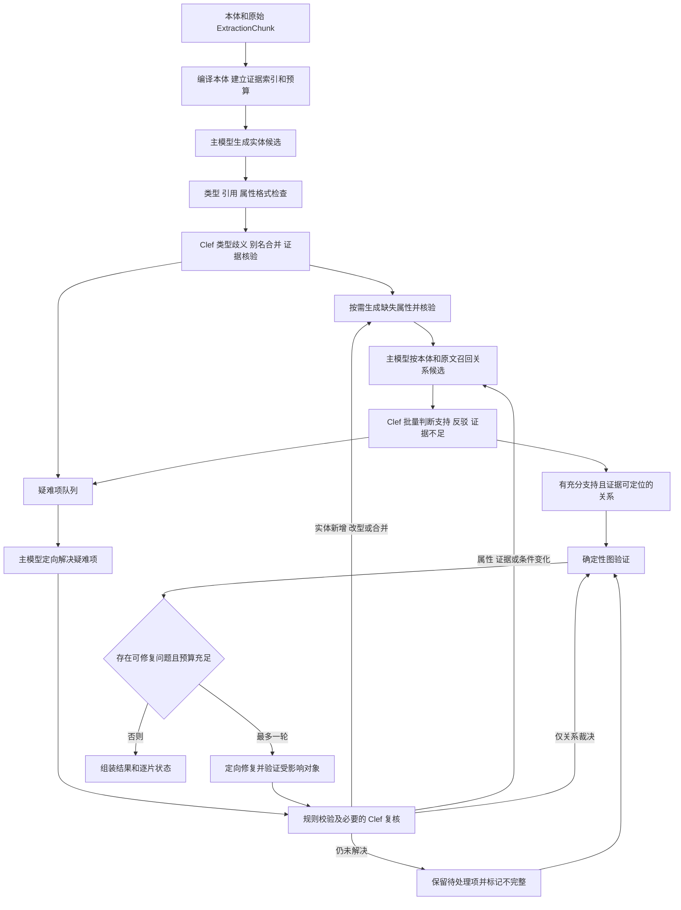

# 知识抽取 Clef Harness 设计

> 版本说明：本实现开发期代号为 V3.3；自代码库清理起对外版本号统一为 `v3.1`（Python 包 `algorithm.knowledge_extract.v3_1`）。下文历史评测记录与数据沿用当时的 V3.3 名称。

当前 V3.3 沿用 V2 的实体候选、属性补全、关系判定、验证修复流程，将已有候选的语义支持、类型歧义、别名及属性冲突判断交给 88 GPU2 上的 Clef。主模型负责发现实体、生成属性值、召回关系和解决疑难项；代码负责本体约束、证据定位、声明身份的机械归一、预算与图组装。

设计目标是减少关系分类和证据核验对生成式模型的调用，同时改善 V3.2 mini 中的关系漏抽、语义实体被过滤及长文本部分失败。效果和节省比例由最新版 mini eval 验证，不预设提升幅度。实现版本为独立的 `v3.1`（开发期代号 V3.3），包名 `v3_1`，输入输出沿用 V2，`latest` 保持独立实体目录。

本文以当前实现为主。早期设想中的结构分类、程序关系候选召回、确定性事实插件、枚举专用路由、普通负候选的不足终结和 Clef 修复排序均未启用，下文明确列为备选。关系候选统一由主模型结合原文与本体召回，不用领域关键词，也不枚举全部实体笛卡尔积。运行完整性不等于语义召回完整。

## V2 的可复用流程

V2 实际包含三个主要模型阶段：实体候选、固定实体集合后的属性补全、固定端点的关系分类。实体和属性阶段还可能调用生成式模型核验证据，最后可进行最多两轮定向修复。主要编排见 [split_extractor.py](../../algorithm/knowledge_extract/v2/split_extractor.py)，公开契约见 [result_contract.py](../../algorithm/knowledge_extract/v2/result_contract.py)。

| V2 环节 | 新 harness 的处理 | 执行者 |
| --- | --- | --- |
| 本体编译、继承与目标类型解析 | 复用编译产物，构建精简类型及关系目录 | 代码 |
| 文档与局部上下文 | 保存原 chunk 边界、邻片及显式请求的原文，定位引用 | 代码 |
| 实体候选生成 | 生成实体、身份候选、已有属性和逐项证据 | 主模型 |
| 歧义实体合并 | 精确身份先归并，语义别名批量裁决 | 代码和 Clef |
| 实体与属性的语义证据核验 | 替换生成式 yes/no/uncertain 核验 | Clef，疑难项交主模型 |
| 属性补全 | 请求缺失的非身份字段，只接受有证据并通过语义核验的值 | 主模型和 Clef |
| 固定端点关系分类 | 主模型先提议合法三元组，再逐条判断，可同时接受多种关系 | 主模型和 Clef |
| 标题层级等结构信息 | 作为原文提供给模型；没有直接生成业务事实的插件 | 主模型 |
| 修复计划与优先级 | 按未解决项所属原 chunk 分组，最多处理前两个分组；未使用 Clef 排序 | 代码和主模型 |
| 最终校验、覆盖统计、结果组装 | 统一记录成功、部分失败、预算耗尽及未解决项 | 代码 |

V2 当前在线 NanoJev 主要用于实体歧义合并。[jev_harness.py](../../algorithm/knowledge_extract/v2/jev_harness.py) 虽有关系分流函数，但在线 `relation_pass()` 没有调用它。新 harness 必须把 Clef 关系判定实际接入主流程，不能只替换一个未被调用的客户端。

## 服务能力与接入边界

Clef 接收 `state + questions`，输出命名选项、真假倾向或有序评分，不生成自由文本。因此它适合裁决已给出的候选，实体名称、开放属性值和新的证据原文仍需要生成模型或原文定位程序。[官方模型说明](https://huggingface.co/Cloudflare/clef-flash/blob/17f0b0ad64efb65d273590632833508766b2aae6/README.md)

2026 年 10 月 8 日通过 SSH 核对的服务状态如下。调用统一经过现有 [ClefFlashClient](../../external_services/clef.py)，端点仍登记在 [application.py](../../external_services/application.py)。

| 项目 | 已部署值 |
| --- | --- |
| 服务状态 | `clef-flash.service` active，`GET /health` ready |
| 设备 | 88 GPU2，RTX 3090 24 GiB；实例内为 `cuda:0` |
| 宿主机地址 | `http://172.17.0.1:8188` |
| Backend 容器地址 | `http://host.docker.internal:8188` |
| 决策接口 | `POST /v1/systemone` |
| 完整编码输入 | 最多 2048 tokens，包含状态、问题、候选和模板 |
| 请求限制 | 64 KiB；16 题；每题 32 选项；总计 128 选项 |
| 执行方式 | 单进程串行推理，最多 4 个请求等待 |
| 输出 | `answers` 与问题 ID 一一对应，`usage.output_tokens=0` |

Backend 继续通过 HTTP 调用独立模型服务，不新增 Torch/Transformers 依赖，不需要重建 `qasystem-env-v1`。根 [.env.example](../../.env.example) 已登记 Clef 和 V3.3 配置；运行环境仍须注入 `CLEF_SERVICE_URL`，独立实验进程显式配置，不把地址散落在算法中。用户请求仍走现有执行队列，服务密钥不进入业务 payload、日志或结果。

## 主流程



每次请求重新构造显式输入，不延续不断增长的聊天历史；原始本体仍在每个请求中完整携带一份，以保留解析器未结构化的语义说明。实体发现阶段的历史目录携带身份，其他阶段携带身份及模型选择的 `context_property_ids`，完整属性保存在运行状态中。已定位且正文在当前请求可见的重复证据转为字符引用。实现见 [harness.py 的 payload/catalog/prompt_record](../../algorithm/knowledge_extract/v3_1/harness.py)。

疑难项保留所属阶段、候选和原文来源。未被接受的实体不进入后续属性与关系目录，未解决别名也不执行合并。定向修复更新目录后，按关系端点及条件实体的完整语义快照检查依赖：类型、名称、属性或规范 ID 已变化的旧任务标为 `superseded` 并移除其旧边；无关关系保留。新增端点仍需搜索可能遗漏的关系。显式请求重跑某阶段时会实际执行，所有补充调用仍计入原预算，不开启无界修复。当前实现及后续精确复用、定向复核的实测说明见 [准确性复核与改进](知识抽取V3.1准确性复核与改进.md)，代码见 [harness.py 的 repair/rerun_stage](../../algorithm/knowledge_extract/v3_1/harness.py)。

被替换的旧任务标记 `superseded` 并保留历史，不再作为当前未解决任务。已经消耗的墙钟和请求数不会因任务替换而退还。当前硬预算只有墙钟和调用次数；单请求 `max_tokens` 限制生成长度，token usage 可用于评测成本观测，但没有文档累计 token 硬预算。

### 实体候选与属性

第一阶段每个原始非空 chunk 进行一次常规实体候选调用。继续采用一套通用系统规则，通过任务字段区分实体、属性、疑难关系和修复；不增加按文档类别切换的大段隐藏 prompt。失败重试和后续修复单独计数，不把“一次常规调用”表述为整个 harness 只有一次调用。

当前直接将原 chunk 提供给主模型理解标题、表格与叙述，没有代码结构分类或 Clef 文档类别路由。将结构分类用于上下文优先级是未启用的备选，不能据此跳过 chunk 或排除本体允许类型。

生成模型输出 `candidate_id/type/name/properties/evidence/context_property_ids`。代码先检查类型合法、JSON 属性类型及证据定位，数值单位和属性含义是否忠实由模型判断。非身份属性格式错误只隔离该字段并保留未解决 issue，让有效实体继续接受语义核验；身份属性格式错误阻止候选准入。活动、规则、职责等实体允许忠实归纳的名称，必须有可定位的原文证据。编码、数值和明确的业务身份仍要求忠实于原文，内部候选 ID 不冒充业务 identity。

实体类型歧义使用主模型给出的合法候选类型加 `UNKNOWN`，不在代码中推断业务类型。别名判断使用 `same_entity/different_entity/insufficient`。不同声明身份或类型冲突由代码阻止合并，适用条件是否一致由语义判断负责。合并前比较两个组的全部成员，合并后的旧 ID 保留别名映射，不能仅凭 A≈B、B≈C 两次判断直接合并未核验的 A、C。

实体/属性核验均使用 `supported/contradicted/insufficient`。原文缺失、低把握或冲突项进入待处理区，不直接成为已接受事实。属性阶段请求已接受实体缺失的非身份字段，由主模型判断原文是否有值，再核验其提议；缺失本身不构成正文一定有答案的证据。当前没有枚举属性专用生成路由。已发现的属性值冲突会交 Clef 在候选值与 `UNKNOWN` 间裁决，这与为缺失枚举属性生成值不同。

### 关系候选与证据

关系候选由主模型读取原 chunk、相邻原文、本体及已接受实体目录后提议。代码检查端点引用、关系签名、继承及证据位置，再构造逐条支持判断任务；没有按同段、同表或指代规则生成关系候选。任务使用运行内 `task_id`，公开图按源端点、关系类型、目标端点去重；没有独立的 `scope_id` 任务字段。类型合法只表示可以提问，不表示关系成立。

同一实体对可能同时具有多种关系，当前对每个已提议三元组分别判断，不做关系之间的互斥单选。端点、关系类型和方向在交给 Clef 前固定，Clef 只返回裁决。

每个候选在 `state.evidence_sets[task_id]` 下绑定原文证据；定位结果使用 `source_block_ids/start_char/end_char/quote`，可包含多个原 chunk 的片段。Clef 问题指明只依赖对应集合，候选陈述本身不算证据。代码验证引用和签名，模型判断完整候选的事实支持、方向及条件。Clef 不输出 quote；程序直接绑定已定位的证据集合，不能把模型解释当原文。

条件信息须落在本体允许的属性、规则或活动实体中，并关联到相应事实。内部 `condition_entity_ids` 不能替代公开图中的条件表达：验证时要求条件实体就是端点，或通过已接受的公开关系与端点关联。若当前本体无法表达关键条件，不把条件事实压平成无条件关系，应记录表达缺口及未解决项。

无完整证据集合的关系保留 issue，进入有限修复或上下文补充。局部 `insufficient` 只表示该证据集合不足，不能当作整篇文档没有关系。主模型疑难裁决读取邻片及任务已引用的原文，关系阶段也可显式请求更远 chunk，修复必须实际读取相关原文。单题仍装不进 Clef 请求时交主模型，不能把未提议或未处理的关系计成 `NONE`。

当前 `search_plan` 在每个关系阶段请求前建立该 anchor chunk 的记录，包括本次原文来源、合法签名、修订号、扫描状态、提议数量及上下文请求；非相邻原文只有被显式请求才加入。它不是运行前穷举的实体对、同表/同节或显式引用台账，也没有证明所有潜在候选都被提议。运行完整性仅表示已执行任务没有未解决项。按 gold 区分端点缺失、未召回、裁决错误可用于人工归因，当前运行协议及正式评分器未自动提供这一完整三分类。

早期“由类型组合产生普通负候选，并在完整搜索后自动终结不足”的路由未实现。当前所有实际创建的任务都是正向候选，Clef 的 `insufficient/UNKNOWN` 均升级主模型或保持未解决，不按 0.98 阈值直接终结。代码保留了主模型对非正向任务返回 `resolved_no_support` 的处理分支，但当前流程不创建此类任务，不能将其列为已启用能力。

V2 的 [relation_resolver.py](../../algorithm/knowledge_extract/v2/relation_resolver.py) 全局排除了 `issuedBy/defines` 等多个关系 ID。当前 V3.3 不复用这类排除表，合法且由主模型提议的候选均可进入语义核验。确定性事实插件属于未启用备选，当前不存在由插件跳过模型判断的路径。

### Clef 决策与疑难项升级

所有概率只作为当前模型、模板及输入下的分流信号，不直接发布为图谱事实可信度。`choice` 使用经过校验的完整 `probabilities`，计算所选项概率与第一、第二名差值；不能只信 `confidence` 字段。必须校验键集合、有限数值、范围、概率和及 choice 与最大项的一致性，允许官方四位小数带来的舍入误差。

以下数值仅作为第一轮 mini 的固定实验参数，不是经校准的生产阈值。实体核验、合并与关系判定各自记录表现，之后按独立标注数据分别调整。

| 裁决 | 初始实验条件 | 行为 |
| --- | --- | --- |
| 支持实体语义、属性或关系 | `P(supported) >= 0.95`、第一二名差值至少 0.20，且证据及本体检查通过 | 接受候选 |
| 明确反驳 | `P(contradicted) >= 0.98`，条件与作用域完整且不存在相反证据 | 拒绝该候选断言 |
| 合并实体、调整类型或选择冲突属性值 | 胜出概率至少 0.98、差值至少 0.20，且引用、本体及声明身份检查通过 | 应用语义决策；修复改变对象后重跑关系 |
| 局部证据不足、其余低把握、模型与契约冲突 | 不直接形成接受或拒绝结论 | 增补上下文或交主模型 |
| 无预算、响应无效或服务不可用 | 不伪造裁决 | 标记未解决，反映在部分失败状态 |

主模型处理疑难项时只接收相关原文、候选和具体问题，不接收 Clef 的概率或结论。其返回必须带可定位证据、合法选项及 `context_complete=true`，通过契约检查后可直接完成该任务；当前没有强制的 Clef 二次投票，也不启动模型互相追问循环。每个原 chunk 最多两批常规疑难裁决，之后保留未解决项供有限修复。主模型调用默认关闭 thinking，记录真实请求参数；不支持关闭时明确暴露配置不兼容，不隐式恢复 provider 默认。

当前 harness 只使用 `choice`。`noul` 真值探针、`score` 修复优先级均是未接入主流程的备选能力。有序评分不等于事实正确概率，不能拿 `score >= 0.8` 当统一准入门槛。

## 任务契约与批处理

当前 [decisions.py 的 DecisionTask](../../algorithm/knowledge_extract/v3_1/decisions.py) 将 Clef 与生成接口分开，实际签名如下。`state` 保存候选、证据及相关本体契约，不另设 `candidate_payload_ref/scope_id/evidence_set_id` 构造参数。V2 输入和结果类型保持复用。

```python
DecisionTask(
    task_id="relation:r17",
    kind="relation_support",
    state={
        "claims": {"relation:r17": candidate_claim},
        "evidence_sets": {"relation:r17": evidence_list},
        "ontology_context": task_ontology_contract,
    },
    instructions="仅依据对应原文证据判断候选，保持身份、方向、条件和否定。",
    criteria={
        "supported": "原文支持完整候选。",
        "contradicted": "原文明示反驳候选或候选混淆对象、方向、条件。",
        "insufficient": "提供的原文不足以判定。",
    },
    source_chunk_ids=("chunk-2",),
)
```

上例中的候选、证据和本体契约变量代表调用方准备的数据；共享批次在实际 state 中另有任务投影标记，拆批时只保留对应 claims 与 evidence_sets，完整公共本体上下文不被裁剪。绝对截止时间通过 `decider.decide(tasks, deadline=..., trace=...)` 传入，不在 `DecisionTask` 字段中。

`DecisionResult` 实际字段为 `task_id/status/selected/probabilities/margin/reason/details`；`status` 为 `decided/unavailable`。harness 另保存候选、证据、provider 及 `pending/decided/accepted/rejected/unresolved/superseded` 等逻辑任务状态。`resolved_no_support` 仅为当前未触发的非正向任务分支；没有独立 `needs_context` 状态，补上下文需求以 issue 记录。`run_trace` 保留任务与尝试，不能只保存两个端点 ID。

已实现 `ClefDecider` 实例内缓存，正常为单文档生命周期。缓存键包含客户端模型名、任务 kind、完整提交 state、instructions、有序 criteria 及来源 chunk；state 中含本次相关本体契约、候选与证据。它没有独立模型权重 revision、模板版本或全量本体 hash 字段。跨运行缓存、跨模型修订复用及统一版本化缓存协议均未实现；不得将局部缓存描述成跨版本可信复用。

Clef 一次接收一个 `state` 和多个 `questions`，不能直接发送 NanoJev 的 `states[]`。共享 state 的任务合批，每题明确绑定自己的候选及证据集合。当前默认和最大值均为每批 4 题；完整编码输入还受服务 token 限制，题数合规不代表请求一定可容纳。

示例请求中的原文与候选明确分开，候选是待核验内容：

```json
{
  "model": "clef-flash",
  "state": {
    "evidence_sets": {
      "ev8": [{"chunk_id": "chunk-2", "start": 0, "end": 13, "quote": "供电车间负责检修牵引电机。"}]
    },
    "candidate_claims": {
      "r17": {"from": "供电车间", "relation": "负责检修", "to": "牵引电机", "evidence_set_id": "ev8"}
    }
  },
  "questions": {
    "r17": {
      "type": "choice",
      "instructions": "只依据 ev8 判断 r17；候选不是证据。保持方向、否定、条件一致。",
      "criteria": {
        "supported": "原文明示支持此关系。",
        "contradicted": "原文明示否定此关系或条件矛盾。",
        "insufficient": "原文不足以判定，包括仅共现。"
      }
    }
  }
}
```

此例只展示服务接受的 wire protocol，具体 state 内容由调用方定义；实际 harness 使用前述 `claims/evidence_sets/ontology_context` 结构及 `start_char/end_char` 字段。`relation` 使用本体稳定 ID，相关本体契约随任务提交。偏移采用原 chunk 内 Unicode 字符下标、左闭右开，代码验证 `text[start_char:end_char] == quote`，不混用字符与字节位置，也不把它当作整篇文档的全局偏移。

2048 token 限制包含所有问题和模板。服务拒绝超限输入后，当前最多两层拆分题目批次；每层只投影所属候选及证据，拆至单题仍超限就返回 unavailable，由 harness 升级主模型或保留未解决。没有自动重写单题证据窗口，更不会静默截断。服务端只读 preflight 属于后续备选，当前不在 Backend 加载模型 tokenizer。

## 预算与失败处理

主模型 controller 管理文档绝对截止时间和主模型调用数；ClefDecider 接收相同截止时间并维护自己的请求计数。任务保留原 chunk 来源，失败归属不依赖派生 ID 的字符串格式。两类请求尝试最终合入运行诊断，主模型禁用 SDK 隐式重试。这里没有文档累计 token 硬预算。

| 预算 | 当前默认值 | 目的 |
| --- | --- | --- |
| 文档抽取墙钟 | 900 秒 | 与现有评测抽取预算一致 |
| 单次 Clef 请求 | 最多 10 秒，受剩余总预算约束 | 不沿用默认 120 秒无限等待 |
| 单次主模型调用 | 最多 120 秒，受剩余总预算约束 | 同时记录传输耗时及调用总墙钟 |
| Clef 并发 | 每个 Backend 进程最多 1 个在途请求 | 适配当前串行 GPU 服务 |
| 单文档 Clef 请求 | 最多 128 次，含失败重试和拆批请求 | 控制候选组合膨胀 |
| 主模型疑难项升级 | 每原 chunk 最多 2 个批次 | 按共享证据合批，不逐实体无限调用 |
| 定向修复生成 | 每文档最多 1 轮，最多 2 次 repair 生成请求 | 按原 chunk 分组；后续属性、关系或显式阶段重跑另计 |

常规实体、属性和关系阶段按原 chunk 调用，属性阶段只有存在缺失字段时才请求。修复后的依赖重跑可能再次调用这些阶段，因此“最多 2 次 repair 生成”不是整个修复过程的 HTTP 上限。全部主模型显式调用共享 `6 × 非空 chunk 数 + 2` 的默认总上限，可由函数参数覆盖；主模型无隐式 HTTP 重试。达到调用数或墙钟限额会记录对应预算错误，未解决项使完整性检查失败，不能通过省略失败状态制造低延迟。

请求队列等待、重试退避和模型执行都消耗同一墙钟预算。不能仅依赖 HTTP read timeout 实现总截止时间；controller 到期后停止投递、取消待执行任务并忽略过期响应。客户端取消不能保证立即终止已开始的 GPU 推理，应统计晚到响应；当前服务仍由一个模型进程串行执行。

| 故障 | 处理 |
| --- | --- |
| 413 或明确的编码长度超限 422 | 有限拆题，单题仍超限则升级；普通 schema 422 不重试 |
| 429 | 带随机抖动退避，最多一次重试，遵守总预算 |
| 503、网络故障或请求超时 | 不放大并发；最多一次重试，仍失败则显式交主模型或留未解决 |
| 401、配置错误 | 立即报告，不做盲目重试 |
| 无效概率、缺问题答案、模型 ID 不符 | 该批无有效裁决，保留失败原因 |
| 主模型截断、JSON 不完整 | 该次响应不准入，保留先前已验证事实；进入有限修复，必要的阶段重跑仍受总预算约束 |

现 [ClefFlashClient](../../external_services/clef.py) 已使用 `ClefServiceError` 提供不含响应正文和凭据的 `status_code/error_kind/retryable/retry_after`。客户端区分长度超限与普通 schema 422，决策层按结构化错误决定拆批或重试，不解析异常字符串。实现分别见 [external_services/clef.py](../../external_services/clef.py) 和 [decisions.py](../../algorithm/knowledge_extract/v3_1/decisions.py)。

若 Clef 不可用而主模型完整接管了相应任务，逻辑任务记完成并显式记录 provider 降级；保留原 HTTP 失败尝试，但不因已恢复的 attempt 给顶层留下失败 `error_code`。最终状态由当前有效逻辑任务决定：完整执行为 succeeded；有必要任务未解决且 `best_effort=True`、存在已接受事实时为 partial；严格调用或无可用事实的失败执行为 failed。正常完成但无支持事实可返回空结果，仍由 `empty_reason` 和评测空抽取门禁识别。

公开 `extract()` 保持 V2 的成功结果契约，对非 succeeded 结果按契约抛错；`extract_harness()/extract_aggregate()` 保留 `raw/graph/intermediate_model/attempts/warnings/profile/verification/run_trace` 等内部诊断。不能让 Backend 将 partial 投影为完整成功。

## 当前模块与未启用备选

当前编排已在独立版本包实现，不直接改变 V2、V3.2 或 `latest` 的行为。版本登记沿用仓库既有方式，`latest` 保持完整实体目录。实际文件如下，早期提出的拆分文件名不属于已交付模块。

| 模块 | 职责 |
| --- | --- |
| [harness.py](../../algorithm/knowledge_extract/v3_1/harness.py) | 阶段编排、语义任务、属性隔离、关系检查、有限修复与诊断 |
| [controller.py](../../algorithm/knowledge_extract/v3_1/controller.py) | 主模型调用上限、绝对截止时间、排队计时及迟到响应隔离 |
| [evidence.py](../../algorithm/knowledge_extract/v3_1/evidence.py) | 原文 quote/字符偏移验证、来源与 JSON 类型检查 |
| [decisions.py](../../algorithm/knowledge_extract/v3_1/decisions.py) | DecisionTask/DecisionResult、Clef 合批、概率验证、运行内缓存及有限重试 |
| [prompts.py](../../algorithm/knowledge_extract/v3_1/prompts.py) | 一套通用系统规则及实体、属性、关系、疑难裁决、修复任务结构 |
| [llm_client.py](../../algorithm/knowledge_extract/v3_1/llm_client.py) | thinking 默认配置与单次显式请求客户端 |
| [__init__.py](../../algorithm/knowledge_extract/v3_1/__init__.py) | V2 公开结果转换及 aggregate 入口 |
| [knowledge_extract_adapter.py](../../backend/app/services/knowledge_extract_adapter.py) | Backend 版本选择、逐片投影及质量状态透传 |

当前复用 V2 的本体解析、`ExtractionChunk`、上下文管理和图组装。没有导入 V2 `CandidatePool` 的逐实体同步 adjudicator、全局关系排除表或领域过滤策略。

当前已接通实体/属性生成、关系提议、Clef 核验、疑难升级及有限修复闭环。没有可配置的 `shadow/hybrid` 双模式，也没有完成同一冻结候选上 Clef 与主模型的独立质量对照；不能将本地注入裁决的契约回放当作真实模型效果。正常链路由 Clef 处理达到阈值的候选，主模型处理其余疑难项。

未启用的早期备选包括：程序生成关系候选及完整作用域覆盖台账、结构分类、枚举属性专路、确定性事实插件、普通负候选不足终结、`score` 修复排序、`noul` 专用探针、`shadow` 模式、跨运行及模型修订感知缓存。这些需要独立实现与验证，不能据此解释当前结果或宣称节省调用。

## 验证与 mini eval

现服务已完成四条合成关系探针，均按预期区分支持、共现不足、否定和丢失条件。首次请求 3.4984 秒，后三次分别为 0.1899、0.1760、0.1755 秒，输入 332 至 342 tokens，输出 tokens 为 0。这只说明短输入接口及这些简单判断可用，不是知识抽取准确率、吞吐或阈值校准结果。按上文实验阈值，明确支持样例可接受；两条反驳样例的概率分别为 0.9731 和 0.9475，均应升级，共现不足样例也应升级，不能把四次类别命中说成四次自动准入成功。请求、返回和服务配置见 [探针记录](../../tmp/design/clef-harness/20261008/service_probe.json)。

当前测试围绕以下执行契约；具体通过数量与日志以版本报告为准，列表本身不代表所有未来设想已落地：

- 原文 quote 与偏移校验，跨 chunk 来源保留，条件和否定不因裁剪丢失；语义名称可接受，虚构身份不接受。
- Clef 三态分流、无效概率、遗漏答案、同一对多关系、别名传递冲突、合法关系不因固定排除表消失。
- 2048 token 超限处理、429/503 重试限额、总墙钟与取消、无 SDK 隐式重试、thinking 默认关闭。
- 子任务失败归属原 chunk，接受、拒绝、未解决及 superseded 状态可核对；恢复成功保留失败尝试，空图与部分失败不会被伪装成完整结果。
- V2 输入输出、Backend 逐片投影、队列鉴权及服务密钥不进入产物。

抽取效果仍只跑原有 5 例 mini：`official_01`、`official_02`、`故障记录test`、`Simple_故障规则的诊断`、`standard_01`。使用开始评测时的最新版 `eval/run.py` 与 `eval/mini_eval.py`，冻结整套评分器、实际模型配置、本体、golden 和原始 chunks；每次新运行生成完整 provenance 清单。主 judge 与 Clef 独立，不能用同一套 Clef 裁决给自己验收。

当前已进行 V3.3 首轮 mini，并在冻结修正版后单独复核；没有新增同配置 V2 五案例对照，也没有完成同一冻结候选的 Clef/主模型真实裁决对照。历史 V2、V3.2 只能在交代模型、golden、评分器及有效评分覆盖差异后作参照，不能据此宣称优于 V2。当前报告统计完整链路的实体/关系 F1、有效评分覆盖、空抽取、partial、调用数、已返回 token usage、墙钟与失败原因；未返回 usage 的请求不计为零成本。

重点逐例核对：simple 的 Problem 到 Solution 关系、official 的发文及业务关系、rule 中语义名称实体的准入，以及 standard 长文本失败片和结构类型。归因时区分候选未提议、契约拒绝、语义裁决和预算失败；现有 `run_trace/profile` 是诊断数据，不代替正式 F1，也不保证自动完成所有错误分类。

质量与成本的改进需要同口径比较：实体及关系 F1、可核验的漏抽修复、有效评分覆盖、空抽取与 partial，以及调用和总耗时均需报告；若质量和成本冲突，说明取舍。未建立同口径基线时不宣称达到“不回退”门槛。5 个样例只能支持迭代判断，不据此宣称阈值已校准或通过生产发布门禁。

当前实现、首轮失败归因及修正版 mini 进度统一见 [V3.1 语义 Harness 与评测](知识抽取V3.1语义Harness与评测.md)。其中修正版结果占位保留至本批复核完成；本设计稿不提前填入效果结论。
