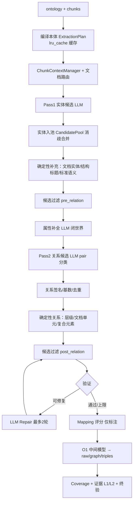

# 知识抽取 V3.1 基线评审（2026-10-08）

> 状态：本文评审的旧 `v3.1`（`v2` 的逐字节副本 + prompt router）实现已随版本清理从代码库移除。当前 `v3.1`（包 `v3_1`）指语义 harness，见 [知识抽取V3.1语义Harness与评测](知识抽取V3.1语义Harness与评测.md)。

## 0. 评审对象与前提

- **对象**：`algorithm/knowledge_extract/v3_1/`，42 个生产模块、16,250 行。
- **前提**：本目录于 2026-10-08 重置为 `v2/` 的逐字节副本（生产 `.py` 经 `diff -rq` 校验无差异）。因此**本评审描述的流程与问题全部是 V2 的**，V3.1 原样继承。被重置丢弃的 WIP 改动备份在 `tmp/backup/v3_1-wip-20261008-130602/`。
- **方法**：代码直读 + 可复现实测 + 5 个独立子审计分层的模块级深挖（LLM/prompt、本体编译、解析与证据、领域策略、校验与状态），关键结论均已二次复核。第 3 节每条注明证据类型与严重度。
- **结构**：§3.1–§3.7 为主题分类（跨层），§3.8–§3.12 为分层补充。同一根因在多层出现时已在文中互相引用，不重复计数。

## 1. 结论摘要

V3.1 本质上是一条**"LLM 提候选 + 确定性规则裁决"的两段式流水线**，架构清晰、职责划分合理。当前的核心问题不是架构，而是六条：

1. **质量闸门形同虚设**：全流程没有任何基于证据的接受门禁，实体永不因证据不成立被丢弃（§3.1）；选择器的 11 个拒绝码无一与证据相关，反而有"按类/族整体拒绝"的规则压制 LLM 结果（§3.12 M8）。这与 v2 实体 precision 仅 0.246 互为因果。
2. **实体身份不稳定、合并过宽**：图 UID 只看 `type::identity`，比 resolver 的合并判据更粗，导致 resolver 拒绝合并的实体在 graph 里并成一个节点（§3.12 H1）；`alias_key` 删掉小数点后 `"1.5 mm"` 与 `"15 mm"` 会被合并（§3.12 H3）。
3. **常见失败模式是静默全量丢数据**：截断响应已解码好的合法前缀被丢弃、schema 校验一处脏字段即丢整批、且都不写 warning（§3.2）。空抽取在算法层不可观测，与 AGENTS.md 要求的 `stats.extraction.empty_reason` 运维路径冲突。
4. **可选步骤的失败会升级为整篇失败**：算法侧 pass 名与 backend 非承重白名单对不上，一次证据核验抖动就能让整篇判 failed（§3.3）；而 `primary_failure()` 又完全忽略 pass_name（§3.10 中-1）。
5. **本体解析静默失真**：`rdfs_subClassOf` 写法完全不被识别为继承，继承链整条丢失且无告警；类型范围收窄失败时会产出 `"enum": []` 的 schema，导致整块静默零抽取（§3.8）。
6. **确定性层与特定 golden 同源耦合**：同一 case 的确定性产出 73/74 命中 `eval-v2` golden、仅 35/74 命中 `eval-v3` golden；且它会整体替换属性字典、静默删掉 LLM 已填属性（§3.11 高-2/高-3）。

此外，本次重置把 V3.1 钉在 V2 的基线上，而 V2 的实测质量显著低于 `v3`/`latest`（§4），且 `v3/latest` 已经修掉了本文 §3.2、§3.8 的多处缺陷——**这些差距是后续演进要补的清单**。

## 2. 抽取流程

入口 `extract_split`（`split_extractor.py:443`），12 个阶段：



| 阶段 | LLM 负责 | 确定性代码负责 |
| --- | --- | --- |
| 实体 | type / mention / span / evidence | 校验、消歧、结构补全、候选拒绝 |
| 属性 | 补缺失属性 | 校验是否声明、是否已有 |
| 关系 | 在**枚举好的 pair** 里选关系或 `NONE` | pair 枚举、签名/基数校验、组装 |
| 修复 | 按 verifier issue 补候选 | 定位 issue、绑定证据、限制轮数 |

关键设计事实：

- **关系不是"抽"出来的**，是在已接受实体两两枚举的 pair 上做分类。关系召回上限被实体集与 pair 枚举双重卡死。
- **Mapping 评分默认只标注不拦截**（`apply_mapping_threshold=False`，`split_extractor.py:945`）：分数照算，不参与接受/拒绝。
- **失败语义**：`ExtractionRun.finish()` 扫描 terminal attempt，按 `incomplete→empty→timeout→request→json→schema→schema_validation` 优先级定 `error_code`；`best_effort=True` 且有事实时降为 `PARTIAL` 而非 `FAILED`（`run_state.py:212`）。
- **包内混装两类代码**：在线流水线，以及离线数据门禁 `benchmark_lint.py` + `markdown_quality.py`（共 1158 行，不被 `extract_split` 调用）。后者不是抽取流程的一部分。

## 3. 问题清单

### 3.1 结构性：没有任何证据门禁

**P0 · 证据类型：代码直读（含拒绝码全枚举）**

实体 pass 中证据定位失败时（`candidate_generation.py:1060-1061`）：

```python
# 实体永不因证据未逐字定位而丢弃；不一致项交给 LLM 核验并留痕。
grounded_entities.append(entity)
```

无条件 append 进名为 `grounded_entities` 的列表。随后对未定位项发起 LLM 核验，但**三种结论全部保留**（`candidate_generation.py:1085-1099`）：

| LLM 核验结论 | 处理 |
| --- | --- |
| `yes` | 记 `ENTITY_EVIDENCE_LLM_VERIFIED`，保留 |
| `no` | 记 `ENTITY_EVIDENCE_LLM_UNSUPPORTED`，**"保留并标记"** |
| 不确定 | 记 `ENTITY_EVIDENCE_UNVERIFIED`，**"保留并标记"** |

`CandidateSelector` 的全部 11 个拒绝码中**没有一个与证据/引文相关**：

```
CANDIDATE_DENSE_ENUMERATION  CANDIDATE_FORM_ALIAS  CANDIDATE_HEADING_TYPE_CONFLICT
CANDIDATE_ISOLATED_MATH_VARIABLE  CANDIDATE_SCALAR_VALUE  CANDIDATE_STRUCTURAL_ALIAS
CANDIDATE_TERMINOLOGY_ALIAS  CANDIDATE_UNSCOPED_DOCUMENT
CANDIDATE_UNSCOPED_TECHNICAL_ENTITY  CANDIDATE_UNSUPPORTED_INFORMATION
CANDIDATE_UNSUPPORTED_INFORMATION_FORM
```

全部是形态/别名/scope 类启发式。**结论：只要类型在本体允许集内，一个原文根本找不到的编造实体会一路进入最终图，只在 `warnings` 留一行。**

后果对账：P0 报告实测 v2 实体 precision **0.246**（`docs/算法/V3抽取质量排查与P0消融对比报告.md`），四分之三的预测实体对不上 golden，而流水线内没有任何环节负责拦掉它们。

**下游无从判断**（实测 grep）：

| | `evidence_status` | `evidence_unverified_count` |
| --- | --- | --- |
| `v3_1` (=v2) | **0 处** | **0 处** |
| `v3` / `latest` | 13 处 | 2 处 |

v3/latest 至少在实体上盖 `evidence_status=unverified` 并在 `quality` 给出计数；V3.1 连这个字段都没有，沉淀/入库侧拿不到"这条不可信"的信号。

### 3.2 可靠性：最常见的失败模式是静默全量丢数据

#### H1 截断响应的合法前缀被解码后又被丢弃

**P1 · 证据类型：代码直读（`recovered_items` 全部出现位置已枚举）**

`generate_structured` 在 `incomplete`（`candidate_generation.py:548`）与 `json` 解析失败（`:566`）两条分支会调用 `_recover_array_prefix`，把被 `finish_reason=length` 截断的 JSON 里**已完整闭合**的条目逐条过 schema 后累积到 `recovered_items`（`:500/554/572`）。但：

- `recovered_items` 仅在两处被消费——`:633`/`:655` 写进 attempt 诊断、`:679-682` 拼进**下一次重试的 prompt** 作为提示（"仅作诊断"）；
- 循环结束 `:708` 只 `return None`，**已解码的候选从未被返回**。

后果：一次解出上百条合法候选被整块丢弃，`entity_pass` 返回 `[]`，该 chunk 判 0 实体且**不写任何 warning**，而 `run.mark_chunk_scan` 仍标记该 chunk "已扫描"。触发条件常见：`max_tokens=16384` + 记录表 chunk（单条实体约 40–80 token）。

旁证：`latest/candidate_generation.py:881-898` 新增了 `return_recovered_on_failure` 并在 `:1450` 传入——**下游版本已确认这是缺陷**，V3.1 缺失。

#### H2 schema 校验失败即整响应丢弃，无条目级救回

**P1 · 证据类型：代码直读（已确认恢复逻辑不在 schema 分支）**

`plan.output_schemas` 全部为 `additionalProperties: False`（`ontology_compiler.py:685/696/703/710`），`validate_json_schema` 确实检查该关键字（`structured_output.py:31-34`）。模型只要在任一项多写一个键（`properties`/`name`/`confidence`/`reason` 都很常见），整响应判 `schema` 失败 → 重试 3 次 → `None` → 该 chunk 0 实体。

关键缺陷：`_recover_array_prefix`/`_valid_recovered_items` **只在 `json` 与 `incomplete` 两条分支被调用**，`schema` 分支（`:578-588`）一次都不调用。100 条里 99 条合法、1 条脏字段，被当成"100 条全错"丢弃。

与 H1 叠加后，截断与脏字段这两类最常见失败都变成静默全丢。

#### H3 可选核验 pass 的失败被登记为 terminal 致命失败

**P1 · 证据类型：跨模块代码核对（两侧均已验证）**

`generate_structured` 对所有 pass 一视同仁标 `terminal=True`（`:673-675`），`RunAttempt` 没有"该 pass 是否承重"的信息。而 `verify_items_with_llm` 语义明确非承重（`:725-728`"核验失败返回空 dict，调用方应保留原结果"、`:746-747` 吞异常），却把 `attempts=local_attempts` 透传（`:1079`/`:1083`），最终并入全局列表（`:1116`）。

触发条件：任一片证据无法逐字定位（表格/OCR 常见）→ 发起 `pass_name="evidence_verification"`（`max_attempts=2`）→ 两次超时/空响应 → `primary_failure()` 命中 → 置 `error_code`。

后果两条路都已核对：

- `extract()` 路径：`result_contract.py:27` 直接 `raise`，整篇抽取抛 `ExtractionError`（并把整个 `run_trace` 塞进 `details`）；
- 生产 `extract_aggregate` 路径：`knowledge_extract_adapter.py:453` `if unattributed or status == "failed": return set(range(total))`；即便只是 `partial`，`:437` 的白名单也拦不住。

**根因是命名契约不一致**（两侧实测）：

```python
# backend/app/services/knowledge_extract_adapter.py:69-71
_NON_FATAL_PASSES = frozenset(
    {"property", "relation", "repair_entity", "repair_relation", "verification"}
)
```

而算法侧实际发出的是 `evidence_verification`（`candidate_generation.py:1076`、`property_enrichment.py:473`）——**不在白名单里**。backend 专门为"非承重 pass"写了白名单，却因 pass 名对不上而形同虚设。修复只需统一命名。

#### M3 合法空集合被当成功，空抽取不可观测

**P2 · 证据类型：代码直读**

`{"entities": []}` 走 `else` 分支（`:597-619`）→ `status="succeeded"` → 直接 `return parsed`，`warnings` 无痕迹、`attempts` 无行、run 状态 succeeded。

触发条件：非记录表 chunk，或任何 `llm` 无 `model` 属性/模型名不以 `deepseek` 开头的适配器——`_is_deepseek_llm` 靠鸭子类型判断（`:357-359`），`extract_split(model=...)` 显式收到的模型名**根本没参与判定**。

后果：与 AGENTS.md 中"空结果凭 `stats.extraction.empty_reason` 定位"的运维路径直接冲突。算法层无法区分"该片确实没有实体"与"模型交白卷 / 被 H1·H2 静默丢弃"，只能看到一个成功的空图。

### 3.3 契约与一致性

#### M4 coverage 账本对 relation 失败免疫

**P2 · 证据类型：代码直读（两侧均验证）**

`split_extractor.py:1077-1092` 用 `("relation", chunk.chunk_id)` 判断 relation 扫描是否完成，但 relation attempt 登记的 chunk 名带批次后缀（`candidate_generation.py:1253`）：

```python
chunk_id=f"{chunk.chunk_id}.batch-{offset // RELATION_PAIR_BATCH_SIZE}",
```

永远不等于裸 `chunk.chunk_id`，所以 `completed=True` 恒成立。某片所有 relation 批次全部 terminal 失败时，`run_trace.coverage_ledger[*].relation_scan_complete` 仍报 true（`run_state.py:203-210`/`:258-270`）——覆盖率账本说谎，而它是评测/告警判断"哪些片扫过"的输入。entity pass 用裸 `chunk_id`（`:1020`）无此问题。

#### validation_mode 默认值与唯一调用方不一致

**P2 · 证据类型：代码直读 + backend 文档注释**

算法默认 `validation_mode="strict"`，但 strict 下验证硬问题**不抛异常**，只往 attempts 追加 terminal `schema_validation`（`split_extractor.py:1062`），再经 `finish()` 变成 `FAILED`/`PARTIAL` 状态。后端因此**刻意**改用 permissive + best_effort（`knowledge_extract_adapter.py:25`）：

> In strict mode V2 turns *any* verification hard issue (a single unlocatable evidence quote, one duplicate entity) into a terminal failure for the whole run. V1 only ever reported those as warnings, so strict mode would convert ordinary documents into failed requests.

叠加 `KG_EXTRACT_PUBLISH_BEST_EFFORT=1`，**生产链路上验证未过只置 `graph_publishable=false` + `status=partial`，图照样发布**。这是 P0 有意为之的 fail-open，但意味着算法层唯一的质量闸门在生产配置下是**建议性**的：任何"验证不通过就不入库"的假设都不成立。

#### 路由是单标签 + margin 硬门

**P2 · 证据类型：benchmark 实测（16 case 全覆盖）**

阈值 `_DOMAIN_THRESHOLD=6`、`_DOMAIN_MARGIN=3`（`prompt_router.py:96-97`）。用 V3.1 自身函数实测全部 benchmark case：

| case | kind | source | 本体分 o/s | chunk 分 o/s |
| --- | --- | --- | --- | --- |
| `official_01…10` | `official_document` | ontology | 35/0 | 4–8/0–5 |
| `standard_01…04` | `standard` | ontology | 5/40 | 0/7 |
| `simple` | `generic` | fallback | 0/0 | 0/1 |

**路由在 16 个 case 上全部正确**，由本体主导判定。所以路由**不是**当前瓶颈。两个设计脆弱点仍然存在：

- `_score_ontology` 每命中一个 token 加 5（`:194`/`:198`），而阈值是 6——**单个本体命中永远无法路由**，必须凑到两个命中；`dual_strong_ontology`（`:310-312`）的实际含义因此是"双方各命中 ≥2 个"。
- 若某本体同时含两类领域词（official ≥6 且 standard ≥6），会改走本体+chunk 合成分，margin 容易不足 3 → 塌成 `generic`，**同时丢掉两侧领域 prompt**。benchmark 无此类本体，属未被测试覆盖的风险（standard 组 official 分已是 5，离 6 只差一个共享词）。

#### 缓存的 OntologySchema 是可变对象且跨请求共享

**P2 · 证据类型：代码直读 + 缓存行为实测**

`_compile_runtime` 带 `@lru_cache(maxsize=32)`（`split_extractor.py:95`），实测同本体两次调用返回同一对象（`CacheInfo(hits=1, misses=1)`）。

- `ExtractionPlan` 是 `@dataclass(frozen=True)`，`allowed_types` 是 `frozenset` → **安全**；
- `OntologySchema` 是**普通 `@dataclass`（非 frozen）**（`ontology_schema.py:181`）→ 同一 ontology 的所有并发请求共享同一个可变对象。

已 grep 全部模块，**当前无任何代码原地修改 plan/schema**，属**潜在隐患而非现网 bug**。但 `max_workers` 并发路径是明确支持的，一旦以后有人在处理链路里写 `schema.xxx[...] = ...`，会变成跨请求污染的诡异故障。

### 3.4 性能与成本

#### 无实体分段能力，高密度文档只能原地重试

**P1 · 证据类型：跨版本对照 + 既有实测**

`v3`/`latest` 有 `KG_EXTRACT_ENTITY_SEGMENT_{MAX_DEPTH,MIN_CHARS,OVERLAP,TARGET_CHARS}` 驱动递归分段（`v3/candidate_generation.py:1583` 的 `ENTITY_SEGMENT_RETRY`），**V3.1 一处都没有**。而它的重试退避基数是 `retry_base_seconds=0.05`（50ms/100ms/200ms）。

P0 报告已点明这类失败的性质：*"截断类失败不重试直接分段（temperature=0 下重试必然同点截断，纯白烧）"*。V3.1 正是"没有分段、只能原地重试"的形态。实测代价：standard_04 单 case extract **8m25s**。

#### 每 chunk 的 LLM 调用模型偏重，且含条件触发的"LLM 核验"

**P2 · 证据类型：调用点枚举**

| pass | 调用次数 |
| --- | --- |
| Pass1 实体 | 1/chunk |
| 实体证据 LLM 核验 | 条件触发（有未定位证据时） |
| 属性补全 | 1/chunk |
| 属性证据 LLM 核验 | 条件触发 |
| Pass2 关系 | `ceil(pairs/200)`/chunk |
| Repair | ≤2 轮 |

即每 chunk 基线约 4–5 次调用，每次另有最多 3 次尝试。两个核验调用条件是"证据无法逐字定位"，因此有个反直觉的放大效应：**模型越倾向改写而非逐字引用，流水线越多地额外发起核验调用**——恰好在最脏的文档上最贵。

#### prompt 无统一长度预算

**P2 · 证据类型：代码直读**

- relation pass 的 `local_context` 是邻居片**全文**拼接、无截断（`candidate_generation.py:1241`）；property pass 至少有 `_NEIGHBOR_TEXT_MAX`。
- `_truncated_neighbor_context` 的 2000 字符预算**只累加 `text`**（`property_enrichment.py:178-185`），而 `payload = item.to_dict()` 带完整 metadata，metadata 不受预算约束。
- 非 repair 分支的 `known_entities` 不截条数，`local_catalog` 最多 160 条且 properties 是完整值——而 `property_enrichment.py:142-148` 的注释已记录"长文本属性把 prompt 从几千撑到两万以上（实测 26k、单次 66 秒）"，那套截断只作用于 property pass。
- `_catalog_text` 把整个 ontology 目录（含 200 字注释）无条件下发，relation 每片每批重复一次。

全链路没有任何 `len(prompt)`/token 预算断言，超限只能等 provider 报错或超时。

#### call_metrics 逐次保存完整 prompt 并随结果返回

**P3 · 证据类型：代码直读**

每次调用（含失败重试）都把 system+user 全文复制进 `call_metrics`（`candidate_generation.py:1344`），再挂到 `result["run_trace"]["calls"]`（`split_extractor.py:1101-1108`）。按 200 片文档估算约 450 次 × 5–20KB ≈ **数 MB 常驻**，随结果对象被上层持有/序列化；`result_contract.py:35` 在失败时把整个 `run_trace` 塞进异常 `details`，等于把全文文档内容带进错误对象与日志。`attempts`/`call_metrics` 均无条数或大小上限。

#### repair 上下文两次截断，长 chunk 尾部永远修不了

**P3 · 证据类型：代码直读**

`split_extractor.py:812` 先把 3 个 chunk 拼起来砍到 15000，`prompt_router.py:451` 再砍到 8000——最终只看到不到 56%，且第二次截断无任何标记。verifier issue 指向长 chunk 中后部时，模型看不到证据 → `_apply_repair_proposal` 全部按 `REPAIR_*_EVIDENCE_INVALID` 丢弃 → `accepted_facts_added == 0` → `orchestrator.py:74-75` 提前 `repair_no_new_facts` 结束。修复轮被浪费，且原因（上下文被截断）在 warnings 里看不到。

#### 每轮 repair 都构造全量 chunks payload

**P3 · 证据类型：代码直读**

`split_extractor.py:906-908` 每轮（≤2）把所有 chunk 转 dict + `deepcopy` 全套 schema，而内置 `builtin_repair` 只读 `issues`/`round`，从不读 `chunks`/`schemas`。仅当调用方传自定义 `repairer` 时才有意义。

#### 其他浪费

- **M6 实体 pass 白烧目录扫描**：`entity_pass` 每片都算 `manager.local_context(...)`（`:984`）和 `relation_catalog_for_context(...)`（`:993`，目录 >80 条时对每条实体每个属性值在 chunk 上做子串匹配，O(N×L)`），但 `build_chat_messages` 的 entity 分支把这两段替换成占位符（`prompt_router.py:587-588`）。后果：`local_previous`/`local_next`/`same_section` 对 Pass1 **完全无效**（调参者看不到任何变化）。佐证性死逻辑：`split_extractor.py:567` 在 Pass1 **之前**取 `known_entities = pool.entity_catalog()`，那一刻池子必为空 → 恒 `[]`，"跨片复用已知实体"的设计意图整体落空。
- **L2**：`_looks_like_record_table` 在属性补全的逐条循环里被反复整篇 JSON 解析（`property_enrichment.py:424`/`:540`），24 条更新的批次最多触发 48 次全量解析，纯浪费 CPU。

### 3.5 诊断信息失真

- **L1 `_next_response_mode` 是恒等函数**（`candidate_generation.py:383-384` 直接 `return response_mode`）。失败降级阶梯实际不存在，但 attempts 每行都写 `next_response_mode`、日志每轮打印"下一模式=…"，看起来像已降级重试；`run_state.RunAttempt.next_response_mode` 是排障字段。同时 `_record_call` 在异常路径把 `response=None` 归为 `api="legacy_callable"`（`:396-406`），于是**所有网络失败都被记成 legacy 调用**，`api`/`response_mode` 两个诊断维度在失败行上失真。
- **M7 schema 声明与校验能力不一致**：`validate_json_schema` 不实现 `minProperties`/`uniqueItems`/`maximum`/`minimum`/`maxLength`/`anyOf`/`$ref` 等，但 property schema 明确声明了 `minProperties: 1` 与 `uniqueItems: true`（`property_enrichment.py:70`/`:114-115`），于是 `{"entity_id":…, "properties": {}}` 被判合法后静默不生效。同时 `_deepseek_strict_schema_compatible` 把这两个关键字当受支持关键字，与本地校验能力各自为政。对 DeepSeek 而言 property pass 实际因同 schema 的 `minItems`/`minLength` 退回 `json_object`（`llm_client.py:389-394`），此时 `additionalProperties: False` 与 `entity_id` enum 都不再由 provider 强制——**约束强度随模型而异，且结果记录里看不出来**。
- **P3 日志取不存在的键**：`split_extractor.py:1117` 打印 `mapping_summary.get("accepted")`，但该 dict 的实际键是 `entities`/`relations`/`average_entity_score`/`low_confidence`/`rejected`/`weights`/`accepted_threshold`/`low_confidence_threshold`——**没有 `accepted`**，该行永远输出 `accepted=None`（已用脚本核过键名）。

### 3.6 硬编码与配置

#### 三个 P0 开关对 V3.1 完全无效（实测）

`.env.example:114-118` 声明了 `KG_EXTRACT_EVIDENCE_ADMISSION=warn`、`KG_EXTRACT_MAX_REPAIR_ROUNDS=2`、`KG_EXTRACT_LLM_MAX_ATTEMPTS=3`。把三者设为非默认值后实测：

```
       v2.config  暴露的相关配置: （无 → 该版本根本不读这些变量）
       v3.config  暴露的相关配置: ['KG_EXTRACT_EVIDENCE_ADMISSION', 'KG_EXTRACT_LLM_MAX_ATTEMPTS', 'KG_EXTRACT_MAX_REPAIR_ROUNDS']
   latest.config  暴露的相关配置: ['KG_EXTRACT_EVIDENCE_ADMISSION', 'KG_EXTRACT_LLM_MAX_ATTEMPTS', 'KG_EXTRACT_MAX_REPAIR_ROUNDS']
```

V3.1 的 repair 轮数只有一个来源——硬编码默认值：`harness_extractor.py:32` → `split_extractor.py:466` → orchestrator；适配器也不传这两个参数。

**危害**：运维想关掉修复（`KG_EXTRACT_MAX_REPAIR_ROUNDS=0`）或把重试降为 1 次来省成本，**改 `.env` 没有任何效果**——修复照样跑 2 轮、主调用照样重试 3 次。静默的配置陷阱。（`KG_EXTRACT_PUBLISH_BEST_EFFORT` 在 backend 侧读取，版本无关，仍然生效。）

#### 硬编码清单（部分）

- `config.py:13` `http://localhost:9999`；`:15` `deepseek-v4-flash`（模型名写死为默认）；`:16` `16384`；`:20` 超时 `300`。
- `llm_client.py:216` `temperature: 0` 写死；`:471` `max_retries=0`。
- `candidate_generation.py:32-42` `80/160/200/512/20/6000`；`:1080` `min(2,…)`；`:1021` `max(max_attempts, 4)`。
- `prompt_router.py:96-99` `6/3/1200/12`（阈值与打分不自洽，见 §3.3）；`:417` repair 只展示前 25 个实体；`:451` `[:8000]`。
- `property_enrichment.py:134-135`（`40`/`3）、`:165-166`（`800`/`2000`）、`:334`（batch `24`）。
- `semantic_evidence.py:53-54`（`0.8`/`0.6`）。

#### 多文件批量只算一次全局路由，且会跨文件取邻居

**P2 · 证据类型：代码直读**

批量沉淀把 N 个文件拼成一篇只抽一次（`knowledge_precipitation.py:1125` 拼 `## 文件: <name>`，`:1135` 合并；适配器只调一次 runner）。V3.1 对整份 chunk 列表只解出**一个** route，且只用**前 12 片**打分（`_MAX_ROUTE_CHUNKS=12`）。后果：

- 第 2..N 个文件全部套用第 1 个文件的领域提示词；
- `route.kind == "standard"` 是标准类确定性补全的唯一开关（`split_extractor.py:630-634`/`:742-756`），判错时标准语义组装对所有标准文件静默失效；
- 上游从不设置 `previous_chunk_id`/`next_chunk_id`，`_previous_id` 退化为"位置相邻"（`chunk_context.py:119-124`），而拼接后文件边界相邻——每个文件首片会把**上一个文件**的尾片文本塞进 relation/property prompt 的 local context。

旁证：`latest/prompt_router.py:371` 实现了按 `document_id`/`## 文件:` 的分段路由，并有 `latest/tests/test_document_route_multilabel.py` 覆盖。

#### JEV 集成是 v3/latest 已移除的遗留

V3.1 保留 8 个 `KG_EXTRACT_JEV_*` 变量与 `jev_client`/`jev_harness`/`jev_probe`（默认关闭）。一旦开启即依赖外部 nanojev 模型；`v3`/`latest` 已整体移除。属技术债而非缺陷。

### 3.7 工程卫生

- **V3.1 没有本地测试套件**（重置时按决策未复制 `v2/tests/`）：16,250 行算法只有 backend 层间接覆盖，`pytest.ini` 里的 `v3_1/tests` 实际只有一个 `stub_llm.py`（供 `tests/backend/test_knowledge_extract_adapter.py` 导入）。这是当前最大的工程风险。
- **`v2` 测试用例不可直接复制**：全部以硬编码合成包名 `knowledge_extract_v2` 注册模块并复用 `sys.modules`，逐字节拷入 `v3_1/tests/` 会让两套测试互相污染、按收集顺序静默测到错误版本。若要在 V3.1 建测试，须把合成包名改为 `knowledge_extract_v31` 或改用绝对包名。

### 3.8 本体编译层：继承解析与类型范围

#### H1 `rdfs_subClassOf` 不被识别为继承，继承链整条丢失

**P0 · 证据类型：真实本体实测复现（已独立验证）**

`ontology_schema.py:271-300` 只认 `--|>` / `<|--` 两种继承写法；用 `rdfs_subClassOf` 表达的继承会落到普通关系分支（`:302`），成为一条**关系**而不是父子关系。

实测（本次复现）：

| 本体 | 类数 | 含 `rdfs_subClassOf` 行 | 含 `--|>` 行 | 解析出的 `parents` 条目 |
| --- | --- | --- | --- | --- |
| `eval-v3/standard/*/Standard_Ontology.puml` | 60 | 45 | 0 | **0** |
| `eval-v2/standard/standard_01/*.puml` | 20 / 15 | 0 | 15 / 9 | 15 / 9 |

数据集分布：`test_data/eval-v3` 有 4 个文件用 `rdfs_subClassOf`、0 个用 `--|>`；`test_data/eval` 1 个；`test_data/eval-v2` 全部用 `--|>`。**即 V2 的 benchmark 恰好绕开了这个坑，而 eval-v3 与任何采用该写法的生产本体全部命中。**

后果三重，全部静默降级：

1. `include_subclasses` 退化为空操作（`ontology_compiler.py:252-253`）：`target_types=["InformationUnit"]` 时 `expanded_types` 只有自身，输出 schema 的 type enum 只有 1 个值 → 子类实体永远抽不到。
2. `is_assignable`（`ontology_schema.py:384-392`）退化为"类型必须完全相同" → **按父类声明的关系签名无法接受子类实体**：`hasStructuralElement`、`hasClause`、`referencesClause`、`describesAction`、`usesTerm`、`hasRepresentationForm`、`hasNormativeElement` 全部会被 `RelationResolver.add` 以 `RELATION_ENDPOINT_TYPE_MISMATCH` 拒绝，`hierarchy.py` 各 `assemble_*` 计数恒为 0（它们只统计 accepted）。
3. `_compile_class_specs` 依赖 `parents` 物化属性 → 子类完全拿不到父类属性（见 M2）。

旁证：`v3/ontology_schema.py:350` 已加 `rdfssubclassof` 归一化分支。

#### H2 下发给 LLM 的严格 schema 出现 `"enum": []` → 整块静默零抽取

**P0 · 证据类型：代码直读（两条触发路径均可复现）**

`ontology_compiler.py:652-664/678/691` 用 `concrete_types`（allowed_types 中去掉抽象类）填 entity 的 type enum；`candidate_generation.py:303-305` 再按 `allowed` 求交集。两条路径都会得到空 enum：

- **A（`target_types` 写错）**：`UNKNOWN_TARGET_TYPE` 只有 `severity="warning"`（`ontology_compiler.py:241-249`），且 `requested` 非空故不走全量回退 → `allowed_types == frozenset()`。`extract_split` 的 strict 闸只拦 `severity=="error"`（`split_extractor.py:493-499`），因此不抛错、继续跑。
- **B（正常本体 + 正常文本）**：`relevant_types`（`:183-196`）命中的连通分量若只含抽象类，返回值与 `concrete_types` 交集为空。例如本体含 `abstract class "元素" as Element`（孤立分量），文本出现"元素"即命中。

后果：`llm_client._deepseek_strict_schema_compatible`（`llm_client.py:29-61`）不检查空 enum，schema 以 `strict=True` 原样下发；模型只能返回空集合，而空集合**能通过本地校验** → 该 chunk 零实体、无任何告警。同时 `CandidatePool`（`entity_resolver.py:283-285`）对空 `allowed_types` 回退为"允许本体全部类"，与 `plan.allows()`（全 False）自相矛盾。

这条与 §3.2 M3（空集合不可观测）叠加，构成一条完整的**静默空抽取**链路。

#### M1 `relevant_types` 是子串匹配 + 失败即放开

**P1 · 证据类型：代码直读**

```python
if any(cue and cue in normalized for cue in cues):   # 子串包含，不是词边界
    selected.update(partition.class_ids)             # 命中一个 = 整分量放行
return frozenset(selected or self.allowed_types)     # 什么都没命中 → 放开全部
```

短 cue（`id`/`no`/`name`/`编号`/`号`）几乎命中任意文本；而分区是连通分量，抽到根类时一个命中就拉进整图。两头失效：该窄的不窄（prompt 与全量一致，白做），不该窄的窄成空集（放大 H2-B）。

#### M2 `ClassSpec` 只物化直接父类属性，而校验走传递闭包

**P1 · 证据类型：代码直读 + 实测**

`ontology_compiler.py:537-557` 只取 `parent_class.properties`（父类**自身声明**的属性），不递归。实测三层链 `Document <|-- Chapter <|-- Clause`：`Clause` 的属性只有 `clauseTitle`/`clauseNo`，**祖父的 `docNo` 丢失**；而 `schema.resolve_property("Clause","docNo")` 走 `_properties_for`（`ontology_schema.py:394-412`，本文件内已有递归实现）能解析到。

后果：同一条属性，`validate_extraction` 认而 `feature_specs`、prompt 属性目录（`prompt_router.py:144-147`/`:377`）、`property_enrichment._declared_properties`、`candidate_selector` 都不认 → LLM 从不被要求抽这些属性（漏抽）；`document_entities._document_class` 若编号/标题属性来自祖父也会直接放弃文档锚点。

旁证：`v3/ontology_compiler.py:655-657` 已改为 `schema._properties_for(identifier)` 并注明"materializes the complete transitive ancestor chain"。

#### M3 `@identity` 指向继承属性时存的是显示名而非稳定标识

**P2 · 证据类型：代码直读 + 实测**

`ontology_schema.py:258-262` 用 `OntologyClass.resolve_property`（`:164-169`，只遍历**自身**属性）解析 identity。实测：父类声明 `文档编号 (docNo)`、子类写 `' @identity Clause: 文档编号` → `identity_properties == ('文档编号',)`，而真实属性 id 是 `docNo`。

后果：`entity_resolver.py:76-83` 的 `properties.get("文档编号")` 永远取不到值 → 静默退回 name 身份。身份键决定 UID（`graph_utils.entity_uid`）与合并行为，于是"按编号本应同一实体"会分裂成多条；prompt 里还宣传了一个不存在的属性名。

#### M4 多父类身份冲突只按继承行序取值，无告警

**P2 · 证据类型：代码直读 + 实测**

`ontology_schema.py:428-436` 遇到第一个有身份的父类直接 `return`。实测 `C --|> A` + `C --|> B` → `('aNo',)`；两行对调 → `('bNo',)`，`run_schema_qa` 无任何冲突告警。

后果：同一本体只要导出文件的行序变化，C 类实体的身份属性就翻转 → UID/合并/去重语义改变且完全不可见。旁证：`v3/ontology_schema.py:553-555` 已改为"冲突时返回空，而不是依赖声明顺序"。

#### M6 不支持的 PlantUML 语法静默忽略；`<<enumeration>>` 会把类名变成 "enumeration"

**P2 · 证据类型：代码直读 + 实测**

`ontology_schema.py:26-30`/`:210-211`/`:237-238`：`interface`/`enum`/`entity`/`!include`/宏 等一律静默丢弃。

- 未被关系引用的 `enum`/`interface` 声明：strict 与 permissive 下**零告警**，类型凭空消失（作者以为声明了，LLM 永远看不到）。
- 被关系引用时：strict 下 `UNRESOLVED_RELATION_ENDPOINT_TYPE` 是 `error`（`ontology_compiler.py:362-363`）→ 抛 `ExtractionValidationError`；permissive 下只是 warning，且该关系族从 plan 里悄悄消失。
- `class "颜色" <<enumeration>>` 无 alias 时 `identifier` 取 `stereotypes[0]`（`:147-153`）→ 类名变成 `enumeration`；两个枚举类即触发 `DUPLICATE_CLASS`（恒 `error`）→ strict 硬失败，permissive 下 `classes_by_id` 后者覆盖前者，`resolve_class("颜色")` 返回**另一个**类。

旁证：`v3/ontology_schema.py:55-56` 已加 `_UNSUPPORTED_DECLARATION`/`_UNSUPPORTED_PREPROCESSOR` 显式上报。

#### L2 属性行解析器会把 `--`、方法行当属性

**P3 · 证据类型：代码直读 + 实测**

`ontology_schema.py:32-35`/`:110-135`：`:122` 去掉前导 `-` 后可能剩空串。实测 `{ --  + getName(): String }` → 属性 `('', '', 'string', '')` 与 `('getName()','getName()','String')`。后果：`ClassSpec`/`FeatureSpec` 混入退化项（`feature_id="X."`），prompt 里出现空属性名；空 identifier 还让 `resolve_property("")` 返回 `""`。

#### L3 继承属性的大小写变体不去重，且两条解析路径结论相反

**P3 · 证据类型：代码直读**

`ontology_compiler.py:538` 用**原始** identifier 去重（v3 用 `canonical_name`）。实测父 `Name:string` + 子 `name:int` → `ClassSpec.properties` 同时保留两者；而 `_properties_for`/`resolve_property` 按插入序 + 大小写不敏感匹配，返回的是**父类**的 `Name(string)`。同一属性两种类型：校验按 string 强转、prompt 列两条，跨继承的 datatype 冲突不报（`run_schema_qa:384-401` 只在单类内比较）。

### 3.9 关系解析与确定性组装

#### M5 `DETERMINISTIC_RELATION_IDS` 拼写不匹配 → `HAS_PART`/`EVIDENCED_BY` 仍被送进关系分类器

**P1 · 证据类型：实测复现（已独立验证）**

`relation_resolver.py:14-50` 的集合用的是**无下划线**拼写，而 `canonical_name`（`graph_utils.py:25-36`）保留 `_`。实测：

```
canonical_name('HAS_PART')     = 'has_part'      在集合里? False
canonical_name('EVIDENCED_BY') = 'evidenced_by'  在集合里? False
canonical_name('hasSubClause') = 'hassubclause'  在集合里? True   ← camelCase 恰好能匹配
canonical_name('HAS_SUB_CLAUSE')= 'has_sub_clause' 在集合里? False
```

集合里与这两者对应的条目是 `['evidencedby', 'haspart']` —— 永远匹配不上。

后果与两处代码注释**直接矛盾**（`split_extractor.py:735-737`："HAS_PART / EVIDENCED_BY … are assembled here instead of being enumerated for the relation classifier"；`hierarchy.py:374-377` 只保留 document→unit 方向）：

- 大量无用 pair 进 prompt（公文 DocumentUnit 极多，`RELATION_PAIR_BATCH_SIZE=200` 会因此多发批次）；
- 本体若两个方向都声明，分类器可以合法产出**反向** `DocumentUnit -> OfficialDocument` 边（`RelationResolver.add` 按 `(from, rel, to)` 去重，反向是新 key）→ 与确定性方向过滤冲突，产生金标之外的假阳。

camelCase 的 `hasSubClause` 恰好能匹配，所以**只有公文（official）这条链出问题**。

#### M7 确定性组装层大量硬编码领域词表，换本体即静默失效

**P2 · 证据类型：代码直读**

- `hierarchy.py` 写死类型 id：`documentunit`(`:371,377`)、`clause`(`:513,687`)、`actionclass`(`:696`)、`property`(`:773`)、`Subject of Standardization`(`:793`)、`externalresource`(`:840`)、`constrain`/`constraint`(`:858`)；写死中文标记：`附录`/`参考文献`/`要求`(`:518-529`)、`术语和定义`/`符号`(`:536-537`)、`附件`(`:335`)、`约束目标`(`:866`)、谓词表 `应无|应正确|应清晰|应符合|应满足`(`:832`)、`按…检验|试验`(`:718,732`)；关系 id 写死 `hasSubClause`/`hasStructuralElement`/`cites`/`hasClause`/`defines`/`usesTerm` 等十余处。
- `structure_entities.py:98-99` 写死 `章编号`/`条编号`/`章标题`/`条标题`。
- `document_entities.py:110-124` 写死 `发布日期`/`实施日期`/`编制目的`/`语言版本`/`标准状态=现行`/`标准约束类型` 与 `GB/T→推荐、GB→强制`；`:29` 写死 `本文件规定了`。

触发条件：换一套命名（`hasSubClause`→`hasChildClause`、`章编号`→`chapterNo`、类 id 用中文）即整族关系静默不产出，`profile` 只显示 0，**没有任何 schema 层告警**。当前 4 套 benchmark 恰好命中，所以是耦合风险而非现行故障。

#### L1 `_document_class` 的"参与关系加分"是死代码

**P3 · 证据类型：实测复现**

`document_entities.py:63` 用 `plan.relation_specs.get(class_id)` 给参与关系的类加分，但 `plan.relation_specs` 的 key 是**关系 id**（实测 key 为 `['hassubclause','hasclause','defines','referencesclause','hasrepresentationform']`，`plan.relation_specs.get("Standard")` 恒为 `None`）。

后果：该加分永不生效 → 两个文档类得分并列时走 `:79-80` 的平局弃权 → 无文档锚点 → `assemble_document_relations` 全 0。当前 4 套 benchmark 仍能选出（Standard/OfficialDocument），属潜在故障。

#### L4 `_nearest_document_unit` 对"位于所有单元之前"的实体回退到第一个单元

**P3 · 证据类型：代码直读**

`hierarchy.py:315-316`：`return preceding[-1] if preceding else eligible[0][1]`。前言/标题区的事实会被挂到它后面才开始的 DocumentUnit 上，产生"证据不在该单元内"的 `EVIDENCED_BY` 边。

### 3.10 校验、覆盖与运行状态层

#### 高-1 coverage/verifier 用"显示名键"比对"稳定属性 ID" → required 属性被误判缺失

**P0 · 证据类型：代码直读（键空间已核对）+ 下游已修旁证**

`_compat_properties`（`split_extractor.py:189-201`）把对象模型的属性键从稳定 ID 换成**显示名**：

```python
labels = {canonical_name(prop.identifier): str(prop.display_name or prop.identifier) ...}
return {labels.get(canonical_name(key), key): value for key, value in entity.properties.items()}
```

而审计与校验吃的是这份 compat raw（`:1021`/`:1025`、`verification.py:167`），`coverage.py:112-113` 却拿**稳定 ID** 去比对：

```python
provided = set(entity.get("properties") or {})                      # ← 显示名键
missing = [spec for spec in intrinsic if spec.identifier not in provided]   # ← 稳定 ID
```

中文本体天然是"中文显示名 + 拉丁 ID"（`+ 术语标准名称 (TermName): String`），于是**每个 intrinsic 属性都被判为缺失**：

- 若本体写了 `@required`：`hard = any(spec.required is True ...)` → strict 直接 `failed`/`LLM_SCHEMA_INVALID`；permissive 下 `verification.valid=False` → 后端 `graph_publishable=false` + 降级 partial（图谱不进沉淀）；repair 循环还会去"补"一个已经存在的属性，白烧一轮 LLM（`repair_rounds=[{round:1, accepted_facts_added:0}]`）。
- 若没写 `@required`：`coverage_gaps` 凭空多出 `feature_coverage` 项 → 覆盖报告系统性虚高。
- `_composite_coverage`（`coverage.py:282-288`）用同一 compat 键比 `spec.combination_property`，同类误报会升级成可修复的 `REQUIRED_RELATION_MISSING`，把 repair 引向"补一条已存在的关系"。

**旁证（已核对）**：`latest` 专门修了这个 bug——`latest/graph_assembler.py:262` 新增 `canonical_raw()`，并在 `latest/split_extractor.py:2056-2057`（校验）与 `:2127`（覆盖）改用它。属被承认的缺陷，非设计。

#### 高-2 strict 只是"打标签"：仍返回完整 graph/raw，且 error_code 一律写成 LLM_SCHEMA_INVALID

**P1 · 证据类型：代码直读 + 实测**

`split_extractor.py:1062-1075` 在 strict + hard issue 时**只追加一条 attempt**，不抛异常、不清空结果。实测：`status='failed' error_code='LLM_SCHEMA_INVALID'`，`graph` 照旧返回。补充 §3.3 的两点：

- 同一文件里 strict 语义不自洽：本体编译阶段是 `raise ExtractionValidationError`（`:494-499`），结果校验阶段只标状态；
- `error_code` 恒为 `LLM_SCHEMA_INVALID`，即使 hard issue 其实是 `DUPLICATE_ENTITY`/`DUPLICATE_RELATION`/`FINAL_SCHEMA_FACT_LOSS`/`DANGLING_RELATIONSHIP`（与 LLM 输出无关）→ 抛出的消息是"LLM 返回内容不满足 ontology 约束"，**误导排查方向**；
- `extract_split` 在 `__all__` 中公开导出，直接读 `result["graph"]`/`["raw"]` 的调用方拿到的是"形状完全正常"的降级数据。

#### 高-3 空输入返回"成功"：`succeeded` + `valid=true` + 覆盖率 1.0

**P1 · 证据类型：代码直读 + 实测**

`_empty_result` 里 `run.absorb_attempts([])` 后 `run.finish(...)`（`split_extractor.py:388-389`），`primary_failure()` 只看 terminal attempt → `None` → `status = SUCCEEDED`。实测：

```
status='succeeded' error_code=None stop_reason='empty_input' verification={'valid': True, ...}
```

`ExtractionRun` 状态机没有"空输入"这一态；唯一信号 `stop_reason`/`warnings[EMPTY_INPUT]` 都被公开契约丢弃（`result_contract.py:39-62` 只取 raw）；而 `evidence.py:277-278` 把 `total=0` 的覆盖率定义为 **1.0** → 空抽取在观测上是"100% 覆盖且成功"，正好是发布门禁 `gate.empty_failures` 想抓的形态。

#### 高-4 `apply_mapping_threshold=True` 会连低置信带一起删掉，且事后校验报 valid

**P1 · 证据类型：代码直读（opt-in 路径）**

`split_extractor.py:943-946` 在 enforce 模式下把 `low_confidence` 也写进 `mapping_status`，而 `pool.accepted_entities()` 只认 `== "accepted"`（`entity_resolver.py:381-382`）→ **低置信带（0.70–0.85）被一并删除**。实测：`nodes=0`，而 `status='succeeded'`、`verification.valid=True`、`mapping={'low_confidence':1,'rejected':0}`，唯一痕迹是文案读起来像"保留但标记"的 warning `MAPPING_LOW_CONFIDENCE`。

`mapping_scorer.py:14-16` 明确写"enforce 只按阈值过滤 **rejected** 候选"，对应测试也只覆盖 rejected 带——低置信带被删是**未实现、未测试**的行为。且删除发生在 `ExtractionVerifier.verify` **之前**，校验对象是"已被删空的图"，自然 valid。

#### 中-1 纯增量 pass 的失败被当成"必需 pass 失败"

**P2 · 证据类型：代码直读 + 实测**

`run_state.py:236-249` 的 `primary_failure()` 只按 `error_type` 排序，**完全忽略 `pass_name`**。实测（entity pass 成功、property pass 永久 503）：`status='failed'`、`error_code='LLM_REQUEST_FAILED'`、`stop_reason='required_pass_failed'`，而实体已抽全、图可用。默认参数下 `extract()` 直接抛异常丢弃整篇结果。

后端 `_NON_FATAL_PASSES` 反而明确把这些 pass 列为非承重（`knowledge_extract_adapter.py:69-71`）——与 §3.2 H3 是同一根因的两面：**算法侧对"哪些 pass 承重"没有建模，后端白名单又漏了 `evidence_verification`**。

#### 中-2 repair 循环的"新增事实"计数不可靠

**P2 · 证据类型：代码直读 + 实测**

`_pool_fact_keys`（`split_extractor.py:272-292`）把 `properties` 与 evidence `span_id` 都算进 key，于是**同一实体换一个可定位的 quote 复述**就被计为新增进展。实测：图节点数始终 1，但 `repair_rounds=[{round:1,'accepted_facts_added':1},{round:2,0}]` → 因此多跑一轮 LLM。

反方向也会错：计数用 `pool.accepted_entities()`（此时 `mapping_status` 默认 accepted），而修复后的 `selector.pre_relation/post_relation`（`:926-927`）才做拒绝 → "计为进展但最终没进图"与"真修好却计数为 0 被提前终止"两个方向都会发生。**结论：`repair_stop_reason` 不宜作为质量指标。**

#### 中-3 `_repair_context_chunks` 的索引空间与 verifier 不一致

**P2 · 证据类型：代码直读 + 实测**

`split_extractor.py:156-175` 按 `entities[i]` 取事实，但 verifier 的实体顺序来自 `build_intermediate_model`（按 type/identity/candidate_id **排序**，`:211-218`），而修复上下文传的 `entities=pool.entity_catalog()` 是**插入顺序**（`entity_resolver.py:388-407`）。实测：verifier 标 `entities[0]`=Alpha（chunk c2），上下文却解析到 **c1**。

多数 issue 因 path/context 里带 `chunk:start:end` 而被掩盖；但 `rejected_warnings` 的 path 是裸 `"relations"`（`relation_resolver.py:336`），chunk>3 时选不中任何 chunk → `REPAIR_CONTEXT_UNRESOLVED`、跳过本轮，并把"定位不到上下文"误报成 `repair_no_new_facts`。

#### 中-4 `rejected_warnings` 校验支路整体是死代码

**P2 · 证据类型：代码直读**

`pool.unresolved_relation_rejections()` 只可能产出 4 个 code，其中 3 个被 `_REJECTED_RELATION_CANDIDATE_CODES` 过滤（`verification.py:12-16`），第 4 个 `RELATION_HIERARCHY_MISMATCH` 在 `_repair_type_for_code` 里无映射返回 `None`（`:239-247`）→ `continue`。于是 `_repair_type_for_code` 里的 `UNKNOWN_RELATION_TYPE`/`RELATION_ENDPOINT_TYPE_MISMATCH`/`UNKNOWN_RELATION_ENDPOINT_ID`/`DANGLING_RELATIONSHIP` 全部不可达，**文档承诺的 `dangling_relation_endpoint`/`relation_direction_or_signature` 两类修复从不发生**，`verify(rejected_warnings=...)` 参数事实上无效。

#### 中-5 参数校验发生在整轮抽取之后，且全函数没有异常边界

**P2 · 证据类型：代码直读**

`TargetedRepairOrchestrator(max_rounds=...)`（`:912`）与 `MappingScorer(...)`（`:930-934`）的 `ValueError` 校验都在 `run.start()`（`:541`）与所有 LLM pass **之后**；`run` 是局部变量且全函数无 try/finally。后果：`extract_harness(max_repair_rounds=3)` 或写错 mapping 阈值会在**烧完整篇 LLM 之后**抛裸 `ValueError`，调用方拿不到 run_id/trace/结果。

更普遍的问题：`split_extractor.py`/`verification.py`/`coverage.py`/`run_state.py`/`orchestrator.py`/`batch.py`/`__init__.py`/`config.py`/`jev_harness.py` **一处 `except` 都没有**——不是"吞异常"，而是**完全没有异常边界**：`run.start()` 到 `run.finish()` 之间任何异常都越过 `ExtractionRun`，run 永远停在 `running`，无 trace、无 error_code。

真正的静默吞异常集中在被调用模块（完整表格见审计记录），影响较大的四处：

| 位置 | 后果 |
| --- | --- |
| `candidate_generation.py:63` `_structured_row_segments` | 表格 JSON 解析失败静默退化为"整块当普通文本"，结构化行切分消失，无痕 |
| `candidate_generation.py:746` `verify_items_with_llm` | 语义核验整体失效 → 调用方按 `uncertain` 处理并**保留**事实，失败方向是"未核验的当已核验接受"，且不留 attempt/warning |
| `hierarchy.py:594`/`:672`、`standard_semantics.py:444` | `KeyError` → 静默跳过该条款/实体，若上游 segment id 与 chunk id 不一致会**整类丢关系且无人知** |
| `candidate_selector.py:130` `_chunk_text` | 支撑窗口为空 → 支配/弃用规则在"看不见上下文"时静默生效，可能误拒候选 |

#### 中-6 `extract_aggregate` 用 `**_` 静默吞掉任意关键字参数

**P2 · 证据类型：代码直读**

`__init__.py:21-47` 的签名是 `**_: Any`，只显式转发 10 个参数；而 `extract(**kwargs)`（`:12-18`）全量转发。后果：`repairer=`、`max_repair_rounds=`、`use_scheduler=`、`include_subclasses=`、`unknown_content_policy=`、`apply_mapping_threshold=`、`run_id=` 全部被静默忽略，连 `targt_types=` 这类拼写错误也不报错。**同一包的两个公开入口对同一 kwarg 一个生效一个丢弃。**

#### 中-7 evidence 类问题永远只是 warning

**P2 · 证据类型：代码直读**

`verification.py:156-165` 把 `EVIDENCE_INVALID` 硬编码为 `severity="warning"`，`:193-200` 的 `evidence_missing` 同样 warning 且无 `repair_type`；`split_extractor.py:1036-1043` 只转成 warning。后果：实体/关系缺证据或 quote 无法定位时，strict 仍 `valid=True`、status=succeeded，公开契约完全看不到，repair 也不会去修。**AC-4/§16 在 strict 下没有任何强制力**——与 §3.1 的证据门禁缺失是同一结论的另一个入口。

#### 中-8 JEV：默认关闭，但开启即硬失败，且模型目录里的代码会被执行

**P2 · 证据类型：代码直读**

`harness_extractor.py:55-59`：`if jev_enabled(): get_jev_client()` —— 返回值丢弃，失败即抛。四个后果：

1. `from_pretrained` 要求 `CUDA_VISIBLE_DEVICES` 已绑定（`jev_client.py:92-95`）→ CPU-only worker 上打开开关会让**所有**抽取请求在抽取前抛 `JevUnavailableError`；
2. `lru_cache` **不缓存异常** → 每对候选都重新尝试加载（`entity_resolver.py:239-249` 每次 catch 成 warning），反复失败的昂贵加载；
3. 调用方已显式传 `entity_adjudicator` 时仍强制加载模型；
4. `_load_predictor_class` 用 `exec_module` 执行 checkpoint 目录里的 `source/scripts/predict_toy_decisions.py`（`jev_client.py:202-212`）——**模型目录里的代码会被当算法代码执行**。

另：`jev_harness.partition_relation_pairs` 只被 `jev_probe` 调用，主流水线从未接入 → 关系侧 JEV 是死代码；`NanoJevClient.predict` 传 `temperature=1.0`（`jev_client.py:120`），对决策头是采样语义，与"确定性判据"相悖。

#### 中-9 `config.py` 在 import 期做 `int()/float()` 转换

**P2 · 证据类型：代码直读**

`config.py:16-20` 在模块顶层把环境变量转成 `int`/`float`。写成 `"16k"`/`"300s"`（很常见）→ `ValueError` 在**模块导入**时抛出 → `algorithm.knowledge_extract.v3_1` 整包不可导入；而后端 `knowledge_extract_adapter.py:42` 顶层 import 全部版本 → **不是"一个参数失效"而是"抽取功能全挂"**，且没有回退与告警。

#### 中-10 `batch.py` 用显示名重建 UID，identity≠name 时静默丢关系

**P2 · 证据类型：代码直读**

`batch.py:69-70` 用 `entity_uid(from_type, from_name, None)`（`from_name` 是显示名），而 `graph_assembler.py:43` 用 `entity_uid(obj["type"], obj["identity"])`（identity 值）。本体声明了 `@identity` 且 identity 值 ≠ 显示名时，两边 UID 不同 → `filter_relationships_with_known_nodes`（`graph_utils.py:90-104`）把它们全部丢弃，跨 chunk 关系恢复静默失效、无 warning。

#### 低severity 项

- `orchestrator.py:58-77`：`max_rounds=0` 且存在 gap 时一轮没跑却报 `repair_round_limit`（实测 `repair_rounds=[]` + `repair_stop_reason='repair_round_limit'`）→ 巡检会把"配置成不修"误判成"修到上限"。
- 日志语义双错（`split_extractor.py:1115-1120`）：既读不存在的 `accepted` 键（§3.5），又把 mapping 的 `rejected` 档位说成"候选被拒"——实测 `rejected=1` 而 `graph.nodes=1`（实体根本没被拒）；叠加 高-4 会出现"没拒却报 rejected"和"删了却报 0"。
- `_empty_result` 的结果形状与正常路径不一致（`:409-431` vs `:1133-1181`）：`evidence_coverage` 只有 `entities` 一层、`summary.mapping` 缺 `weights`/阈值、`profile` 只有 4 个键 vs 正常 20+ → 只按正常形状取值的消费者，恰好在"空抽取"这条最需要观测的路径上 KeyError。
- `error_code`/`stop_reason` 双份且互相覆盖：`run.finish(stop_reason=repair_stop_reason)`（`:1095`）被 `run_state.py:229-233` 覆写成 `required_pass_failed`/`best_effort_partial`；结果里同时存在 `run_trace.stop_reason`（被覆写）与 `profile.repair_stop_reason`（原值），后端读后者、评测/巡检读前者 → **两边结论不一致**。`result_contract.py:30` 的 `result.get("error")` 恒为空（结果里从无顶层 `"error"` 键），是死分支。

### 3.11 领域策略层（`standard_semantics` / `property_enrichment` 等）

本层含 `standard_semantics.py`(1305) + `standard_strategy.py`(638) + `official_document_strategy.py`(482) + `property_enrichment.py`(604) + `document_entities.py`(321)，约 3350 行。

#### 高-1 继承方言直接决定语义产出

**P0 · 证据类型：代码直读 + 实测（与 §3.8 H1 同源，此处是语义后果）**

`standard_semantics._descendants`（`:79-92`）依赖 `parents`，`parents` 为空（§3.8 H1）→ `_stage_type`（`:95-117`）永远选不到具体子类。实测同一 case：

| 本体方言 | 产出 |
| --- | --- |
| `rdfs_subClassOf` | 抽象父类 `StandardizationProcess "制定程序"` |
| `--|>`（eval-v2） | golden 要求的 `Approval and PublicationStage "批准发布阶段"` |

继承属性同样丢失：`_add_content_entities` 想写的 `条编号`/`条标题`/`唯一标识符` 全部落空（实测 `Clause` 只剩 `{"条款类型":"条款"}`，而 golden 要求 `唯一标识符`+`内容描述`+`条款类型`）。

#### 高-2 确定性逻辑是照 eval-v2 的 golden 写的（自证式耦合）

**P0 · 证据类型：代码直读 + 对比实测**

同一 case（standard_01）的确定性产出：74 个非结构实体中 **73 个逐字命中 `eval-v2` golden**，而只有 **35 个命中 `eval-v3` golden**（39 个冲突/多余）。具体差异：

- Clause 命名 `"5.4 室温放电容量要求"`（`standard_semantics.py:1102-1110`）vs 新 golden `"5.4 室温放电容量条款"`；
- 附录 Clause `"附录A 工装要求"`（`:1148-1155`，靠 `工装/装置/程序/方法/记录/数据` 硬编码 tail 截断）；
- 3 条引用文献被建成 `Standard` 而非本体自带的 `ReferencedDocuments/文献`（`document_entities.py:302-305`）；
- 7 个 `Constrain` 的名字/属性与 golden 不同；11 个 `ActionClass` 名字不同。

**这是本层最重要的结论：确定性逻辑与某一版 golden 强耦合，换 golden 即大批量不命中。**

#### 高-3 确定性 pass 整体替换属性字典，静默删掉 LLM 已填的属性

**P0 · 证据类型：代码直读 + 实测**

不是 merge，是**整体替换**：`standard_semantics.py:852` `accepted.properties = dict(constraint_properties)`、`:1052` `prop.properties = dict(property_properties)`，另有 `:1021`/`:298`/`:1226`/`:1253`、`document_entities.py:310`。实测：LLM 填的 `Property「放电容量/特性值=不低于初始容量的95%」`被删空（而 eval-v3 golden 要求该属性）；`Constrain「初始容量极差约束」`最大值 `5%`→`5`，而 `property_conflicts` 里却记录 `kept:"5%"` —— **记录与实际结果相反**。

这绕过了 `entity_resolver.py:428-450` 的 merge 冲突策略（该策略本意是保护先到的 LLM 值）。

#### 高-4 `property_enrichment` 的"值必须来自当前 chunk"根本没生效

**P0 · 证据类型：代码直读（已核对调用点）**

`_literal_supported`（`:217`）与 `_requires_literal`（`:228`）**只有定义、零调用点**；`_valid_update`（`:233-251`）签名收了 `chunk: ExtractionChunk` 却**从不使用**，末尾直接 `return True`：

```python
# 是否逐字定位不再决定丢弃：调用方先做语义比对，不一致时交由大模型核验。
return True
```

实测：返回 `特性值="绝对不存在的虚构值"`、`evidence.quote` 用 chunk 内已有片段 → `applied=1`、`warnings=[]`、值写入实体。**闭世界只约束了 `entity_id` 与属性名，没有约束值。**

#### 高-5 路由完全由本体决定，内容证据被丢弃

**P1 · 证据类型：代码直读 + 实测**

`prompt_router.py:309-333`：本体单边 ≥6 分即 `source=ontology` 并**忽略 chunk 打分**。实测：公文（`中车集团办科信〔2026〕18号` + `关于开展…通知`）配标准本体 → `kind=standard`；标准配公文本体 → `official_document`，而 `reasons` 只有 `route.selected.*`，**看不到 `〔2026〕18号` 这类反证**。

另：`_score_ontology` 的 `issuedby` 一项就让标准本体白拿 `official_document=5` 分（本文 §3.3 实测中 standard 组的 5/40 即此来源）。

#### 高-6 规范性引用行会把主文档属性整体换掉

**P1 · 证据类型：代码直读 + 实测**

`document_entities.py:306-312`：规范性引用行若与主文档同号同名，`ref_properties` 会**替换**主文档属性。实测：主文档的 `发布日期`/`实施日期`/`编制目的`/`语言版本`/`标准约束类型` 全被清空，只剩 `{文件编号, 文件名称, 标准状态}`，且 `normative_reference_ids` 为空（引用没建出独立实体）。

#### 中severity 项

| # | 问题 | 定位与后果 |
| --- | --- | --- |
| 7 | 领域词表/单位假设 | `_TECHNICAL_PROPERTY_ENDING`(`:41-42`)、`_REQUIREMENT_MODAL`(`:40`，只有 5 个情态词，缺 `应/宜/不得/应能`)、`_ENVIRONMENT_PREFIX`(`:54`)、**unit 恒为 `"%"`**(`:656`)。实测 Property 只出 9/20（golden 20），非百分数约束（MPa/℃/s/mm）**全部静默丢弃** |
| 8 | 编造数值 | `:636-638` 当"不低于 X"且右侧出现引用名而无百分数时把 value 置 `"100"`（实测 `最小值=100`、`阈值范围=100-110`，原文无此数）；`:1206` 硬编码阶段代码 `"60"`，且 `enddate=startdate=发布日期` |
| 9 | 枚举越域 | `:827` 所有约束的 `约束类型` 恒为"质量约束"（golden 有时间/安全/流程/合规约束）；`:1108`/`:1118` 条款类型写 `"条款"`/`"要求"`，**不在本体注释声明的枚举**（要求型/推荐型/指示型/允许型/陈述型）内 |
| 10 | 静默失效的类名门控 | `:1065-1069` 只要 `Normative Element`/`Informative Element`/`Clause` 三个字面类名缺一就 `return {}`，连带 `Clause→Property→Constrain` 全链消失；本体写 `NormativeElement`（无空格）即失效，无告警。同链还隐式依赖 `structure_entities.py:27-44` 的 `hasSubClause` 唯一拓扑 |
| 11 | property pass 结构性缺陷 | `:345-346` 把确定性实体整体排除在补全之外（与高-3 叠加＝Clause 既不能补也不能改，永远缺 `唯一标识符`/`内容描述`）；`:352-355` 无 anchor 的实体挂到 `chunk_ids[0]`，属性/证据可能来自不相关首片；`:410-418` 的 per-update 拒绝分支**基本不可达**——本地 `validate_json_schema` 会因单个越界 `entity_id` 整体打回，重试 3 次付费调用后 `parsed=None`，summary 是 `applied=0/rejected=0/warnings=[]`（实测日志 `status=schema`） |
| 12 | 死代码 / 职责边界 | **v3_1 内无任何模块 import `standard_strategy` / `official_document_strategy`**（仅它们互相注册，`__init__` 也不导出）→ **638+482 行策略及其 `coverage_audit` 全部不在在线链路**；`official_document_strategy._document_units`(`:79-115`) 在 benchmark 本体（有 `单元标题`）下不可达；`_golden_document_units`(`:160-220`) 的名字"通知正文/排查要求N/报送要求/附件列表"是 golden 口径 |
| 13 | 跨模块靠"名字后缀"耦合 | `hierarchy.py:524/579/687` 用 `name.endswith("要求")` 与编号解析名字决定关系拓扑 → **重命名（`latest` 已改成"…条款"）就会改变 hasClause/imposesConstraint 结构** |
| 14 | 输入格式假设 | `document_entities.py:27-28` 只认 ISO `YYYY-MM-DD 发布/实施`；`:18-22` 的 IGNORECASE 标准号正则会误配英文+数字（如 `and 5`）；`:221-223` 要求全文唯一 H1，否则整块 abstain；`standard_semantics.py:331` 引用条目扫描不遇标题即停 |

#### 硬编码量化（AST 统计非 docstring 字面量）

| 项目 | 数量 |
| --- | --- |
| 中文字符串 | **277 处**（`standard_semantics` 116/去重 87、`standard_strategy` 63、`official_document_strategy` 50、`document_entities` 26、`property_enrichment` 22） |
| 含中文正则 | 38 条（`standard_semantics` 15 条） |
| 中文词元 | 548 次 / 421 个去重 |
| 硬编码类型名 | 41 处（Clause 7、Normative Element 5、Subject of Standardization 4、Annex/Table/Reference/Property/ExternalResource/Equation/ActionClass/Informative Element 各 3、Terminology/Constrain 各 2） |
| 硬编码关系名 | `standard_semantics` 4 个 + `hierarchy` 12 个 |
| "英文标识+中文展示名"兼容元组 | 32 组 |
| 重复实现 | 标准号正则 2 份相同（`prompt_router.py:101-104` = `standard_strategy.py:26-30`）、heading 正则 3 份、`YYYY-MM-DD 发布` 2 份、`_resolve_property` 2 份 |

### 3.12 实体/关系解析与证据层

#### H1 图 UID 丢掉 identity 属性维度 → resolver 拒绝合并的实体在 graph 里并成一个节点

**P0 · 证据类型：代码直读（UID 构成与全部调用点已核对）**

`entity_uid`（`graph_utils.py:39-44`）在 name 非空时**完全忽略 properties**：

```python
if normalized_name:
    return f"{normalized_type}::{normalized_name}"
payload = json.dumps(properties or {}, ...)      # 仅 name 为空时才用到
```

而 `graph_assembler.uid_for`（`:28-30`）与关系两端（`:70-71`）**全部传 `None`**。于是 UID 只由 `type::canonical(identity)` 决定，比 `entity_resolver._identity_compatible`（`:156-164`，明确要求 identity 属性相同才允许合并）**更粗**——dedup key 是 `(type, identity_property, canonical(value))`，UID 只有 `(type, canonical(value))`。

实测：`Clause("5.1", 无属性)` 与 `Clause("5.1 范围", 条编号="5.1")` → pool 里 2 个实体、`raw` 2 entities/2 relations，但 `graph` 只剩 **1 node / 1 relationship**（`graph_assembler.py:44` 撞 UID 即静默丢对象；第二条边被 `relationship_keys` 吞掉）；节点属性只保留排序靠前者。

更隐蔽的是 `verification.py:113-124` 的 `DUPLICATE_ENTITY` 用 `(type, canonical_name(name))` 判定，两个名字不同 → **不报，`valid` 仍为 True**。后果：`raw` 与 `graph` 计数不一致、边静默丢失，而后端实际建图用的是 graph。

#### H2 空 identity 时 UID 退化成常量 → 同类型匿名实体互撞；identity 还会在 merge 时被就地改写

**P0 · 证据类型：代码直读（调用点已核对）**

承上：name 为空时走 `__anonymous__<sha256(properties)>` 分支，但**所有调用点（`graph_assembler.py:30`、`:70-71`、`batch.py:69-70`）都传 `None`** → payload 恒为 `"{}"` → 同一类型的全部匿名实体得到**同一个 UID**。实测 `entity_uid('X','',None) == entity_uid('X','   ',None)`。

另 `entity_resolver.py:359-365` 在 merge 时按源优先级或 name→属性改写 `identity_value`（`candidate_models.py:44` 用 `identity_value or name`）。实测：LLM 的 `Clause("5.1 范围", 无属性)` 先入池（split pass 产出的实体 `properties` 恒为 `{}`，见 `candidate_generation.py:887-890` → 一律以 `name` 为身份），随后结构标题 `Clause(clauseNumber="5.1")` 并入（`_SOURCE_PRIORITY["markdown_structure"]=1 > 0`）→ identity 变为 `"5.1"`、**UID 由 `Clause::51范围` 变成 `Clause::5.1`**。

后果：§27 声称的"UID 只由稳定类型 + canonical identity 生成"不成立——同一实体的 UID 随"标题解析是否成功 / 该 chunk 抽取是否失败 / 属性补全是否命中"而漂移，跨文档与跨批次对齐失去稳定键；匿名实体互撞则直接丢事实。

#### H3 alias 合并只看"去标点后的名字"，identity 与证据都不校验

**P1 · 证据类型：代码直读 + 实测**

`alias_key`（`entity_resolver.py:47-54`）删除所有 Unicode **P（标点）与 Z（空白）类字符**——含小数点与连字符：

```python
return "".join(c for c in normalized if not unicodedata.category(c).startswith(("P","Z")))
```

`:97-106` 唯一命中即合并，**不查证据**；`:155-164` 的 `_identity_compatible` 因链式比较 `incoming[1] == existing[1] != "name"` 在双方 identity_property 都是 `name` 时**整体短路为恒 True**。

实测：`Object("1.5 mm")` 与 `Object("15 mm")` 合并为一个实体（`resolution_method=deterministic_alias`）；`"A-1型"="A1型"`、`"7.3.1"="7、3、1"`、`"①②"="12"` 同理。

**这直接推翻 `split_extractor.py:11-12` 声称的"Identity 精确匹配 → 规范化匹配，只有通过类型与证据约束后才允许 merge"**：在这条路径上既无证据约束，identity 约束也是空操作。两个物理量完全不同的实体被并成一个节点，属性与证据互相污染且不可逆——与 §3.1（无证据门禁）叠加，构成 precision 0.246 的两个来源。

#### M1 `_dense_enumerations` 把同 chunk 5 个以上同类实体整批拒绝

**P2 · 证据类型：代码直读 + 实测**

`candidate_selector.py:134-137` 的 `_paragraph_bounds` 只找 `"\n\n"`，无空行时退化为**整个 chunk**；`:28` 的 `_SEPARATOR` 又把单个换行也算分隔符。实测 `## 6 要求` 下 5 行 `- 6.1 …` 条款 → 5 个 Clause 全部 `CANDIDATE_DENSE_ENUMERATION` 拒绝；**给每行之间加空行 → 全部 accepted**。

表格行（≥2 个 `|…|`）与 JSON/TSV 有豁免，**纯项目符号列表没有**——说明作者已意识到"结构化要放过"，但漏了中文标准里最常见的列表形态。且只要候选的**任一**证据单元落进这种段落就被拒，它自身的其他独立证据不参与判定。

#### M2 拒绝单向不可逆，修复产物会被并进已拒绝实体后一起丢弃

**P2 · 证据类型：代码直读 + 实测**

`candidate_selector.py:208-210` 对已 `rejected` 的候选直接 return（连告警都不再记），所有规则以 `!= "accepted": continue` 开头。而 `split_extractor.py:924-927` 的注释声称"Repair proposals pass through the same acceptance boundary"——实际是**只会再收紧、不会复评**：

- 被 dense 规则拒的实体，即使移除触发条件后单独重跑 `pre_relation` 仍是 `rejected`；
- `_apply_repair_proposal` 造出的同名修复实体经 `_resolver.decide` 命中后 merge 进那个已 rejected 的实体（`entity_resolver.py:336-373` 的索引不看状态）→ 修复轮的 LLM 调用全部白费且不留可用产物；
- `find_entity`（`:375-379`）还会把已拒实体当合法端点返回，修复器据此提出的关系随后又被级联拒绝 → 可空转到 `max_repair_rounds`。

#### M3 关系证据被调用方整体覆盖，`relation_resolver` 的证据累积失效

**P2 · 证据类型：代码直读 + 实测**

`relation_resolver.py:261-267` 在去重命中时刻意 append 证据，但调用方一律直接赋值：`split_extractor.py:710-715`、`:374-375`、`composite.py:168-170` 的 `resolved.evidence = [evidence]`。实测同一 `(from, rel, to)` 在两个 chunk 各被发现一次 → 最终只剩第二段的 evidence，多段证据全部丢失。

#### M4 composite 自动成员关系：spec 互相覆盖、可造自环、仅子串判定、基数硬编码

**P2 · 证据类型：代码直读 + 实测**

- `composite.py:66-73`：spec 以 **class identifier** 为 key，同一类有多条 membership 关系时**后者覆盖前者** → 实测 `CompositeRule→SimpleRule` 与 `CompositeRule→CompositeRule` 同时声明时只留一条，**另一族成员关系永不补建**；`min_members` 硬编码 2；
- `:140-155`：members 允许包含复合自身，**无 `member_id != composite.candidate_id` 判断**，而 `:82` 的判定是"自身文本必然包含自身"→ 实测每个复合规则都生成 `X hasSubRule X` **自环**并被标 accepted（一级/二级各一条，evidence 就是它自己的 ruleText）；
- `:99-109`：`_bind_membership_evidence` 用 `locate_quote(manager, text)` **不限 chunk**，证据可落在无关章节；绑定失败则关系**无证据仍 accepted**；
- 实测 `CompositeRule "1" --> "1..*"` 只 1 个成员时仍报 `INSUFFICIENT_COMPOSITE_MEMBERS`（无视本体基数）→ 触发一次无意义修复。

#### M5 证据会被绑到"文档里第一次出现该 quote 的 chunk"

**P2 · 证据类型：代码直读 + 实测**

`evidence.py:88-102` 按 `chunk_ids` 顺序取**首个**命中；`split_extractor.py:303` 的 `_bind_entity_evidence(..., manager)` **未传 `chunk_ids`** → 全文档搜索；`composite.py:106` 同样不限。实测 quote `"5.1"` 同时出现在 c1/c2 时，来自 c2 的候选被绑到 `c1:2:5`。

后果直接落在后端：`knowledge_extract_adapter.py:334-345`/`:365-370` 正是按 evidence 的 `source_block_ids` 把文档级实体投影回 chunk（找不到就落到第 0 片）→ **实体被归到错误 chunk**，`_evidence_units` 的段落判定与结构覆盖检查随之偏移。

#### M6 `locate_quote` 对未知 chunk_id 抛 KeyError → 一句畸形证据崩掉整轮抽取

**P1 · 证据类型：代码直读（两条路径的守卫差异已核对）**

`locate_quote`（`evidence.py:85-93`）对每个 id 直接调 `manager.find_span(chunk_id, quote)`，**无 `has_chunk` 守卫** → 未知 chunk_id 经 `chunk_context.get_chunk` 抛 `KeyError`。而 `verify_evidence`（`:218`）**有**守卫，同一份畸形数据只产生一条 L1 fail 判定：

```python
located = any(manager.has_chunk(block_id) and manager.find_span(block_id, quote) is not None ...)
```

触发面：自定义 `repairer` 返回的 evidence、`json_object` 降级模式下模型多吐的 `source_block_ids`（`split_extractor.py:310-316`、`candidate_generation.py:910-921` 给什么传什么；DeepSeek 不兼容时 schema 降级，`additionalProperties: False` 挡不住多余字段）。

**而 `split_extractor.py` 一处 `except` 都没有**（§3.10 中-5）→ 异常直接越过 `ExtractionRun`，run 永远停在 `running`，无 trace、无 error_code。附带：`Evidence.from_dict`（`:38`/`:50-62`）会把字符串型 `source_block_ids` 拆成**单字符**（`list("chunk-7")` → `['c','h',...]`）。

#### M7 `evidence_coverage` 只数"quote 非空"，不验证可定位

**P2 · 证据类型：代码直读 + 实测**

`evidence.py:256-263` 的覆盖率只判 quote 是否非空，而 L2 定位失败（`:179-248`）只产出 verdict、在 `verification.py:163` 被降级为 warning。实测 `quote="完全不存在的一句话"` → **coverage rate 1.0**，同时 `verify_evidence` 给出 L2 fail。

即 **AC-4 覆盖率可以 100% 而全部证据都不可定位**，整条证据链既不拒绝也不阻断。附带：L1 只检查 `block_ids[0]`（`:218`），后续 block 可定位也会误报 L1 fail。

#### M8 源权威"闭集"规则按类/族整体拒绝，与候选自身证据无关

**P2 · 证据类型：代码直读 + 实测**

`candidate_selector.py:369-391`：只要存在带 `document_anchor` 的 accepted `Standard`，正文提及的 `Standard` 一律 `CANDIDATE_UNSCOPED_DOCUMENT`；`:483-520`：只要技术解析器接受过任意 `Property`，LLM 的 `Property` 一律 `CANDIDATE_UNSCOPED_TECHNICAL_ENTITY`。

实测：(1) 正文 `"应符合 GB/T 191 的规定"` 抽出的 Standard（**自带正确证据**）被拒——因为确定性解析器只覆盖"规范性引用文件"章节内（`document_entities.py:269-313`）；(2) `耐电压性能` 这类 LLM Property 被拒——因为 `standard_semantics.py:40` 的情态正则只认 5 种模式。

规则无法用候选自身证据/编号/是否与权威实体同一对象来豁免，是**纯粹的精度换召回**，且不能通过提升证据质量绕过。

#### 低severity 项

- **L1 mapping 门禁在生产链路是死代码**：`harness_extractor.py:76-79` 从不传 `apply_mapping_threshold`（backend 也不传）→ `profile.mapping_mode` 恒为 `annotate`，§17 要求的"benchmark 校准"从未发生；`mapping_scorer.py:41-63` 的权重与 0.85/0.70 阈值均为硬编码默认值。关系分数 = 证据(0/1) + 合法性(恒 1) + 基数(0.5/1)，**有效取值只有 `1.0/0.5`** → 阈值实际只筛"有没有证据"。开启后 `low_confidence` 等同拒绝（§3.10 高-4）。
- **L2 同一事实在两套契约里字段不同名**：实测同一 Clause 在 `intermediate_model.objects[0].properties` 是 `{'clauseNumber','clauseTitle'}`，在 `raw.entities[0].properties`（及 graph 节点属性、`to_public_result`）是 `{'条编号','条标题'}` → 按属性名 join 两套视图直接错位；且类 spec 缺失时 `_compat_properties` 又退回 identifier 键，**键风格随数据变化**。`graph_assembler.py:111-113`/`:135-137` 的 raw **只保留 `evidence[0]`** → `verify_evidence`/`CoverageAuditor` 永远看不到第二条及以后的证据跨度；`result_contract.py:39-61` 丢掉 `candidate_id`/`evidence`，公共契约无法回溯事实。
- **L3** `relation_resolver.py:283-297`：抑制拒绝时用 `frozenset((from_id, to_id))`，**不比对关系类型、连方向也被抹平** → 同一对端点间只要有任意一条 accepted 关系（哪怕类型完全不同或反向），`RELATION_ENDPOINT_TYPE_MISMATCH`/`UNKNOWN_RELATION_TYPE` 的拒绝记录就被隐藏，verifier 与修复都看不到；而 `profile.candidate_selection.rejected_relations` 仍计入 → 两处口径不一致。
- **L4** `candidate_selector.py:662-685` 的级联拒绝缺"已拒绝"幂等守卫（`_warn` 有），`extract_split` 正好调用两次 `post_relation`（`:761`/`:927`）→ 实测 `RELATION_REJECTED_ENDPOINT` 告警 1→2，污染审计口径。
- **L6** `entity_resolver.py:108-110`/`:166-195` 的 `local_coreference` 只按"同 section + 同类型且唯一"合并，**不看指代方向、距离与证据内容** → 先行词其实在别处时会把错误实体吞并，并让该实体多出一条"该系统…"的证据 span。
- **L7** `semantic_evidence.py:14`/`:44-84`：`_TOKEN_PATTERN` 把中文**按单字**切，`overlap≥0.6` → 实测 `semantic_support("本标准规定了温度的要求", ["温"])` 返回 **True**，短中文名几乎必过；`candidate_generation.py:1046-1060` 据此把未逐字定位的实体标成 `ENTITY_EVIDENCE_SEMANTIC`（="语义比对通过"）**并跳过 LLM 核验** → 观测口径被污染，幻觉实体缺少最后一道确认。且实体/关系不对称：实体永不因证据丢弃（`:1060-1062`），关系则会丢（`:1283-1285`）。

## 4. 与 v3/latest 的差距（后续演进清单）

本次重置把 V3.1 钉在 V2 基线，而 V2 实测质量显著低于 `v3`/`latest`（同切片、同 judge，见 P0 报告）：

| 指标 | v2 (=V3.1) | v3+P0 |
| --- | --- | --- |
| 实体 F1 | 0.214 | **0.381** |
| 关系 F1 | 0.074 | **0.180** |

V3 相对 V2 的 8 项增量阶段（`docs/算法/知识抽取算法逻辑说明.md` §V3-二）：

1. 逐 chunk 多标签路由（`chunk_routes`/`chunk_route_details`，公文与标准可并存；V2 为单标签）
2. 前置结构骨架 `standard_skeleton`
3. 公文表单/结构确定性入池（`build_official_form_agents`、`build_official_structure_entities`）
4. 身份补全 + 全局实体解析
5. 闭世界属性补全覆盖率兜底 + 自动补跑一轮
6. 关系基数重算（超限拒绝/降级；V2 只算不拦）
7. 标准对齐 `standard_alignment`（standard 路由）
8. 映射评分参与终选

以及**更新的 prompt 版本**：official **v5 → v10**、standard v2 → v3、base v4 → v5。official 恰是历史最弱项，v3 的 v5→v10 五轮迭代针对的正是文档记录的三个病灶：公文关系过生成（116 条预测 vs 75 条 golden）、`DocumentUnit`/`OperationalInformation`/`OperationalExchange` 覆盖不足、活动粒度碎片化（"向集团报告"/"第一时间处置" vs golden 的高层级活动）。

另有两处 v3 已修而 V3.1 缺失的实现：`return_recovered_on_failure`（§3.2 H1）、实体分段（§3.4）。

**`v3`/`latest` 已修、可直接照抄的 7 处**（修复参考坐标）：

| 本文条目 | v3/latest 中的对应实现 |
| --- | --- |
| §3.8 H1 `rdfs_subClassOf` | `v3/ontology_schema.py:350` 归一化分支 |
| §3.8 M2 传递物化属性 | `v3/ontology_compiler.py:655-657` 改用 `schema._properties_for()` |
| §3.8 M3/M4 identity | `v3/ontology_schema.py:396`（继承已知后解析）、`:553-555`（冲突返回空） |
| §3.8 M6 不支持声明上报 | `v3/ontology_schema.py:55-56`、`:317-326` |
| §3.2 H1 截断前缀回收 | `latest/candidate_generation.py:881-898` `return_recovered_on_failure` |
| §3.3 L5 缓存可变对象 | `latest/split_extractor.py:145-155` 缓存外层 `deepcopy` |
| §3.6 多文件分段路由 | `latest/prompt_router.py:371` 按 `document_id`/`## 文件:` 分段 |

## 5. 复核后确认为"非问题"的点

以下曾被怀疑、读码后排除，记录在此避免重复排查：

1. **属性补全多线程写 `entity.properties` 竞态** —— 不竞态。按 anchor 分组（`property_enrichment.py:338-357`）+ `_batches` 切分（`:571`），每个实体只属一个批次。
2. **`attempts`/`call_metrics` 并发写入** —— 安全。"每 worker 本地 list + `executor.map` 结束后主线程 extend"；`:674` 的 `attempts[-1]` 操作本 worker 刚 append 的行，不会错位。
3. **重试 sleep 占并发额度** —— 不占，`time.sleep`（`:707`）在 `with request_slot():`（`:521`）之外。
4. **scheduler 死锁 / 窗口裁剪** —— 正确。deque 按时间序 append、从头部按 `>=seconds` 剪枝；`finally` 里 release + `notify_all`；无等待环。
5. **`output_schema_for_types` 改 enum 污染 `lru_cache` 的 plan** —— 不会，`:302` 先 `deepcopy`（`split_extractor.py:908` 同）。
6. **schema 含 `$ref`/`$defs` 导致 strict 判定失效** —— 不存在，`_compile_output_schemas` 只输出 `type/properties/items/required/additionalProperties/enum/pattern`。
7. **`decode_json_object` 的 code fence 处理** —— 对 ```` ```json … ``` ```` 与裸 JSON 都成立（`:132-141`），能容忍前后散文。
8. **`is_structured_payload` 误判正文夹 JSON** —— 有 0.8 非空白字符占比门槛（`structured_text.py:157`），风险已被有意控制。
9. **嵌套并发死锁** —— 无。各 pass 串行，持 slot 的线程内部不再申请 slot。
10. **`_structured_row_segments` 遇到不可解析 JSON** —— 返回 `[]` 回落原逻辑，不抛异常。
11. **缓存命中后被本包代码就地改写** —— 对完整 `extract_split`（StubLLM）做 plan+schema 全量结构化指纹的前后对比：`MUTATED: False`。即 §3.3 L5 的**风险成立但触发点不成立**。
12. **`target_types` 传 list/set 导致 `lru_cache` TypeError 或 key 抖动** —— `extract_split:485` 已 `tuple(...)`；set 入参只是 cache miss，不是 bug。
13. **strict 下本体解析失败会静默漏抽** —— 相反：未解析的关系端点在 strict 下提为 `severity="error"`（`ontology_compiler.py:362-363`）并在 `split_extractor.py:493-499` 抛错，是"响亮失败"。真正静默的是 permissive 与"未被任何关系引用"的声明（§3.8 M6）。
14. **确定性关系与 LLM 结果重复** —— `RelationResolver.add` 按 `(from, rel, to)` 去重并合并证据，同向不重复；只有反向边会（§3.9 M5）。
15. **深层继承的属性重复** —— `seen_identifiers` 去重有效，问题只在"不递归"（§3.8 M2）。
16. **空 class 体 `{ }` 产生伪属性** —— `_PROPERTY` 要求 name 至少 1 字符，" " 不匹配，实测干净。
17. **`DUPLICATE_CLASS`/`INHERITANCE_CYCLE` 恒为 error、strict 下抛错** —— 符合 AC-9"能报告、不编造、不崩溃"的设计意图。
18. **继承环导致递归爆栈** —— `ancestors()`/`identity_properties_for()` 的 `trail`/`visited` 都在，环内安全返回。
19. **`CandidatePool.allowed_types` 反向污染 plan** —— `entity_resolver.py:283` 做了 `set(...)` 复制，plan 的 frozenset 不受影响。
20. **`canonical_name` 本身过于激进** —— 对纯中文名几乎无副作用，破折号统一（`GB/T 1234—2020` ≡ `GB/T 1234-2020`）正是想要的。把数值不同的实体并起来的是 `alias_key`（§3.12 H3），不是 `canonical_name`。
21. **`GraphIntegrityError`（`graph_assembler.py:65-69`/`:121-125`）担心端点悬空** —— 实际不可达：`build_intermediate_model`（`split_extractor.py:225-239`）已按 accepted id 双向过滤，`compat_raw`/`build_graph` 共用同一份 objects/relations。
22. **`_check_cardinality` 只告警不拒绝** —— 设计如此（进入 `candidate.warnings` 供评分用）；只是它唯一的消费者 mapping scorer 在 annotate 模式下无效（§3.12 L1）。
23. **`enumerate_relation_pairs` 跳过确定性关系 id** —— 有意为之，这些边由 hierarchy/standard 组装器直接产出；但集合拼写有误（§3.9 M5）。
24. **`schema.validate_extraction` 会改坏最终 `raw`** —— 不会，对每个实体/关系 `deepcopy`（`ontology_schema.py:599`），`FINAL_SCHEMA_FACT_LOSS` 的长度比较有效。
25. **重试留痕把"先失败后成功"误标为失败** —— 不会：先写 `terminal: False`（`candidate_generation.py:658`），仅最后/不可重试才置 True（`:673-675`）。
26. **`Evidence.__post_init__` 的 `ValueError` 会崩流水线** —— LLM 路径被 facing schema 的 `additionalProperties: False` 挡住，仅自定义 `repairer`/`llm` 可绕过（已并入 §3.10 中-5 的异常边界问题）。
27. **`_valid_update` 的"已有值不覆盖"检查** —— 有效；属性名白名单（`batch_allowed[entity_id].get(prop_id)`）也确实拒绝未声明属性并告警。失效的是"值必须来自当前 chunk"那一维（§3.11 高-4）。
28. **CRLF 文档的 char 偏移** —— `_line_rows` 用 `splitlines(keepends=True)` 并以原始长度累加偏移，正确。
29. **`deduplicate_chunk_graphs` 丢 v3.1 的节点** —— 不会，graph 节点带 `uid`；`chunk_indices` 缺失时按下标回退是合理降级。
30. **`_add_terminology` / `_next_definition` 误抓普通"术语"节** —— 要求标题同时含"术语"与"定义"、遇标题即停，已避免。

## 6. 覆盖范围与残留未决

五层模块级深挖（LLM/prompt、本体编译、解析与证据、领域策略、校验与状态）均已并入本文。仍有一项无法在只读环境判定：

- provider 端（DeepSeek）对 `"enum": []` 的具体反应是**拒绝请求**还是**返回空集合**。两条路径都指向"该 chunk 无实体"，故 §3.8 H2 的结论不受影响。

另需注意本文的一个方法论限制：多处"实测"依赖 `test_data/` 现有本体与构造样例。§3.11 高-2 已经指出，`eval-v2` 的 golden 与 `standard_semantics` 的输出**同源**（Clause 名、Constrain 名逐字一致，Property 恰好缺 `特性值`）——因此**用 `eval-v2` 评测无法暴露该层的错误**，任何以这层为改造对象的验证都应改用独立标注的 golden。

## 7. 溯源

- 三方对比与门禁数据：`docs/算法/V3抽取质量排查与P0消融对比报告.md`
- 流程与 V3 增量：`docs/算法/知识抽取算法逻辑说明.md`
- 生产消费方契约：`backend/app/services/knowledge_extract_adapter.py`
- 被重置丢弃的 WIP：`tmp/backup/v3_1-wip-20261008-130602/`
- 本文中由评审者亲自复现的实测项：路由 16 case 全覆盖、三个 P0 开关对各版本的生效性、`_compile_runtime` 缓存行为、`mapping_summary` 键名、`eval-v2` vs `eval-v3` 的本体继承解析对比、`DETERMINISTIC_RELATION_IDS` 拼写、`relation_specs` 的 key 空间、`_compat_properties` 与 `coverage.py` 的键空间、`entity_uid` 构成与调用点、`locate_quote` 守卫缺失。均为一次性 heredoc 执行，未落盘。
- 各层模块级深挖由 5 个独立子审计分别完成，其"已实证"项基于 `compile_plan` + `CandidatePool` + 真实 `test_data` 本体/golden + StubLLM 的离线探针；本评审已对其中 12 条关键结论做二次复核，未发现证伪。
