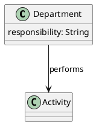
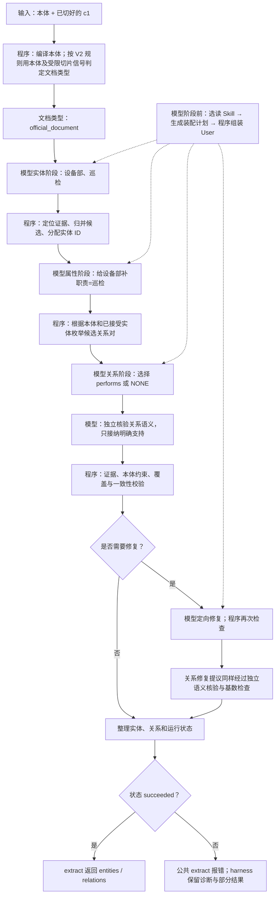
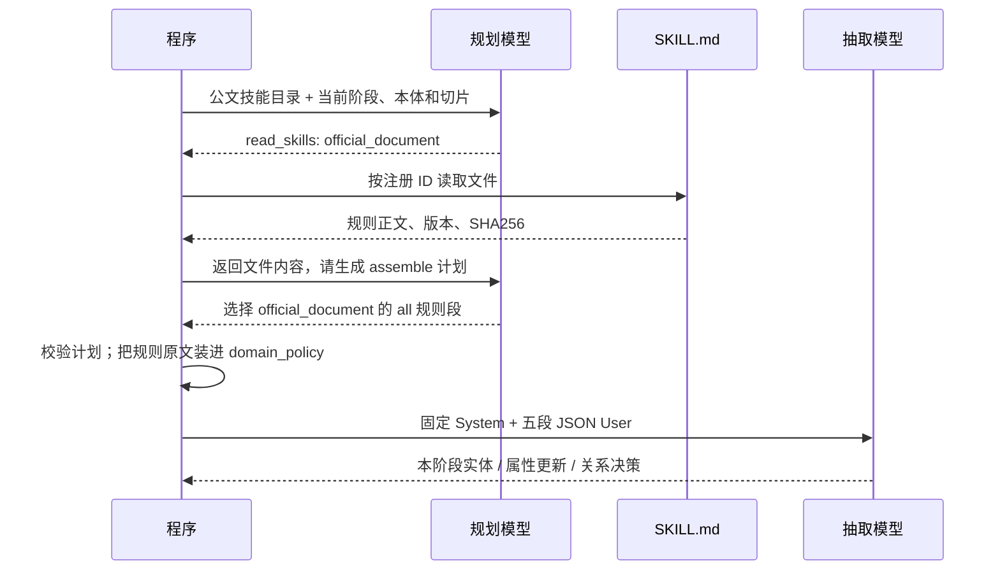
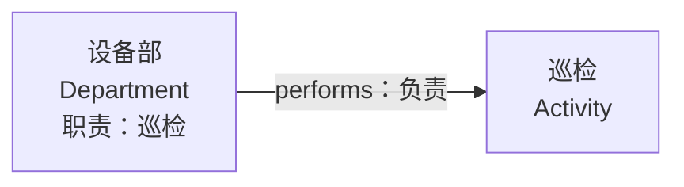
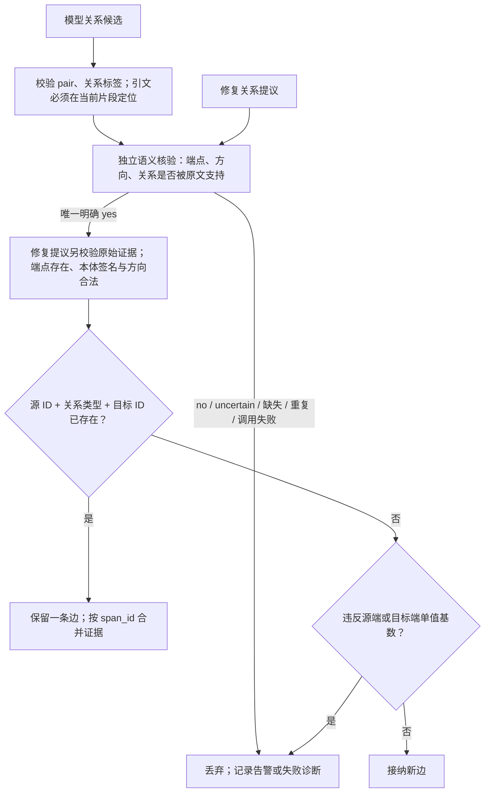

# 用一个最小例子看懂 V3.1 抽取

依据：`fff455c` 基线及本次 V2 路由改动，2026-10-11。下面用 **1 个切片、2 个实体、1 个属性、1 条关系** 展示流程。模型回答是教学示意，不是新一次真实模型实测；只展示成功路径，省略不影响理解的字段。

## 1. 输入：原文与本体是两份不同的信息

上游已经完成解析和切片，给 v3.1 一个 `ExtractionChunk(chunk_id="c1", text=...)`：

```text
关于开展巡检的通知
〔2026〕1号
设备部负责巡检。
```

本体限定“允许抽什么”，本例只声明部门、事项和负责关系：



`Department` 表示部门，`Activity` 表示事项，`responsibility` 表示职责，`performs` 表示负责。**没有声明公文类型，所以即使标题是通知，也不能凭 Skill 新增公文实体。**

## 2. 总流程：先找实体，再补属性、连关系



程序还可能补充文档实体、结构标题和确定性关系；这个最小本体不涉及这些分支。没有缺失属性、候选关系对或待修复问题时，对应模型步骤可以跳过。

## 3. Skill 在哪里起作用？

当前目录保留 `official_document`、`rule`、`trouble` 三份技能。**本次选择规则与 V2 一致**，路由只输出 `official_document`、`standard` 或 `generic`，因此 rule/trouble 不再自动命中，standard 暂无对应技能。

程序先为本体特征打分（每项命中 +5）。若单一领域已达到阈值，优先采用本体；否则结合前 12 个切片的文本（每片前 1200 字符）、标题、条款编号及指定元数据。最高分至少 6、领先另一类至少 3 才选中，否则 generic。同类文本信号在整个请求只计一次。

本例本体没有领域特征；公文标题 +4、文号 +3、“通知” +1，公文得 8 分、标准得 0 分，所以选公文技能。只保留通知标题会得到 5 分，走 generic。路由按整个请求确定一次，各阶段共享；模型仍负责在匹配目录内选读规则段。



规划模型与抽取模型是**任务角色**，当前入口复用同一个注入的模型运行对象，不要求部署两个模型。`read_skills` 是应用解析结构化响应后执行的协议，不是模型自行访问文件。

本例实体阶段的装配计划可以是：

```json
{
  "action": "assemble",
  "operation": "entity",
  "chunk_id": "c1",
  "skills": [{"skill_id": "official_document", "sections": ["all"]}],
  "reason": "通知正文，使用公文实体粒度与证据规则"
}
```

这不是实体答案。程序按引用复制 Skill 原始规则，不让模型自由重写规则。

规划按待装配输入进行；通常选读一次、计划一次，不是全文只规划一次。完全相同的输入在请求内复用缓存。`generic` 或没有匹配技能时直接使用空策略，不调用规划模型，但仍执行后续抽取。

## 4. 模型每次拿到的信息如何组织？

抽取使用固定的 System，以及下面五段 JSON User。**规划器只替换 `domain_policy`，其余四段保持原样。**

| User 字段 | 本例实体阶段 | 后续阶段的变化 |
| --- | --- | --- |
| `task` | `operation=entity`，只提议实体 | 属性阶段列出已知实体；关系阶段列出候选 pair |
| `output_contract` | 只允许类型、mention、位置、证据 | 分别切换为 `updates`、`decisions` 的 Schema |
| `domain_policy` | 选中的公文规则原文、版本、哈希 | 可按当前阶段重新选规则段 |
| `ontology` | 只给实体类型目录 | 属性阶段给可补字段；关系 pair 已限定可选关系 |
| `documents` | 当前 `c1` 原文；不读邻片 | 后续阶段可使用程序允许的局部上下文；本例只有一片 |

## 5. 同一份信息，如何逐步变成图？

### 第一步：只抽实体，不补属性

模型响应示意：

```json
{
  "entities": [
    {"type": "Department", "mention": "设备部", "start_char": 19, "end_char": 22, "evidence": {"quote": "设备部"}},
    {"type": "Activity", "mention": "巡检", "start_char": 24, "end_char": 26, "evidence": {"quote": "巡检"}}
  ]
}
```

位置是 **当前切片内、从 0 开始、左闭右开** 的字符区间，换行也占一个字符。这里选正文中的“巡检”，不是标题中的同名词。程序验证/纠正定位并归并候选；为便于说明，以下假设分配 `entity-0=设备部`、`entity-1=巡检`。实际 ID 由程序生成。

### 第二步：只给已有实体补属性

程序发现 `entity-0` 缺少本体声明的 `responsibility`，交给模型补全：

```json
{
  "updates": [
    {"entity_id": "entity-0", "properties": {"responsibility": "巡检"}, "evidence": {"quote": "设备部负责巡检。"}}
  ]
}
```

此时实体集合已固定，模型不能通过属性响应新建、重命名实体或添加关系。`Activity` 没有声明属性，本例无需为它补值。

### 第三步：对程序给出的关系对做选择

程序根据本体列出候选，以下 pair ID 仅作示意：

```text
pair-0：entity-0（Department） --performs--> entity-1（Activity）
```

模型判断原文是否支持：

```json
{
  "decisions": [
    {"pair_id": "pair-0", "label": "performs", "evidence": {"quote": "设备部负责巡检。"}}
  ]
}
```

有证据就选该 pair 的 `relation_id`；没有证据就选 `NONE`，不生成关系。模型不能自行新建端点或挑选其他关系。

### 第四步：校验后输出

成功路径下，公共 `extract()` 返回的形状如下（实体排列顺序不作保证）：

```json
{
  "entities": [
    {"type": "Department", "name": "设备部", "properties": {"responsibility": "巡检"}},
    {"type": "Activity", "name": "巡检", "properties": {}}
  ],
  "relations": [
    {"from_type": "Department", "from_name": "设备部", "rel_type": "performs", "to_type": "Activity", "to_name": "巡检"}
  ]
}
```



首轮的 `mention` 经程序处理成为实体 `name`；属性来自补全阶段；关系来自候选 pair 分类。公共结果不包含证据和规划记录。调试用 `extract_harness()` 查看 `raw`、`graph`、`warnings`、`attempts`、`status` 和 `profile.prompt_assembly`。

## 6. 对照代码时看哪里？

| 要看什么 | 入口 |
| --- | --- |
| 公共调用与规划接线 | [harness_extractor.py](../../algorithm/knowledge_extract/v3_1/harness_extractor.py) |
| V2 规则分类、各阶段 User | [prompt_router.py](../../algorithm/knowledge_extract/v3_1/prompt_router.py) |
| Skill 发现与类型过滤 | [skill_registry.py](../../algorithm/knowledge_extract/v3_1/skill_registry.py) |
| 选读、计划校验、保真装配 | [skill_planner.py](../../algorithm/knowledge_extract/v3_1/skill_planner.py) |
| 实体 → 属性 → 关系 → 校验修复 | [split_extractor.py](../../algorithm/knowledge_extract/v3_1/split_extractor.py) |
| 每阶段允许输出的字段 | [output_contracts.py](../../algorithm/knowledge_extract/v3_1/output_contracts.py) |
| 成功结果与失败边界 | [result_contract.py](../../algorithm/knowledge_extract/v3_1/result_contract.py) |

当前默认公共入口没有注入 Clef 实体判定器，也不会自动把结果写入数据库。本页描述抽取算法，不包含上游文件解析、切片或下游图谱入库。

## 7. V2 路由改动实测（修复重复关系之前，2026-10-11）

已将 `cyue-dev` rebase 到 `origin/develop` 的 `fff455c`，恢复未提交改动时无冲突。本次只替换文档类型判定与相关说明，继续使用 V3.1 的 Markdown Skill、模型装配计划、固定 System 和五段 User；没有引入 V2 的提示词扩展。

验证覆盖 V2/V3.1 路由元数据一致性、本体优先级、阈值与冲突、元数据、后续片段、12 片/1200 字符边界、重复信号去重，以及四阶段受保护字段不被装配计划改写。本地和 88 的相关测试均为 269 passed、1 skipped（缺少 Standard_Ontology.puml）；随后新增的“后片信号驱动整次请求共享技能”用例所在测试文件，在两处均为 8 passed。

真实样本使用仓库 `simple`（对应本次 sample），2 个已切片片段、5853 字符；在 88 现有 `qasystem_backend` 内通过隔离源码快照调用 `extract_harness()`，模型为 DeepSeek-V4-Flash，未替换服务运行代码。这是抽取层验证，不包含 HTTP、解析、切片或入库测试，也未进行全量质量评分。

该样本的路由输出为：

```json
{
  "kind": "generic",
  "source": "fallback",
  "scores": [["official_document", 0], ["standard", 1]],
  "reasons": ["route.chunks.standard.lexical", "route.fallback.low_score"]
}
```

所以 sample 不附加 Skill，也不调用 Skill 规划模型；它仍按本体执行实体、属性、关系抽取。目录中有技能文件并不代表每份文档都会使用技能。

实测已完成：

| 项目 | 实测值 |
| --- | --- |
| 状态 | `succeeded`，公共结果转换成功 |
| 输出 | 39 个实体、7 条关系 |
| 总耗时 | 358.221 秒 |
| 模型调用 | 实体 2、属性 4、关系 2、关系修复 1，共 9 次 |
| Skill 规划调用 | 0 |
| 重试 | 属性批次 1 次 180 秒超时，重试成功 |
| 告警 | 48：位置纠正 39、缺失标识 4、关系基数超限 4、属性证据语义 1 |

以下为实际公共输出节选，省略其他节点与边：

```json
{
  "entities": [
    {
      "type": "Concern",
      "name": "故障原因定位",
      "properties": {
        "关注点标识": "CON_DIAG_001",
        "名称": "基于故障现象的故障原因定位",
        "类型": "故障诊断关注点",
        "描述": "针对故障样例数据中的故障状况、所属系统、故障详细分类等信息，利用故障规则推理可能的故障原因。"
      }
    }
  ],
  "relations": [
    {
      "from_type": "Concern",
      "from_name": "故障原因定位",
      "rel_type": "is a matter of importance to",
      "to_type": "Stakeholder",
      "to_name": "信号维修工程师"
    }
  ]
}
```

输出中还同时出现 `故障原因定位` 与 `故障原因定位_01` 等名称，是否应归并需要结合 golden 进一步评估。`succeeded` 表示算法执行与最终校验通过，不等于实体/关系准确率达标；本次没有计算 F1。

完整输入、请求、响应、结果、路由和日志保存在本地 `tmp/v31-v2-routing-20261011/`：

- [真实公共输出](../../tmp/v31-v2-routing-20261011/results/simple/public.json)
- [状态与耗时](../../tmp/v31-v2-routing-20261011/results/simple/summary.json)
- [完整诊断与规划记录](../../tmp/v31-v2-routing-20261011/results/simple/result.json)
- [运行日志](../../tmp/v31-v2-routing-20261011/live.log)

这些是临时验证产物，不进入运行源码交付包。

## 8. sample 重复关系修复（2026-10-11）

此前的 7 条关系没有完全相同的三元组，但包含两组未归并实体衍生的重复边，以及把主问题方案传播给四个子问题的多余边。本次修复三个接纳边界：

1. **对象身份**：从原文 `object 名称 <<类型>>` 声明和名称字段建立身份索引，把声明与后续引用归为同一实体。只有声明及证据能支持时才归并，不全局去除 `_01`。不同文档、不同编号、同名但有不同声明的对象保持独立；已有本体 identity 值优先。内部图 UID 使用带文档范围的对象身份。
2. **关系语义**：模型提议关系后，独立调用核验器检查原文是否支持指定端点、方向和关系。`no`、`uncertain`、遗漏、重复裁决和调用失败都不接纳。对象声明、子问题列表、共现或本体必需基数不能单独证明关系；修复补边也走相同核验。
3. **单值基数**：同一端点已接受一条单值关系后，冲突候选明确拒绝，保留告警和拒绝记录；完全相同的端点与关系继续合并证据。

核验器复用注入的 LLM 和现有调度器，使用独立固定 System 与 `task/documents/candidates` JSON，不经过 Skill 装配。常规抽取仍使用前文的五段 User。独立核验会增加模型调用，其判断仍需质量评测；不能把模型核验视为绝对正确。

为了排除模型采样变化，重放了修复前同一组 39 个实体候选：归并后为 37 个，`信号维修工程师/_01` 和 `故障原因定位/_01` 各成为一个对象，保留两片证据。见 [固定回答重放结果](../../tmp/v31-relation-fix-20261011/entity-replay.json)。

新增 16 项回归用例覆盖声明与引用、无声明不去后缀、跨文档隔离、同名不同对象、显式 identity 优先、双向单值基数、重复边、核验拒绝/不确定/遗漏/重复/超时，以及修复补边不能绕过核验。本地与 88 的相关测试均为 **286 passed、1 skipped**（缺少标准本体）。

最终版在 88 的实测结果（同一输入、DeepSeek-V4-Flash、隔离源码快照）：

| 指标 | 修复前 | 修复后 |
| --- | --- | --- |
| 状态 | succeeded | succeeded |
| 实体 | 39 | 37 |
| 关系 | 7 | 2 |
| 总耗时 | 358.221 秒 | 95.796 秒 |
| 模型调用 | 9（含一次超时重试、一次关系修复） | 9（含两次独立关系核验，无重试/修复） |
| 基数超限告警 | 4 | 0 |
| Skill 规划调用 | 0 | 0 |

保留的关系为：

```text
故障原因定位 --is a matter of importance to--> 信号维修工程师
基于故障规则的故障诊断问题_01 --需要方案--> 基于故障规则的故障诊断方案_01
```

四个子问题到同一方案的提议均得到 `no`，记录 `RELATION_EVIDENCE_UNSUPPORTED` 并丢弃。两个切片均提出关注点到干系人的关系，归并后端点 ID 一致，因此只保留一条边，合并不同 span 的证据。

关系接纳顺序：



去重基于归并后的实体 ID，不按关系文字或目标节点单独去重。不同源实体指向同一目标不一定重复，须按本体基数判断。发生单值冲突时保留已接纳的边，拒绝后来候选，当前不做全局最优关系重排。程序确定性生成的结构关系仍由既有结构规则产生，不额外调用语义模型；它们也经过关系池的签名、去重和基数检查。

仍有 39 次位置纠正、4 次缺少本体 identity、1 次属性证据语义提示，以及 4 次关系拒绝告警。两次运行耗时差异受模型响应和重试影响，不能据此认定性能提升；本次未做全量 F1 评测、部署或推送。

- [最终公共输出](../../tmp/v31-relation-fix-20261011/results-final/simple/public.json)
- [最终运行摘要](../../tmp/v31-relation-fix-20261011/results-final/simple/summary.json)
- [完整诊断与拒绝记录](../../tmp/v31-relation-fix-20261011/results-final/simple/result.json)
- [最终运行日志](../../tmp/v31-relation-fix-20261011/live-final.log)

补充修复：修复提议命中已有关系时，不再覆盖旧证据，而是按 `span_id` 追加不同证据。最终源码重放 88 的全部 9 次模型回答，与实测公共结果完全一致。见 [最终代码重放记录](../../tmp/v31-relation-fix-20261011/final-replay.json)。
