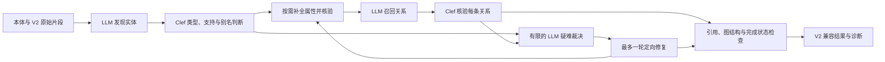

# 知识抽取 V3.1 语义 Harness 与评测

> 版本说明：本实现开发期代号为 V3.3；自代码库清理起对外版本号统一为 `v3.1`（Python 包 `algorithm.knowledge_extract.v3_1`）。下文历史评测记录与数据沿用当时的 V3.3 名称。

V3.3 参考 V2 的多阶段流程，把业务含义交给模型判断，把代码限制在可检验的执行契约上。算法位于 [v3_1](../../algorithm/knowledge_extract/v3_1/)，版本选择使用 `KG_EXTRACT_ALGO_VERSION=v3.1`。V2 和 `latest` 的实现继续独立保留（V3.2 实验实现已下线）。

本页记录初版实现与历史评测。后续 V2 对照、开源调研及最新 mini 结果见 [V3.3 准确性复核与改进](知识抽取V3.1准确性复核与改进.md)。默认版本没有切换，也未部署。

初版结论：实现及相关回归通过，但五案例 mini 门禁未过。修正版有效评分覆盖 4/5，实体 micro F1 为 `0.120444`，关系为 0；长文请求超时、事实覆盖和关系核验仍是限制。

合并修复后另用当前 DeepSeek 官方接口跑一例定向 mini，实体 F1 `0.292398`、关系 F1 `0.211111`，仍为部分结果；该轮与前两轮服务协议不同，不混入五案例汇总。真实图回放确认修复保留了全部已有关系证据，详见末节。

## 从问题本身划分职责

抽取的输入是原始片段和本体，输出是有原文依据、可映射到本体的事实。名称是否描述同一对象、原文是否支持一个关系，都属于语义问题；JSON 是否完整、类型是否声明、端点是否存在、引用是否真在原文中，属于程序可以直接验证的问题。

| 问题 | 执行者 | 处理方式 |
| --- | --- | --- |
| 原文有哪些实体和属性 | 主 LLM | 基于全部允许类型生成候选，不按文档类别切换策略 |
| 候选是否得到原文支持 | Clef | `supported / contradicted / insufficient` |
| 类型歧义、别名同一性 | Clef | 本体候选类型或 `same_entity / different_entity / insufficient` |
| 缺失属性的开放文本值 | 主 LLM，再经语义核验 | 缺失字段不自动填默认业务值 |
| 已接受实体之间有哪些关系 | 主 LLM 提议，Clef 核验 | 保留方向、否定和条件，同一端点对允许多种关系 |
| Clef 输入超长、不可用、低把握或证据不足 | 主 LLM | 带扩展原文上下文独立裁决；不把服务失败当否定 |
| 引用、类型、端点、预算、结果状态 | 代码 | 可定位的证据和明确执行契约，不猜测业务事实 |

通用系统提示词位于 [prompts.py](../../algorithm/knowledge_extract/v3_1/prompts.py)。各阶段只改变任务字段和输出结构。没有领域关键词列表、文档类型路由、固定关系排除名单，也没有按标题格式直接生成业务事实的插件。语义名称无需逐字出现在原文中，但其依据必须是可定位的连续原文引用。

实体、属性、关系分别承担事实责任。非身份属性格式错误时，先隔离该字段，让名称、类型和证据有效的实体继续接受语义核验；错误仍保持未解决，不由代码拆字符串、猜数值或补默认值。身份属性错误保守处理，避免改变实体身份。字段问题只有在修正值符合本体、被语义接受并实际写入对应实体后才解除，空重跑或“已修复”的声明不能消除问题。

LLM 显式区分原文质量提醒和未完成事实：只有 `source_observation`、`affects_completeness=false` 且有原文依据的提醒记录为信息；未知格式、条件无法表达、未读上下文和执行失败仍阻断完整成功。此处分流依赖模型的语义判断，没有“笔误”等关键词白名单。

## 执行流程与接口

`extract(chunks, ontology, **kwargs)` 沿用 V2 的公开抽取结果转换与失败异常；`extract_aggregate(ontology, chunks, **kwargs)` 返回 Backend 使用的图、原始结果、证据、质量状态及诊断。输入复用 V2 `ExtractionChunk`，保留 `chunk_id`、文档、页码和原始范围；派生任务不改写原始切片身份。

兼容范围是输入输出契约，不是旧版所有编排行为：`repairer`、`entity_adjudicator`、`max_workers`、`prompt_variant` 和 `retry_base_seconds` 接收但不执行对应旧逻辑，语义测试与扩展使用 `llm`、`decider` 或 `clef_client`；`max_attempts` 只允许 1，旧 `max_repair_rounds=2` 按一轮处理。Backend 返回非空图时，仍可能是 `quality.status=partial`、`graph_publishable=false`，调用方须检查质量状态，不能把“有图”当作完整成功或可沉淀。

关系候选由 LLM 对原片段及相邻上下文进行语义搜索，避免枚举所有实体对。需要更远片段时可以显式请求；未覆盖的上下文和未解决项保留在诊断中。`succeeded` 表示计划内任务完成，不代表已经证明全文实体和关系全部召回。

上下文按任务组织：原始本体保留一份，历史实体目录携带身份和 LLM 选定的 `context_property_ids`，完整属性仍保存在结果状态中。有效证据重复文本转换为可定位引用；裁决和修复涉及的远距证据会递归补入原片段，无法携带原文时保留证据文本。没有字符截断、领域筛选或固定 top-k 实体裁剪。修复请求的新上下文必须被对应阶段实际读取，不能仅凭模型声明清除遗漏。

只有本体、原文和模型判断支持的事实进入已接受集合。修复改变实体、类型、属性或别名后，需要刷新依赖关系；旧任务保留历史，不能与当前任务重复计完成率。部分事实可供分析，但未解决的任务使结果保持 `partial` 或 `failed`。

## Clef 与预算

复用现有独立 Clef HTTP 服务和 [ClefFlashClient](../../external_services/clef.py)，不在应用进程加载 GPU 模型。88 的容器侧地址为 `http://host.docker.internal:8188`；本次独立实验通过 SSH 隧道访问宿主机 `172.17.0.1:8188`，服务运行在 GPU2。

配置统一见根 [.env.example](../../.env.example)：

| 配置 | 默认值 |
| --- | --- |
| `KG_EXTRACT_V31_DISABLE_THINKING` | `1` |
| `KG_EXTRACT_V31_DOCUMENT_TIMEOUT` | `900` 秒 |
| `KG_EXTRACT_V31_REQUEST_TIMEOUT` | `120` 秒 |
| `KG_EXTRACT_V31_CLEF_TIMEOUT` | `10` 秒 |
| `KG_EXTRACT_V31_CLEF_MAX_CALLS` | 每文档 `128` 次 |
| 主 LLM 调用上限 | `6 × 非空原始片段数 + 2`，可由函数参数覆盖 |

预算包含失败尝试和补充调用。主 LLM 每次显式调用只发一次 HTTP 请求，关闭 SDK 隐式重试和输出格式回退；超时的迟到响应不改变已返回结果。Clef 暂态错误最多重试一次，长度错误有限拆批，schema 错误不重试。完整证据不因 2048 token 限制而静默截断。

Clef 校验选项概率是否完整、有限、归一并与所选项一致。首版分流参数为支持概率至少 `0.95`，反驳、合并和类型选择至少 `0.98`，前两名概率差至少 `0.20`；证据不足始终进入疑难处理。这些是实验参数，没有经过独立校准，也不作为图谱可信度输出。

## 验证记录

本轮只运行原 mini 的 5 个案例：2 个公文、1 个故障记录、1 个简单规则、1 个标准。复用原始 12 个切片共 30,706 字符，golden 为 456 个实体、517 条关系；不重跑解析切片，也不新增全量评测。

评测运行使用独立本机 Backend，调用现有主模型 `deepseek-ai/DeepSeek-V4-Flash` 和 88 GPU2 Clef。抽取与 judge 均关闭 thinking。正式评测器修复了 `quality.status=partial` 被“有图”覆盖为成功的问题；部分图仍可评分，但不能通过完成状态门禁。评测器、输入、参数和应用源码均记录哈希，请求账本只记录状态、时长和 usage，不保存凭据。

最终相关单元与集成测试共 **836 项通过**，覆盖 V3.3、V3.2、V2、Clef 客户端/服务、Backend 错误与质量投影和评测器。V3.3 包内 110 项、Backend 专属对接另 6 项，覆盖任意本体标识、语义名称、多关系、否定条件、证据不足升级、超时迟到、类型和属性修复后的依赖重跑、原始切片失败归属，以及本轮新增的 31 项上下文、字段隔离和修复状态回归。合并器修复另增加 8 项算法回归及 1 项 Backend 投影到合并的集成回归，旧实现会丢失后片关系的证据，新实现通过。最终日志位于 `tmp/eval/v3_3/20261008-194600/post_merge_unit_tests.log`；首轮实现有 796 项、上下文修正版有 827 项相关测试通过。这里不是仓库全部单测或发布前全量门禁的通过声明。

正式评测器 `eval/run.py` SHA256 为 `9a7dea62d13bdfebb071dfdf30cfd29ada6c9a37198f4fd3a3ec426814cd30ef`；同批冻结 `quality.py`、`provenance.py`、`report.py` 等模块。本轮只运行 mini，不构成部署前全量发布门禁。

历史 V2 没有与本轮同口径的完整五案例有效 LLM 基线：部分案例此前是 `identity_fallback`，有的模型、golden 或评测器版本不同，不能据此宣称 V3.3 优于 V2。审计记录位于 `tmp/eval/v3_3/20261008-175815/history/v2_comparability_audit.json`。

V3.2 的最近一次重评使用同一组原始 mini 输入和同一主模型，见 [V3.2 报告](知识抽取V3.2通用提示词与评测.md)。其有效评分覆盖为 4/5：初写版实体 micro F1 `0.145098`，提炼版 `0.142596`，两者关系 F1 均为 0。该结果只聚合有效评分的 433 个实体、475 条关系 golden，另一个失败案例没有被算作零分混入；旧抽取缺少完整原生输入 manifest，因此也不能当作严格通过的基线。V3.3 本轮主模型配置并发为 1，历史 V3.2 为 4，耗时不能当成严格控制变量对比。比较质量时也必须同时报告评分覆盖，不直接比较不同分母的数值。

### 首轮实现

原始记录位于 `tmp/eval/v3_3/20261008-175815/runs/20261008-181929/`。5 个案例均未通过完成状态门禁，其中 3 个部分图使用 LLM 正常评分，2 个没有可评分图；无 judge 降级。

| 案例 | 抽取状态 | 实体 / 关系数 | 实体 F1 | 关系 F1 | 抽取秒数 |
| --- | --- | ---: | ---: | ---: | ---: |
| official_01 | partial | 92 / 0 | 0.031746 | 0 | 900.063 |
| official_02 | failed，无可评分图 | — | — | — | 240.043 |
| 故障记录test | partial | 10 / 0 | 0.750000 | 无关系 gold/pred | 93.231 |
| Simple_故障规则的诊断 | partial | 3 / 0 | 0.200000 | 0 | 478.642 |
| standard_01 | failed，无可评分图 | — | — | — | 534.281 |

原生有效评分覆盖 3/5：实体 TP/FP/FN 为 `11/94/56`，micro F1 为 `0.127907`；关系为 0。另算失败案例视为漏抽的全五例保守实体 F1 为 `0.039216`，仅作覆盖诊断，不改写原生评分。评测退出码为 2，门禁未过。

这批结果暴露了三个跨领域问题：

1. 上下文重复积累。`official_01` 最后一片只有 1,208 字符，但实体请求达到 93,138 bytes；实体和属性阶段占满预算，关系阶段无法完成。其 90 个未匹配实体中，79 个名称可在表单原文找到，gold 主要覆盖正文，不能把所有未匹配项都解释为幻觉。
2. 提醒与未完成事实混淆。故障记录已经召回全部 6 个 gold 实体，但两条“原文疑似笔误且保持原文”的提醒被当成阻断错误。
3. 错误粒度过大。简单规则中，25 个非身份数组属性被输出成字符串，导致整个实体被拒；24 个候选有有效原文证据，两条重复的关系提议也因实体端点丢失而被挡。这里需要隔离字段错误、继续核验有效事实，不能由代码猜测字符串应如何拆成数组。

首轮实际调用主模型 38 次、Clef 85 次、judge 7 次。主模型 29 次返回 usage，合计 559,347 tokens（输入 453,861，输出 105,486，已返回 reasoning tokens 均为 0）；9 次超时和 judge token 未完整记录，因此不是完整计费成本。全部 HTTP 生命周期已结束。402 个应用源码文件、输入和评测器均通过运行前后哈希核对；本地测试进程和隧道已清理。审计见同目录 `final_integrity_usage_audit.json`。

### 修正版复核

修正版使用同五个案例、相同模型与预算单独运行 mini，记录位于 `tmp/eval/v3_3/20261008-190255/runs/20261008-190850/`。19:08:50 至 19:56:07 完成，运行期间冻结算法和评测代码。

| 案例 | 抽取状态 | 实体 / 关系数 | 实体 F1 | 关系 F1 | 抽取秒数 |
| --- | --- | ---: | ---: | ---: | ---: |
| official_01 | partial | 83 / 13 | 0.034188 | 0 | 900.064 |
| official_02 | failed，无可评分图 | — | — | — | 240.039 |
| 故障记录test | succeeded | 10 / 0 | 0 | 无关系 gold/pred | 48.769 |
| Simple_故障规则的诊断 | partial | 47 / 0 | 0.675676 | 0 | 711.360 |
| standard_01 | partial | 58 / 0 | 0.051887 | 0 | 900.052 |

有效 LLM 评分覆盖 4/5，实体 TP/FP/FN 为 `38/160/395`，gold 分母为 433，micro F1 `0.120444`；关系 gold 分母为 475，F1 为 0，无 judge 降级。抽取执行为 1 个成功、3 个部分结果、1 个无图失败；成功执行的故障记录也未达到 F1 门槛。评测退出码 2，完整性、质量及耗时门禁未过。

两轮共同可评分的三个案例中，实体 micro F1 从 `0.127907` 变为 `0.260870`，gold 分母同为 67。若将无图案例视为漏抽并纳入全部 456 个 gold 实体，两轮保守诊断 F1 分别为 `0.039216` 和 `0.116208`；这不是原生有效评分指标。不能直接比较两轮原生汇总，因为可评分覆盖从 3/5 变为 4/5。完整对照、数据集哈希及评分契约一致性见同目录 `final_integrity_usage_audit.json`。

简单规则命中 25/27 个 gold 实体，前轮为 3/27；非身份属性格式问题从 25 项降至 1 项、连带实体证据错误从 25 项降至 0。结果仍有关系引用/证据、属性核验、超时及调用数预算问题，最终没有关系，不能因实体改善而判作成功。标准案例仅第三片实体阶段完成，得到 58 个实体、命中 11 个，关系阶段三个请求均超时，保留为部分图。

本轮主模型 46 次请求：31 次 HTTP 200、14 次 ReadTimeout、1 次在测试 Backend 清理时尚无终结记录。主模型已返回 usage 为输入 291,171、输出 91,060，合计 382,231 tokens；未返回 usage 的 15 次请求不估算。Clef 105 次，其中 96 次成功、9 次长度超限 422；judge 41 次均成功，已返回 221,024 tokens。主模型与 judge 均关闭 thinking。403 份应用源码、原始输入及最新评测器通过哈希核对，测试进程全部退出、端口已释放；最后一个主请求的迟到 HTTP 结果未完整记账，不宣称全部请求已正常结算或成本完整。

已完成的 `official_01` 返回 83 个实体、13 条关系，仍因超时为 `partial`。正文片段的实体请求由 93,138 bytes 缩至 42,676 bytes，第一次关系请求由约第 875 秒提前至第 458 秒；这说明阶段推进有所改善，不代表抽取质量达标。同一片段仍超时，最终节点没有正文片段的来源。按本轮实体匹配结果，75 条 gold 关系中 74 条缺少至少一个匹配端点；唯一端点齐全的 `ISSUED_BY` 也未获得独立关系 judge 的匹配。两个关系窗口正常覆盖全部 975 对候选后返回零匹配，判定协议没有解释字段，无法进一步确认其拒绝理由。

13 条关系中，10 条仍有审签表证据，另外 3 条在公共图合并过程中丢失了证据。7 条细粒度表单动作关系有具体原文支持但 gold 未独立标注；3 条“文档要求活动”关系可能混淆领导批示和正文要求的作用域。`APPLIES_TO → 发布集团` 也存在发布者与适用对象混淆疑点。不能把所有未匹配边都算成幻觉，也不能仅凭有引用就宣称事实语义正确。

故障记录两轮均输出 10 个 `RuleType`，但具体名称和属性并非相同预测。本轮执行状态已成功、抽取耗时 48.769 秒，LLM 实体 F1 却为 0：完整的 6 × 10 候选窗口返回合法空匹配，无降级。一个同类型同名称的候选仍有共同属性差异，因此精确名称相同不代表符合语义评测契约。两轮均将 `RuleTypeBody` 输出为 `ImplicationRuleType`，而 gold 填完整事实句；前后件与连接词也存在差异。旧轮在这些差异下判为 6 个匹配，新轮判为 0；没有 judge 理由，不能把差值全部归因于新算法，也不能自行补回旧分数。identity F1 `0.125` 仅作对照。

### 公共合并器的证据保留缺陷

V3.3 复用 V2 的 `deduplicate_chunk_graphs`。Backend 将全量 `raw` 放入每个片段结果；原合并器按“本片图、全量 raw、下一片图”收集关系，并仅保留首条同端点同类型边。这样前一片的裸 raw 关系可能抢占后一片带完整证据的关系。此问题属于通用数据传递错误，不应通过领域关键词或模型重判解决。

修复已应用：先汇集所有片段图，再补充仅存在于 raw 的跨片关系；重复关系只合并已经提供的证据与来源，不推断新事实，不根据所在片段补造证据。当前五案例批次完成、源码哈希审计和进程清理后才应用该修复，并通过 836 项相关测试。受影响的 `official_01` 另行定向 mini 复核，不把不同源码批次拼成一轮五案例汇总。

本批保存的 Backend envelope 仅包含合并后的图，没有逐片 `items`、原始关系图或完整 `run_trace`；请求账本也只有状态、哈希和用量。因此无法从保存结果恢复这 3 条原始证据，不能拿原文或 gold 重新编造引文。完整诊断在算法聚合返回中存在，但最终 API 的保存粒度仍是可观察性缺口。评测器在关系匹配前删除证据字段，所以该修复本身不会改变同一事实的评分；后续新抽取的差异也不能全部归因于合并修复。

### 合并修复后的定向 mini

记录目录为 `tmp/eval/v3_3/20261008-194600/`，仅 `official_01`，复用同 4 个原始切片、9,095 字符、34 个实体与 75 条关系 gold。启动前检测到现有部署已切换主模型服务，本项目配置中没有可用的旧 SiliconFlow 凭据；本次不修改生产配置，使用当前 DeepSeek 官方服务单独验证。

| 协议项 | 前两轮五案例 | 合并修复后单案例 |
| --- | --- | --- |
| 主模型与 judge 服务 | `https://api.siliconflow.cn/v1` | `https://api.deepseek.com/v1` |
| 模型 ID | `deepseek-ai/DeepSeek-V4-Flash` | `deepseek-v4-flash` |
| thinking 关闭字段 | `enable_thinking=false` | `thinking.type=disabled` |
| judge auto 首选格式 | `json_schema` | `json_object` |
| 主模型生成上限 / judge 上限 | `16384 / 8192` | 相同 |
| 原始输入、Clef、调用数与墙钟预算、评测器代码 | 已冻结 | 相同 |

因此本次分数与前两轮不能作为同协议效果对比，也不能把可能的变化归因于合并修复。独立实验进程记录真实合并入口的输入图与输出图，再以相同捕获输入对照旧、新合并器；观测保持原参数、返回对象和异常，不增加模型调用。

本次于 20:06:14 至 20:15:46 完成，运行目录 `runs/20261008-200614/`。返回 `partial`、`graph_publishable=false`，137 个实体、105 条关系。实体 TP/FP/FN 为 `25/112/9`、F1 `0.292398`；关系为 `19/86/56`、F1 `0.211111`。抽取 565.590 秒，judge 5.542 秒，案例总计 571.144 秒；退出码 2，门禁仍未过。

主模型 26 次请求均 HTTP 200，无超时；Clef 128 次调用中 106 次成功、22 次长度超限 422；judge 19 次均成功。主模型及 Clef 调用数都达到原上限，仍有条件作用域、属性冲突、引用/证据、响应不完整和本体基数等未解决项。HTTP 成功不等于事实完成，调用预算耗尽也没有被改写为完整成功。

最终有 229 个阻断记录，其中包括 98 个未决关系支持任务、56 个未决属性支持任务、41 个条件作用域问题；这不是 229 个不同事实错误的计数。剩余为引用/证据、属性冲突、基数冲突、实体支持、属性值裁决、响应不完整及一次主调用预算耗尽。

对同一份真实合并输入，离线运行冻结的旧函数和修复后函数，新函数回放与真实输出完全一致：

| 同输入检查 | 旧合并器 | 修复后 |
| --- | ---: | ---: |
| 实体 / 关系数 | 137 / 105 | 137 / 105 |
| 具有证据和来源片段的关系 | 45 / 105 | 105 / 105 |
| 丢失的已有 graph 关系证据项 | 88 / 159 | 0 / 159 |
| 丢失的已有关系来源片段项 | 60 | 0 |
| 事实集合、业务字段、记录顺序 | 基准 | 与旧函数相同 |
| 修改输入副本 | 否 | 否 |

60 条关系此前被全量 raw 裸边抢先占位，新函数沿用后片图的完整信息。raw 证据核对也由丢失 60 项变为 0，但它们与 graph 证据重叠，不能相加。业务字段比较包含本次捕获的完整 graph；raw 观测只保留白名单字段，不对未捕获的 raw 属性作不变性断言。本次新输出的精确回放表明，捕获内容足以重现实际合并结果。

该离线对照没有重新抽取或评分，只证明此输入下原有事实及业务属性相同、证据传递恢复；不普遍保证再次调用语义 judge 会给相同分数。核验结果见 `offline_merge_comparison_summary.json` 和 `offline_merge_comparison.json`，真实输入/输出及安装位置记录于 `merge_trace/`。

最终审计见 `targeted_final_summary.json`：404 份源码快照、输入、评测器、参数及 12 个实验工具哈希均通过，全部测试进程已退出、端口释放。所有 HTTP 记录已有终结状态，实际主请求峰值并发为 1；26 次主请求和 19 次 judge 均实际发送 `thinking.type=disabled`。主模型已返回 688,137 tokens（输入 497,394、输出 190,743），judge 为 177,313 tokens（输入 176,504、输出 809）；Clef 成功请求输入 163,740 tokens，22 次拒绝未提供 usage。本次没有完整发布评测或部署，也不将单例视为五案例通过。
