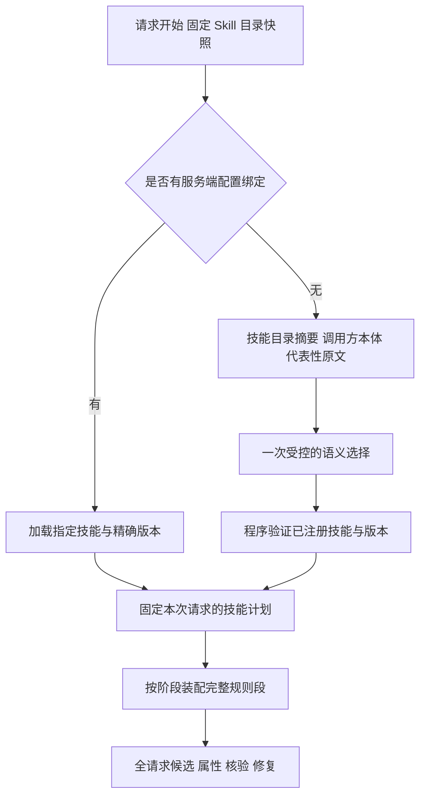

# 知识抽取 V3.1 领域 Skill 路由方案草案

当前一次抽取请求只处理同一领域的文件，因此在请求开始时选择一次 Skill，固定其版本与内容，将选中技能的适用规则段用于请求中的全部实体、切片、批次和后续阶段。领域类型、典型本体及适用边界维护在各 SKILL.md 的 description 中，路由器不维护固定领域枚举。

默认采用一次受控的语义选择：提供技能目录摘要、调用方本体和代表性原文，由模型选择适用技能；已有服务端配置绑定的请求可以直接加载精确版本。当前无需按实体类型、表格行或文件建立多个技能计划。规则的粒度、名称和归并原则维护在 Skill 中，框架负责发现、选择、装配、核验与审计。

请求级路由已接入算法入口。现有技能版本为 rule 6、trouble 5、公文 9，正式入口可从完整目录选择，包括兼容文档分类为 generic 的请求。选择提示词 v2 依据调用方本体、本轮允许类型及技能描述，多个技能须适用、互补且不冲突，不能据单测称真实模型质量已通过。当前行为见 [V3.1 README](../../algorithm/knowledge_extract/v3_1/README.md)。

## 当前问题与证据

改造前，文档分类只支持三个领域值，generic/simple 禁止加载技能，rule/trouble 无法正常命中。现在 [skill_selector.py](../../algorithm/knowledge_extract/v3_1/skill_selector.py) 独立选择技能，[skill_registry.py](../../algorithm/knowledge_extract/v3_1/skill_registry.py) 提供全部目录元数据并校验精确标识；旧分类不再限制候选。标准暂未提供对应 Skill。

此前 rule Skill v1 允许使用故障分类作为 mention，并要求 mention 为连续原文；这容易将分类当作规则名称。[property_enrichment.py](../../algorithm/knowledge_extract/v3_1/property_enrichment.py) 随后按完全相同的 type + name 分组，候选阶段丢失的规则粒度无法在属性阶段恢复。当前 [rule Skill](../../algorithm/knowledge_extract/v3_1/skills/rule/SKILL.md) 已禁止分类充当身份，允许无显式名称时归纳可区分的规则名，并以共享语义约束条件、结论和效果归属。当前修复不能重命名或拆分已有实体，不能仅靠提示词承诺修复误合并。

[20261013-150514 报告](../../tmp/eval/runs/20261013-150514/report.md) 的 rule 组为 golden 40、predicted 12；[实际预测](../../tmp/eval/runs/20261013-150514/rule/rule_01/backend_extract.json) 中部分名称直接是“对标不准”“轨旁ATP”“屏蔽门不能联动”“RTU”。技能未加载与规则粒度错误需要分别验收，不能把实体数等于 golden 数量写成算法目标。

## Skill 对适用本体的描述

技能描述说明典型本体的主要对象、关键字段、语义目标及容易混淆的其他本体。下表来源是当前 benchmark 本体，只用于维护技能描述；运行时始终使用调用方传入的本体，不读取 benchmark 本体或 golden。

| Skill | 典型本体 | 关键语义和字段 | 选择边界 |
| --- | --- | --- | --- |
| rule | [rule.puml](../../test_data/eval/rule/ontology/rule.puml)，主要实体为规则 RuleType | RuleName、RuleTypeBody、RuleTemplate、antecedent、connectionSymbol、consequent；RuleID 是声明的身份字段 | 抽取条件、原因或对象约束所表达的规则；不能因文本涉及故障就改选 trouble |
| trouble | [trouble.puml](../../test_data/eval/trouble/ontology/trouble.puml)，包含 FaultComponent、FaultType、FaultHandlingMethod、TroubleshootingExperiment、ExperimentResult | 部件名称、异常名称、维修动作、检查过程、观测结果与状态 | 表达检修的不同对象和过程；若本体主要是前件和后件规则，应选 rule |
| official_document | [Official_Ontology.puml](../../test_data/eval/official/ontology/Official_Ontology.puml)，包含 OfficialDocument、DocumentUnit 和六类 Operational 实体 | 文件标题、来文字号、来文单位、主送、抄送、拟办意见、领导批示、原文内容、职责 | 表达公文身份、结构、主体、任务、交互、信息和约束；“方案”一词不等于公文领域 |

simple 组的 [术语本体](../../test_data/eval/simple/ontology/Term_Ontology.puml)、[问题与方案本体](../../test_data/eval/simple/ontology/Problem_Solution_Ontology.puml)、[利益相关者与关注点本体](../../test_data/eval/simple/ontology/Stakerholder_Concern_Ontology.puml) 用于说明现有技能的排除边界，不能因文本含“故障”“方案”或“约束”而误选。按本轮要求，sample/simple 不新增 Skill，使用公共提示词和调用方本体；无匹配为正常空策略，显式 `skill_refs=[]` 可跳过选择。不在路由程序中按目录名硬编码。

类名与字段是典型特征，不能要求完全一致。调用方改变类名、但仍定义条件到结论的知识时，应根据类定义和属性说明判断；仅有一个字段或词汇命中也不足以确定技能。description 写在现有 frontmatter 中，较详细的维护依据放在 rules 段之前，不自动作为抽取规则发送。无需增加 applicability、类型过滤或表格行匹配语言。

## 请求级选择与规则装配

1. **目录发现。** 沿用 SkillRegistry 发现 SKILL.md，提供 name、version、description 摘要，并固定文件内容及 SHA-256。新增领域时更新技能，不从目录名或 eval case 类型推断领域。
2. **请求级选择。** 以调用方完整本体说明及编译目录为主要依据，原文样本辅助判断。模型只返回当前目录中的技能标识和理由，不生成规则正文、任意路径或抽取事实。一般选择一个领域 Skill；同领域确需多个互补技能时可以选择多项。无匹配可以返回空集合，歧义须明确记录。
3. **程序验证与固定。** 校验技能是否已注册、版本是否存在、是否重复和是否超预算，固定请求内选择。选择理由与模型置信度不是事实证据。可选配置绑定使用同一验证与加载流程，只引用服务端登记技能，不接受任意路径或规则正文。
4. **规则装配。** 全请求共享选中技能。各阶段沿用现有消息契约装配适用规则段，完整段保留；按技能、版本、章节去重，不按实体类型或来源记录分配不同技能，也不逐行去重。核验的规则裁剪沿用通用核验契约。
5. **核验与修复。** 使用相同固定技能和现有本体、证据、输出契约，不重新选择技能。规则命名、方向和归并要求由 rule Skill 提供，不在通用框架新增领域专属判断。

选中的适用规则段对本次请求所有实体生效，但只能解释调用方本体已声明的类型和属性。同领域正文、表单和附件共享技能；各材料的抽取边界由领域规则及已有来源契约处理。本体、输出契约和原文证据要求保持有效。

保留请求内快照和两条抽取消息，不改切片 ID、text、range、metadata 或证据回映。选择有独立结构化调用，后续阶段仍使用现有 JSONL。旧 document_route 可作兼容诊断，generic 不再阻断技能选择。

分窗、批次、重试和后续阶段复用一次选择。选择调用沿用已有 LLM、供应商登记、调度和文档 deadline；原文样本记录实际覆盖范围。预算不足或选择失败保留明确原因，不能伪装成正常无匹配。当前阶段不实现按实体或源行分配不同 Skill。

## 参考实现与采纳范围

参考源码为本地固定快照：医疗仓库提交 `53d00679e52ba632e0341770b0fc41f8d0546ede`，AFU 仓库提交 `ba8b9b0cf533303ac006dacd00f22e259c217101`。结论针对这两个提交，不表示远端最新行为。

| 来源 | 已有实现 | 本方案采纳 |
| --- | --- | --- |
| [医疗仓库](https://code.alipay.com/recneptune-tenants/recneptune-med-ai-personal) | 给模型技能目录 name、description、location，模型通过 read_skill 选择，再由程序校验和加载 | 目录摘要与正文分开，描述承载适用边界，模型只选择已注册技能 |
| [AFU 仓库](https://code.alipay.com/recneptune-tenants/arec2-afu-managed-agent) | 当前 Graph 使用精确 Skill ref，支持配置、force、intention、别名及版本覆盖并记录来源 | 可选配置绑定、精确版本和选择来源审计 |

医疗仓库的 [目录渲染](../../tmp/v31-reference-review/recneptune-med-ai-personal/src/main/java/com/alipay/recneptune/biz/tenant/archivemanagement/client/ArchiveSkillContextRenderer.java)、[调用与选择校验](../../tmp/v31-reference-review/recneptune-med-ai-personal/src/main/java/com/alipay/recneptune/biz/tenant/archivemanagement/client/ArchiveFunctionCallLoop.java)，以及 AFU 的 [路由实现](../../tmp/v31-reference-review/arec2-afu-managed-agent/src/arec2_afu_managed_agent/online_agent/integrations/skills/routing.py) 为主要参考。QASystem 采用一次有界选择即可，无需复制完整 Agent 工具循环。AFU 当前生产 [目录约定](../../tmp/v31-reference-review/arec2-afu-managed-agent/src/arec2_afu_managed_agent/online_agent/subgraphs/main_agent/assets/skills/README.md) 已移除旧 skill.yaml RequestManifest，本方案沿用现有 SKILL.md 单一来源。

## 更新 审计与失败行为

新请求读取更新目录，进行中的请求使用旧快照。评测记录技能选择、版本、内容摘要、选择理由、耗时及装配章节，并保存可恢复的内容或发布快照。默认请求内复用，不只按本体名称或领域标签复用旧选择。

无匹配、已选择、歧义和选择失败分别记录。正常无匹配使用公共规则；模型超时、无效标识或加载失败不能伪装成正常无匹配。指定技能或版本不存在时明确失败，partial、failed 和可发布状态沿用既有契约。

## 实施范围与验收

| 部分 | 计划变更 |
| --- | --- |
| 三份 SKILL.md | 已补充典型本体、关键字段和排除边界，领域规则继续在 Skill 维护 |
| skill_registry.py | 已提供目录摘要和精确标识校验，正式入口解除 generic 对加载的阻断；保留低层兼容预览 |
| skill_selector.py | 已实现一次请求级语义选择及有界重试，只选择已注册技能 |
| skill_planner.py | 已接入请求级选择及显式配置绑定，复用阶段编译、规则段去重和快照 |
| split_extractor.py、harness_extractor.py | 已接入固定选择、失败终止、审计和调度预算；skill_refs 从算法公共入口透传 |
| tests、eval、文档 | 目录与选择审计、装配回归、同口径质量对照 |

必要回归包括：rule/trouble 本体分别选对技能；相同故障文本在不同本体下选用对应 Skill；本体改名后按定义判断；术语、问题与方案、利益相关者本体不误选现有技能；新增 Skill 无需改领域枚举；全请求共享规则；所有阶段使用同一快照；无效选择、失败与更新状态明确。

rule 质量回归覆盖同分类不同规则、重复规则、一行多规则、缺编号和关键限定。真实对照使用相同冻结 chunks、本体、模型和评分器，比较原始版本、只修路由加载旧 Skill、路由加修正后 Skill。只改 Skill 但仍路由为 generic 的运行不能判断规则是否有效。报告技能命中、误选、误合并、实体与属性质量、覆盖率、失败 case 和耗时，不能只以 predicted 等于 golden 数量验收。

评测程序留在 eval/，输出留在 tmp/，失败回归留在 test_data/eval/ 或对应单测。发布仍须执行根 AGENTS.md 的全量评测、同口径基线和观测门禁。v3.1 关系固定为空，实体改进不能解释为关系能力通过。
